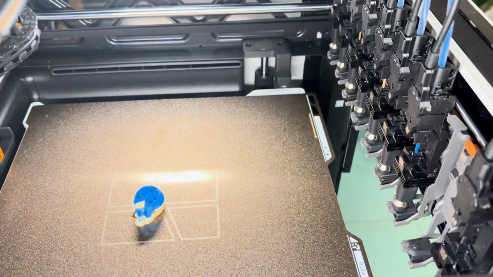
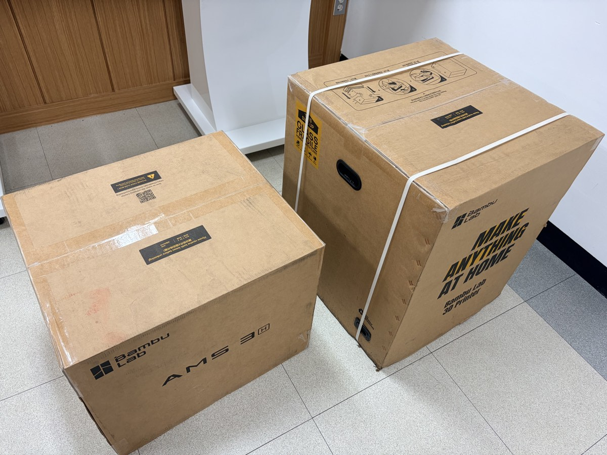
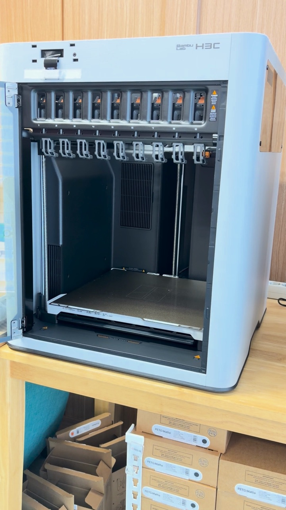
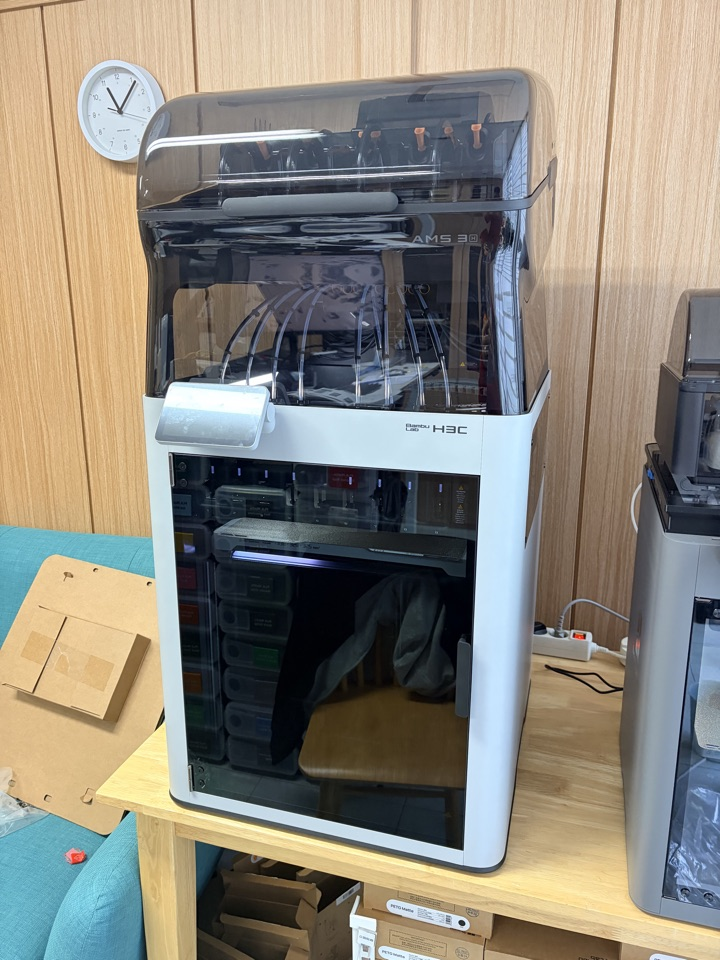
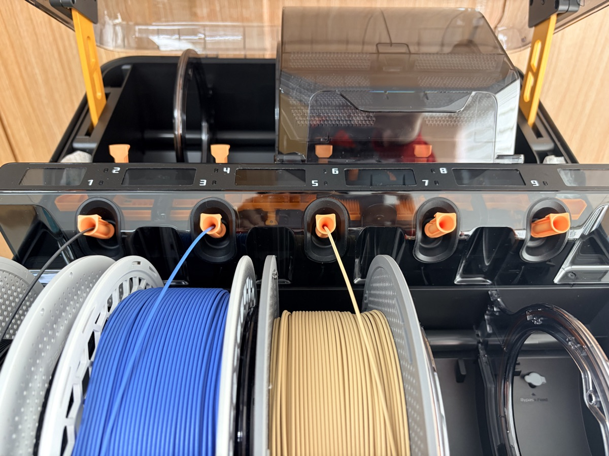
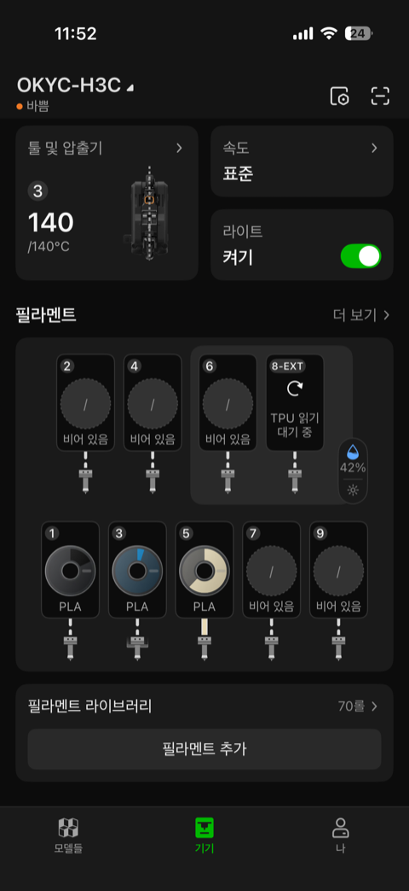
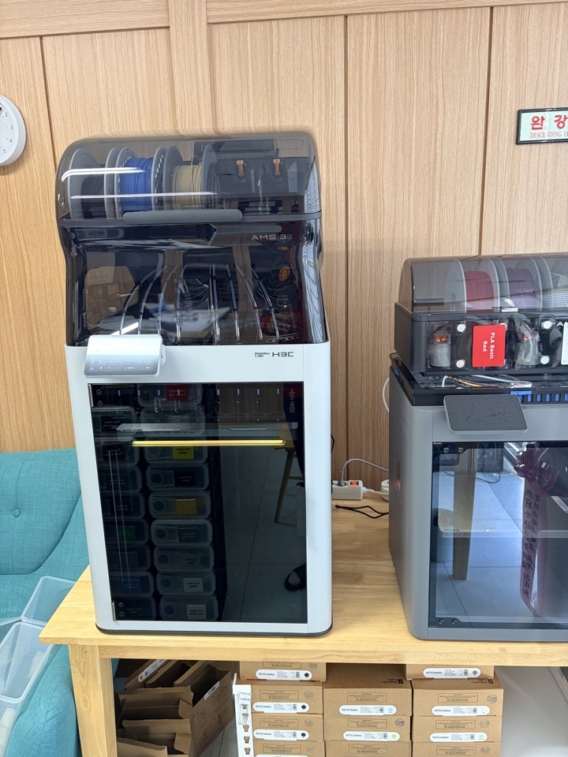
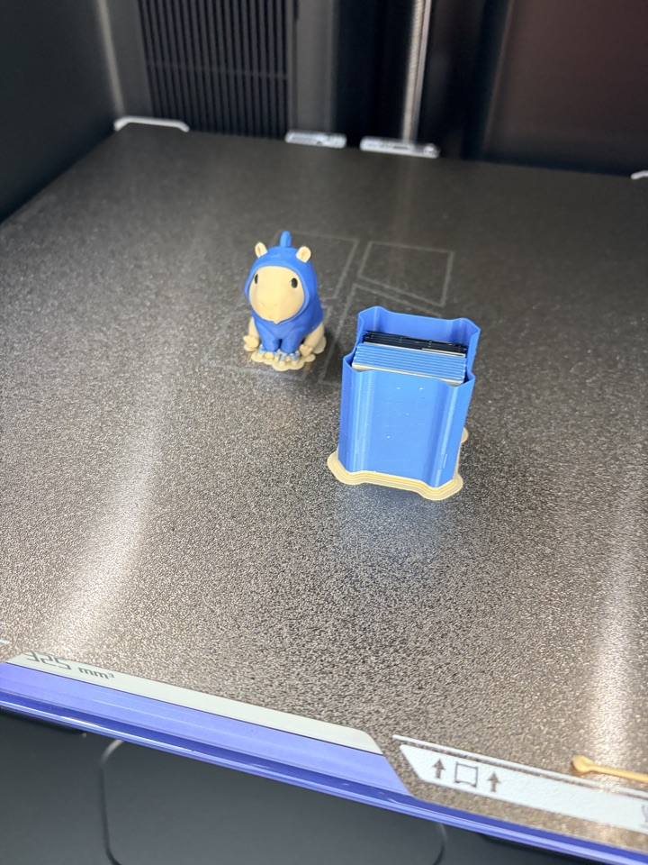
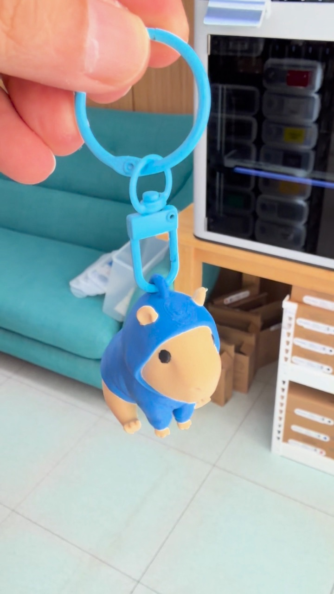
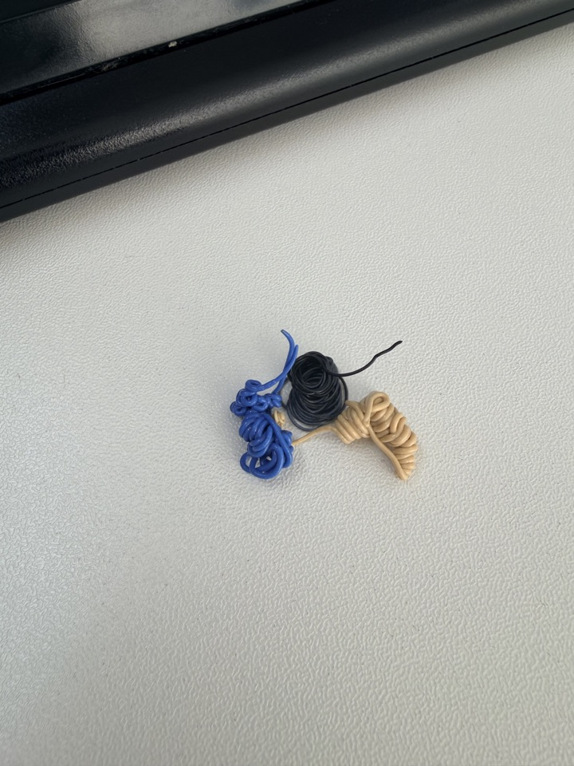

My Bambu Lab H3C arrived yesterday.

It's a tool changer with 9 nozzles.
The new AMS 3 sits right on top.

To be honest, I never used the H2C. I jumped straight to the H3C.
Maybe that's why, but after the first run I only had one thought.

This felt like a whole new world.

I rushed through the setup and got a first print out, so here's a quick rundown.

## Two boxes

One box for the printer, one for the AMS 3.

Cut the straps, open the lid, pull out the foam, take out the accessory box.
So far, the same as any other Bambu Lab unboxing.

After lifting the printer out, removing the plastic wrap and peeling off the protective film, I found something new.

Every tool dock has a red shipping clip.
They keep the tool heads from moving around during transport.

You have to open the door and pull them out one by one.
Nine nozzles, nine clips.

## The AMS 3 just sits on top

Take the AMS 3 out, remove the paper packing, and set it on top of the printer. That's it.

With everything in place, it's a pretty big machine.

## The biggest surprise: AMS 3

Honestly, what felt newest this time wasn't the nozzles. It was the AMS 3.

With the AMS 2 Pro, loading filament meant pressing a button and pushing the filament in with some force.

With the AMS 3, you just insert it.
No effort needed. It detects the filament right away and pulls it in.

Also, on the old unit, filament inserted while drying or printing wasn't recognized.
This time, I could add filament at any point.
At first I thought I was imagining it, but it worked again when I tried.

Since the AMS 3 is powered by default, drying is built in.

## 9 nozzles, and #8 is for TPU only

I connected the power, picked a language, and opened the app.

With 9 nozzles, the app interface now shows 9 slots.

Nozzle #8 is dedicated to TPU.
Seeing that made me want to try a TPU print.

## First print: a capybara keychain

For the first print, I picked a capybara keychain wearing a hoodie.
It uses several colors, so it's perfect for watching the tool changes.

The tool head goes to the dock, sets down the current tool, picks up a new nozzle, and keeps printing.

The interesting part is hotend management.
It preheats the next hotend to the right temperature while printing.
So the print keeps going without pauses, even across tool changes.

Print progress is shown by LEDs under the build plate.

Done!

## By the numbers

I sliced the same keychain for my P2S and X2D to compare.
All three have about the same number of filament changes (223–225).

| Printer | Print time | Filament | Waste (flush) |
|---|---|---|---|
| P2S | 6h 40m | 97.2 g | 72.0 g |
| X2D | 6h 16m | 91.3 g | 64.8 g |
| H3C | 1h 25m | 24.7 g | 0 g |

(Based on slicer estimates)

A print that took over 6 hours now takes 1 hour 25 minutes.
That's more than 5 hours saved.

I wonder if the H2C showed a similar gap.
Skipping a generation may have made the difference feel even bigger.

This is all the purge there was.
Just the three colors from the initial loading. Nothing else.

## Wrapping up

Going from the H2C to the H3C, I think two things changed.

The nozzle count went up to 9.
And the AMS 3 arrived.

Those two feel like the real innovations of this generation.

Next up, I want to try a TPU print with nozzle #8.
I'm also planning a longer video that covers the unboxing in more detail.

If you've moved from the H2C to the H3C, I'd love to hear how it felt in the comments.

## Watch the video

I put the unboxing and first print into a Short.

  <iframe src="https://www.youtube.com/embed/wdej-f_pGgM" title="Bambu Lab H3C + AMS 3: From Unboxing to First Print" style="position: absolute; inset: 0; width: 100%; height: 100%; border: 0;" allow="accelerometer; autoplay; clipboard-write; encrypted-media; gyroscope; picture-in-picture; web-share" allowfullscreen loading="lazy"></iframe>

- YouTube: [Bambu Lab H3C + AMS 3 unboxing to first print](https://www.youtube.com/shorts/wdej-f_pGgM)
- Keychain model: "Cute Capybara in a Hoodie" by DietrickArt on MakerWorld
