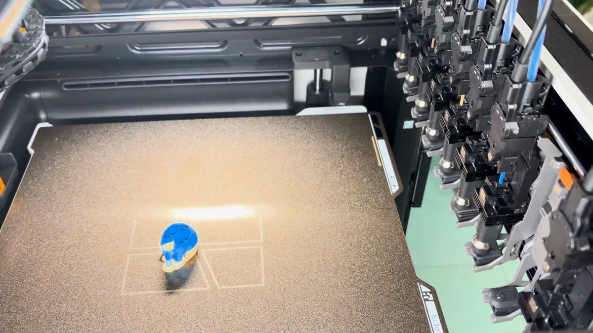
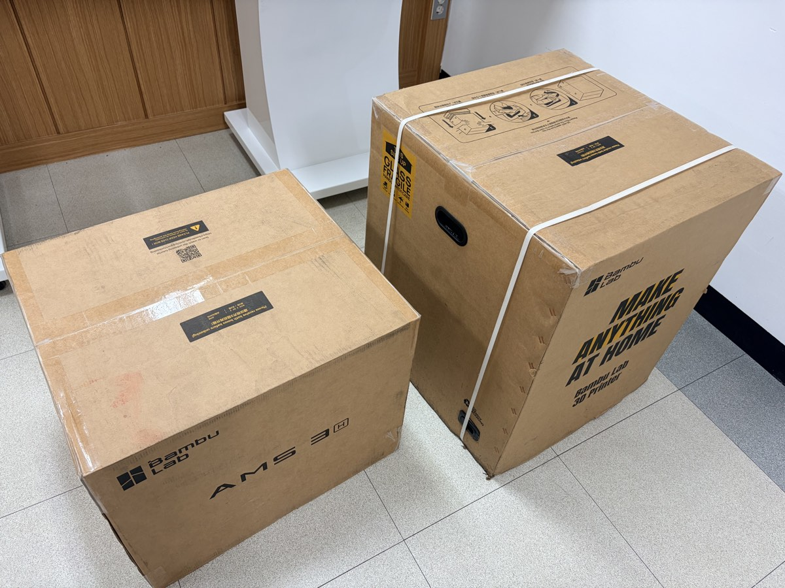
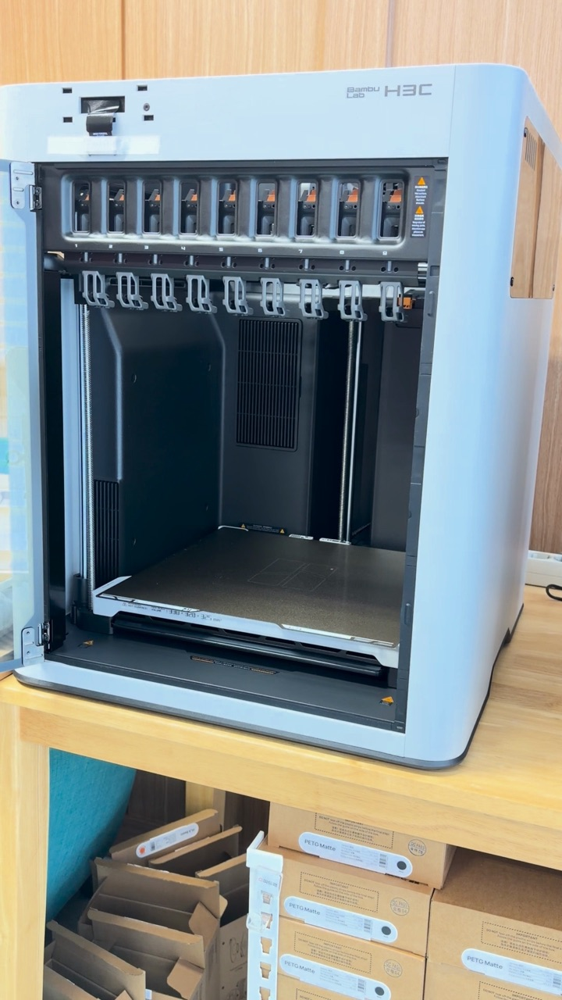
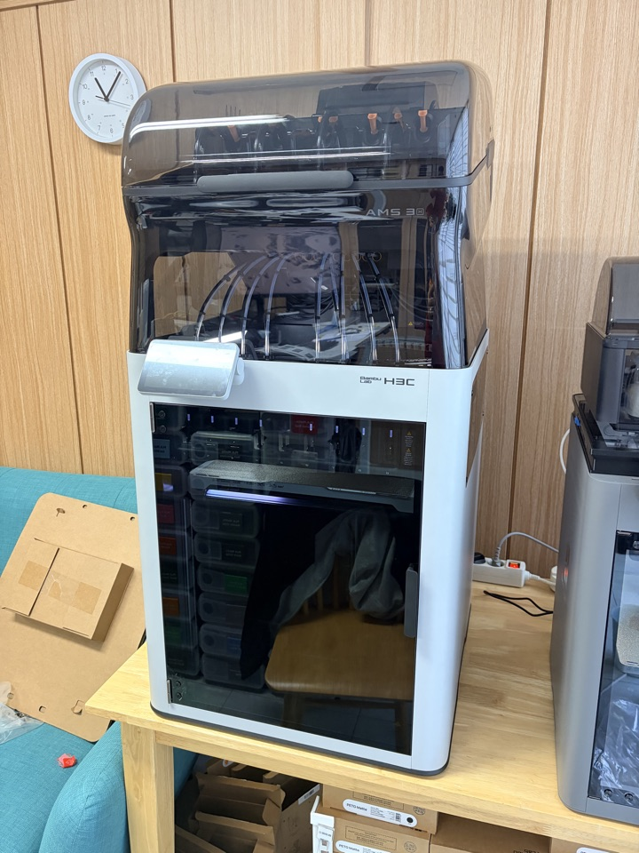
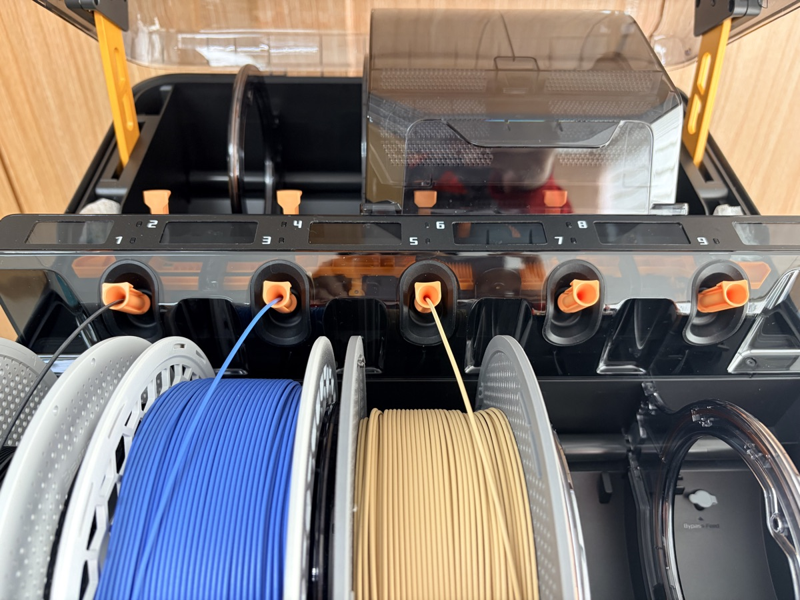
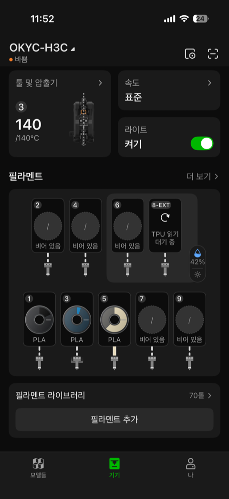
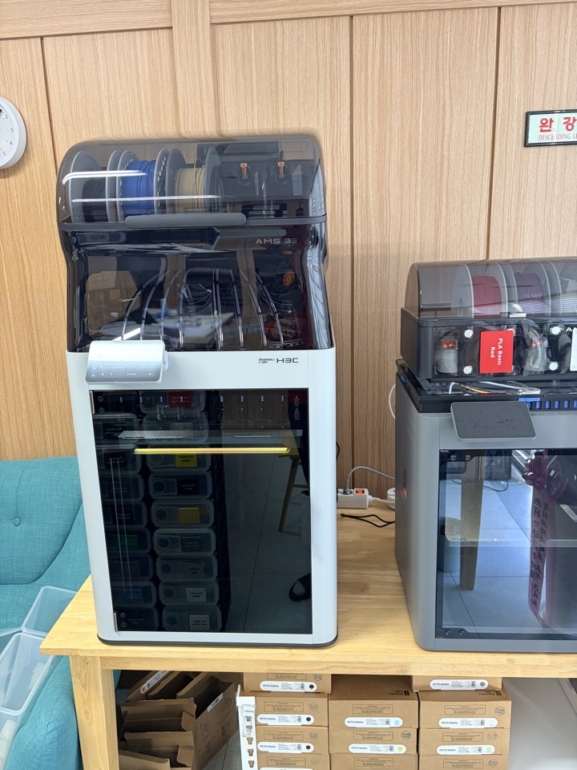
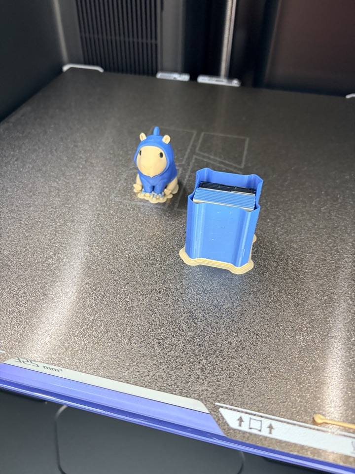
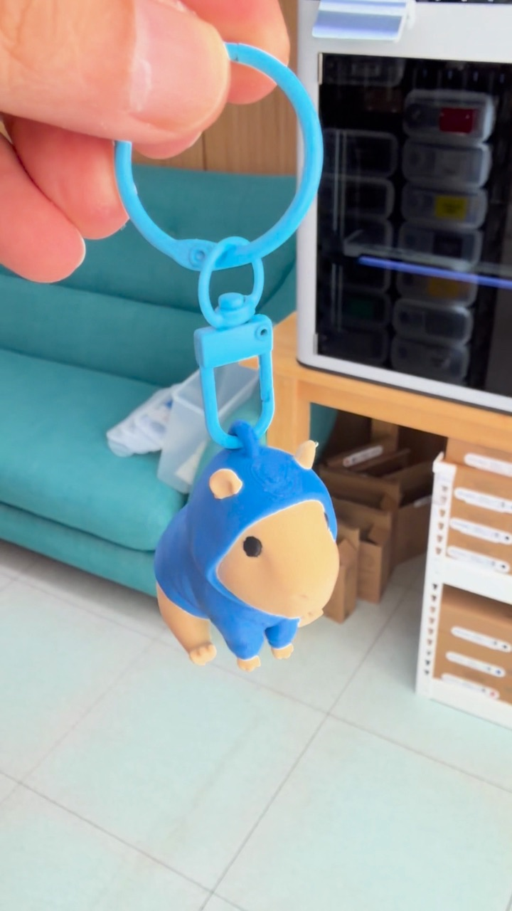
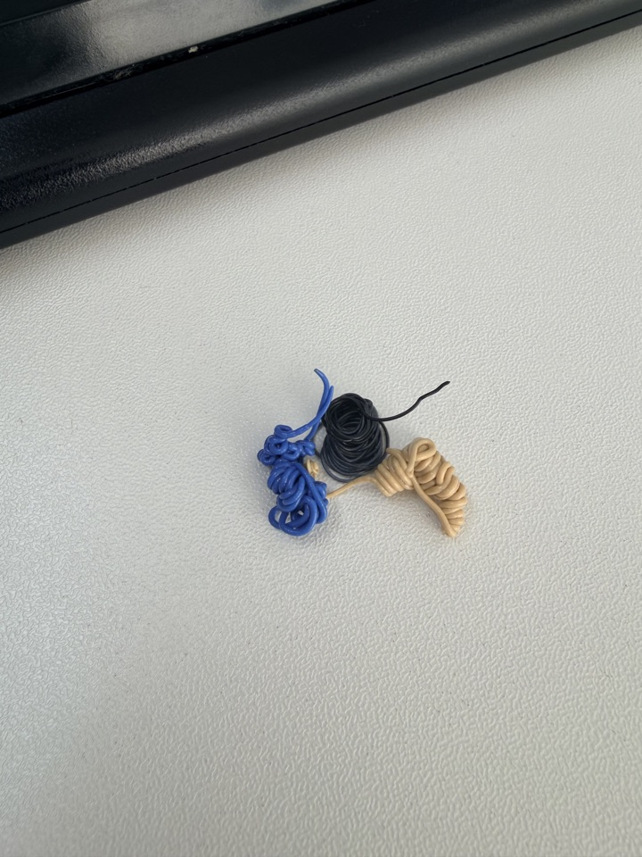

昨日、Bambu LabのH3Cが届きました。

ツールチェンジャーでノズルは9本。
上には新しく出たAMS 3を載せる構成です。

正直に言うと、H2Cは使ったことがなく、いきなりH3Cに乗り換えました。
そのせいかもしれませんが、使ってみて思ったことはひとつでした。

まるで新しい世界を体験したような感覚です。

慌ただしく設置して初プリントまで済ませたので、順番にまとめてみます。

## 箱は2つ

本体の箱がひとつ、AMS 3の箱がひとつです。

バンドを切って、ふたを開けて、発泡スチロールを外して、付属品の箱を取り出します。
ここまでは、これまでのBambu Labの開封とほぼ同じです。

本体を取り出してビニールを外し、保護フィルムまではがすと、初めて見るものがありました。

ツールドックごとに赤い固定クリップが差し込まれています。
輸送中にツールヘッドが揺れないようにするためのものです。

扉を開けて、ひとつずつ抜く必要があります。
ノズルが9本なので、9回です（笑）

## AMS 3は上に載せるだけ

AMS 3も取り出して、紙の固定材を外し、本体の上に載せれば完了です。

載せてみると、なかなかの大きさです。

## いちばん新鮮だったのはAMS 3

今回いちばん新しく感じたのは、実はノズルよりもAMS 3でした。

これまでのAMS 2 Proでは、フィラメントを入れるときにボタンを押して、少し力を入れて押し込む必要がありました。

AMS 3は差し込むだけでスッと入ります。
力を入れなくてもすぐに認識して引き込んでくれるのが良かったです。

また、以前は乾燥中や印刷中に新しいフィラメントを入れても認識されませんでした。
今回はタイミングに関係なく、すぐに追加できます。
最初は気のせいかと思いましたが、もう一度試してもちゃんと動きました。

電源が標準で接続される構造なので、乾燥機能も標準で付いています。

## ノズル9本、8番はTPU専用

電源を入れて言語を選び、アプリを開いてみました。

ノズルが9本なので、アプリの画面も9つの枠に変わっていました。

そのうち8番はTPU専用ノズルです。
これを見て、TPUの印刷を一度試してみたくなりました。

## 初プリントはカピバラのキーホルダー

初プリントは、パーカーを着たカピバラのキーホルダーにしました。
色をたくさん使うモデルなので、ツールチェンジを見るのにぴったりです。

ツールヘッドがドックへ行き、使っていたツールを置いて、新しいノズルを取ってきて印刷を続けます。

面白いのはホットエンドの管理です。
次に使うホットエンドの温度を前もって適切に合わせながら印刷していました。
そのため、ツールを交換しても途切れずに印刷が続きます。

進捗はビルドプレートの下のLEDで知らせてくれます。

印刷完了です！

## 数字で比べると

同じキーホルダーを、これまで使っていたP2SとX2Dでスライスした結果と比べてみました。
フィラメントの交換回数は3台とも223〜225回で、ほぼ同じです。

| プリンター | 印刷時間 | フィラメント | 捨てる量（フラッシュ） |
|---|---|---|---|
| P2S | 6時間40分 | 97.2 g | 72.0 g |
| X2D | 6時間16分 | 91.3 g | 64.8 g |
| H3C | 1時間25分 | 24.7 g | 0 g |

（スライサーの予測値ベース）

6時間以上かかっていたものが1時間25分。
5時間以上短くなりました。

H2Cでも同じくらいの差だったのでしょうか？
間の世代を飛ばしたぶん、体感がより大きかったのかもしれません。

パージ（色替えで捨てるフィラメント）はこれだけです。
最初のロード時に出た3色分、本当にこれだけでした。

## まとめ

H2CからH3Cで変わったのは、結局この2つだと思います。

ノズルが9本に増えたこと。
そしてAMS 3が登場したこと。

この2つが今回の世代の革新ではないでしょうか。

次は8番ノズルでTPUの印刷を試してみるつもりです。
開封の過程をもっと詳しく収めた長めの動画も作ってみる予定です。

H2CからH3Cに乗り換えた方がいらっしゃれば、体感がどうだったかコメントで教えていただけるとうれしいです。

## 動画で見る

開封から初プリントまでをショート動画にまとめました。

  <iframe src="https://www.youtube.com/embed/wdej-f_pGgM" title="Bambu Lab H3C + AMS 3 開封から初プリントまで" style="position: absolute; inset: 0; width: 100%; height: 100%; border: 0;" allow="accelerometer; autoplay; clipboard-write; encrypted-media; gyroscope; picture-in-picture; web-share" allowfullscreen loading="lazy"></iframe>

- YouTube: [Bambu Lab H3C + AMS 3 開封から初プリントまで](https://www.youtube.com/shorts/wdej-f_pGgM)
- キーホルダーのモデル: MakerWorld「Cute Capybara in a Hoodie」by DietrickArt
