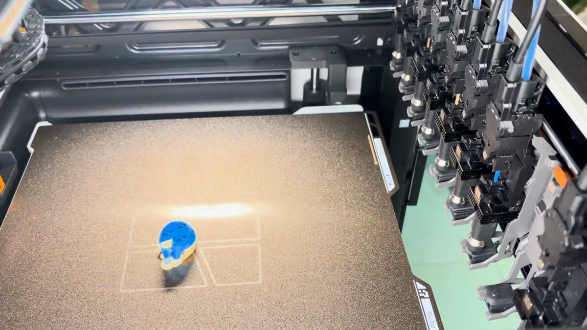
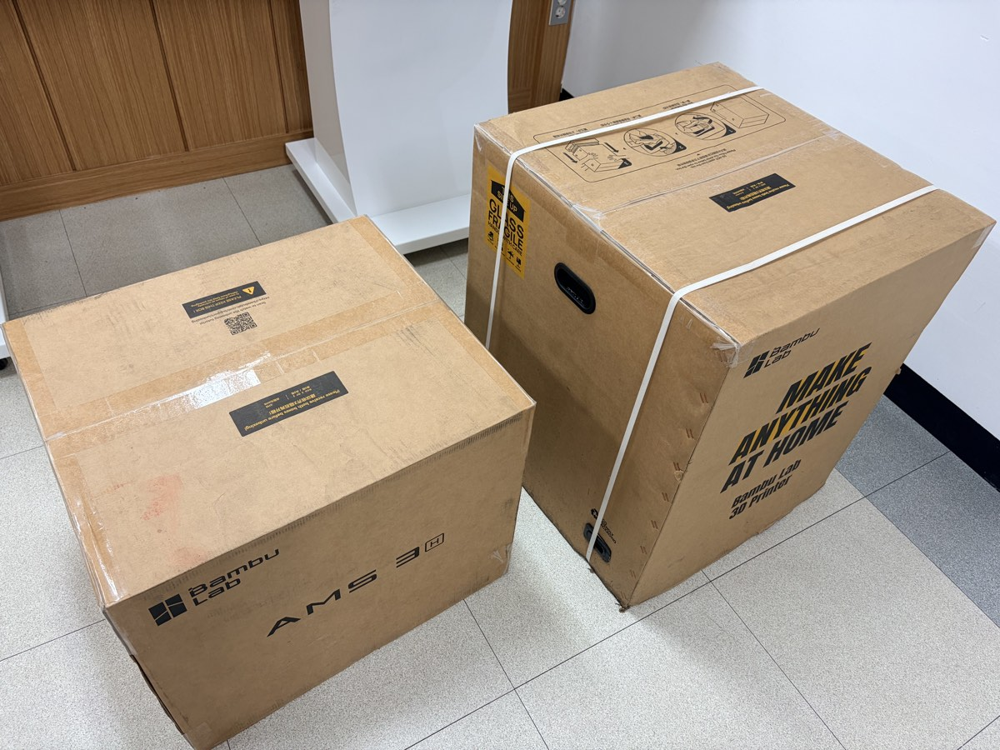
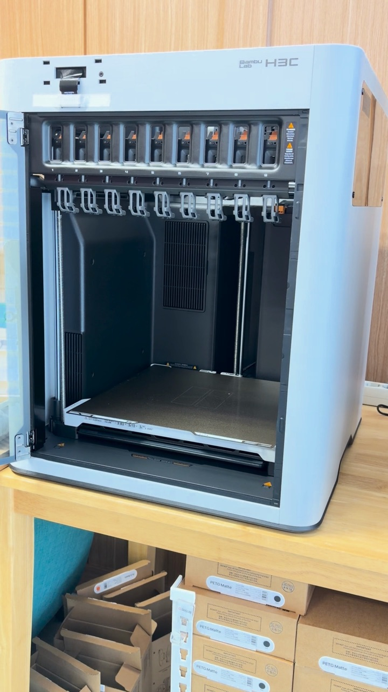
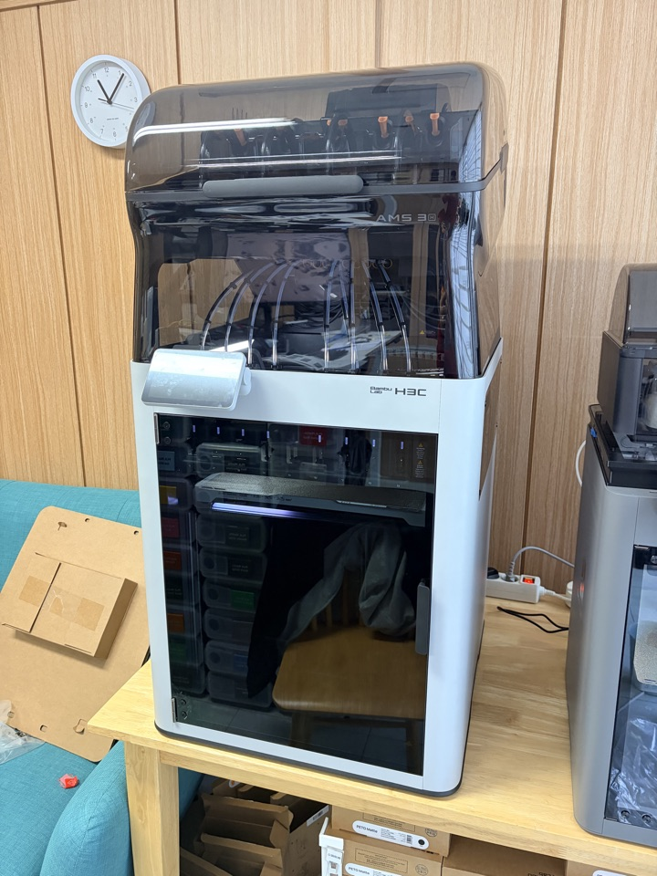
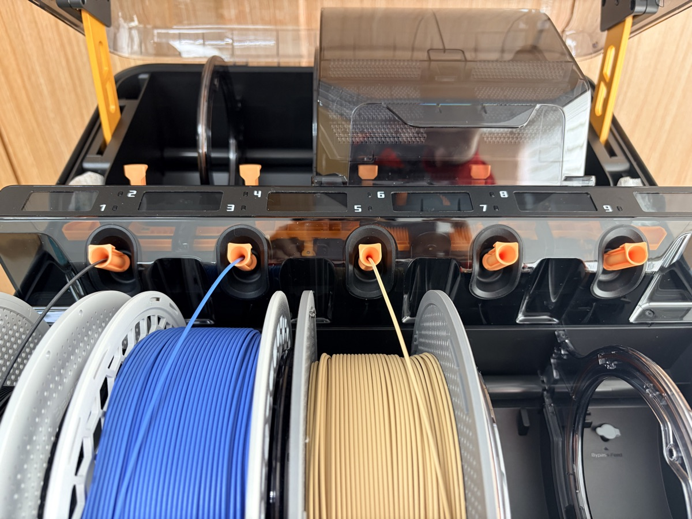
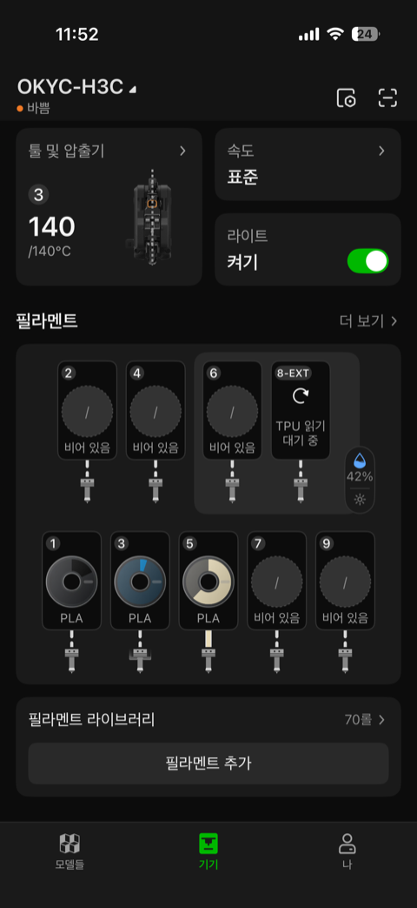
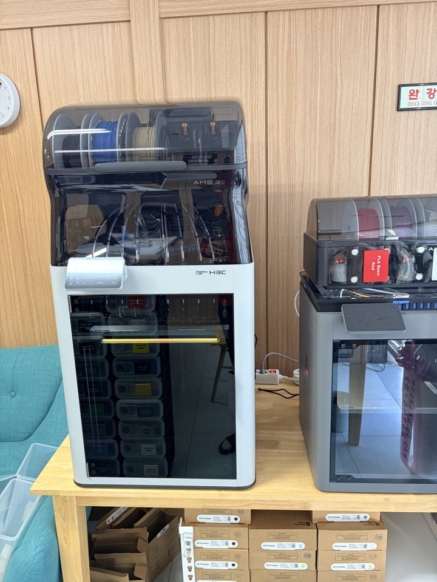
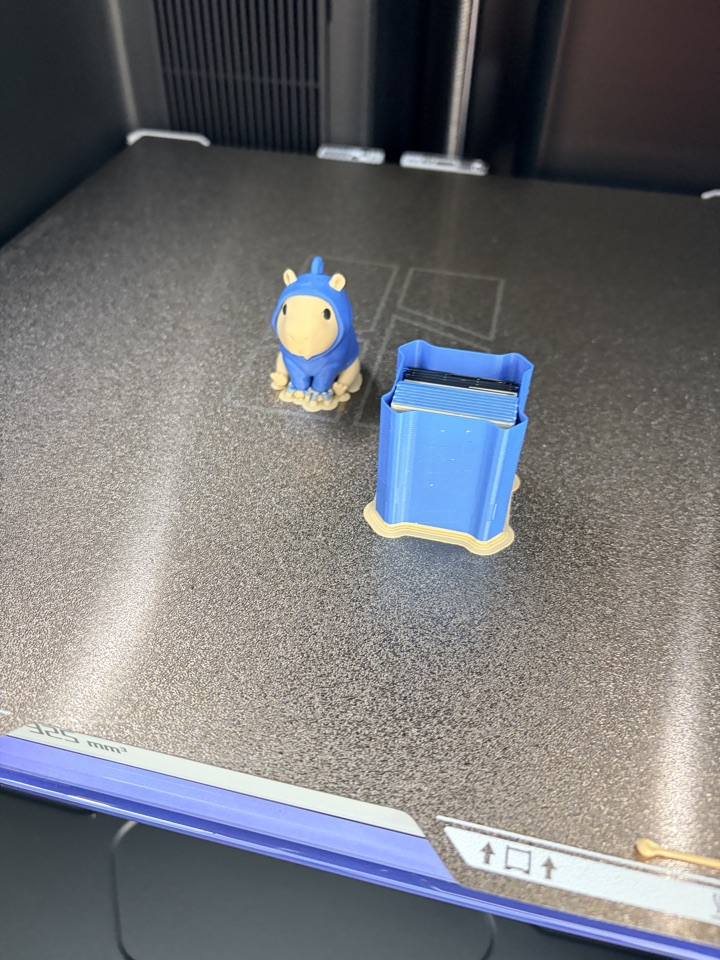
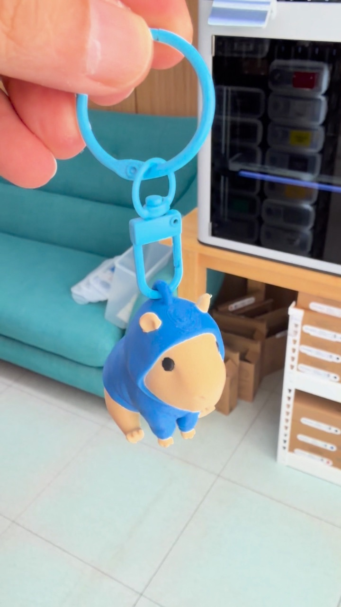
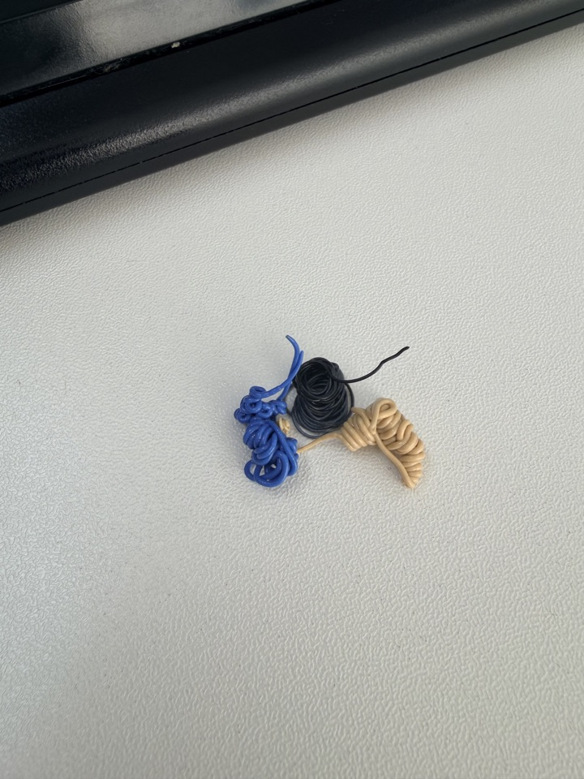

어제 뱀부랩 H3C가 도착했다.

툴 체인저에 노즐이 9개.
위에는 새로 나온 AMS 3까지 얹는 구성이다.

솔직히 H2C는 써보지도 못하고 바로 H3C로 넘어왔다.
그래서 그런지 모르겠지만... 써보고 나서 든 생각은 하나였다.

신세계를 경험?? 한 느낌 ㅎㅎ

부랴부랴 설치하고 첫 출력까지 해봤으니 하나씩 정리해 본다.

## 박스가 두 개다

본체 박스 하나, AMS 3 박스 하나.

끈 자르고, 뚜껑 열고, 스티로폼 빼고, 부속품 상자 꺼내고.
여기까지는 기존 뱀부랩 개봉이랑 비슷하다.

본체 꺼내서 비닐 벗기고 보호 필름까지 떼고 나니까 처음 보는 게 있었다.

툴 도크마다 빨간 고정 클립이 꽂혀 있다.
운송 중에 툴 헤드가 흔들리지 말라고 끼워 둔 거다.

문 열고 하나씩 빼줘야 한다.
노즐이 9개니까 9번 ㅋㅋ

## AMS 3는 위에 올리면 끝

AMS 3도 꺼내서 종이 고정재 빼고 본체 위에 올리면 끝이다.

올려놓고 보니까 덩치가 꽤 된다.

## 제일 새로웠던 건 AMS 3

이번에 가장 새롭게 느껴진 건 사실 노즐보다 AMS 3였다.

기존 AMS 2 Pro는 필라멘트를 넣으려면 버튼을 누르고 약간 힘을 줘서 밀어 넣어야 들어갔다.

AMS 3는 그냥 꽂으면 쏙 들어간다.
힘 안 들이고 넣어도 바로 인식해서 끌고 들어가는 게 좋더라.

그리고 기존에는 건조 중이거나 출력 중일 때 새 필라멘트를 넣으면 인식이 안 됐었다.
이번엔 상관없이 바로바로 추가가 된다.
처음엔 착각인가 싶었는데 다시 해봐도 되더라.

전원이 기본으로 연결되는 구조라 건조 기능도 기본으로 들어 있다.

## 노즐 9개, 8번은 TPU 전용

전원 넣고 언어 고르고 앱을 열어봤다.

노즐이 9개라 앱 인터페이스도 9칸으로 바뀌었다.

그중 8번은 TPU 전용 노즐이다.
이거 보니까 TPU 출력을 한번 해보고 싶어졌다 ㅎㅎ

## 첫 출력은 카피바라 키링

첫 출력은 후드 입은 카피바라 키링.
색이 여러 개 들어가는 모델이라 툴 체인지 구경하기 딱 좋다.

툴 헤드가 도크로 가서 쓰던 툴을 내려놓고, 새 노즐을 집어 와서 다시 출력한다.

재밌는 건 핫엔드 관리다.
다음에 쓸 핫엔드 온도를 미리 적절히 맞춰 두면서 출력하더라.
그래서 툴을 바꿔도 끊기지 않고 이어서 나온다.

진행 상황은 빌드 플레이트 아래 LED로 알려준다.

출력 끝!

## 숫자로 비교해 보면

같은 키링을 원래 쓰던 P2S, X2D로 슬라이싱한 것과 비교해 봤다.
필라멘트 교체 횟수는 셋 다 223~225번으로 거의 같다.

| 프린터 | 출력 시간 | 필라멘트 | 버리는 양(플러시) |
|---|---|---|---|
| P2S | 6시간 40분 | 97.2 g | 72.0 g |
| X2D | 6시간 16분 | 91.3 g | 64.8 g |
| H3C | 1시간 25분 | 24.7 g | 0 g |

(슬라이서 예상값 기준)

6시간 넘게 걸리던 게 1시간 25분.
5시간 넘게 줄어든 거다.

H2C도 이 정도 차이였으려나?
중간 단계를 안 거쳐서 체감이 더 컸던 것 같기도 하다.

똥은 이게 다다.
처음 로딩할 때 3가지 색 나온 것, 딱 이것만 나왔다.

## 정리하면

H2C에서 H3C로 오면서 바뀐 건 결국 두 가지 같다.

노즐이 9개로 늘어난 것.
그리고 AMS 3가 나온 것.

이 두 개가 이번 세대의 혁신이 아닐까 싶다 ㅎㅎ

다음엔 8번 노즐로 TPU 출력을 해볼 생각이다.
개봉 과정을 더 자세히 담은 긴 영상도 만들어 볼 거다.

혹시 H2C 쓰다가 H3C로 넘어오신 분 계시면 체감이 어땠는지 댓글로 알려주세요.

## 영상으로 보기

개봉부터 첫 출력까지 쇼츠로 정리했다.

  <iframe src="https://www.youtube.com/embed/wdej-f_pGgM" title="뱀부랩 H3C + AMS 3 개봉부터 첫 출력까지" style="position: absolute; inset: 0; width: 100%; height: 100%; border: 0;" allow="accelerometer; autoplay; clipboard-write; encrypted-media; gyroscope; picture-in-picture; web-share" allowfullscreen loading="lazy"></iframe>

- 유튜브: [뱀부랩 H3C + AMS 3 개봉부터 첫 출력까지](https://www.youtube.com/shorts/wdej-f_pGgM)
- 키링 모델: MakerWorld "Cute Capybara in a Hoodie" by DietrickArt
