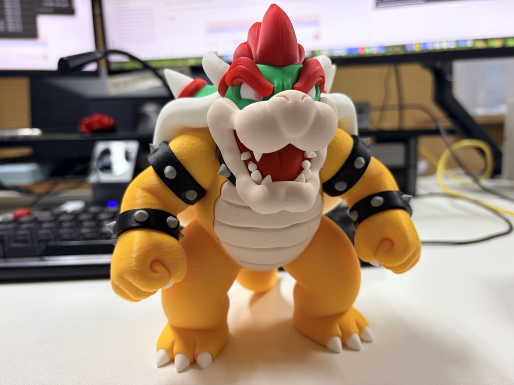
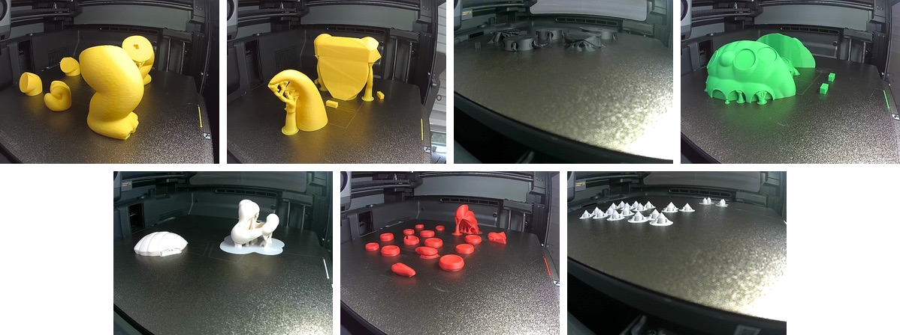
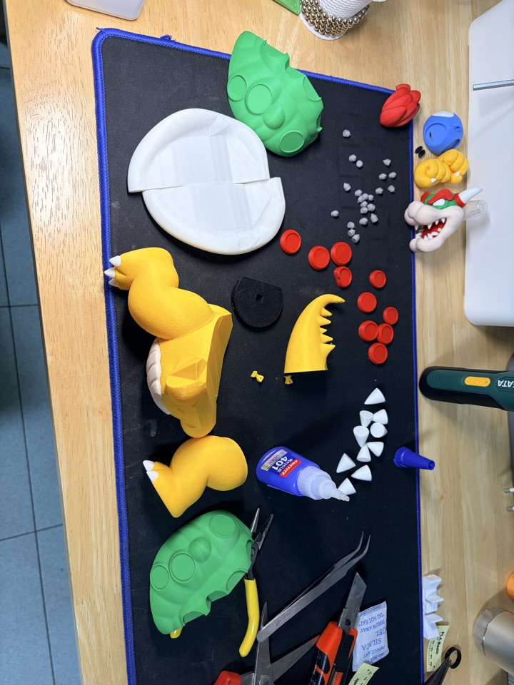
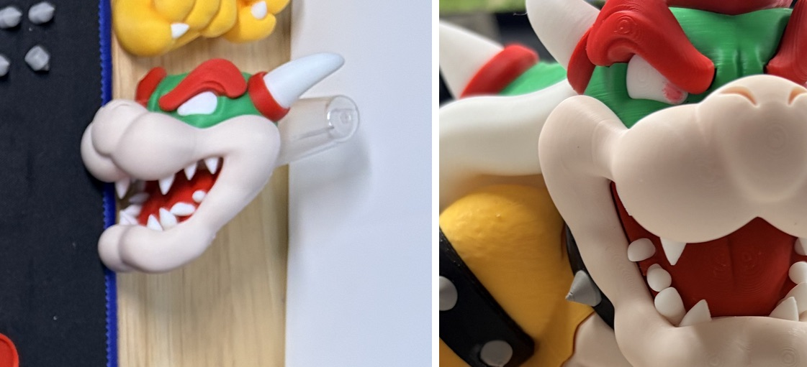
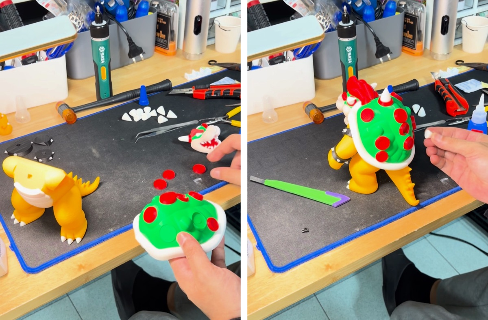
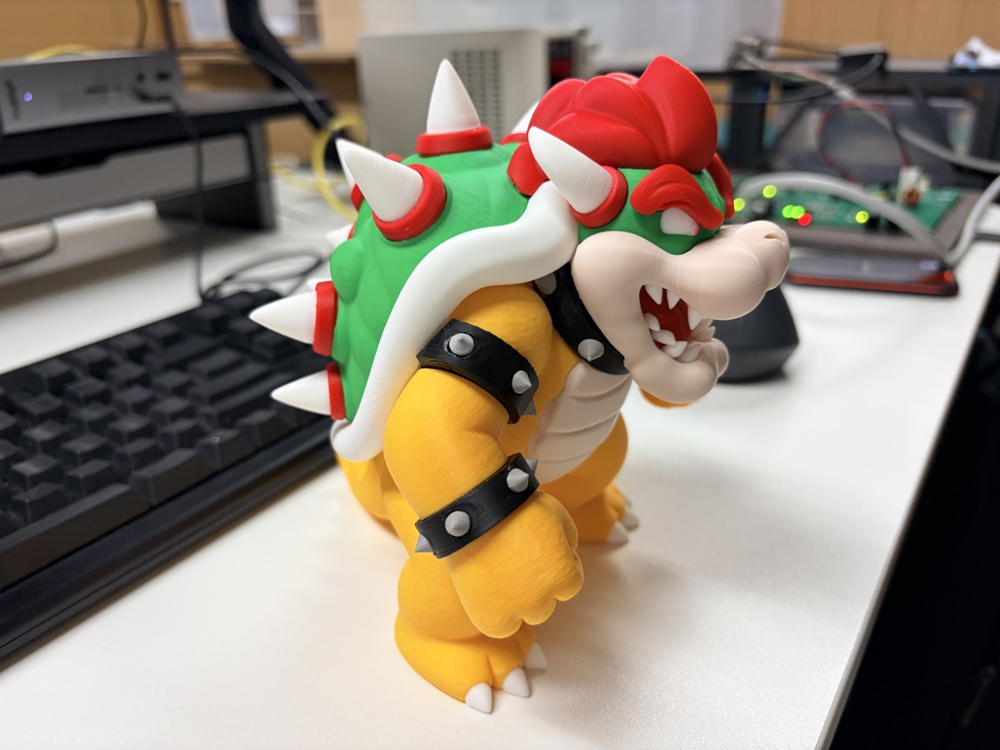
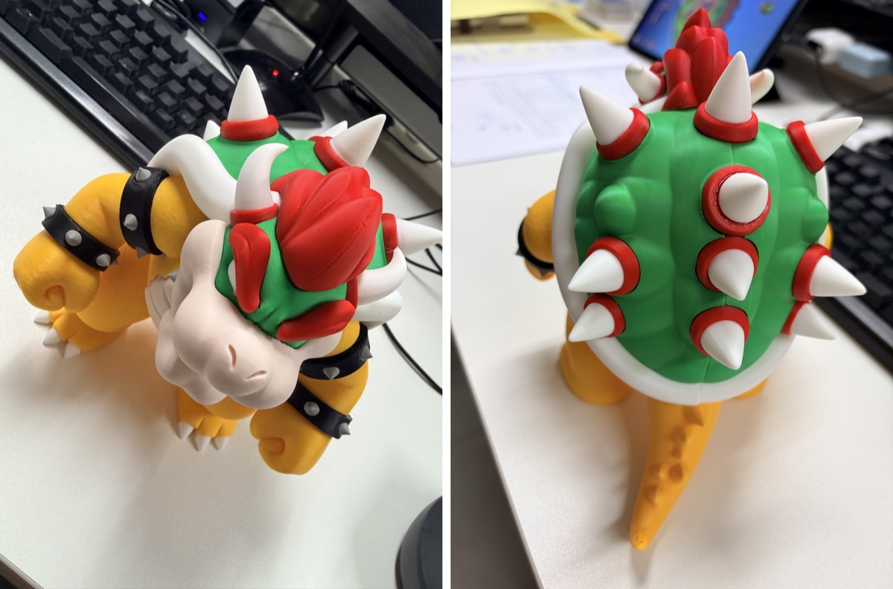

This time it's Bowser from Mario.

The model is "Bowser - Ultra-Low Waste (No AMS Modular Design)" on MakerWorld, designed by Crystopher81.

As the name says, it's split into pieces by color so you can print it without an AMS.
The point is that almost no filament gets wasted on color changes.

## Printing one color at a time

The body is a 10-plate project, and the eyes and mouth each have a separate plate for AMS multicolor printing.

I printed the body on the P2S and the eyes and mouth on the X2D.

Yellow legs and arms, the tail and torso, black bracelets, the green shell, the white belly and shell rim, red spots, and white spikes.

Each plate uses a single color, so there's no filament change during a print.

## All the parts laid out

Laid out together, it's quite a lot.
The small gray pieces are the studs that go on the bracelets.

## The teeth were the hardest part

The hardest part of this build was the teeth.

On the left is the head piece before assembly, and on the right is the finished result.
I finished this part before I started recording, so it isn't in the video.

## Gluing it together piece by piece

Everything else I glued on one piece at a time with instant glue.

Legs and tail → shell → bracelets → red shell spots → arms → belly and head → shell spikes.

I recorded the whole assembly, and it came to almost 40 minutes.
The red spots on the shell took the longest — about 7 minutes in the video.
The shell spikes at the end took more than 5 minutes too, gluing them one by one.

## Finished

Only after every spike was on the shell was it finally done.

## Watch the video

I put the whole thing on video, from printing to assembly.
The printing keeps the printer's own sound, and the assembly flips through still shots, one click for each new piece.

  <iframe src="https://www.youtube.com/embed/zcSouFcNGtQ" title="Printing and Assembling a Bowser Figure — The Teeth Were the Hardest Part" style="position: absolute; inset: 0; width: 100%; height: 100%; border: 0;" allow="accelerometer; autoplay; clipboard-write; encrypted-media; gyroscope; picture-in-picture; web-share" allowfullscreen loading="lazy"></iframe>

There is a short version too.

  <iframe src="https://www.youtube.com/embed/X5TQIys0Tp4" title="Bowser figure, from printing to assembly" style="position: absolute; inset: 0; width: 100%; height: 100%; border: 0;" allow="accelerometer; autoplay; clipboard-write; encrypted-media; gyroscope; picture-in-picture; web-share" allowfullscreen loading="lazy"></iframe>

- YouTube (full): [Printing and Assembling a Bowser Figure — The Teeth Were the Hardest Part](https://youtu.be/zcSouFcNGtQ)
- YouTube Shorts: [Bowser figure, from printing to assembly](https://www.youtube.com/shorts/X5TQIys0Tp4)

- Model: "Bowser - Ultra-Low Waste (No AMS Modular Design)" by Crystopher81 on MakerWorld
