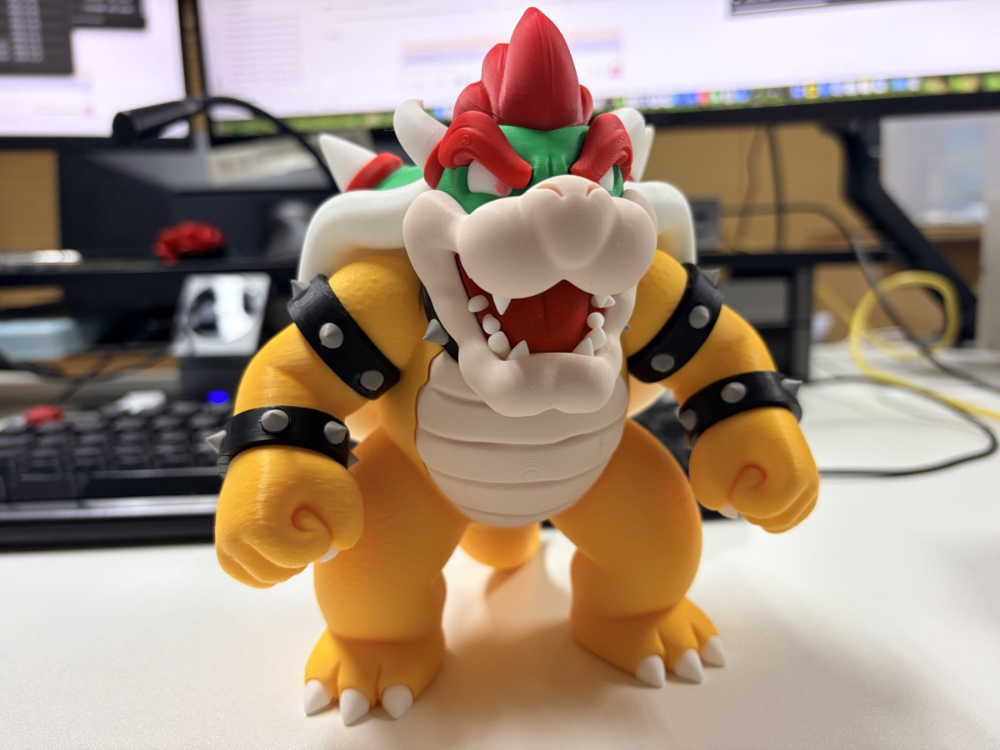
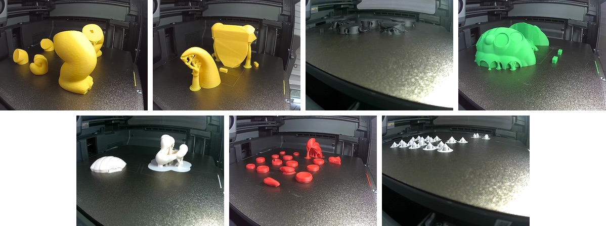
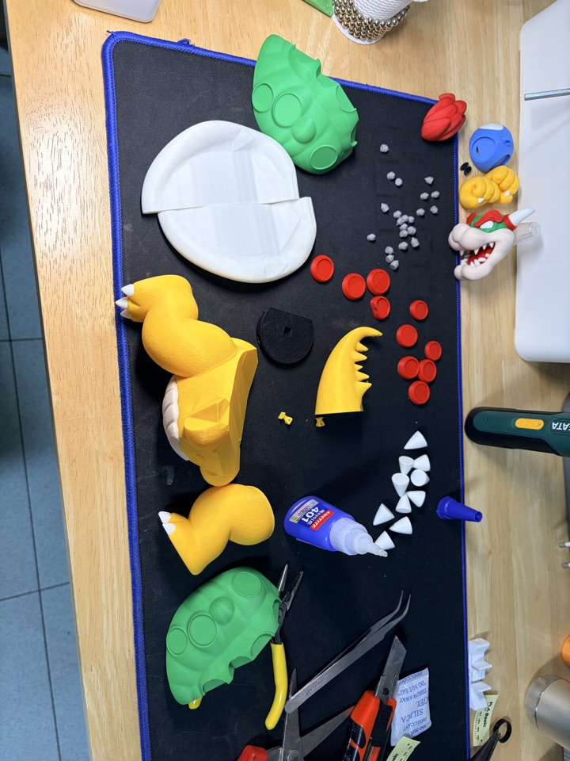
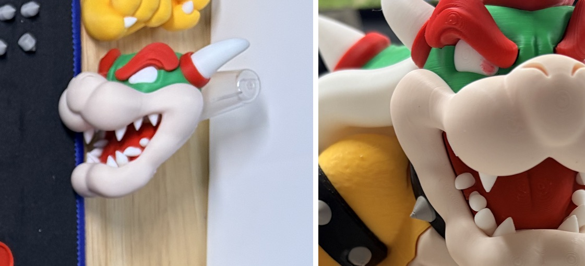
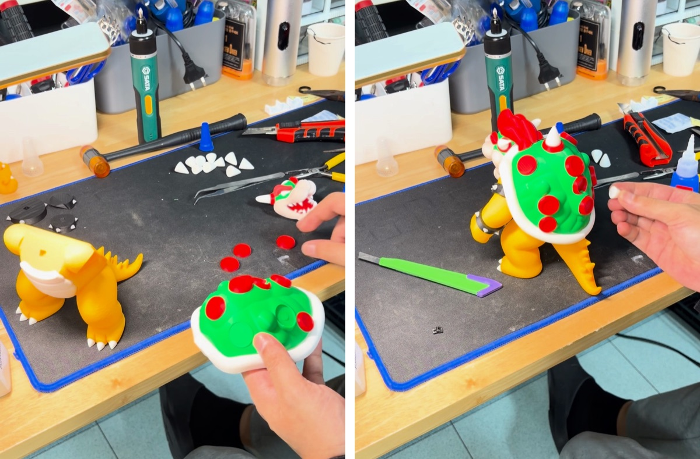
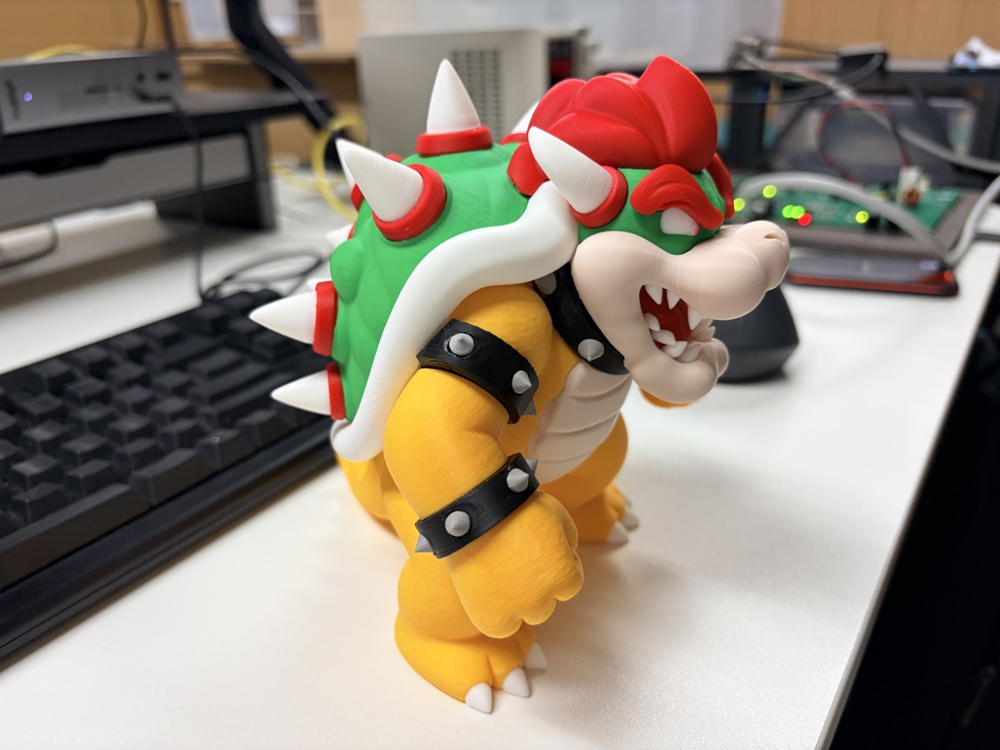
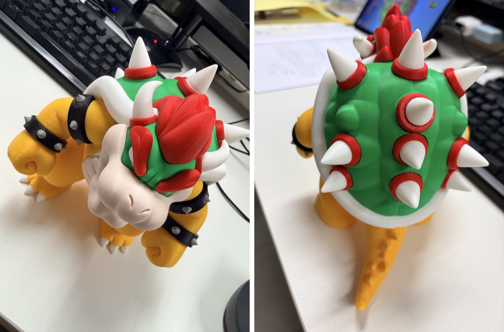

今回はマリオのクッパです。

MakerWorldで公開されている「Bowser - Ultra-Low Waste (No AMS Modular Design)」というモデルです。
Crystopher81さんが作ったものです。

名前のとおり、AMSがなくてもプリントできるように色ごとにパーツが分かれています。
色替えで捨てるフィラメントがほとんど出ないのがポイントです。

## 色ごとに別々にプリント

本体は10プレートのプロジェクトで、目と口はAMSマルチカラー用にそれぞれ1プレートずつあります。

本体はP2S、目と口はX2Dでプリントしました。

黄色い脚と腕、しっぽと胴体、黒いブレスレット、緑の甲羅、白いお腹と甲羅のふち、赤い模様、そして白いトゲ。

プレートごとに1色なので、プリント中にフィラメントを替える必要がありません。

## 全部並べてみると

全部集めると、なかなかの量です。
小さなグレーのパーツは、ブレスレットに付ける鋲です。

## いちばん大変だったのは歯

今回の組み立てでいちばん大変だったのは歯でした。

左が組み立て前の頭のパーツ、右が完成した姿です。
組み立て動画を撮る前に済ませておいた部分なので、動画には映っていません。

## 瞬間接着剤でひとつずつ

残りは瞬間接着剤でひとつずつ貼っていきました。

脚としっぽ → 甲羅 → ブレスレット → 甲羅の赤い模様 → 腕 → お腹と頭 → 甲羅のトゲ。

組み立ての様子を丸ごと撮ったら、40分近くになりました。
その中でも、甲羅に赤い模様を付けるのがいちばん時間がかかりました。動画で見ると7分ほどです。
最後の甲羅のトゲも、ひとつずつ付けていたら5分以上かかりました。

## 完成

甲羅のトゲを全部付け終えて、ようやく完成です。

## 動画で見る

プリントから組み立てまでを動画にまとめました。
プリントはプリンターの音そのままに、組み立てはパーツが増えていく様子を静止画でテンポよくつなぎました。

  <iframe src="https://www.youtube.com/embed/zcSouFcNGtQ" title="クッパのフィギュアをプリントから組み立てまで、いちばん大変だったのは歯" style="position: absolute; inset: 0; width: 100%; height: 100%; border: 0;" allow="accelerometer; autoplay; clipboard-write; encrypted-media; gyroscope; picture-in-picture; web-share" allowfullscreen loading="lazy"></iframe>

短く見たい方はショート動画でどうぞ。

  <iframe src="https://www.youtube.com/embed/X5TQIys0Tp4" title="クッパのフィギュア、プリントから組み立てまで" style="position: absolute; inset: 0; width: 100%; height: 100%; border: 0;" allow="accelerometer; autoplay; clipboard-write; encrypted-media; gyroscope; picture-in-picture; web-share" allowfullscreen loading="lazy"></iframe>

- YouTube（本編）: [クッパのフィギュアをプリントから組み立てまで、いちばん大変だったのは歯](https://youtu.be/zcSouFcNGtQ)
- YouTubeショート: [クッパのフィギュア、プリントから組み立てまで](https://www.youtube.com/shorts/X5TQIys0Tp4)

- モデル: MakerWorld「Bowser - Ultra-Low Waste (No AMS Modular Design)」by Crystopher81
