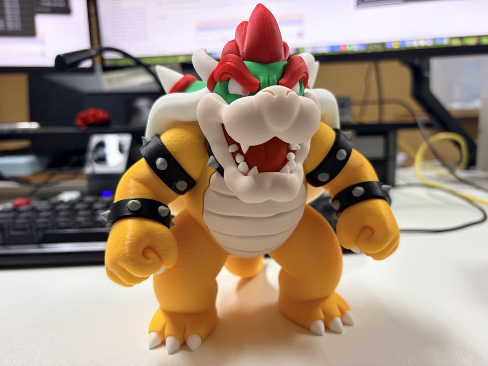
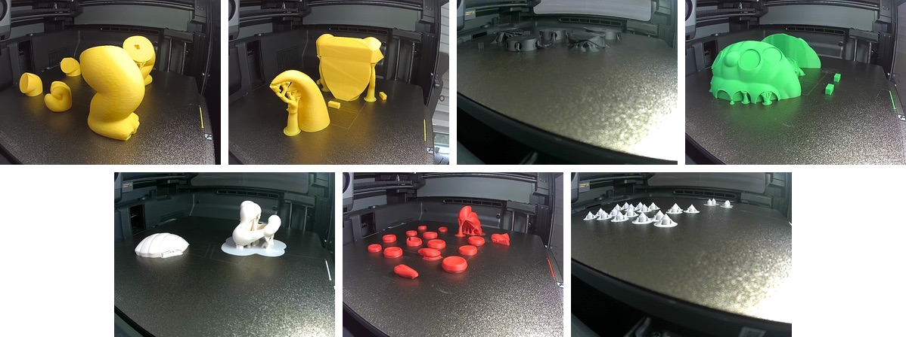
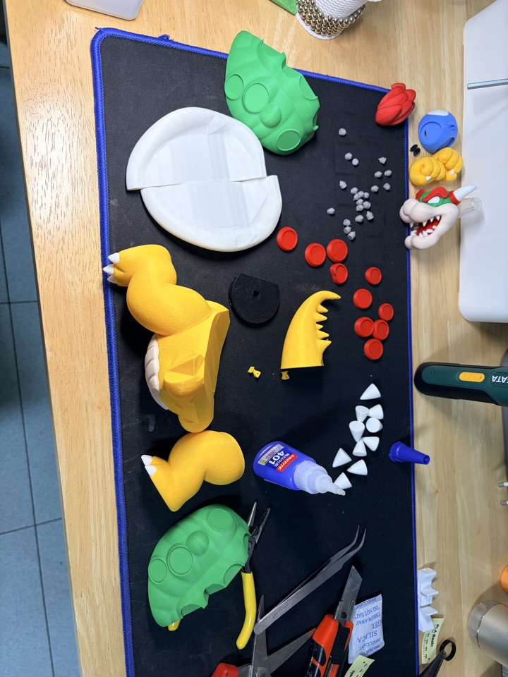
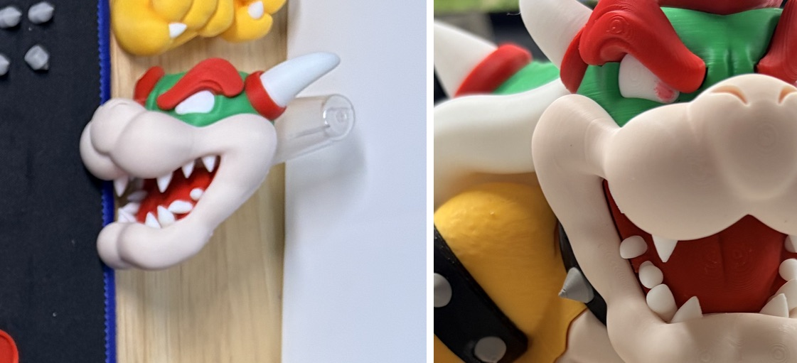
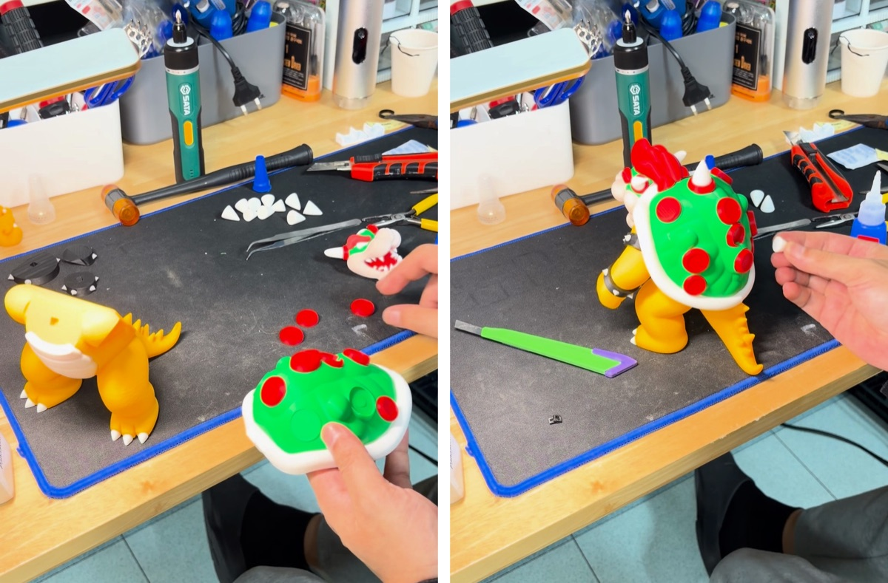
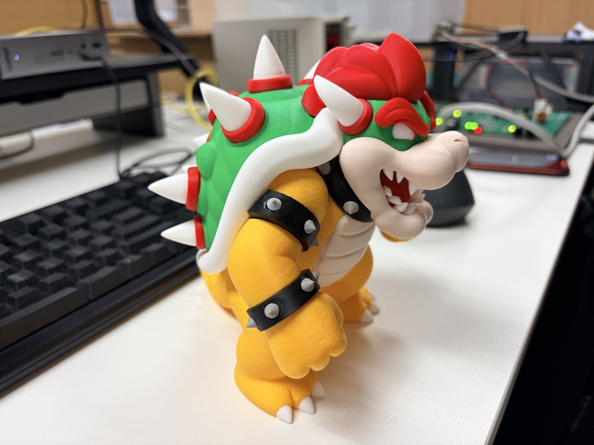
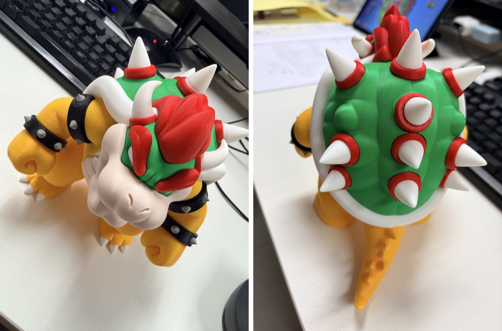

이번엔 마리오의 쿠파다.

MakerWorld에 올라온 "Bowser - Ultra-Low Waste (No AMS Modular Design)" 모델이다.
Crystopher81이라는 분이 만든 거다.

이름 그대로 AMS 없이도 뽑을 수 있게 색깔별로 조각을 나눠 놓은 모델이다.
색을 바꿀 때 버리는 필라멘트가 거의 없다는 게 포인트.

## 색깔별로 따로 출력

본체는 10판짜리 프로젝트고, 눈과 입은 AMS 멀티컬러용으로 한 판씩 따로 있다.

본체는 P2S로, 눈과 입은 X2D로 뽑았다.

노란 다리와 팔, 꼬리와 몸통, 검정 팔찌, 초록 등껍질, 흰 배와 등껍질 테두리, 빨간 무늬, 그리고 흰 가시들.

판마다 한 가지 색이라 출력 중에 필라멘트를 바꿀 일이 없다.

## 다 뽑아서 펼쳐 놓으니

다 모아 놓으니 양이 꽤 된다.
작은 회색 조각들은 팔찌에 박히는 징이다.

## 제일 힘들었던 건 이빨

이번 조립에서 제일 힘들었던 건 이빨이었다.

왼쪽이 조립 전 머리 부품이고, 오른쪽이 완성된 모습이다.
조립 영상을 찍기 전에 미리 끝내 둔 부분이라 영상에는 안 나온다 ㅠㅠ

## 순간접착제로 하나씩

나머지는 순간접착제로 하나씩 붙여 나갔다.

다리와 꼬리 → 등껍질 → 팔찌 → 등껍질 빨간 무늬 → 팔 → 배와 머리 → 등껍질 가시.

조립 과정을 통째로 찍었더니 40분 가까이 되더라.
그중에 등껍질에 빨간 무늬 붙이는 게 제일 오래 걸렸다. 영상으로 보니 7분 정도.
마지막 등껍질 가시도 하나씩 붙이느라 5분 넘게 걸렸다.

## 완성

등껍질 가시까지 다 붙이고 나서야 완성이다 ㅎㅎ

## 영상으로 보기

출력부터 조립까지 영상으로 담아 봤다.
출력은 프린터 소리 그대로, 조립은 하나씩 붙어 가는 모습을 정지 화면으로 착착 넘겨 봤다 ㅎㅎ

  <iframe src="https://www.youtube.com/embed/zcSouFcNGtQ" title="쿠파 피규어 출력부터 조립까지, 제일 힘들었던 건 이빨" style="position: absolute; inset: 0; width: 100%; height: 100%; border: 0;" allow="accelerometer; autoplay; clipboard-write; encrypted-media; gyroscope; picture-in-picture; web-share" allowfullscreen loading="lazy"></iframe>

짧게 보고 싶으면 쇼츠로 ㅎㅎ

  <iframe src="https://www.youtube.com/embed/X5TQIys0Tp4" title="쿠파 피규어, 출력부터 조립까지" style="position: absolute; inset: 0; width: 100%; height: 100%; border: 0;" allow="accelerometer; autoplay; clipboard-write; encrypted-media; gyroscope; picture-in-picture; web-share" allowfullscreen loading="lazy"></iframe>

- 유튜브 롱폼: [쿠파 피규어 출력부터 조립까지, 제일 힘들었던 건 이빨](https://youtu.be/zcSouFcNGtQ)
- 유튜브 쇼츠: [쿠파 피규어, 출력부터 조립까지](https://www.youtube.com/shorts/X5TQIys0Tp4)

- 모델: MakerWorld "Bowser - Ultra-Low Waste (No AMS Modular Design)" by Crystopher81
