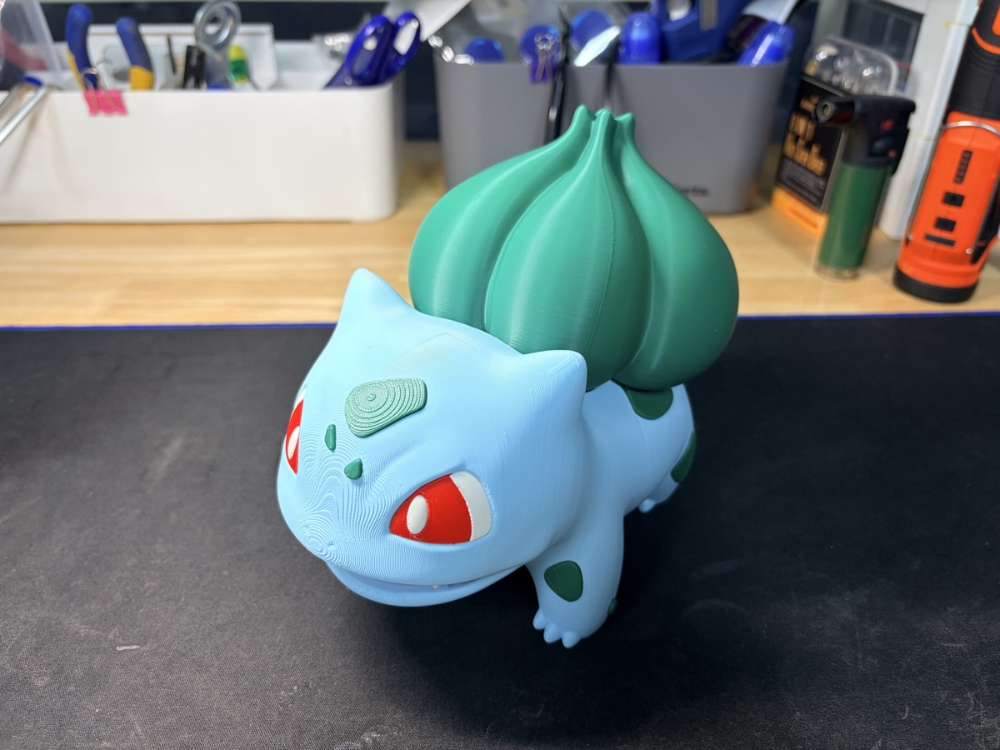
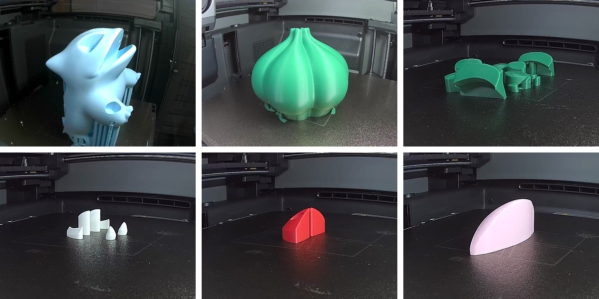
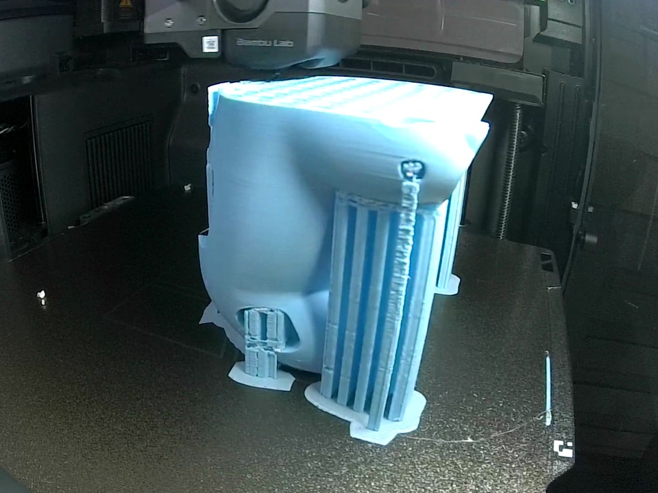
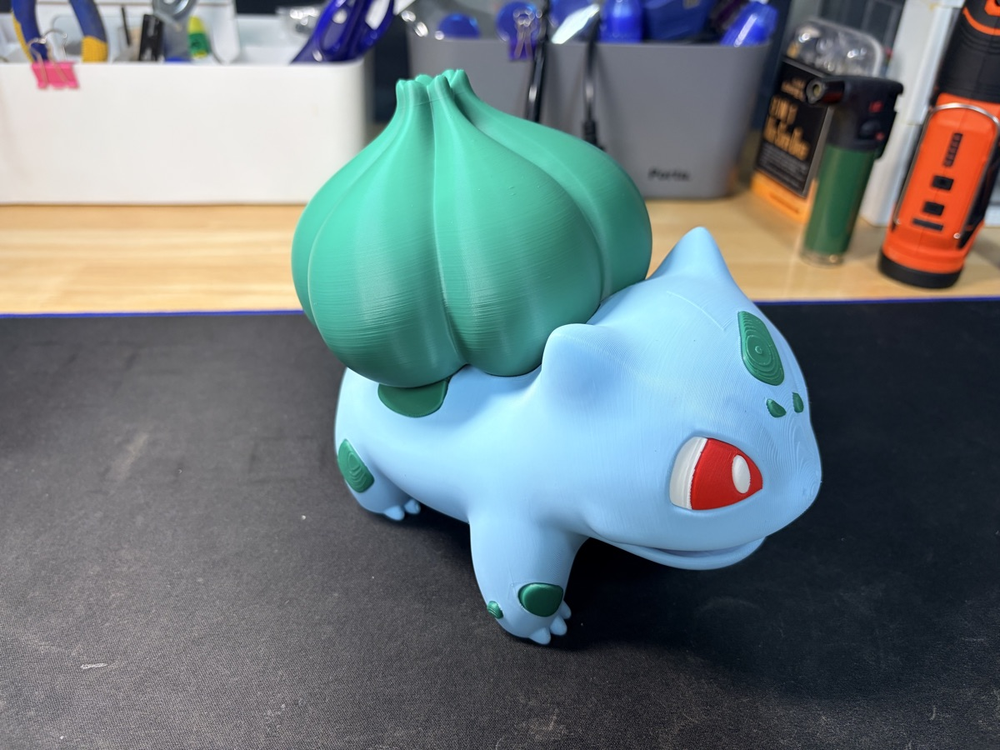

I printed this Bulbasaur at the end of last month, and I'm only now getting around to writing it up.

The model is "#0001 Bulbasaur HQ - 15cm Multiparts" on MakerWorld, designed by 3D Girl.

As the name says, it's a 15cm figure split into multiple pieces.
Each color is its own piece, so you print each color separately and assemble them.

## Six pieces, two printers

There are six pieces in total.

A light blue body, a green bulb, green spots, white eyes and claws, red eyes, and one pink piece.

I printed the body on the X2D and everything else on the P2S.
Splitting the work across two printers, all six pieces were done in a single day.

## The body needs a lot of support

The body is big and has a complex shape, so it needs plenty of supports.
From the side, you can see a dense wall of support columns.

The bulb is also a large piece, but it only needed a little support around the bottom.

## Putting it together

Here's how it looks with all six pieces assembled.

Because each color is printed as its own piece, the colors come out crisp even on a single-nozzle printer.
That's the real advantage of multipart models.

## Watch the video

This time I captured the printing process as a quiet Short.
No fast editing, just soft piano and the pieces slowly building up.
It's nice to just zone out and watch.

  <iframe src="https://www.youtube.com/embed/roiKAYF-dus" title="Printing a 15cm Bulbasaur in Six Pieces" style="position: absolute; inset: 0; width: 100%; height: 100%; border: 0;" allow="accelerometer; autoplay; clipboard-write; encrypted-media; gyroscope; picture-in-picture; web-share" allowfullscreen loading="lazy"></iframe>

- YouTube: [Printing a 15cm Bulbasaur in Six Pieces](https://www.youtube.com/shorts/roiKAYF-dus)
- Model: "#0001 Bulbasaur HQ - 15cm Multiparts" by 3D Girl on MakerWorld
