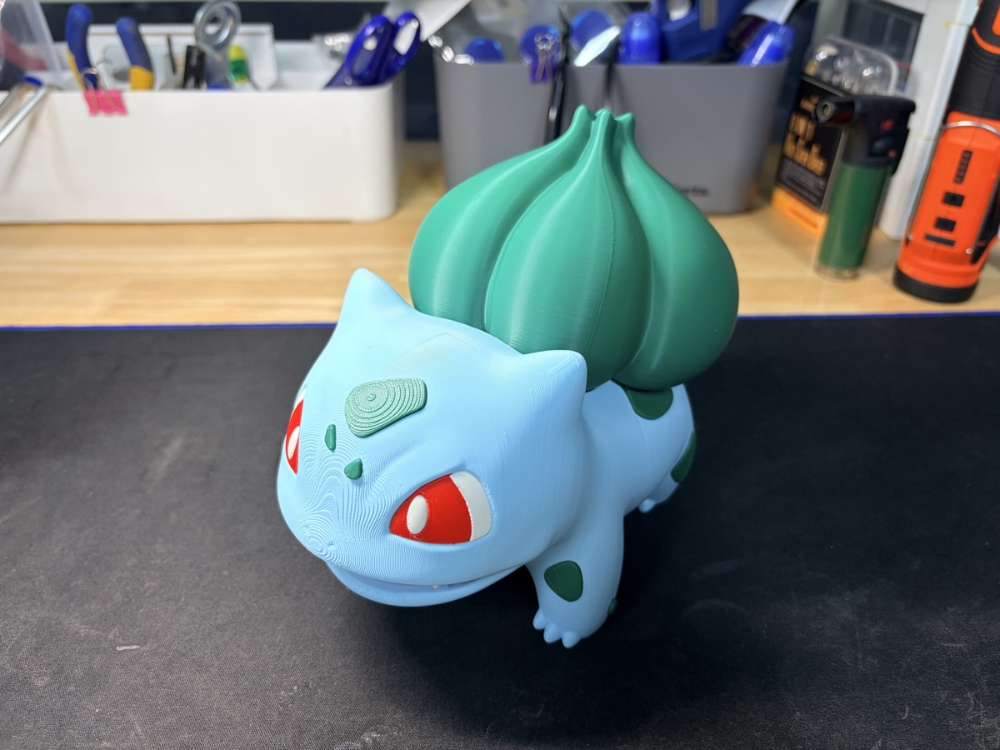
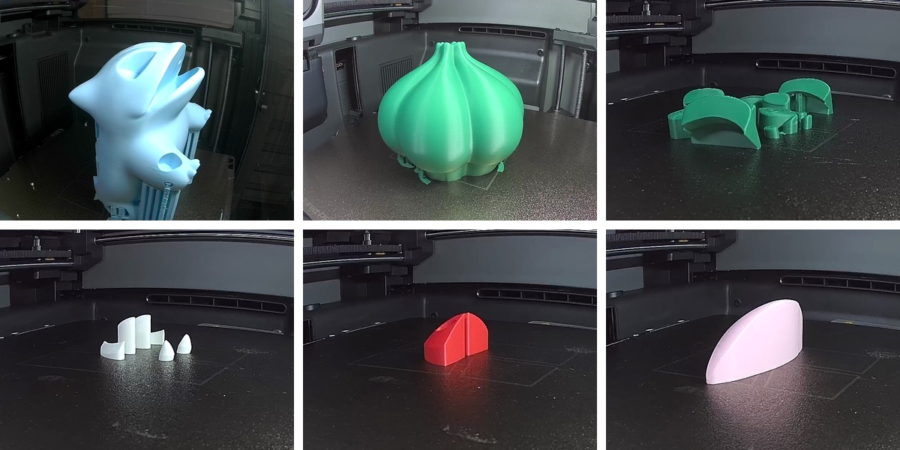
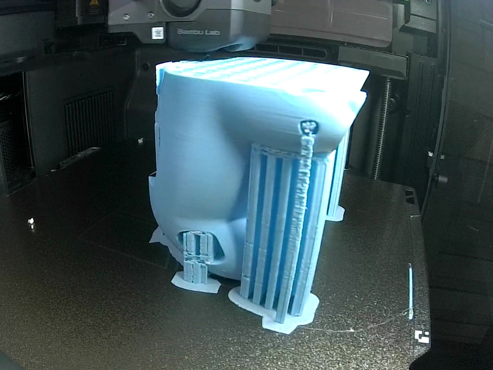
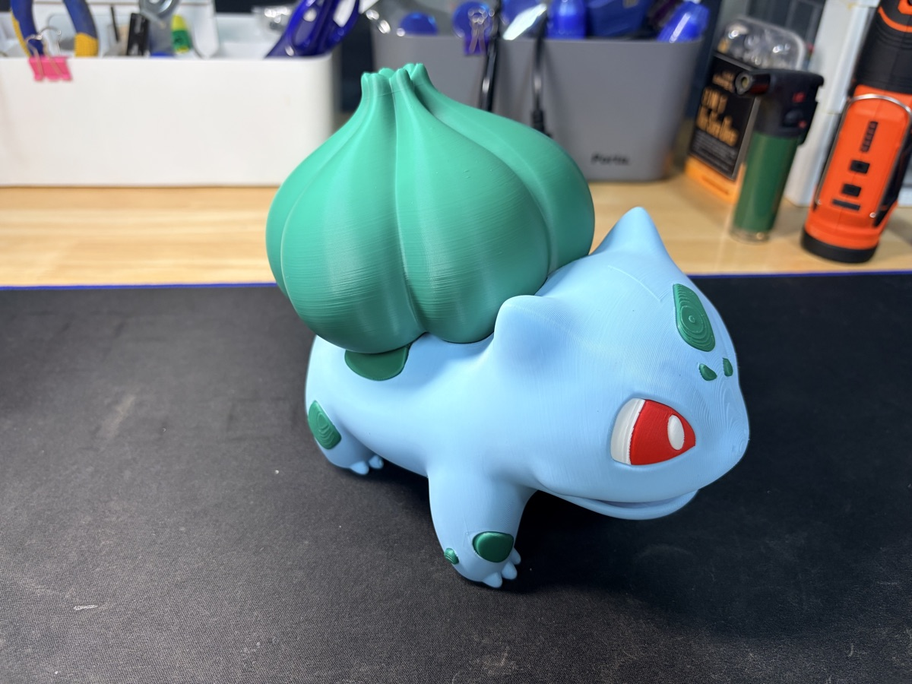

先月末にプリントしておいたフシギダネを、ようやくまとめます。

MakerWorldで公開されている「#0001 Bulbasaur HQ - 15cm Multiparts」というモデルです。
3D Girlさんが作ったものです。

名前のとおり、15cmサイズを複数のパーツに分けてプリントするモデルです。
色ごとにパーツが分かれているので、色ごとに別々にプリントして組み立てます。

## 6つのパーツ、プリンター2台

パーツは全部で6つです。

水色の胴体、緑のタネ、緑の模様、白い目とツメ、赤い目、そしてピンクのパーツがひとつ。

胴体はX2Dで、残りはP2Sでプリントしました。
2台に分けて動かしたので、1日で6つのパーツがすべてそろいました。

## 胴体はサポートがたっぷり

胴体は大きくて形も複雑なので、サポートがたくさん付きます。
横から見ると、サポートの柱がびっしり並んでいます。

タネも大きなパーツですが、サポートは下のほうに少し付く程度でした。

## 組み立ててみると

6つのパーツを組み立てると、このようになりました。

色をパーツごとに分けてプリントするので、ノズルがひとつのプリンターでも色がくっきり出ます。
これがマルチパーツモデルの良いところです。

## 動画で見る

今回はプリントの過程を、静かなショート動画にまとめてみました。
速い編集はなしで、穏やかなピアノとともにパーツが積み上がっていく様子だけを収めています。
ぼんやり眺めるのにぴったりです。

ショート動画は、まもなく[YouTubeチャンネル](https://www.youtube.com/@realcoding2003/shorts)で公開します。

<!-- SHORTS_EMBED -->

- モデル: MakerWorld「#0001 Bulbasaur HQ - 15cm Multiparts」by 3D Girl
