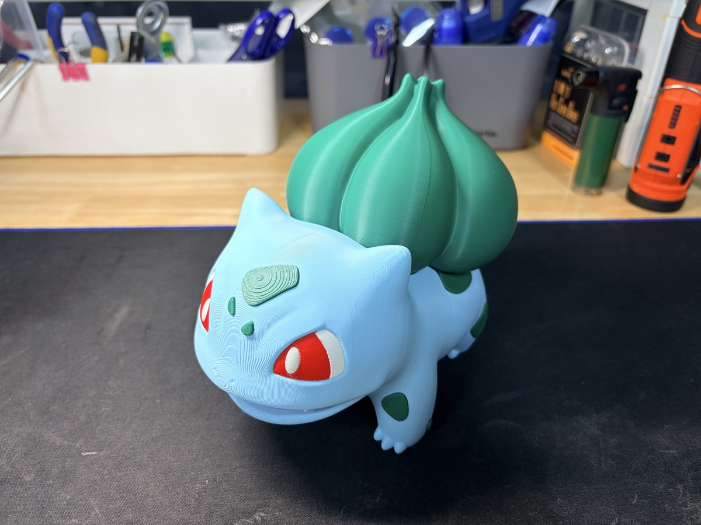
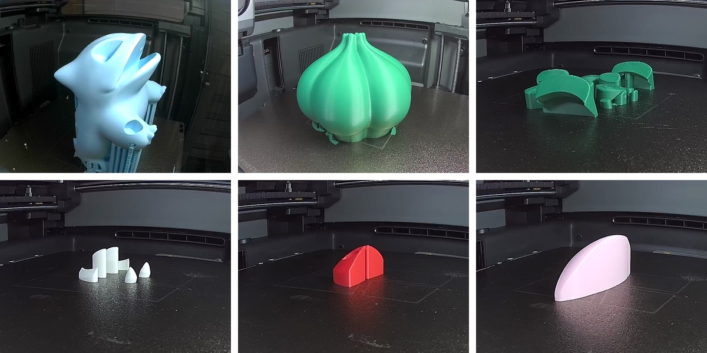
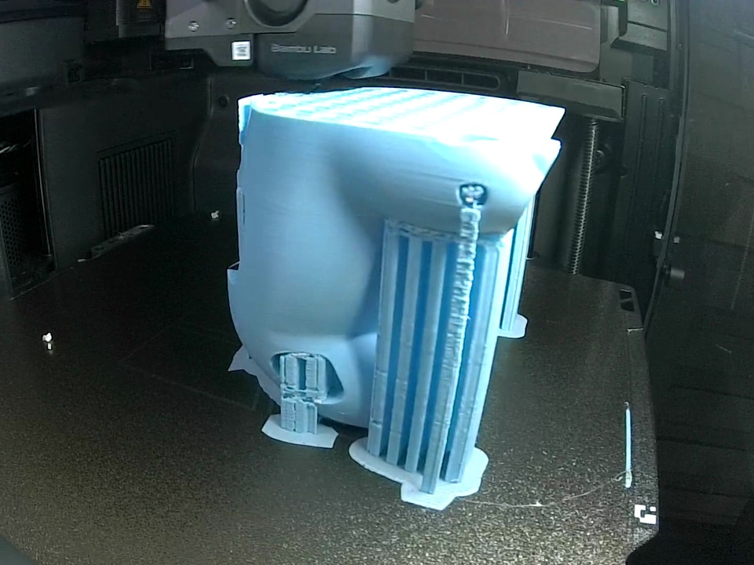
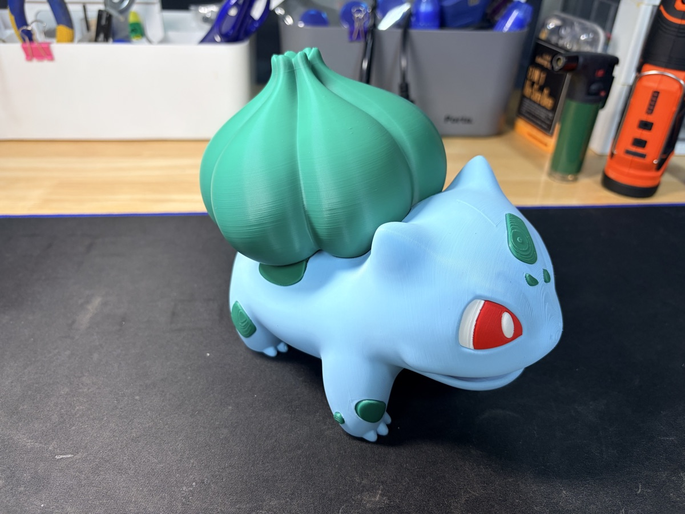

지난달 말에 뽑아 둔 이상해씨를 이제야 정리한다.

MakerWorld에 올라온 "#0001 Bulbasaur HQ - 15cm Multiparts" 모델이다.
3D Girl이라는 분이 만든 거다.

이름 그대로 15cm 크기를 여러 조각으로 나눠 뽑는 모델이다.
색깔별로 조각이 나뉘어 있어서, 색마다 따로 출력해서 조립하면 된다.

## 여섯 조각, 프린터 두 대

조각은 모두 여섯 개.

하늘색 몸통, 초록 씨앗, 초록 반점, 흰색 눈과 발톱, 빨간 눈, 그리고 분홍 조각 하나.

몸통은 X2D로, 나머지는 P2S로 뽑았다.
두 대로 나눠 돌렸더니 하루 만에 여섯 조각이 다 나왔다.

## 몸통은 서포트가 한가득

몸통은 덩치도 크고 모양이 복잡해서 서포트가 많이 붙는다.
옆에서 보면 서포트 기둥이 빽빽하다.

씨앗도 큰 조각이지만 서포트는 아래쪽에 조금 붙는 정도였다.

## 모아 놓으니

여섯 조각을 모아 조립하니 이렇게 됐다.

색을 조각별로 나눠 뽑으니까 노즐 하나짜리 프린터로도 색이 또렷하게 나온다.
멀티파트 모델의 장점이 이런 거다.

## 영상으로 보기

이번엔 출력 과정을 조용한 쇼츠로 담아 봤다.
빠른 편집 없이, 잔잔한 피아노에 조각이 쌓여 가는 모습만.
멍하니 보기 좋다 ㅎㅎ

  <iframe src="https://www.youtube.com/embed/roiKAYF-dus" title="이상해씨 15cm, 여섯 조각으로 출력해 봤다" style="position: absolute; inset: 0; width: 100%; height: 100%; border: 0;" allow="accelerometer; autoplay; clipboard-write; encrypted-media; gyroscope; picture-in-picture; web-share" allowfullscreen loading="lazy"></iframe>

- 유튜브: [이상해씨 15cm, 여섯 조각으로 출력해 봤다](https://www.youtube.com/shorts/roiKAYF-dus)
- 모델: MakerWorld "#0001 Bulbasaur HQ - 15cm Multiparts" by 3D Girl
