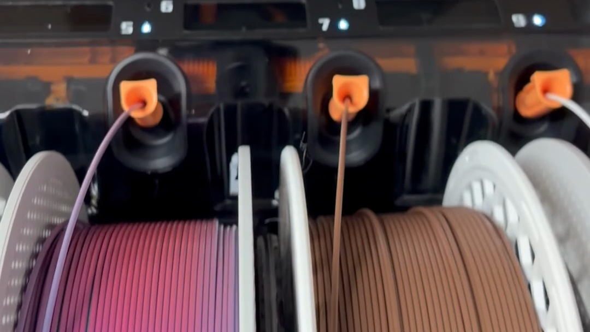
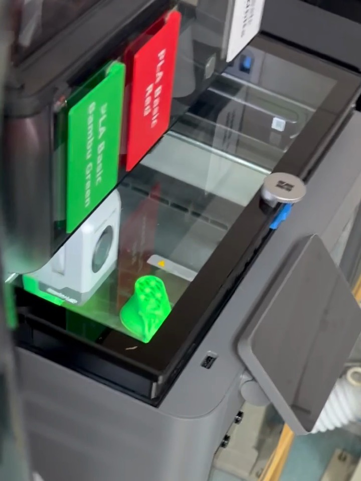
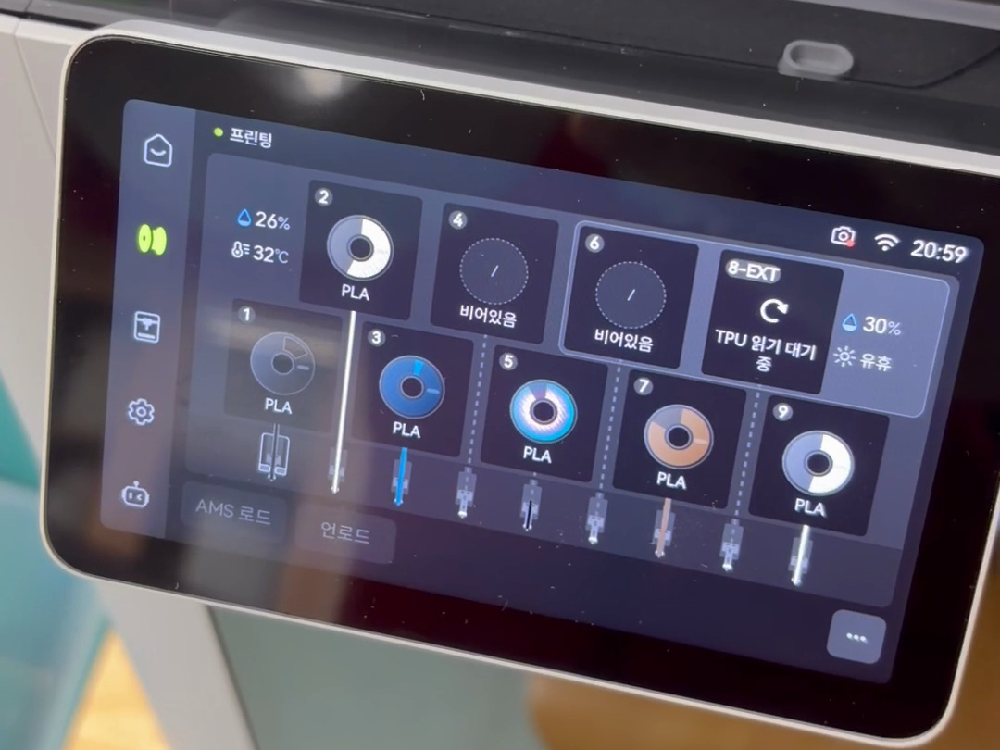
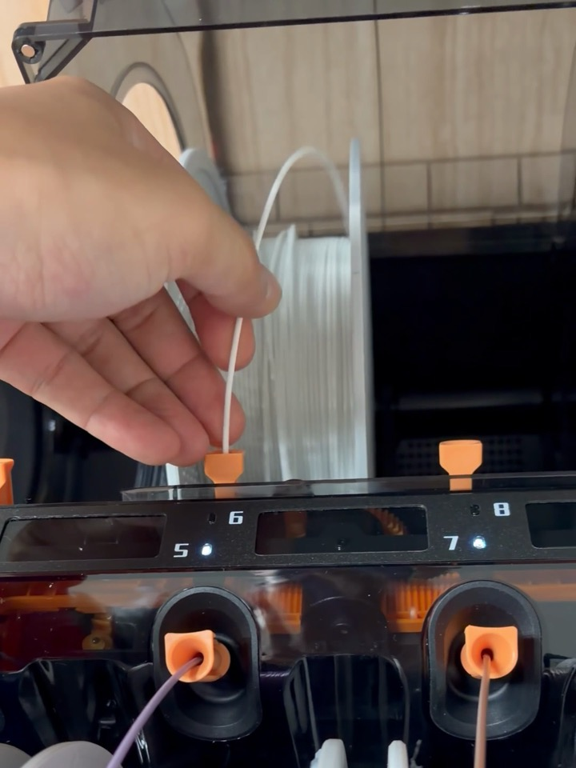
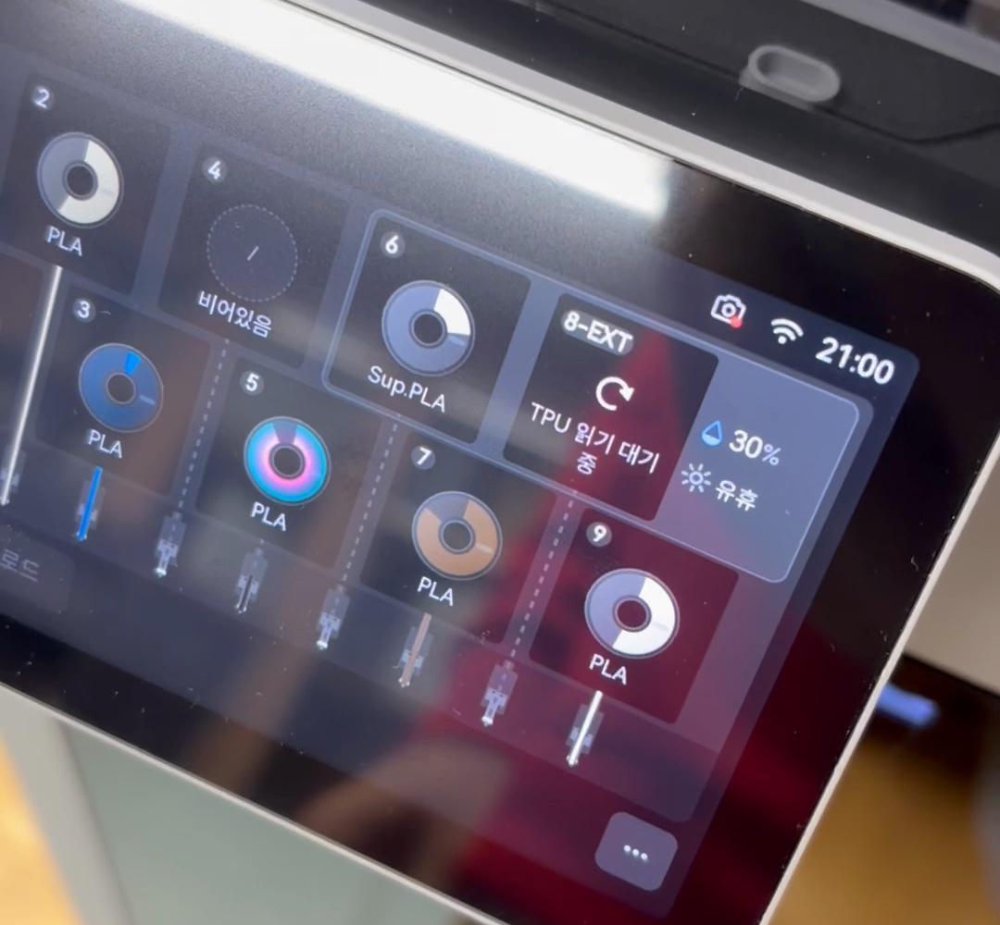
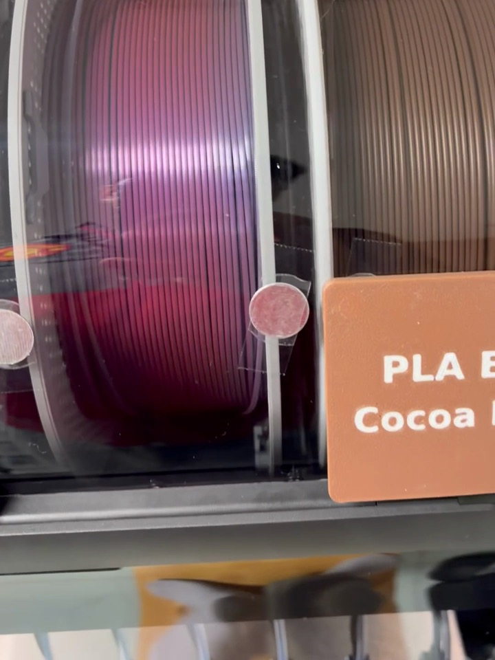
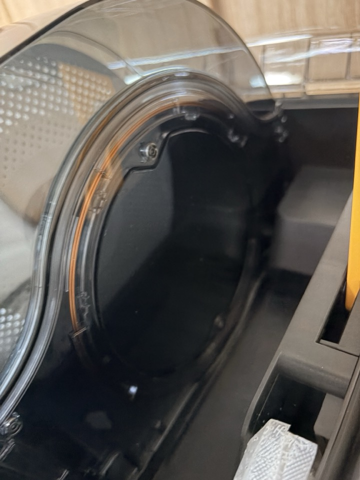

I briefly mentioned the AMS 3 in my [H3C unboxing post](/en/2026/11/07/bambulab-h3c-ams3-unboxing/).
After a few days of use, one thing stands out as the biggest quality-of-life improvement.

Filament recognition.

By the way, the official name isn't AMS 3, it's AMS 3H.
It's the AMS that launched alongside the H3C.

## What Bugged Me About the AMS 2 Pro

My old AMS 2 Pro couldn't recognize newly loaded filament while it was printing or drying.

So to swap a single filament, I had to
turn drying off,
get it recognized again,
and turn drying back on once recognition was done...

Even the recognition itself meant rolling the spool back and forth.
It works by turning the spool until the tag on it lines up with the reader.

Once or twice is fine, but doing it every time got quietly annoying.

## With the AMS 3H, I Just Plugged It In

This time I deliberately loaded filament mid-print.

The screen shows "Printing" at the top, and slot 6 is empty.
The clock reads 20:59.

I inserted white filament into slot 6.
Push the end in and it slides right in.

Then I closed the lid.
I never touched the spool.
The AMS didn't roll the spool either.

When I got to the screen, slot 6 already showed Sup.PLA.
The clock read 21:00.

Timing it on the video I shot, it took less than 10 seconds from plugging it in to standing in front of the screen.
Recognition had already finished by then.

The print never stopped and just kept going.

It was recognized instantly when I loaded it during drying, too.
The whole routine I used to go through with the AMS 2 Pro is simply gone.

## Why No Spool Rolling?

Looking inside, there's a pillar-like part standing between the spools.

This is what it looks like from an empty slot.
There's a round panel about the size of a spool, with an orange line running around its edge.

My guess is that the recognition sensor sits there.
With the reader right beside the spool, there's no need to rotate it to find the tag, I suppose.

The tags on Bambu Lab spools are RFID, using the same 13.56 MHz as NFC.
So calling it an NFC sensor isn't far off.

That said, this is just my guess.
I haven't found any official material from Bambu Lab explaining where the reader is.

## Summary

- Recognized immediately when plugged in, whether printing or drying
- No spool rolling
- No more switching drying off and on just for recognition

It's not as eye-catching as having 9 nozzles.
But for daily use, this is the change I feel more.

If you use an AMS 2 Pro, how do you swap filament while drying?
If you have any other tricks, let me know in the comments.

## Watch the video

I put the instant recognition into a Short, including the 20:59 → 21:00 screen comparison.

  <iframe src="https://www.youtube.com/embed/uPyB9AImuz0" title="Bambu Lab AMS 3H: What's New | Instant Filament Recognition" style="position: absolute; inset: 0; width: 100%; height: 100%; border: 0;" allow="accelerometer; autoplay; clipboard-write; encrypted-media; gyroscope; picture-in-picture; web-share" allowfullscreen loading="lazy"></iframe>

- YouTube: [Bambu Lab AMS 3H: What's New | Instant Filament Recognition](https://www.youtube.com/shorts/uPyB9AImuz0)
- The narration is an AI voice.
