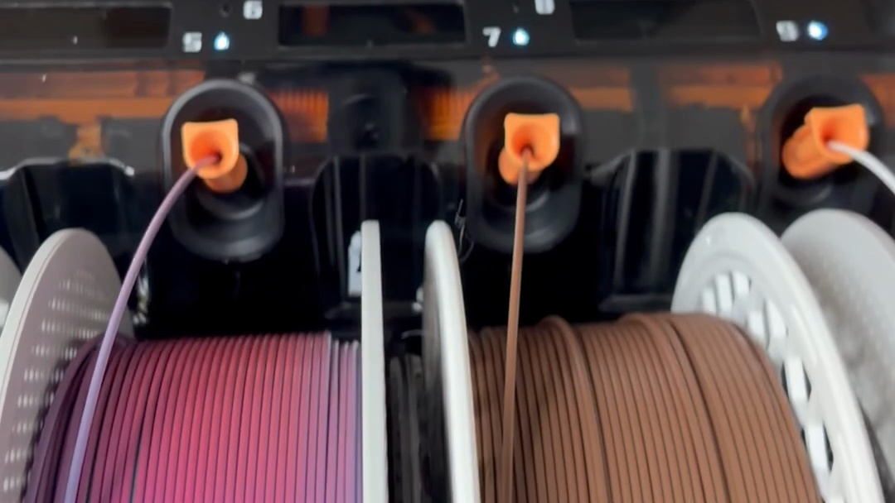
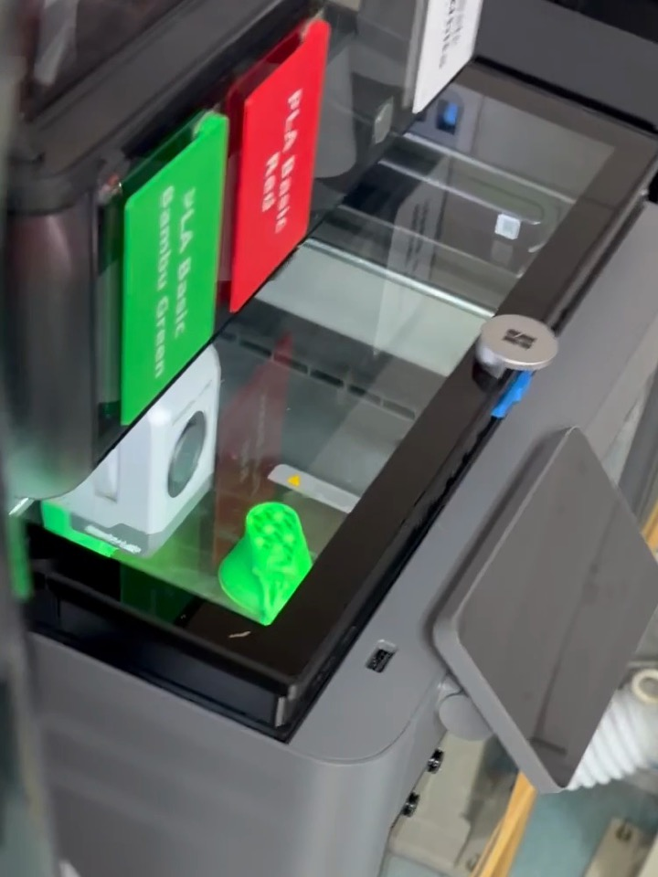
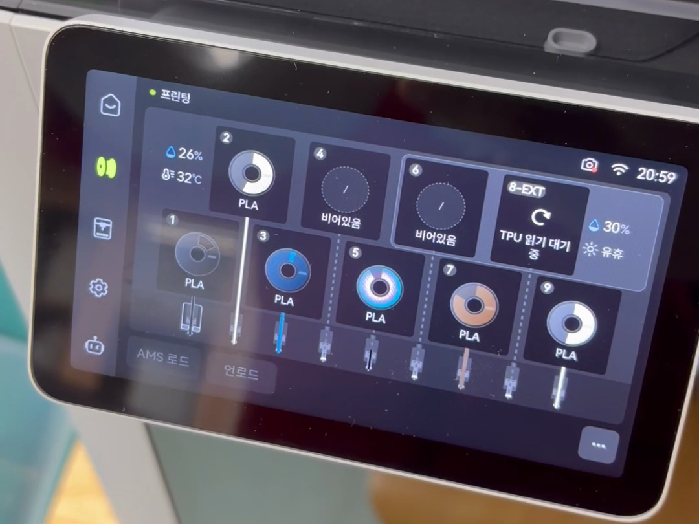
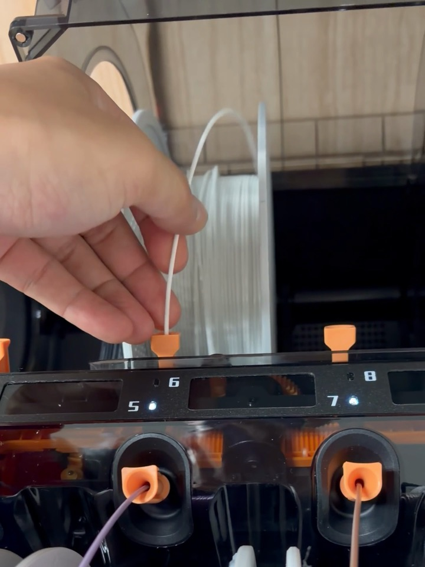
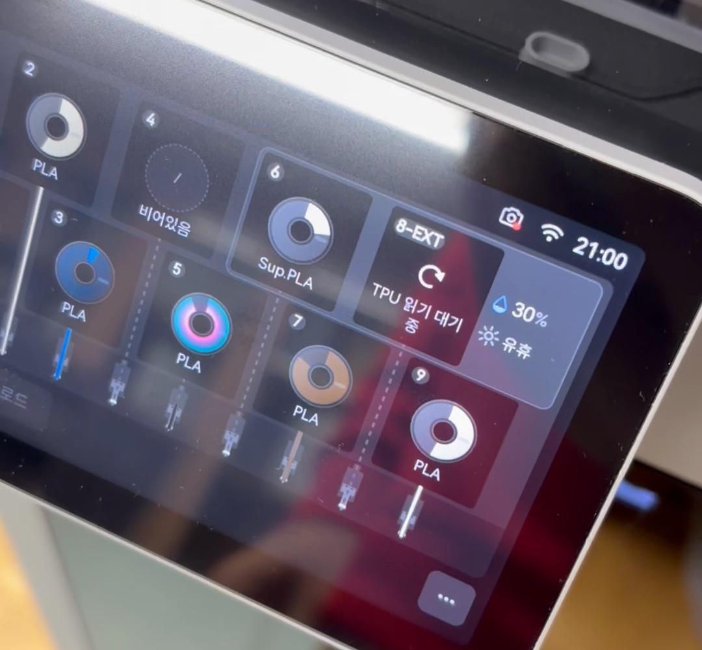
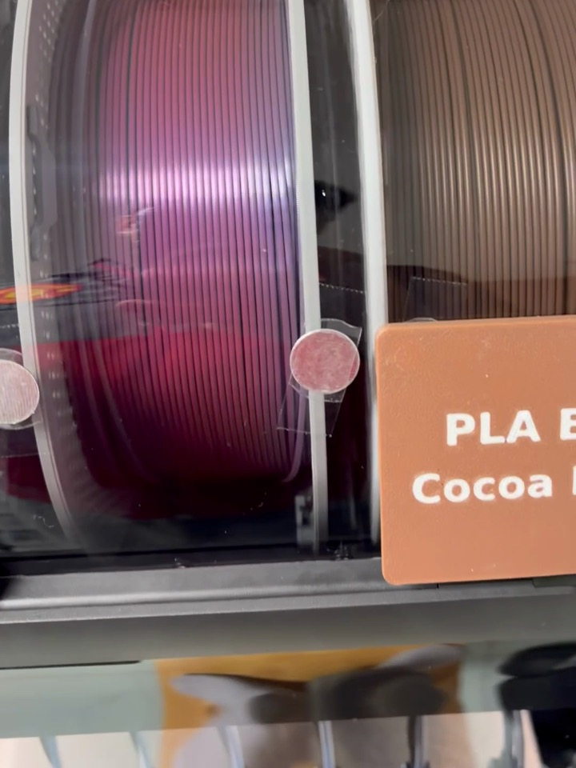
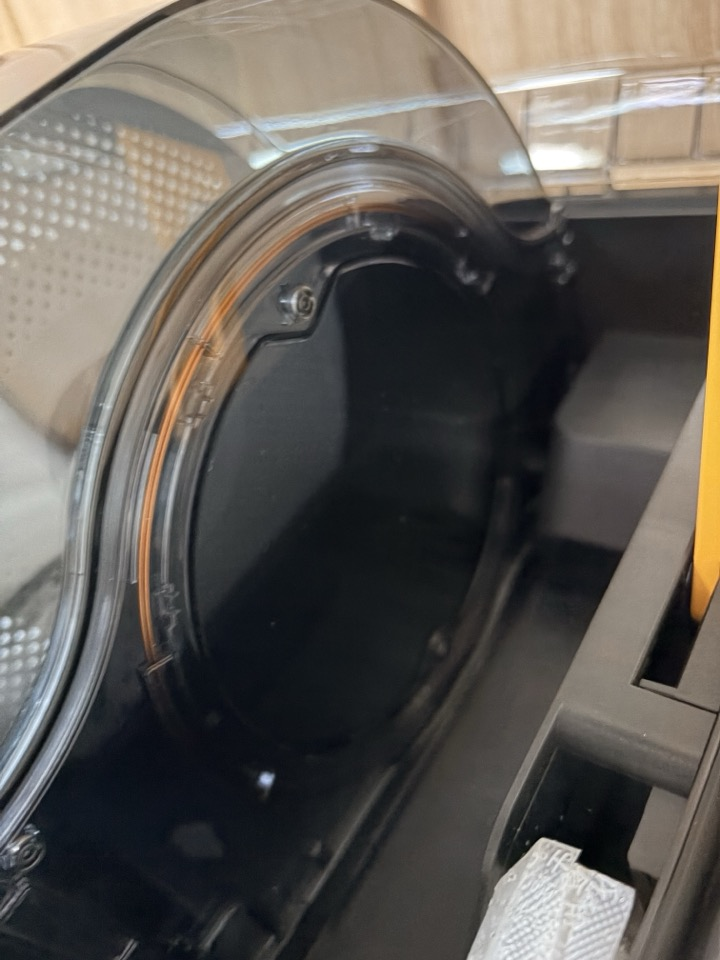

[H3Cの開封レビュー](/ja/2026/11/07/bambulab-h3c-ams3-unboxing/)で、AMS 3について少し触れました。
数日使ってみて、その中でいちばん楽になったことがあります。

フィラメントの認識です。

ちなみに、正式名称はAMS 3ではなくAMS 3Hでした。
H3Cと一緒に登場したAMSです。

## AMS 2 Proのときは、ここが不便だった

これまで使っていたAMS 2 Proは、印刷中や乾燥中だと、新しく入れたフィラメントを認識できませんでした。

そのため、フィラメントを1本替えるだけでも、
乾燥を止めて、
もう一度認識させて、
認識が終わったら乾燥を再びオンにして……という手順が必要でした。

認識のときも、スプールをあちこち回しながら読み取っていました。
スプールに付いているタグがリーダーの前に来るまで回す方式だからです。

1、2回ならいいのですが、毎回となると地味に面倒でした。

## AMS 3Hは、印刷中にそのまま挿した

今回は、あえて印刷中に入れてみました。

画面の上部には「印刷中」と表示されていて、6番スロットは空の状態です。
時計は20:59。

白いフィラメントを6番に挿しました。
先端を入れると、すっと入っていきます。

そして蓋を閉めました。
スプールには触れていません。
AMSもスプールを回しませんでした。

画面を見に行くと、6番はすでにSup.PLAと表示されていました。
時計は21:00。

撮影した動画で測ってみると、挿してから画面の前に行くまで10秒もかかっていませんでした。
その間に認識はもう終わっていたわけです。

印刷は止まらず、そのまま続いていました。

乾燥中に入れたときも、同じようにすぐ認識されました。
AMS 2 Proのときのあの手順が、丸ごとなくなりました。

## なぜスプールを回さなくていいのか

中をのぞくと、スプールとスプールの間に柱のように立っている部分があります。

空きスロットからのぞくと、こんな形をしています。
スプールほどの大きさの丸い板があり、縁に沿ってオレンジ色の線がぐるりと通っています。

おそらく、ここに認識用のセンサーが入っているのだと思います。
スプールのすぐ横にリーダーがあるので、わざわざ回してタグを探す必要がないのではないでしょうか。

Bambu LabのスプールのタグはRFIDで、NFCと同じ13.56 MHz方式です。
そのため、NFCセンサーと呼んでも大きくは外れていません。

ただし、これはあくまで私の推測です。
Bambu Labがリーダーの位置について説明している資料は、まだ見つけられていません。

## まとめ

- 印刷中でも乾燥中でも、挿せばすぐ認識
- スプールを回さない
- 認識のために乾燥をオン・オフする必要がない

ノズル9本ほど目立つ変化ではありません。
でも、毎日使う身としては、こちらのほうが実感が大きいです。

AMS 2 Proをお使いの方は、乾燥中にフィラメントを替えるとき、どうされていますか？
ほかにコツがあれば、コメントで教えてください。

## 動画で見る

挿してすぐ認識される様子をショート動画にまとめました。20:59 → 21:00 の画面比較も入っています。

  <iframe src="https://www.youtube.com/embed/uPyB9AImuz0" title="Bambu Lab AMS 3Hの変わったところ|印刷中に挿してもすぐ認識" style="position: absolute; inset: 0; width: 100%; height: 100%; border: 0;" allow="accelerometer; autoplay; clipboard-write; encrypted-media; gyroscope; picture-in-picture; web-share" allowfullscreen loading="lazy"></iframe>

- YouTube: [Bambu Lab AMS 3Hの変わったところ|印刷中に挿してもすぐ認識](https://www.youtube.com/shorts/uPyB9AImuz0)
- ナレーションはAI音声です。
