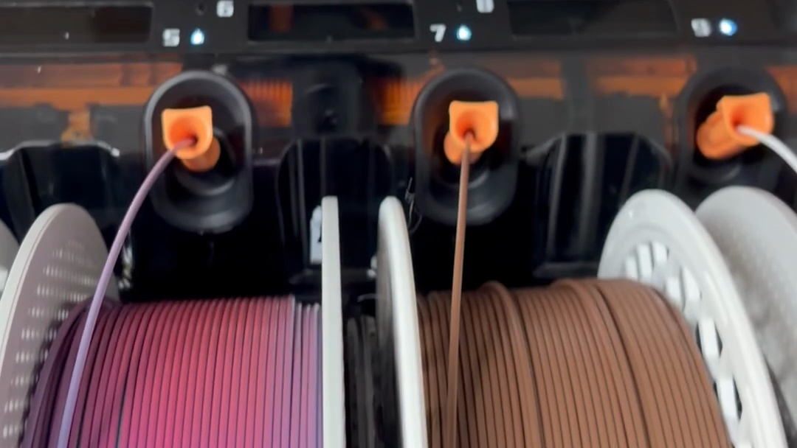
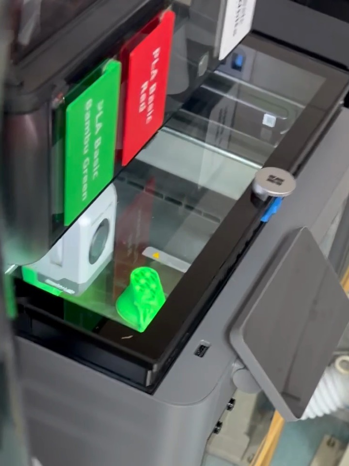
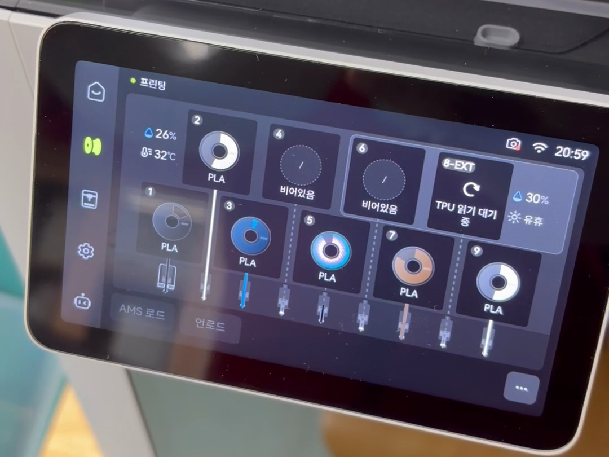
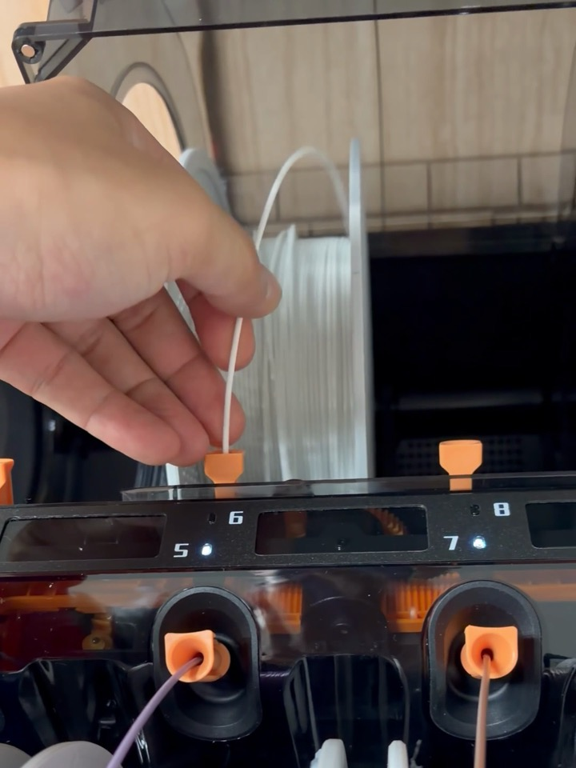
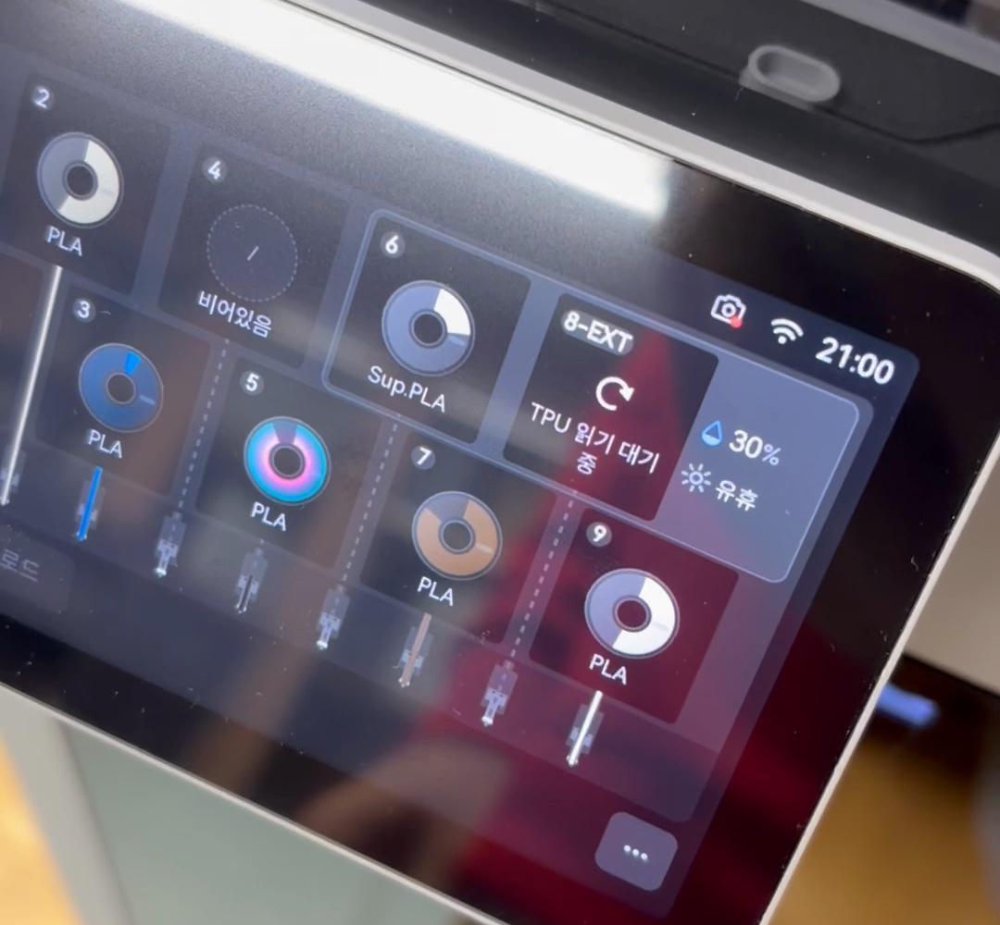
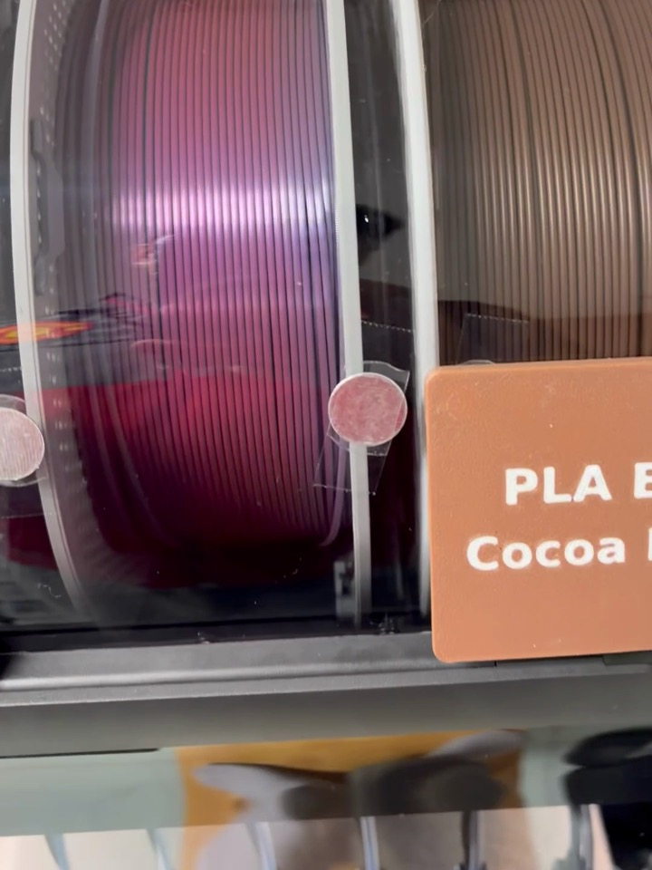
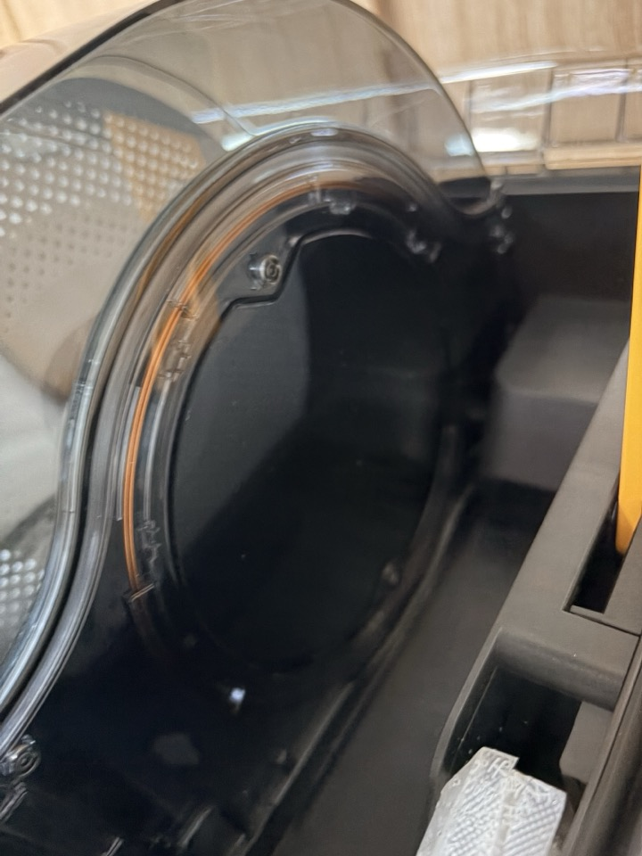

[H3C 개봉기](/2026/11/07/bambulab-h3c-ams3-unboxing/)에서 AMS 3 얘기를 잠깐 했었다.
며칠 써 보니까 그중에서 제일 편해진 게 있다.

필라멘트 인식.

참고로 정식 이름은 AMS 3가 아니라 AMS 3H더라 ㅎㅎ
H3C랑 같이 나온 AMS다.

## AMS 2 Pro 때는 이게 불편했다

기존에 쓰던 AMS 2 Pro는 출력 중이거나 건조 중이면 새로 넣은 필라멘트를 인식하지 못했다.

그래서 필라멘트 하나 바꾸려면
건조 끄고,
다시 인식시키고,
인식이 끝나면 건조를 다시 켜고...

인식할 때도 스풀을 이리저리 굴려 가면서 읽었다.
스풀에 붙은 태그가 리더 앞으로 올 때까지 돌리는 방식이라 그렇다.

한두 번이면 괜찮은데 매번 이러니까 은근 귀찮았다.

## AMS 3H는 출력 중에 그냥 꽂았다

이번엔 일부러 출력 중에 넣어 봤다.

화면 위에 "프린팅"이 떠 있고, 6번 슬롯은 비어 있는 상태.
시계는 20:59.

흰색 필라멘트를 6번 자리에 꽂았다.
끝을 넣으면 쏙 들어간다.

그리고 뚜껑을 닫았다.
스풀은 건드리지 않았다.
AMS도 스풀을 굴리지 않더라.

화면으로 가 보니 6번이 벌써 Sup.PLA로 떠 있었다.
시계는 21:00.

찍은 영상으로 재 보니까 꽂고 나서 화면 앞에 가기까지 10초도 안 걸렸다.
그 사이에 인식이 이미 끝나 있었던 거다.

출력은 멈추지 않고 그대로 계속.

건조 중에 넣었을 때도 똑같이 바로 인식됐다.
AMS 2 Pro 때 하던 그 과정이 통째로 없어진 거다 ㅋㅋ

## 스풀을 안 굴려도 되는 이유는?

안을 들여다보면 스풀과 스풀 사이에 기둥처럼 서 있는 부분이 있다.

빈 칸에서 들여다보면 이렇게 생겼다.
스풀만 한 둥근 판이 있고, 가장자리를 따라 주황색 선이 둥글게 지나간다.

아마 여기에 인식 센서가 들어가 있는 것 같다.
스풀 바로 옆에 붙어 있으니까 굳이 돌려 가며 태그를 찾을 필요가 없는 거 아닐까?

뱀부랩 스풀의 태그는 RFID인데, NFC와 같은 13.56 MHz 방식이다.
그래서 그냥 NFC 센서라고 불러도 크게 틀리진 않다.

다만 이건 내 추측이다.
뱀부랩이 리더 위치를 따로 설명해 둔 자료는 아직 못 찾았다.

## 정리하면

- 출력 중에도, 건조 중에도 꽂으면 바로 인식
- 스풀을 굴리지 않는다
- 인식 때문에 건조를 껐다 켰다 할 일이 없다

노즐 9개만큼 눈에 띄는 변화는 아니다.
근데 매일 쓰는 입장에서는 이게 더 체감이 크더라 ㅎㅎ

AMS 2 Pro 쓰시는 분들은 건조 중에 필라멘트 바꿀 때 어떻게 하고 계세요?
다른 요령이 있으면 댓글로 알려주세요.

## 영상으로 보기

꽂아서 바로 인식되는 장면을 쇼츠로 정리했다.
화면으로 비교한 20:59 → 21:00도 들어 있다.

  <iframe src="https://www.youtube.com/embed/uPyB9AImuz0" title="뱀부랩 AMS 3H 달라진 점 | 출력 중에 꽂아도 바로 인식" style="position: absolute; inset: 0; width: 100%; height: 100%; border: 0;" allow="accelerometer; autoplay; clipboard-write; encrypted-media; gyroscope; picture-in-picture; web-share" allowfullscreen loading="lazy"></iframe>

- 유튜브: [뱀부랩 AMS 3H 달라진 점 | 출력 중에 꽂아도 바로 인식](https://www.youtube.com/shorts/uPyB9AImuz0)
- 내레이션은 AI 음성이다.
