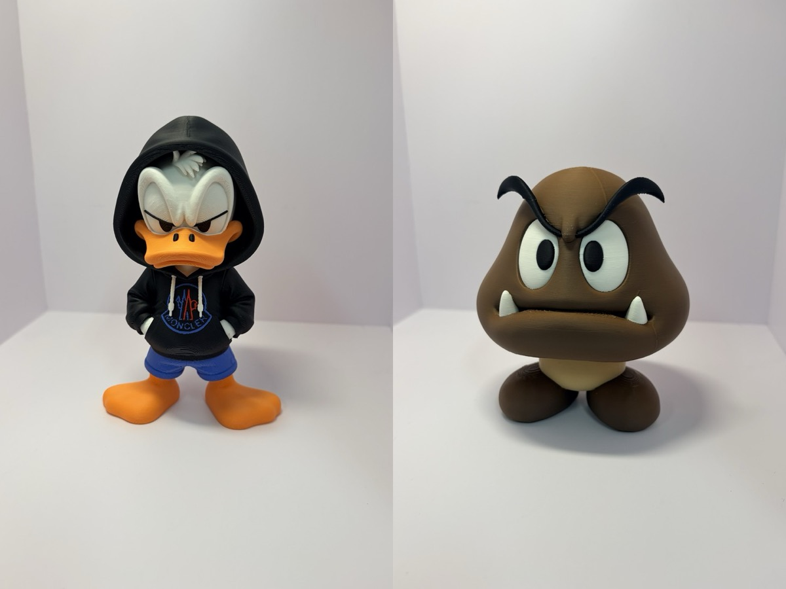
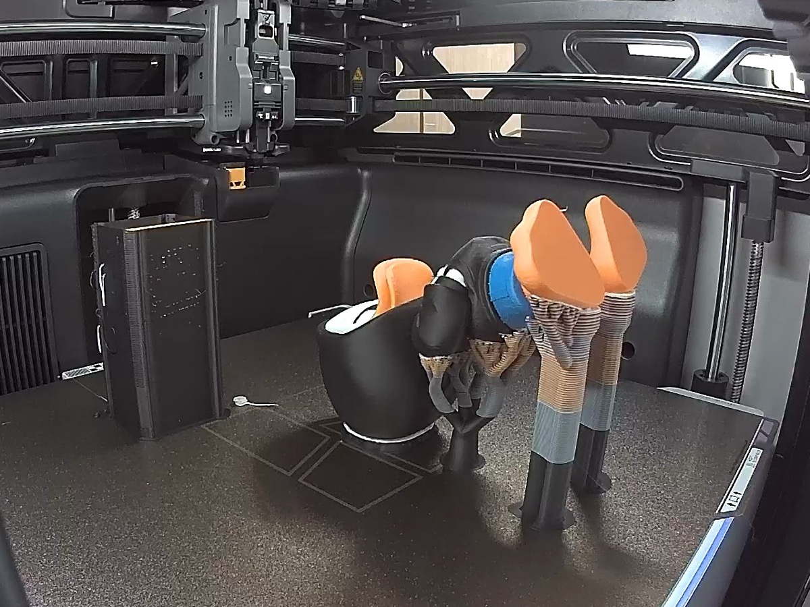
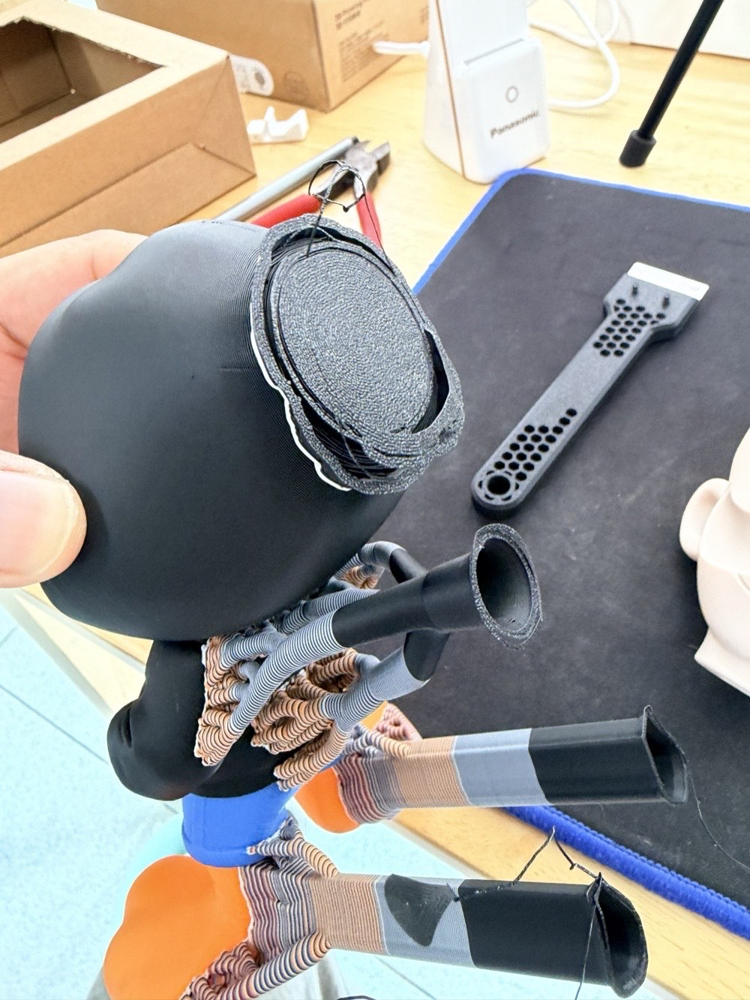
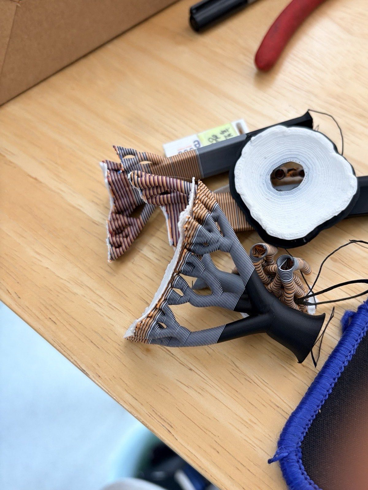
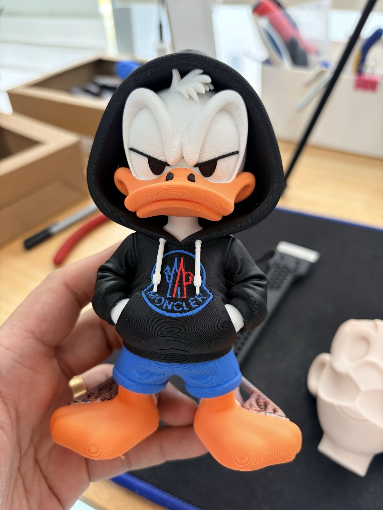
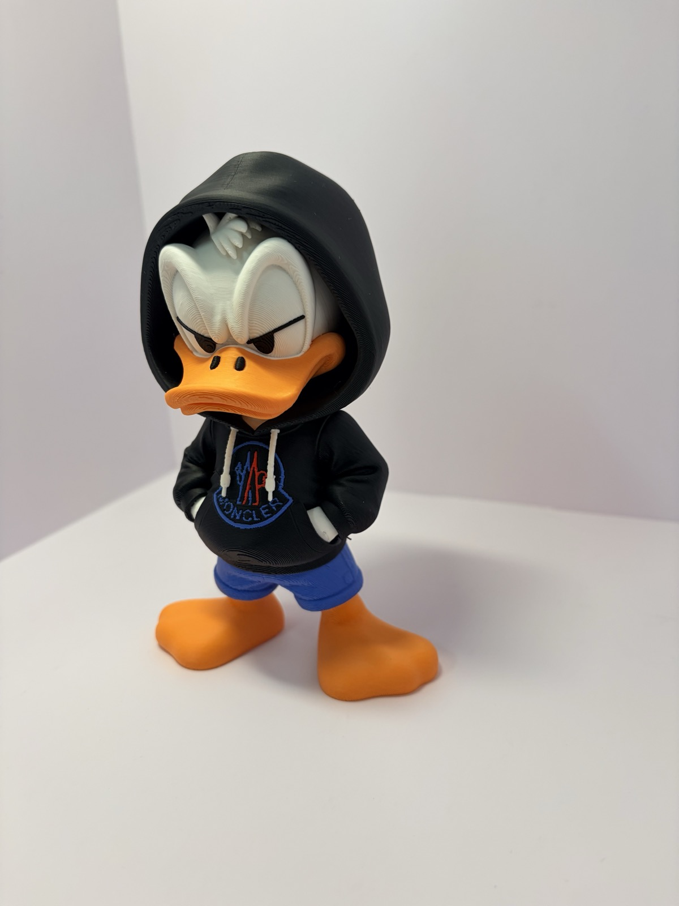
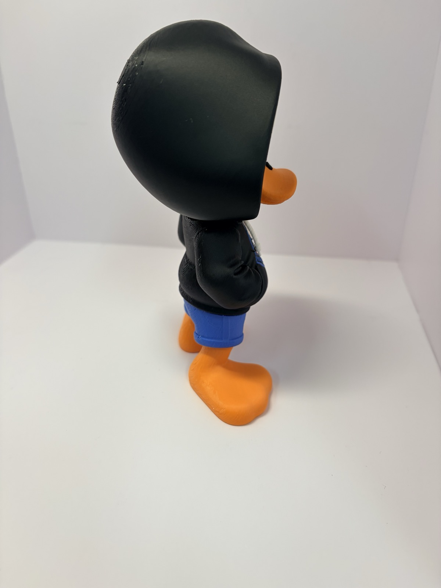
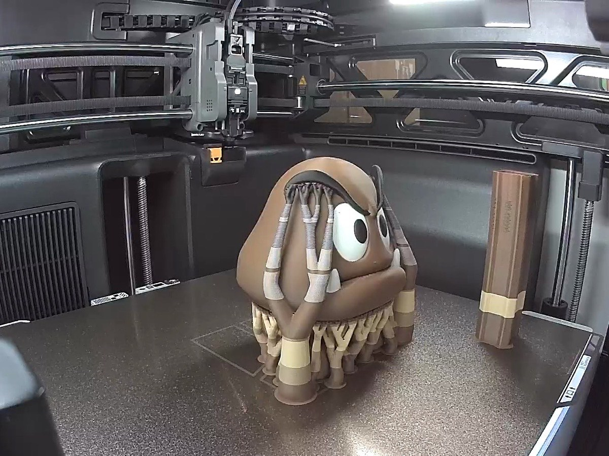
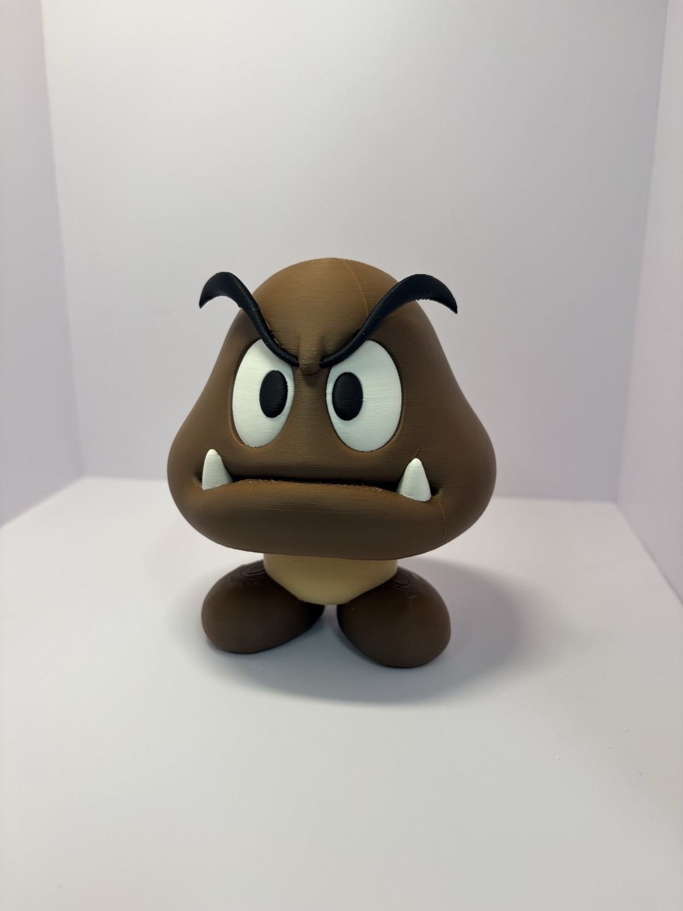
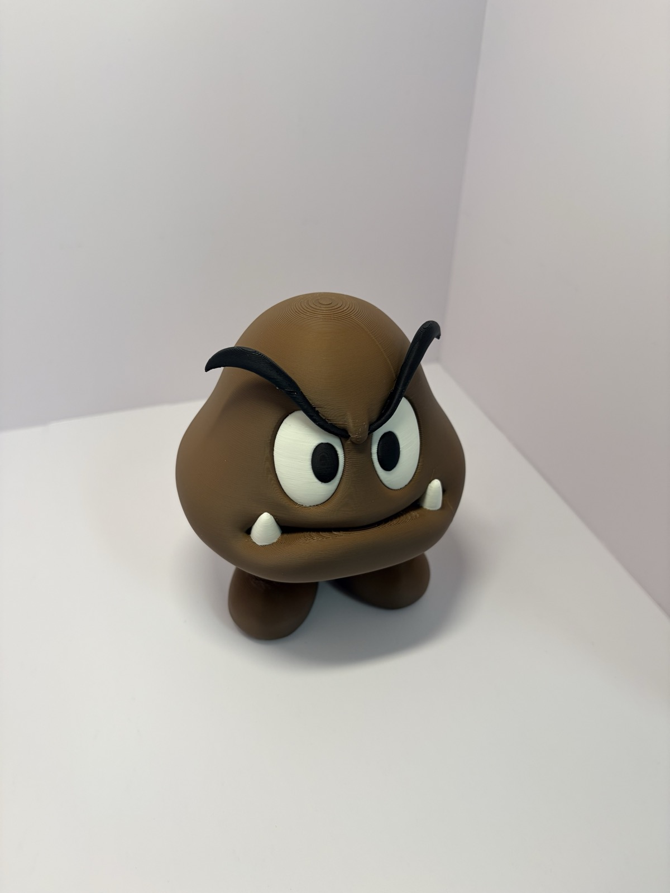

This time it's multicolor figures.
Donald Duck in a hoodie, and a Goomba.

I printed both on the H3C in one go.
They weren't split into pieces by color and glued together. They came out whole, already in color.

## I Wouldn't Have Dared Before

Time was always the problem with multicolor figures.
With a single nozzle, every color change means waiting and purging...
The more colors there are, the more the time balloons.

That's why I printed [Bowser](/en/2026/11/07/bowser-multipart-assembly/) and [Bulbasaur](/en/2026/11/07/bulbasaur-15cm-multipart-print/) in separate pieces by color.
They were multipart models that work without an AMS.
Then I glued them together one by one with super glue, haha.

In my [H3C unboxing post](/en/2026/11/07/bambulab-h3c-ams3-unboxing/), I compared a single keychain: the P2S took 6 hours 40 minutes, and the H3C took 1 hour 25 minutes.
That made me wonder how a figure would go.

## Donald, About 8 Hours

First up, Donald Duck in a hoodie.
Black hoodie, white face, orange beak and feet, blue pants. That's quite a few colors.

The print takes about 8 hours.
With this many colors, the old way would have taken forever.
But the H3C uses a separate nozzle for each color, so it just swaps nozzles and keeps going.

## Supports Come Off by Hand

This is how it looks when I take it out after printing.
Because of the print orientation, quite a lot of support is attached around the head and feet.

But it comes off more easily than I expected.
I just snapped it off by hand and it was done quickly.

This is how much support came off.

And this is how it looks with everything removed, haha.

## The Finished Donald

The white face inside the hood, the logo on the hoodie, and the blue pants all keep their colors.

From behind, the hood covers the whole head.

## Goomba, Same Method

I printed the Goomba the same way.
This one also took about 8 hours.

A tree-like mass of supports grows under the head, but it cleaned up without much trouble too.

Brown body, white eyes, black eyebrows, even the teeth.
Nothing was glued on separately. It all came out at once.

## These Days I Only Look for Multicolor Models

Once this worked, my criteria for picking models changed.

I used to search MakerWorld for "no AMS" models first.
Models split into pieces so I'd never have to change colors.

These days it's the opposite.
I only look for multicolor models that print with the AMS, haha.

## Summary

- About 8 hours per multicolor figure
- Supports come off easily by hand
- No splitting into pieces and gluing, just one go

With the right settings, multicolor figures now seem to be a one-shot job on the H3C.
Getting those settings right is its own chore, though, haha.

What settings do you pay the most attention to when printing in multicolor?
Let me know in the comments and I'll use them as a reference.

## Watch the Video

I put together a Short showing both figures from printing to finished.
This time I added narration in my own voice.
To be precise, it's an AI voice cloned from my own voice, haha.

  <iframe src="https://www.youtube.com/embed/CcLO_yhIbOU" title="Bambu Lab H3C Multicolor Figures: About 8 Hours, One Click" style="position: absolute; inset: 0; width: 100%; height: 100%; border: 0;" allow="accelerometer; autoplay; clipboard-write; encrypted-media; gyroscope; picture-in-picture; web-share" allowfullscreen loading="lazy"></iframe>

- YouTube: [Bambu Lab H3C Multicolor Figures: About 8 Hours, One Click](https://www.youtube.com/shorts/CcLO_yhIbOU)

- Model: a multicolor model downloaded from MakerWorld
