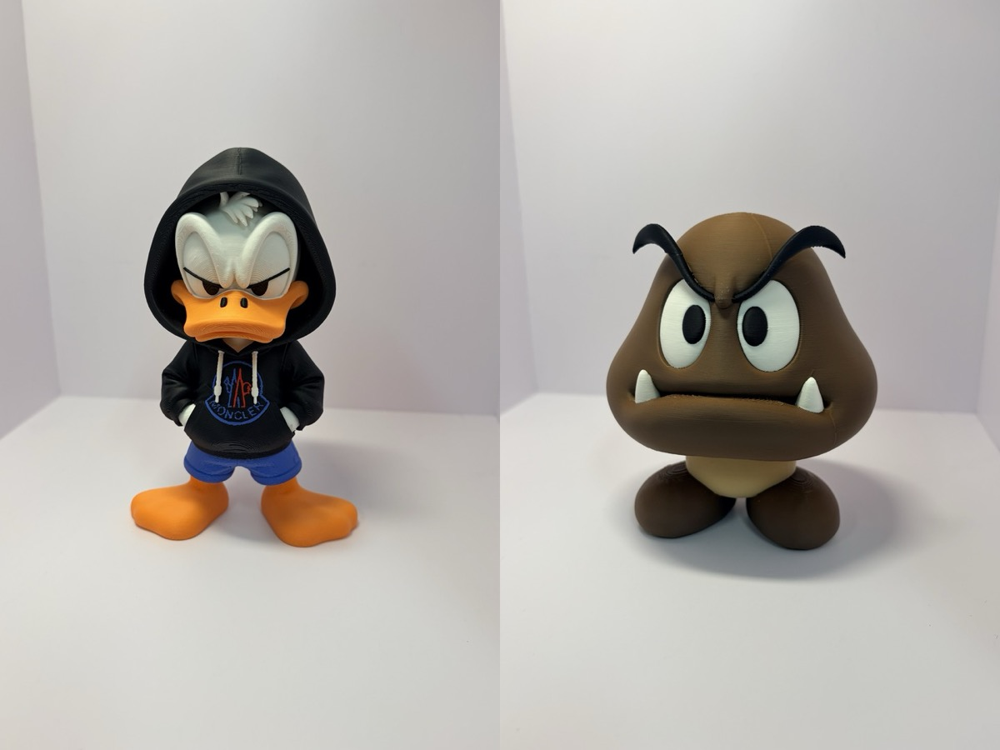
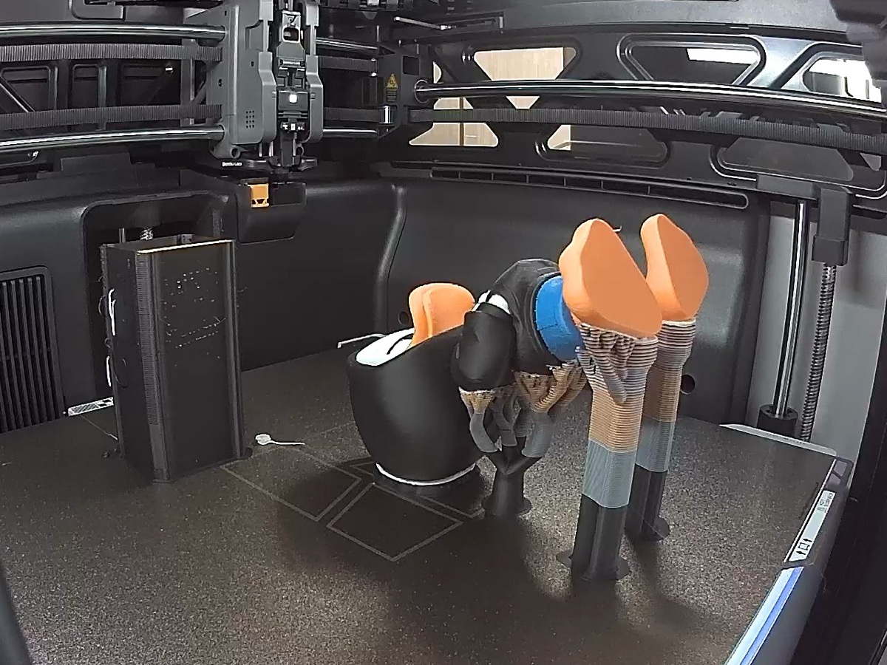
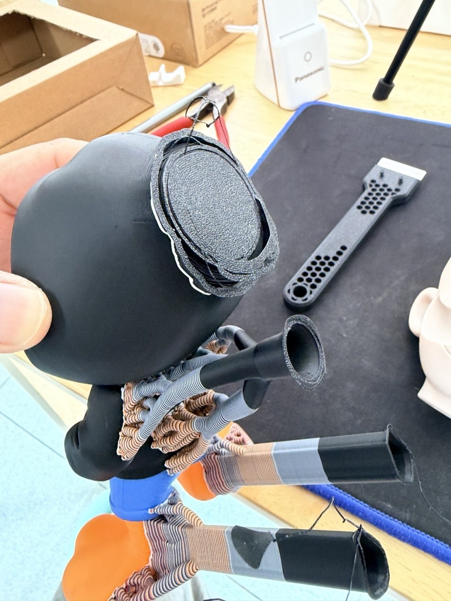
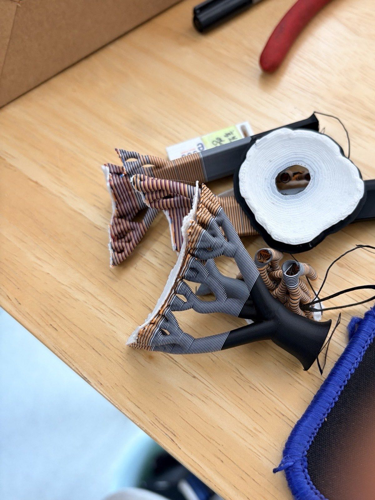
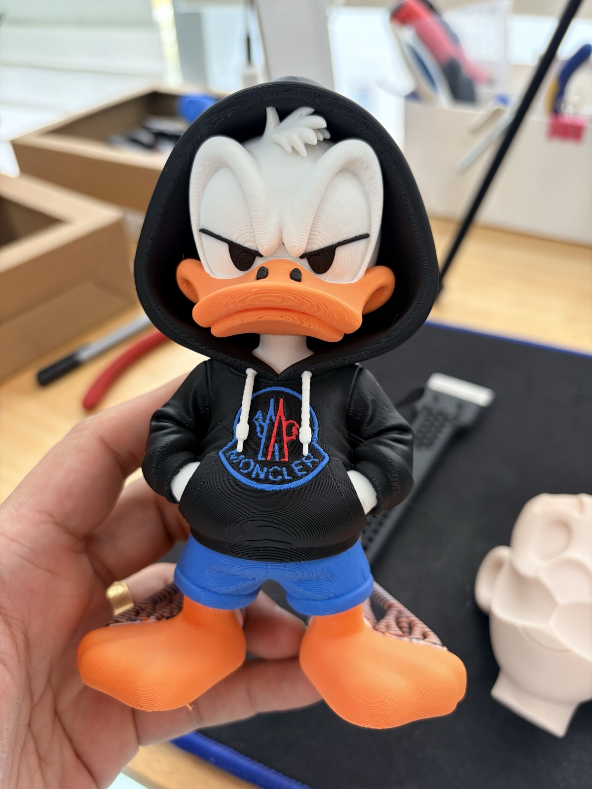
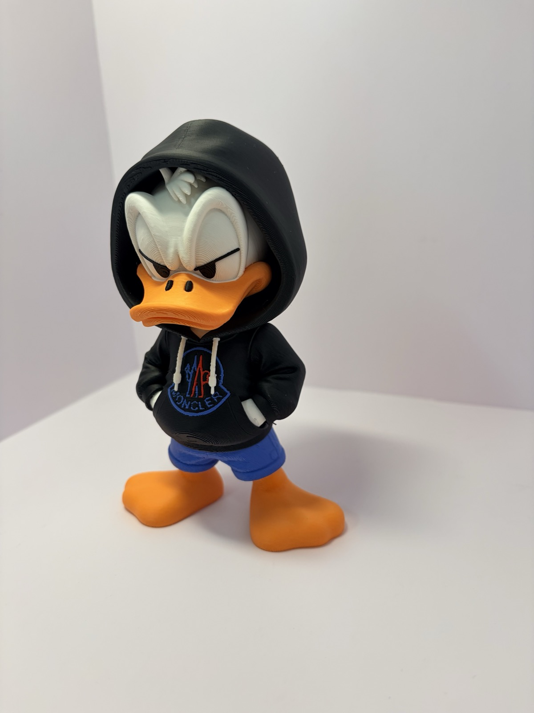
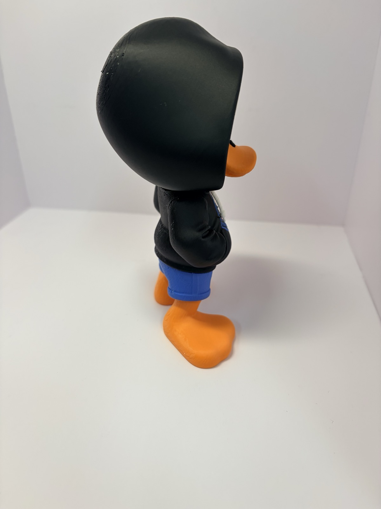
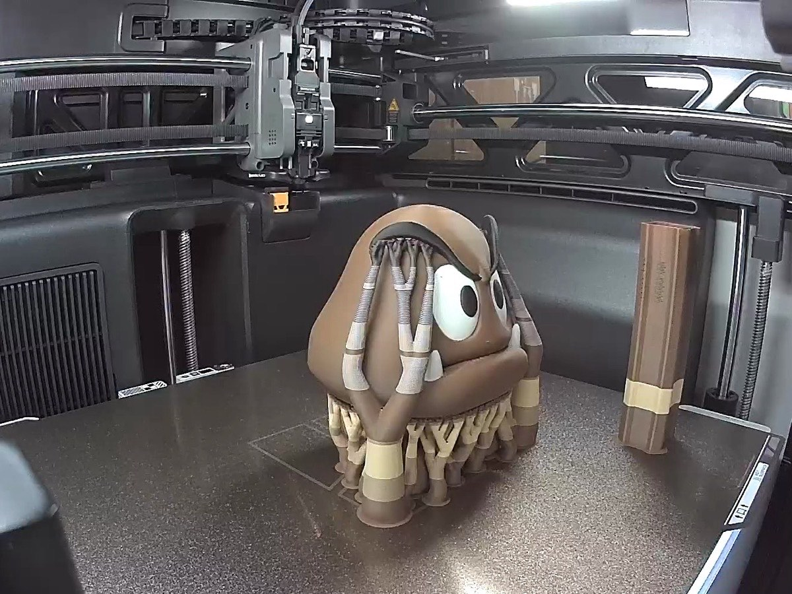
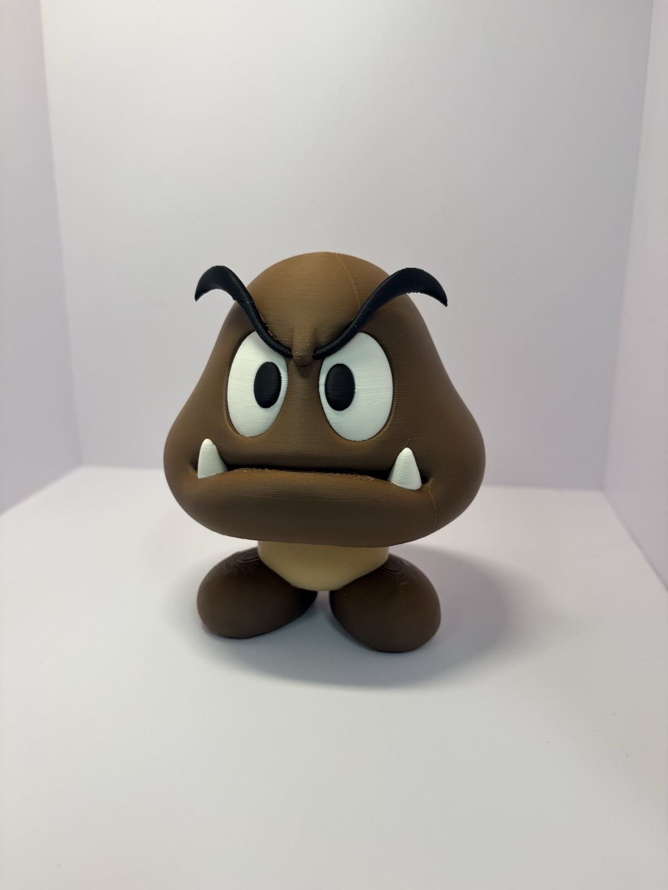
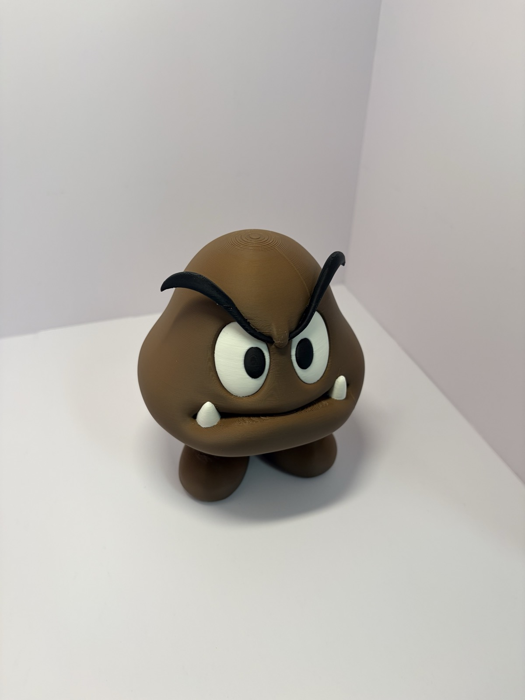

今回はマルチカラーのフィギュアです。
パーカーを着たドナルドと、クリボー。

どちらもH3Cで一度に出力しました。
色ごとにパーツを分けて貼り合わせたのではなく、最初から色が付いた状態で丸ごと出てきたものです。

## 以前なら手が出なかった

マルチカラーのフィギュアは、いつも時間が問題でした。
ノズルが1つだと、色を替えるたびに待って、捨てて……。
色が多いほど、時間が途方もなく増えてしまいます。

そのため、[クッパ](/ja/2026/11/07/bowser-multipart-assembly/)や[フシギダネ](/ja/2026/11/07/bulbasaur-15cm-multipart-print/)は、色ごとにパーツを分けて出力していました。
AMSがなくても出力できるマルチパートモデルです。
出力したあとは、瞬間接着剤で一つずつ貼り合わせていました。

[H3C開封レビュー](/ja/2026/11/07/bambulab-h3c-ams3-unboxing/)では、キーホルダー1個で比較して、P2Sが6時間40分、H3Cが1時間25分でした。
それならフィギュアはどうだろう、と思ったのです。

## ドナルド、約8時間

まずはパーカーを着たドナルド。
黒いパーカーに白い顔、オレンジのくちばしと足、青いズボンと、色がかなり多いです。

出力は約8時間。
これだけ色があると、従来のやり方では途方もない時間がかかったはずです。
でもH3Cは色ごとに別のノズルを使うので、ノズルを切り替えながらそのまま進みます。

## サポートは手でポロポロ

出力が終わって取り出すと、こんな状態です。
出力姿勢の関係で、頭と足のあたりにサポートがかなり付いています。

でも、思ったより簡単に外れます。
手でポロポロ取っていくと、あっという間でした。

外したサポートはこれだけです。

全部外すと、こうなります。

## 完成したドナルド

フードの中の白い顔、パーカーのロゴ、青いズボンまで、色がそのまま再現されています。

後ろから見ると、フードが頭をすっぽり覆っています。

## クリボーも同じ方法で

クリボーも同じ方法で出力しました。
こちらも約8時間です。

頭の下に木のようにサポートがびっしり付きますが、これも難なく片付きました。

茶色い体に白い目、黒い眉毛、歯まで。
後から貼り付けたところはなく、一度で出てきました。

## 最近はマルチカラーモデルばかり探している

これができるようになって、モデルを選ぶ基準が変わりました。

以前はMakerWorldで、まず「AMSなし」のモデルを探していました。
色を替えずに済むよう、パーツに分けてあるモデルです。

最近はその逆です。
AMSで出力するマルチカラーモデルばかり探しています(笑)

## まとめ

- マルチカラーのフィギュア1体で約8時間
- サポートは手でポロポロ外れる
- パーツに分けて貼り合わせる必要がなく、一度で完成

マルチカラーのフィギュアも、設定さえ合わせればH3Cでまとめて完成できるようになった気がします。
その設定を合わせるのがまた大変ではありますが(笑)

マルチカラー出力のとき、どの設定にいちばん気を使っていますか?
コメントで教えていただければ、私も参考にします。

## 動画で見る

2体のフィギュアが出力される様子から完成までを、ショート動画にまとめました。
今回はナレーションを自分の声で入れてみました。
正確には、自分の声を複製したAI音声です(笑)

  <iframe src="https://www.youtube.com/embed/CcLO_yhIbOU" title="Bambu Lab H3Cでマルチカラーフィギュア、約8時間でワンクリック" style="position: absolute; inset: 0; width: 100%; height: 100%; border: 0;" allow="accelerometer; autoplay; clipboard-write; encrypted-media; gyroscope; picture-in-picture; web-share" allowfullscreen loading="lazy"></iframe>

- YouTube: [Bambu Lab H3Cでマルチカラーフィギュア、約8時間でワンクリック](https://www.youtube.com/shorts/CcLO_yhIbOU)

- モデル:MakerWorldからダウンロードしたマルチカラーモデル
