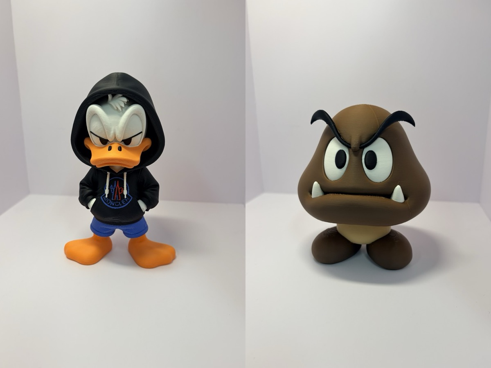
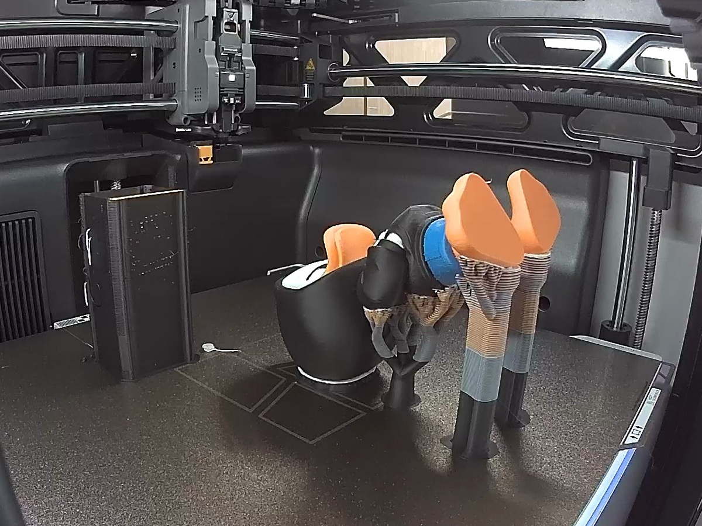
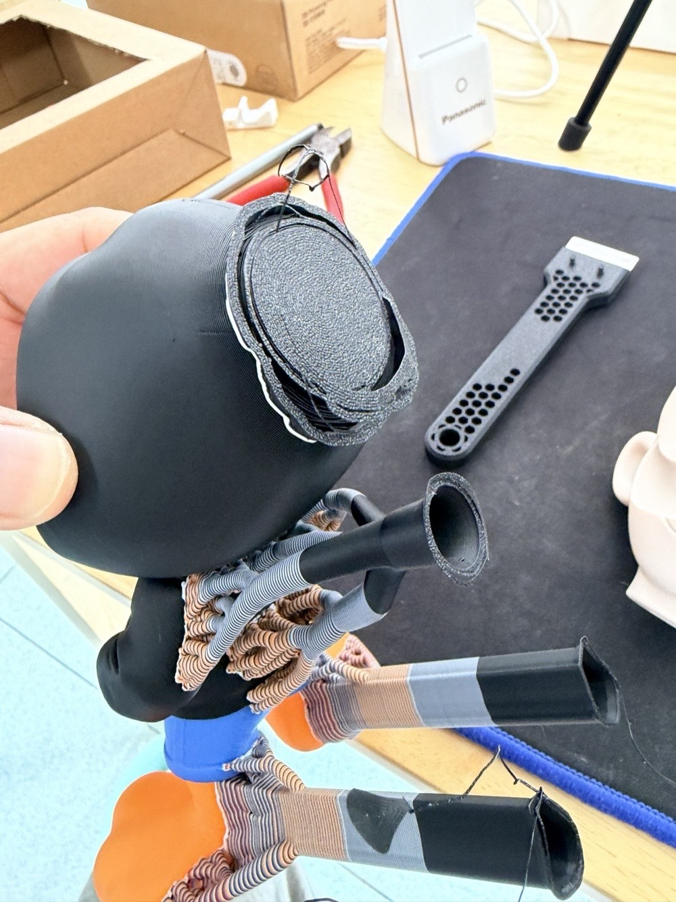
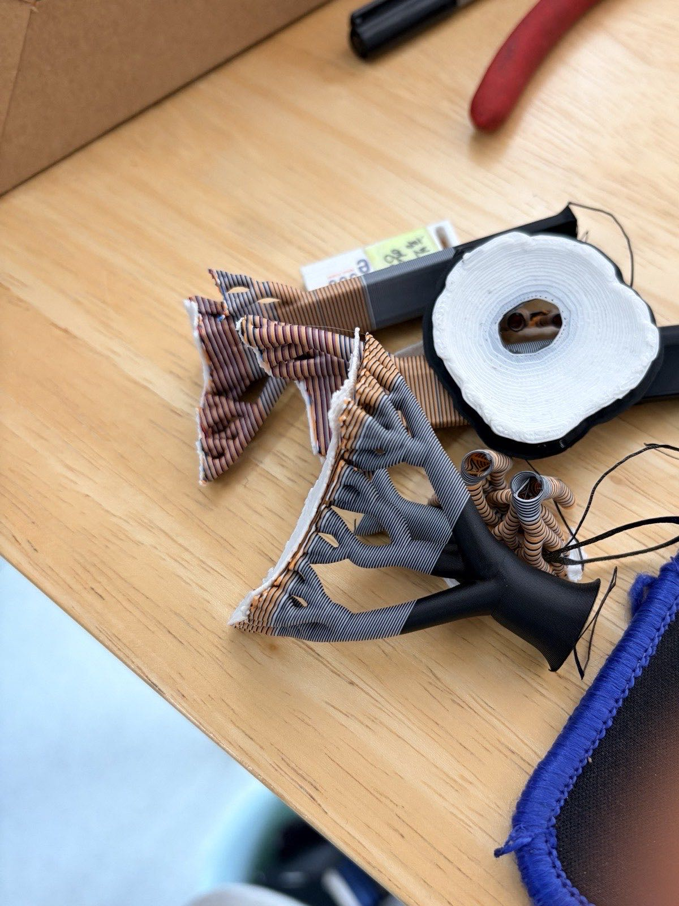
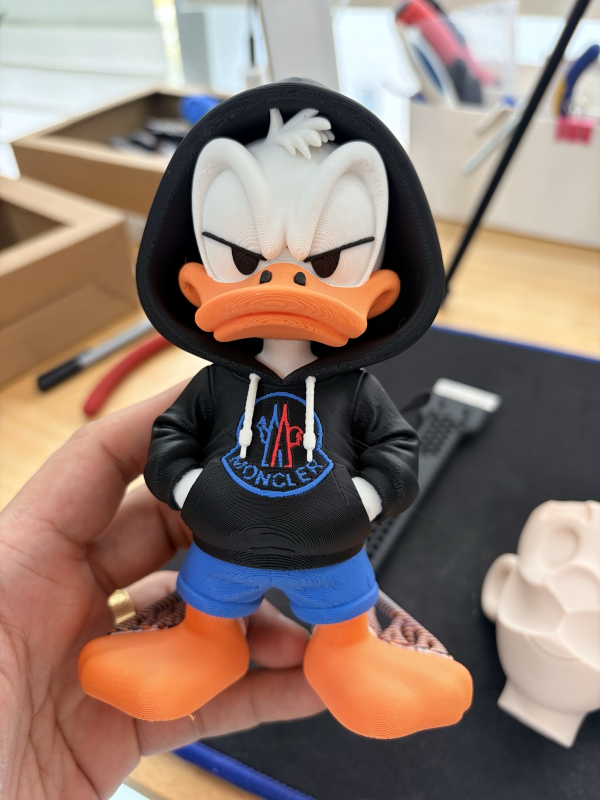
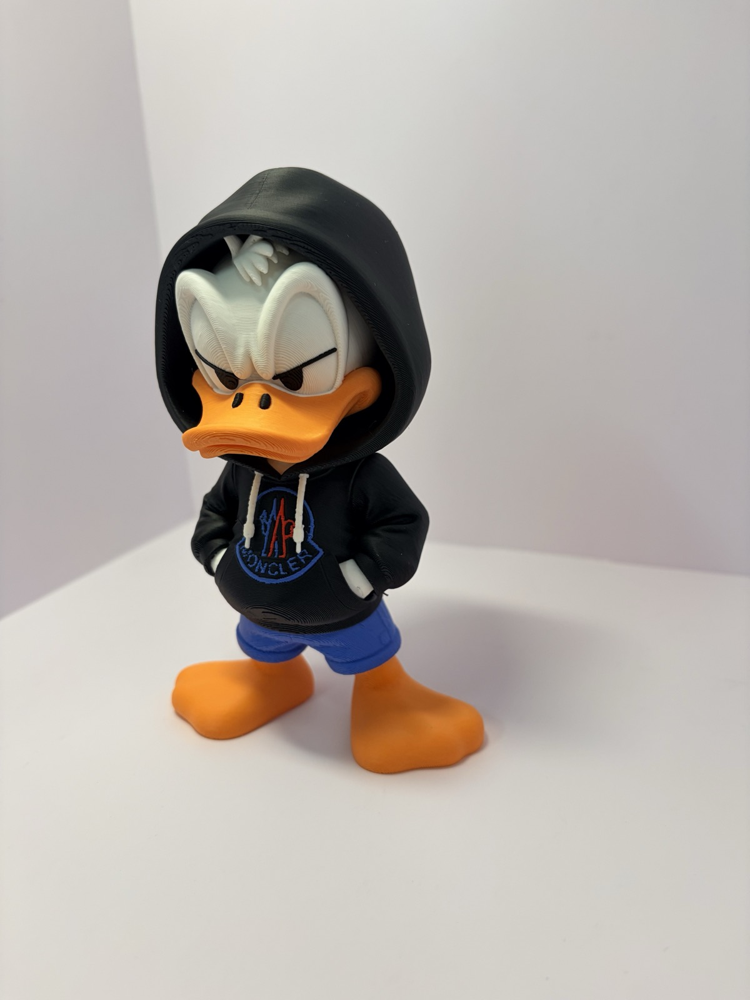
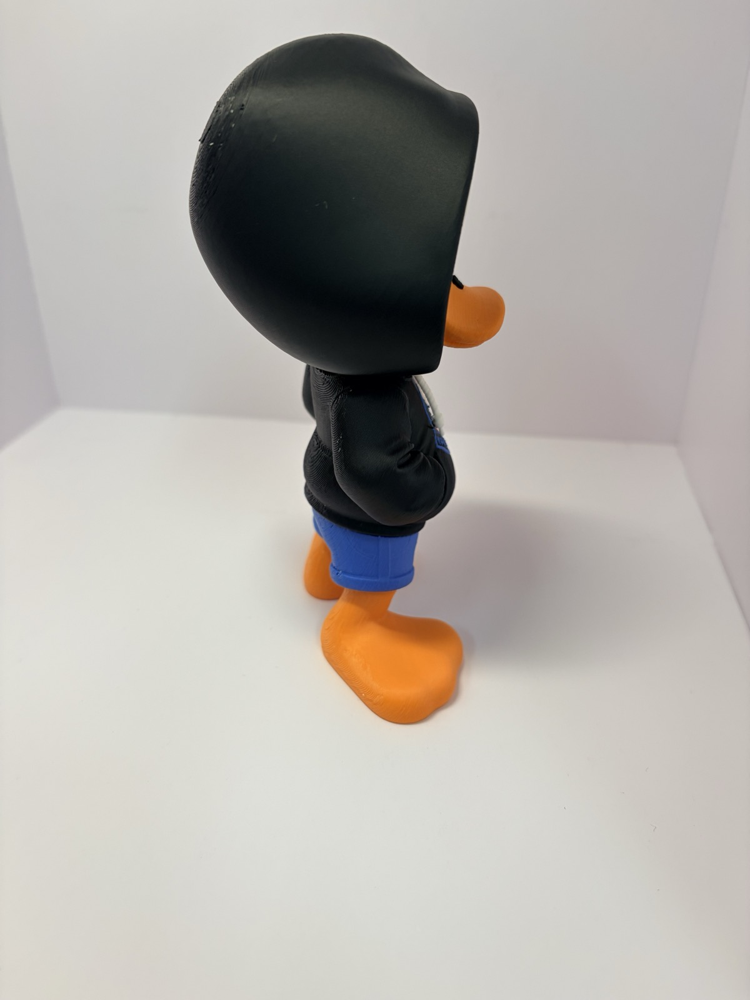
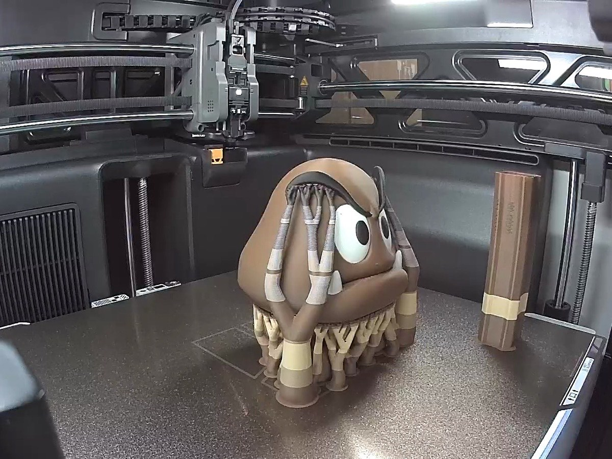
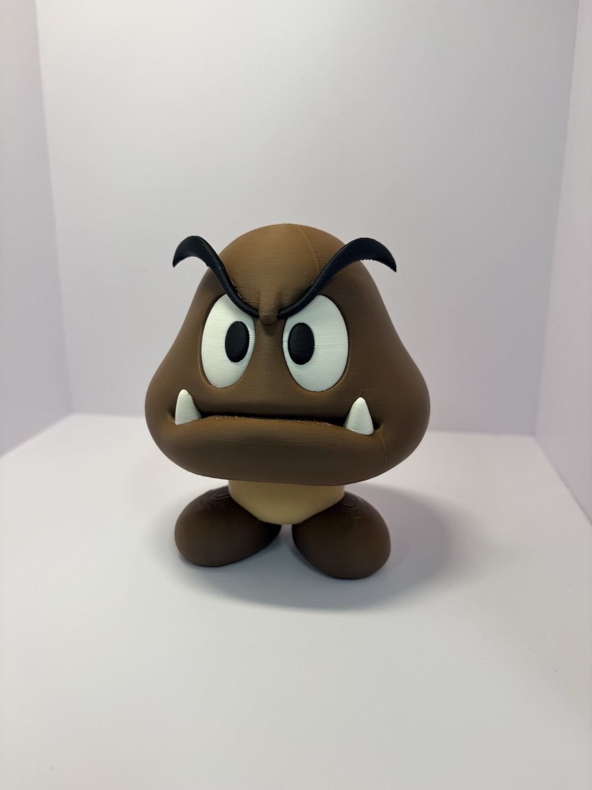
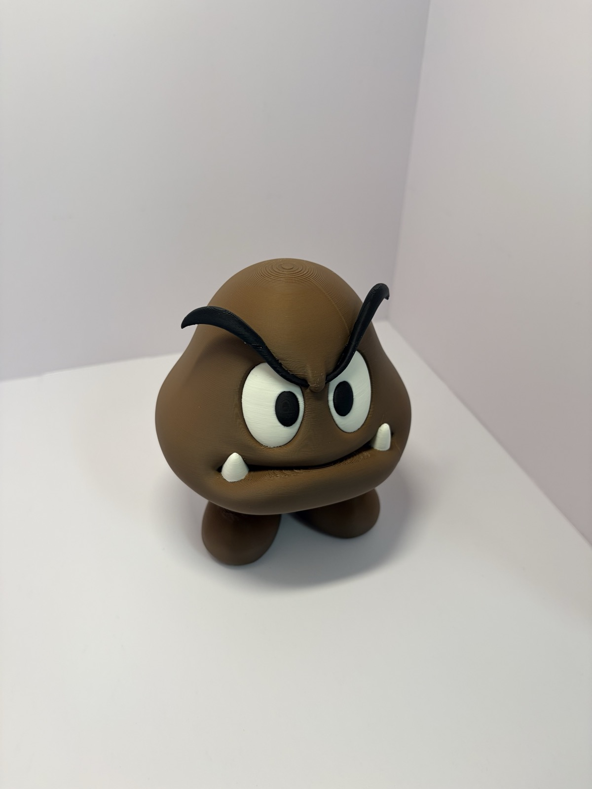

이번엔 다색 피규어다.
후드 입은 도널드랑 굼바.

둘 다 H3C로 한 번에 뽑았다.
색깔별로 조각을 나눠서 붙인 게 아니라, 색이 입혀진 채로 통째로 나온 거다.

## 예전 같으면 엄두가 안 났다

다색 피규어는 늘 시간이 문제였다.
노즐 하나로 색을 바꾸면 바꿀 때마다 기다리고, 버리고...
색이 많을수록 시간이 어마어마하게 늘어난다.

그래서 [쿠파](/2026/11/07/bowser-multipart-assembly/)나 [이상해씨](/2026/11/07/bulbasaur-15cm-multipart-print/)는 색깔별로 조각을 나눠서 뽑았었다.
AMS 없이도 되는 멀티파트 모델로.
뽑고 나서 순간접착제로 하나하나 붙이고 ㅋㅋ

[H3C 개봉기](/2026/11/07/bambulab-h3c-ams3-unboxing/)에서 키링 하나로 비교했을 때 P2S는 6시간 40분, H3C는 1시간 25분이었다.
그럼 피규어는 어떨까 싶었다.

## 도널드, 8시간 안팎

먼저 후드 입은 도널드.
검정 후드에 흰 얼굴, 주황 부리와 발, 파란 바지까지 색이 꽤 많다.

출력은 8시간 안팎.
이 정도 색이면 예전 방식으로는 시간이 어마어마하게 걸렸을 거다.
근데 H3C는 색마다 노즐을 따로 쓰니까, 노즐만 갈아 끼우면서 쭉 간다.

## 서포트는 손으로 톡톡

다 뽑고 꺼내면 이런 모습이다.
출력 자세 때문에 머리 쪽이랑 발 쪽에 서포트가 꽤 붙어 있다.

근데 이게 생각보다 쉽게 떨어진다.
손으로 톡톡 떼어 내니까 금방이더라.

떼어 낸 서포트는 이만큼.

다 떼고 나면 이렇게 된다 ㅎㅎ

## 완성된 도널드

후드 안쪽 흰 얼굴, 후드티 로고, 파란 바지까지 색이 그대로 살아 있다.

뒤에서 보면 후드가 머리를 통째로 덮고 있다.

## 굼바도 같은 방법으로

굼바도 같은 방법으로 뽑았다.
이것도 8시간 안팎.

머리 아래로 서포트가 나무처럼 잔뜩 붙는데, 이것도 어렵지 않게 정리됐다.

갈색 몸통에 흰 눈, 검정 눈썹, 이빨까지.
따로 붙인 데 없이 한 번에 나왔다.

## 요즘은 다색 모델만 찾아 다닌다

이게 되니까 모델 고르는 기준이 바뀌었다.

예전엔 메이커월드에서 "AMS 없음" 모델부터 찾았다.
색을 바꿀 일이 없게 조각으로 나눠 놓은 모델.

요즘은 반대다.
AMS로 뽑는 다색 모델만 찾아 다닌다 ㅋㅋ

## 정리하면

- 다색 피규어 하나에 8시간 안팎
- 서포트는 손으로 톡톡 떨어진다
- 조각 나눠서 붙일 필요 없이 한 번에

다색 피규어도 이제 옵션만 잘 맞추면 H3C로 한 방에 딸깍인 것 같다.
그 옵션 맞추는 게 또 일이긴 하지만 ㅎㅎ

다색 출력하실 때 어떤 설정을 제일 신경 쓰세요?
댓글로 알려주시면 저도 참고해 볼게요.

## 영상으로 보기

두 피규어가 출력되는 모습부터 완성까지 쇼츠로 정리했다.
이번엔 내레이션을 내 목소리로 넣어 봤다.
정확히는 내 목소리를 복제한 AI 음성이다 ㅎㅎ

  <iframe src="https://www.youtube.com/embed/CcLO_yhIbOU" title="뱀부랩 H3C 다색 피규어, 8시간이면 한 방에 딸깍" style="position: absolute; inset: 0; width: 100%; height: 100%; border: 0;" allow="accelerometer; autoplay; clipboard-write; encrypted-media; gyroscope; picture-in-picture; web-share" allowfullscreen loading="lazy"></iframe>

- 유튜브: [뱀부랩 H3C 다색 피규어, 8시간이면 한 방에 딸깍](https://www.youtube.com/shorts/CcLO_yhIbOU)

- 모델: MakerWorld에서 받은 다색 모델
