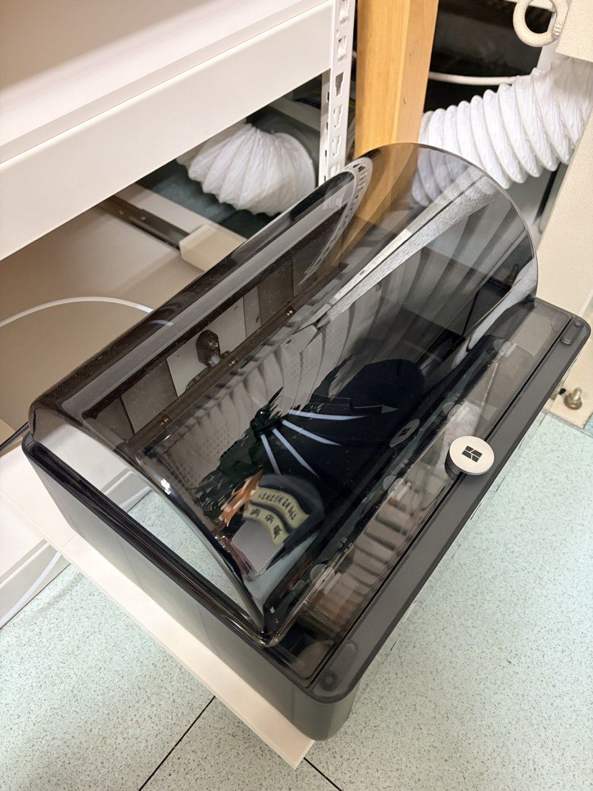
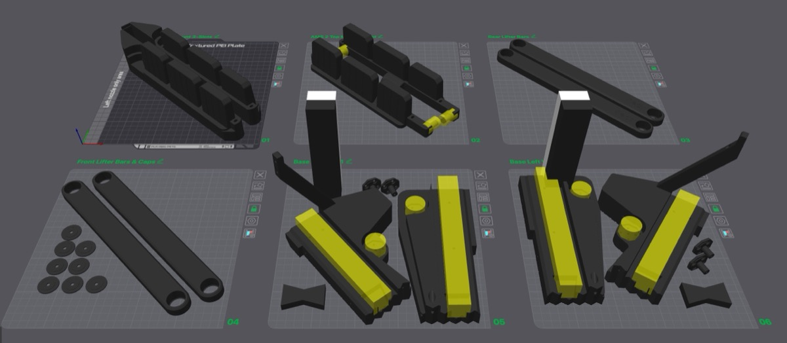
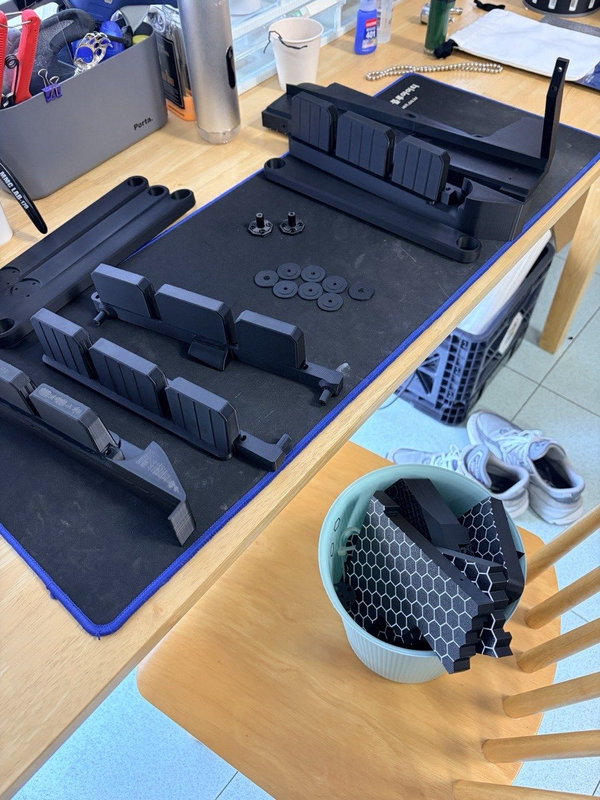
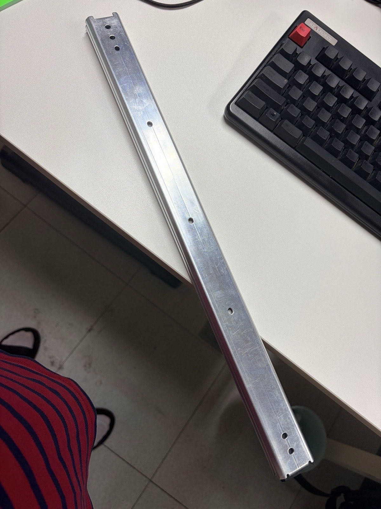
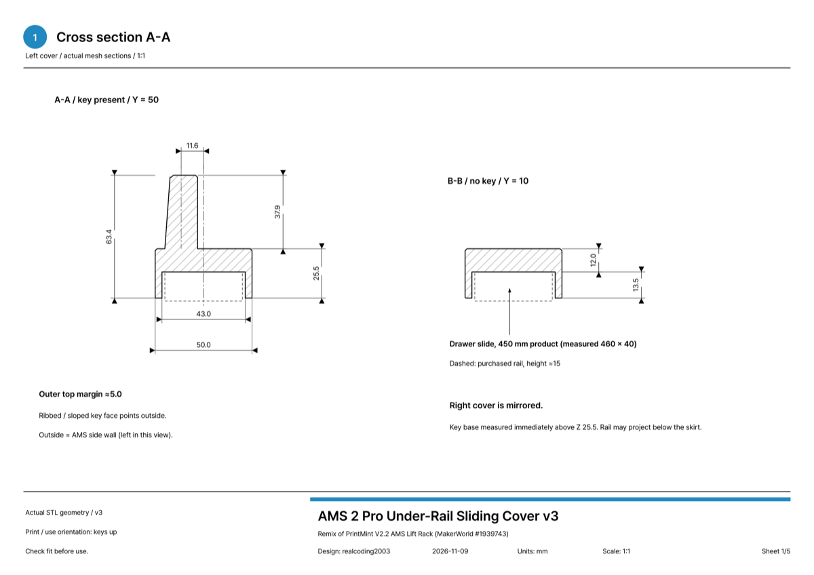
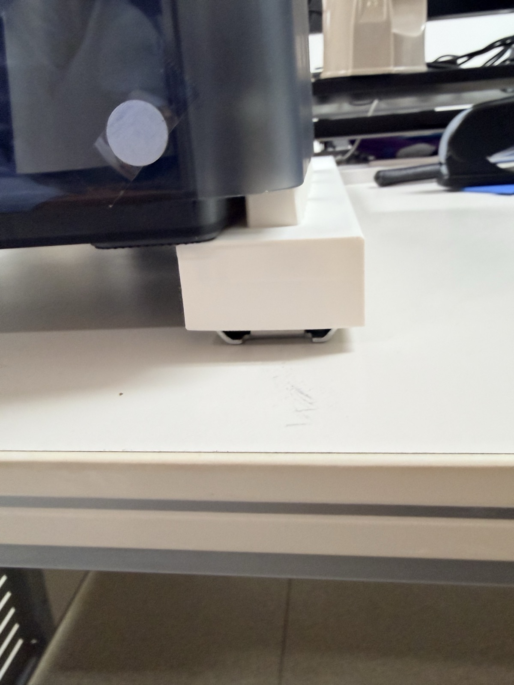
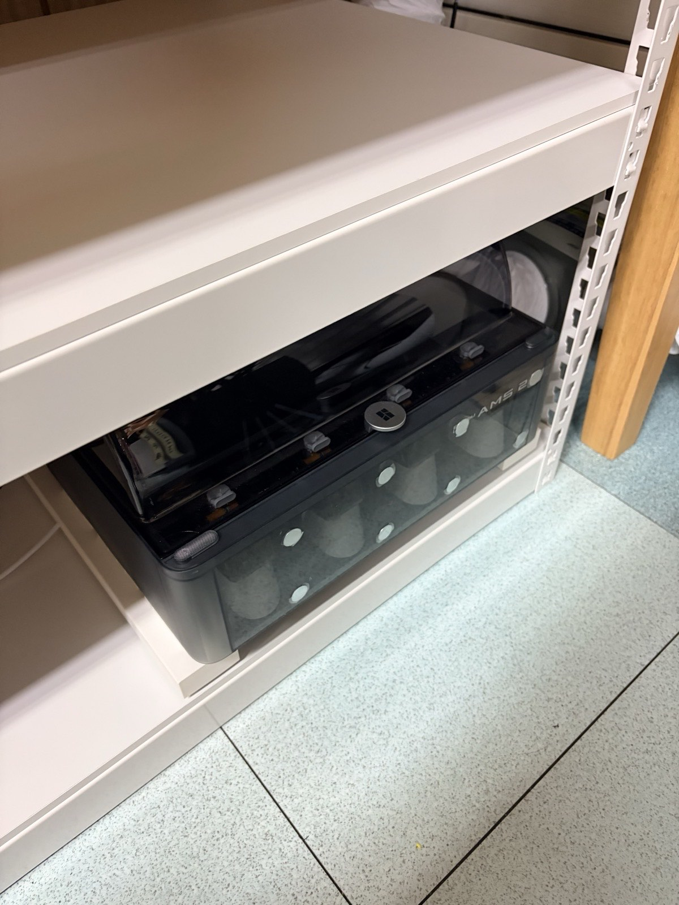
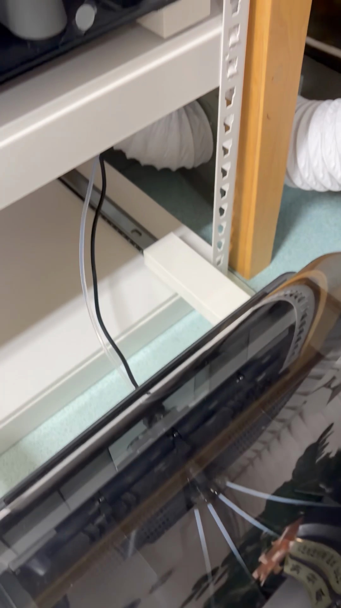
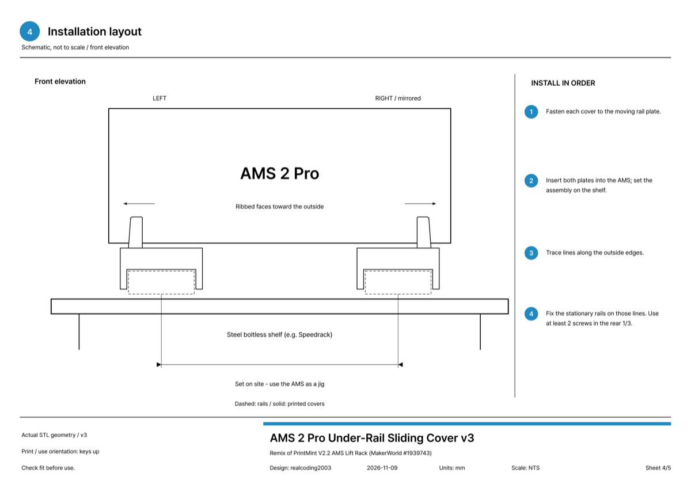

I put two AMS 2 Pro units on the lower shelf of a Speedrack (a cheap Korean steel boltless shelf).
When I need them, I pull them out like a drawer. When I'm done, I push them back in.
The lid opens all the way even while they're pulled out.

The materials are just the Speedrack, drawer slides, and a cover I printed myself.
All together it came to under ₩100,000, haha.

## I Started Out Trying to Build This Model

What first caught my eye on MakerWorld was the [V2.2 AMS Lift Rack](https://makerworld.com/models/1939743) by PrintMint.
The upper AMS lifts on gas springs, and the lower AMS slides out on drawer rails.
It's a well-made model.

But it's six plates.
The print time and filament add up to a ridiculous amount.

I started printing it anyway.
The base, the lifter bars, the AMS cradle, all in black.

But partway through, it just didn't feel right.
I'd still have to buy the hardware separately.
Drawer rails, gas springs, bearings, bolts...
Add the filament for the prints and the materials alone come to ₩200,000–300,000.

That's too much for one AMS stand, ugh.
So I stopped printing there and started a new design with a different approach.

## Could I Combine It with a Speedrack?

Then I thought of the Speedrack.
It's an assembled steel shelf, and it's pretty cheap in Korea.

The Speedrack would be the shelf. All I had to solve was the sliding.

For the sliding, drawer slides (under-rails).
They're ball-bearing rails, so they're smooth, and they're cheap too.

So here's what I decided to try.

- Lay the **drawer slides** flat in two rows, left and right, on a Speedrack plate
- Put a printed **cover** over the moving part of each rail
- On top of the cover, keep the original model's **AMS mounting keys** (the keys that plug into the grooves on the AMS base)

I figured that if the cover hid the rails, it might come out clean.

## What the Cover Looks Like

It's shaped like an upside-down U.
The rail sits in the groove underneath, and three keys stick up from the top.
Those keys slot right into the grooves on the AMS base.

The slides are the 450 mm kind (about 460 mm when you measure them), so the cover is long too.
Too long to print in one piece, so I split it into a front piece (250) and a rear piece (214.5).

The two pieces are joined with bow-tie keys.
The keys hide in a groove on the underside of the cover, so you can't see them from outside.

I left the rear end open on purpose.
If it's closed, it catches on the fixed rail when you pull the slide out.

## What I Fixed After the First Print

I printed the first version and put it on the rail, and...
it was fine.
Much cleaner than I expected, haha.

The keys were in the middle of the cover, though, so the cover stuck out a bit past the AMS.
So I moved the keys to the outer end of the cover, leaving only about 5 mm on the outside.

With the keys moved outward, the cover tucks under the AMS, and the part sticking out to the side shrank a lot.

I put the whole print on one A2L plate.
Left and right front pieces, two rear pieces, and the keys (one is a spare).
It takes about 22 hours and a little over 700 g of filament.
On a printer with a 256 mm bed, split it into two plates, about 12.5 hours + 10 hours.

That's much lighter than the original rack's six plates.

## Installation

The installation steps go like this.

1. Join the front and rear pieces with the bow-tie keys (tap them in with a rubber mallet)
2. Use the holes in the rail's moving plate as a jig, drill 3.2 mm holes in the cover, and fasten it with screws
3. Set the two rails with covers on the shelf while they're still plugged into the AMS
4. Draw a line along the outside of the rails, and fasten the mounting plates to the shelf along that line

Steps 3 and 4 are the trick.
Instead of measuring the left-right spacing with a ruler, you use the AMS as a jig.
You position everything with the AMS still plugged in, so the spacing can't be off.

One thing to watch out for: don't drill any holes within 25 mm of either side of the joint.
The bow-tie key groove is underneath there, so the top plate is thin.

## The Result

Push it in and it slides neatly into the shelf like this.

Pull it and it slides right out.
Look underneath and you can see the white cover sitting over the rail.
The cover hides the rails, so it looks as clean as I'd hoped.

Here's what it cost.

| Item | Cost |
|---|---|
| Speedrack | about ₩40,000 |
| Drawer slides, 2 pairs (for 2 AMS units) | about ₩40,000 |
| Cover printing | a little over 700 g of PLA |
| **Total** | **under ₩100,000** |

Here are the parts I used (Korean shops):

- Shelf: [Speedrack standard storage shelf](https://speedrack.co.kr/product/%EC%8A%A4%ED%94%BC%EB%93%9C%EB%9E%99-%EC%9D%BC%EB%B0%98-%EC%88%98%EB%82%A9%EC%84%A0%EB%B0%98/99/category/29/display/1/) — you pick the width, depth and height to fit your space
- Drawer slides: [the ones I bought on Coupang](https://www.coupang.com/vp/products/9745419126?vendorItemId=86042668434) — 450 mm 3-section ball-bearing slides, sold as a pair with screws. In Korea they're also sold as "table rails" or "rice-cooker rails". Any similar ~18" slide should work.

Something that would have cost ₩200,000–300,000 came in under ₩100,000.
And I got a lower shelf as a bonus, lol.

## What's Next

Right now, two pairs of drawer slides hold two AMS 2 Pro units.
I'm planning to add about two more on the lower shelf.
One pair of slides and one cover set gets you one more unit.

I plan to use the leftover space as filament storage.

## Drawings and Model Files

I've uploaded it to MakerWorld.
It includes a one-plate A2L print profile, a two-plate profile for 256 mm bed printers (P1S, X1, P2S, etc.), and a PDF with the dimensions.

- MakerWorld: [AMS 2 Pro Sliding Mount on Drawer Slides](https://makerworld.com/models/3574866-ams-2-pro-sliding-mount-on-drawer-slides)

For the key shape, I used the original model's AMS 2 mounting keys as they are.
So I registered it as a remix of the original.
The original creator is PrintMint, and the original is the [V2.2 AMS Lift Rack](https://makerworld.com/models/1939743).

Even if your rail length or shelf is different, you should be able to adapt it from the dimensions in the drawing.

## Summary

- Building the AMS lift rack as designed: ₩200,000–300,000 with hardware
- Speedrack + drawer slides + a printed cover: under ₩100,000
- Left-right spacing is set by using the AMS as a jig

Combining what's lying around instead of buying expensive parts has its own charm, haha.

Where do you keep your AMS?
If you have a better storage method, let me know in the comments.

## Watch the Video

I put the whole story into a Short, from the half-printed original rack to the finished install.
The narration is an AI clone of my own voice again, haha.

  <iframe src="https://www.youtube.com/embed/cgMnIAW3yCA" title="Sliding AMS 2 Pro Storage: Speedrack + Under-Rails for Under ₩100,000" style="position: absolute; inset: 0; width: 100%; height: 100%; border: 0;" allow="accelerometer; autoplay; clipboard-write; encrypted-media; gyroscope; picture-in-picture; web-share" allowfullscreen loading="lazy"></iframe>

- YouTube: [Sliding AMS 2 Pro Storage: Speedrack + Under-Rails for Under ₩100,000](https://www.youtube.com/shorts/cgMnIAW3yCA)
