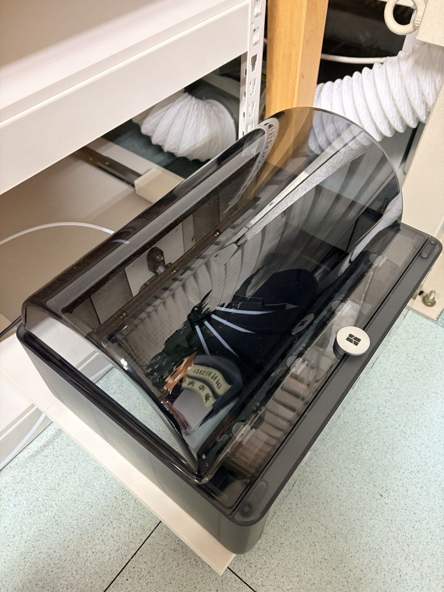
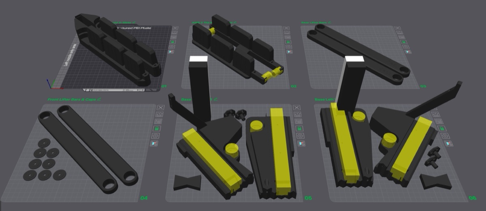
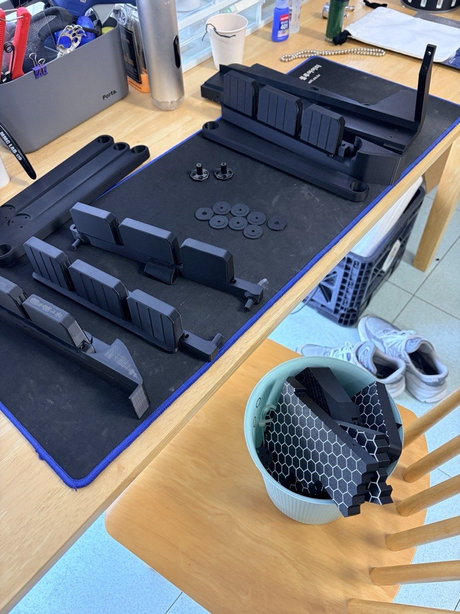
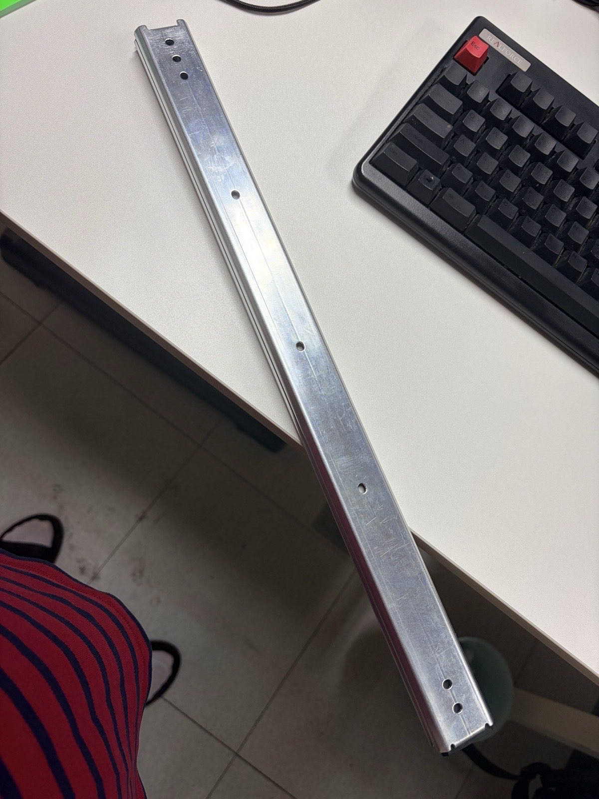
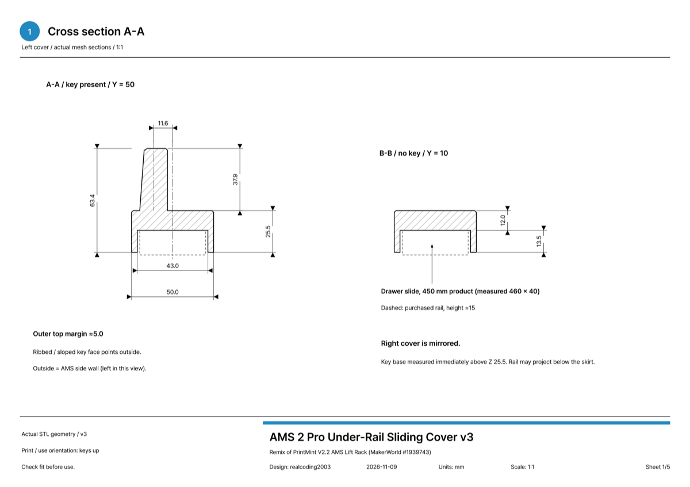
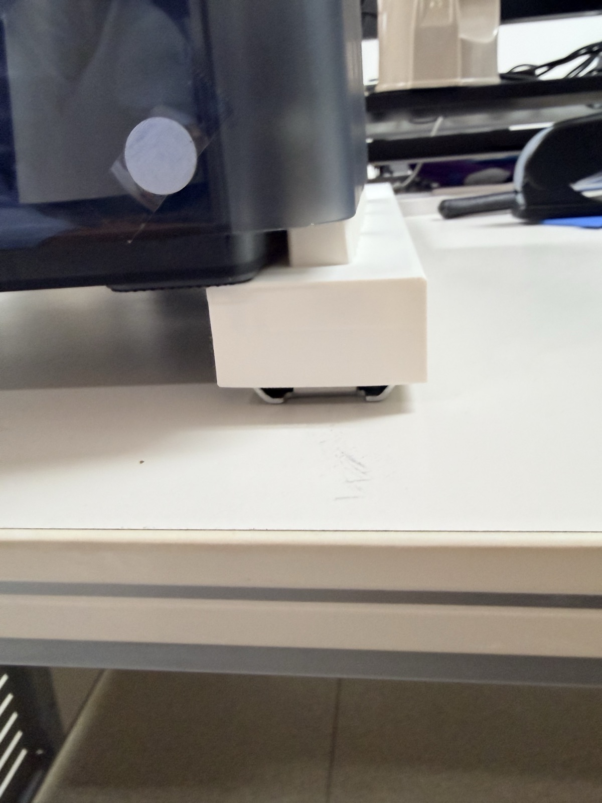
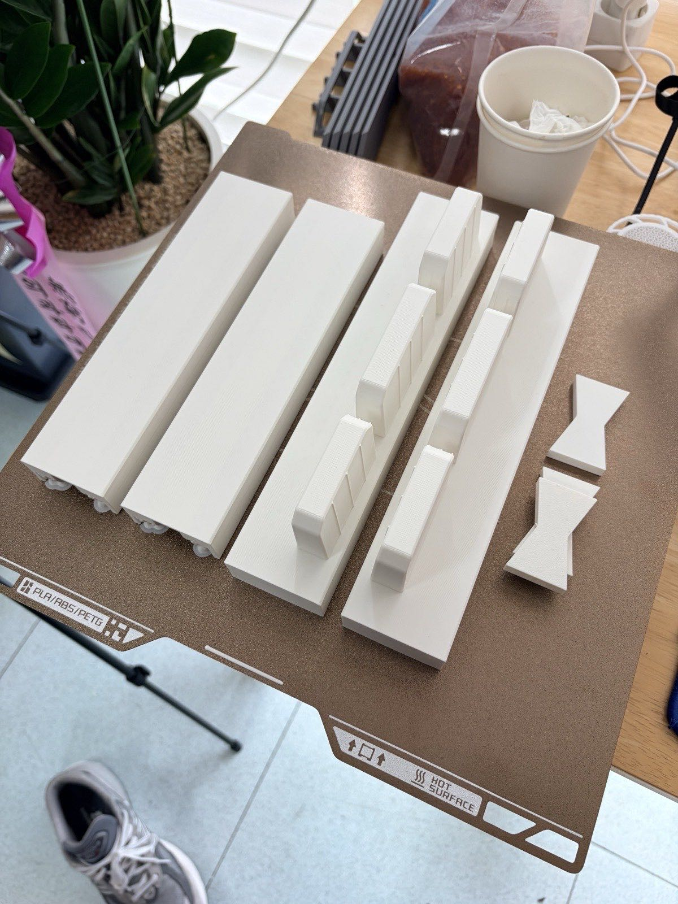
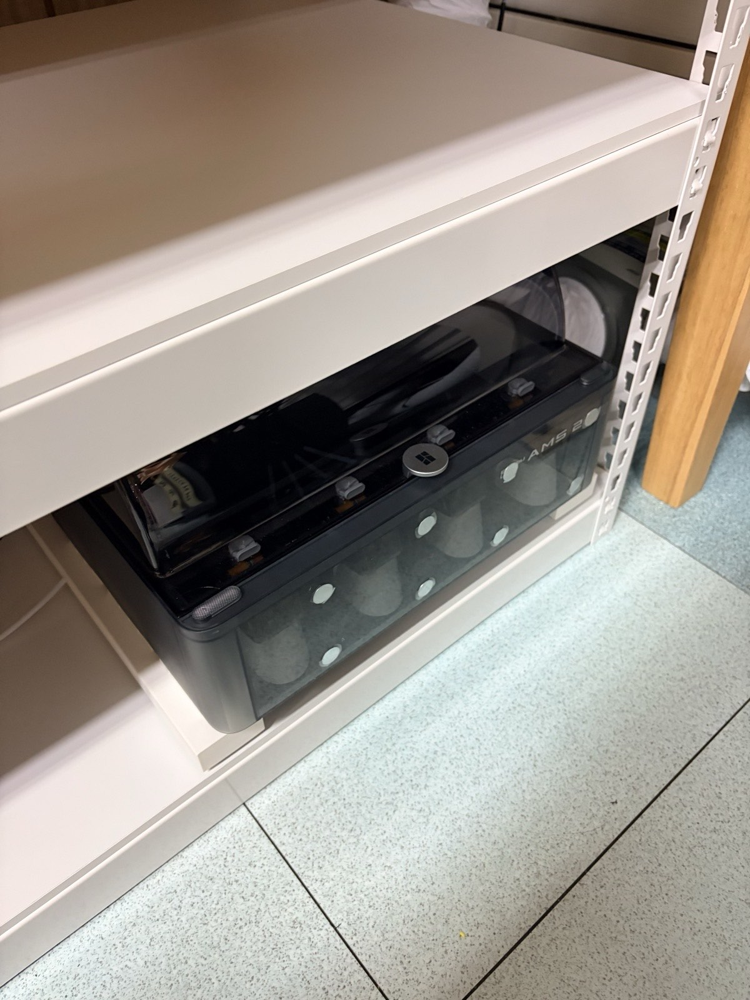
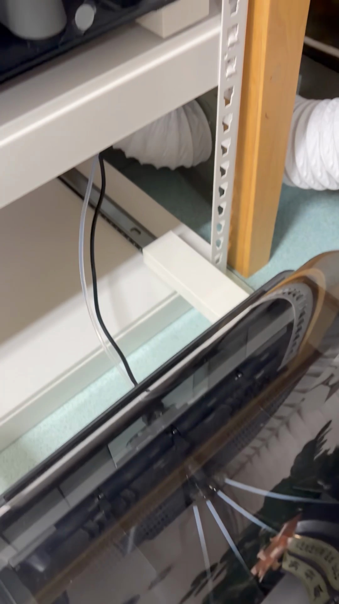
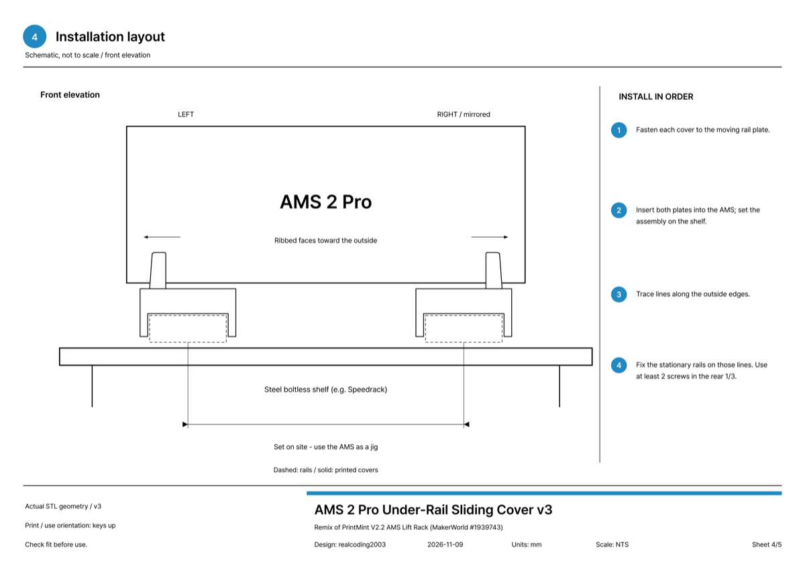

AMS 2 Pro 2台を、Speedrack（韓国の組み立て式スチールラック）の下段に入れました。
使うときは引き出しのように手前にスッと引き出し、使い終わったらまた押し込みます。
引き出したままでも、フタは全開にできます。

材料はSpeedrack、引き出しレール、そして自分で出力したカバーだけです。
全部合わせても10万ウォンかかりませんでした（笑）。

## 最初はこのモデルを作るつもりだった

最初に目に留まったのは、MakerWorldの[V2.2 AMS Lift Rack](https://makerworld.com/models/1939743)（PrintMint作）でした。
上段のAMSはガススプリングで持ち上げ、下段のAMSは引き出しレールで引き出す構造です。
よくできたモデルです。

でも、板が6枚あります。
出力時間もフィラメントもとんでもない量になります。

とりあえず出力を始めました。
ベース、リフターバー、AMSの受け台まで、黒でずらっと。

でも出力している途中で、これは違うなと思いました。
部品は別に買わないといけません。
引き出しレール、ガススプリング、ベアリング、ボルト……。
出力に使うフィラメントまで入れると、材料費だけで20〜30万ウォン。

AMSの台ひとつにこれはさすがに……。
なので出力はそこで止めて、別の方法で設計し直すことにしました。

## Speedrackと組み合わせられないか

そこでSpeedrackを思い出しました。
組み立て式のスチール棚で、韓国ではかなり安く売られています。

棚はSpeedrackを使い、解決すべきはスライドだけです。

スライドには、引き出し用のレール（アンダーレール）を使います。
ボールベアリングのレールで動きが滑らかで、これも安いです。

そこで、こうしてみることにしました。

- Speedrackの板の上に**引き出しレール**を左右2本、寝かせて敷く
- レールの可動板の上に、出力した**カバー**をかぶせる
- カバーの上面には、元のモデルの**AMS取り付けキー**（AMS底面の溝に差し込むキー）をそのまま活かす

レールをカバーで隠してしまえば、きれいに仕上がるのでは？と思いました。

## カバーはこんな形

逆さにしたコの字型です。
下の溝にレールが入り、上面にはキーが3つ立っています。
このキーがAMS底面の溝にスッと差し込まれます。

レールは450 mmの製品（実測では約460 mm）なので、カバーも長くなります。
一度に出力するには長すぎるので、前の部品（250）と後ろの部品（214.5）に分けました。

2つの部品は蝶型キー（バタフライキー）でつなぎます。
キーはカバー下面の溝に隠れるので、外からは見えません。

後ろの端はわざと開けてあります。
塞いでしまうと、レールを引いたときに固定側のレールに引っかかるからです。

## 一度出力して直したところ

最初のバージョンを出力して載せてみたら……
問題ありませんでした。
思っていたよりずっときれいでした（笑）。

ただ、キーがカバーの真ん中にあるせいで、カバーがAMSの外側に少しはみ出しました。
そこで、キーをカバーの外側の端に移しました。
外側には5 mmほどだけ残して。

キーが外側に寄った分、カバーがAMSの下に入り込み、横にはみ出す部分がぐっと減りました。

出力はA2Lの1枚にすべて載せました。
左右の前の部品、後ろの部品2つ、キー（1つは予備）。
22時間ほど、フィラメントは700 g強です。
256 mmベッドのプリンターなら、2枚に分けて12時間半＋10時間ほどです。

元のラックの6枚に比べれば、ずっと軽いです。

## 取り付け

取り付けの手順はこうです。

1. 蝶型キーで前後の部品をつなぐ（ゴムハンマーでトントン）
2. レールの可動板の穴をジグ代わりにして、カバーに3.2 mmの穴を開け、ビスで固定する
3. カバーを付けたレール2本を、AMSに差し込んだまま棚に載せる
4. レールの外側に線を引き、その線に合わせて固定板を棚に取り付ける

3と4がコツです。
左右の間隔を定規で測る代わりに、AMSをジグとして使います。
AMSに差したままの状態で位置を決めるので、間隔が狂うことはありません。

ひとつ注意するのは、継ぎ目の前後25 mm以内には穴を開けないことです。
その下に蝶型キーの溝があって、上板が薄いからです。

## 結果

押し込むと、このように棚の中にスッと収まります。

引くとスーッと出てきます。
下を見ると、レールの上に白いカバーがかぶさっているのが分かります。
レールがカバーに隠れて、思っていたとおりきれいです。

費用はこのとおりです。

| 項目 | 費用 |
|---|---|
| Speedrack | 約4万ウォン |
| 引き出しレール2組（AMS 2台分） | 約4万ウォン |
| カバーの出力 | PLA 700 g強 |
| **合計** | **10万ウォン以下** |

使った材料のリンクも残しておきます（韓国のショップです）。

- 棚：[スピードラック 一般収納棚](https://speedrack.co.kr/product/%EC%8A%A4%ED%94%BC%EB%93%9C%EB%9E%99-%EC%9D%BC%EB%B0%98-%EC%88%98%EB%82%A9%EC%84%A0%EB%B0%98/99/category/29/display/1/) — 設置スペースに合わせて幅・奥行き・高さを選んで注文できます
- 引き出しレール：[Coupangで買った製品](https://www.coupang.com/vp/products/9745419126?vendorItemId=86042668434) — 3段ボールベアリングの450 mm、1組（2本）でネジ付き。韓国では「テーブルレール」「炊飯器レール」という名前でも売られています。同じくらいのサイズなら他の製品でも使えるはずです

20〜30万ウォンかかるところを、10万ウォン以内で済ませました。
おまけに下段の棚までできました（笑）。

## これから

今は引き出しレール2組で、AMS 2 Proが2台入っています。
下段にあと2台ほど入れるつもりです。
引き出しレール1組とカバー1セットで、もう1台入ります。

余ったスペースは、フィラメントの保管庫にする予定です。

## 図面とモデルファイル

MakerWorldにアップしておきました。
A2L 1枚用と、256 mmベッド（P1S・X1・P2Sなど）用の2枚構成の出力プロファイル、それに寸法図のPDFも一緒に入れてあります。

- MakerWorld: [AMS 2 Pro Sliding Mount on Drawer Slides](https://makerworld.com/models/3574866-ams-2-pro-sliding-mount-on-drawer-slides)

キーの形は、元のモデルのAMS 2取り付け部をそのまま使いました。
そのため、元のモデルのリミックスとして登録しています。
原作者はPrintMint、元のモデルは[V2.2 AMS Lift Rack](https://makerworld.com/models/1939743)です。

レールの長さや棚が違っても、図面の寸法を見れば応用できると思います。

## まとめ

- AMSリフトラックをそのまま作ると、部品込みで20〜30万ウォン
- Speedrack＋引き出しレール＋出力したカバーで、10万ウォン以下
- 左右の間隔は、AMSをジグにして合わせる

高い部品の代わりに、身近なものを組み合わせるのは、こういう面白さがありますね（笑）。

みなさんはAMSをどこに置いて使っていますか？
もっと良い収納方法があれば、コメントで教えてください。

## 動画で見る

元のラックを途中まで出力したところから設置までを、ショート動画にまとめました。
今回もナレーションは自分の声を複製したAI音声です(笑)

  <iframe src="https://www.youtube.com/embed/cgMnIAW3yCA" title="AMS 2 Proをスライド収納、スピードラック+アンダーレールで10万ウォン未満" style="position: absolute; inset: 0; width: 100%; height: 100%; border: 0;" allow="accelerometer; autoplay; clipboard-write; encrypted-media; gyroscope; picture-in-picture; web-share" allowfullscreen loading="lazy"></iframe>

- YouTube: [AMS 2 Proをスライド収納、スピードラック+アンダーレールで10万ウォン未満](https://www.youtube.com/shorts/cgMnIAW3yCA)
