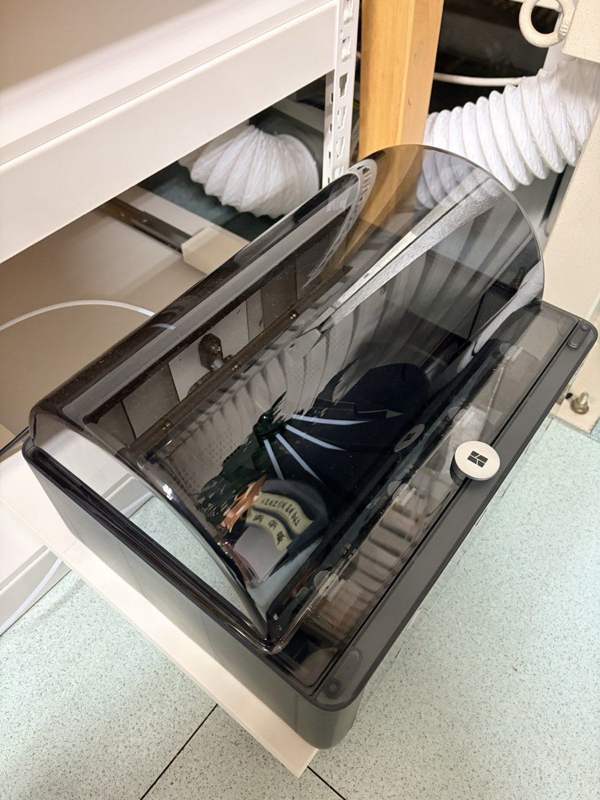
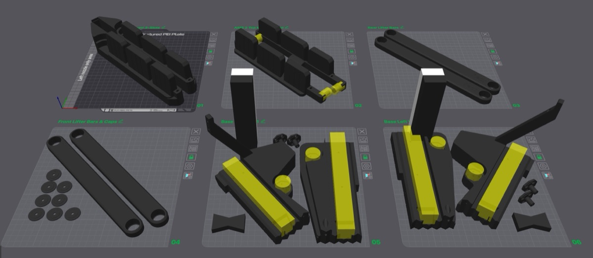
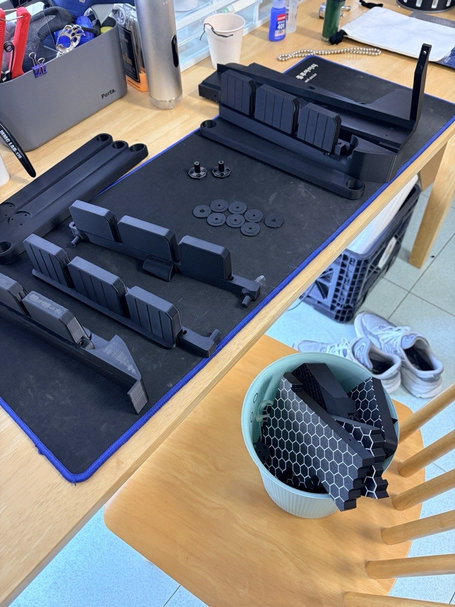
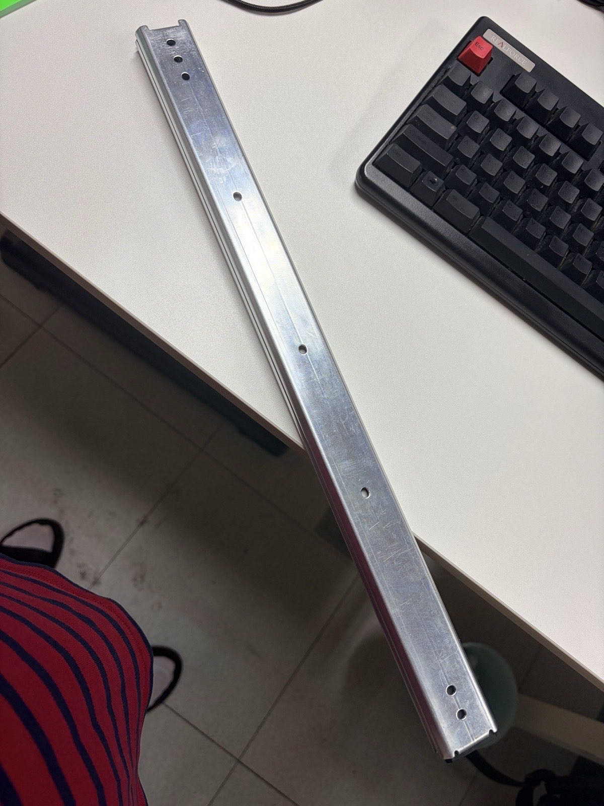
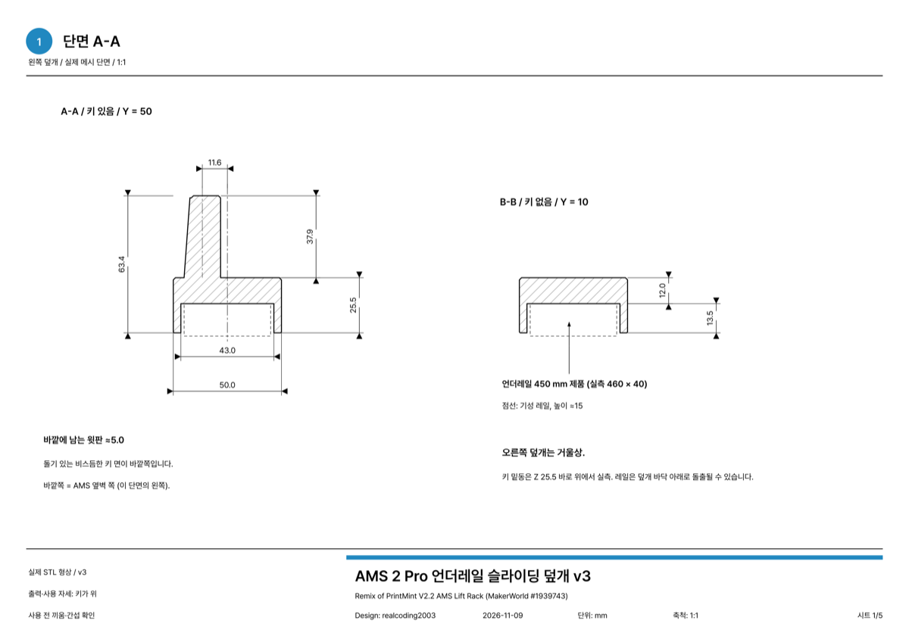
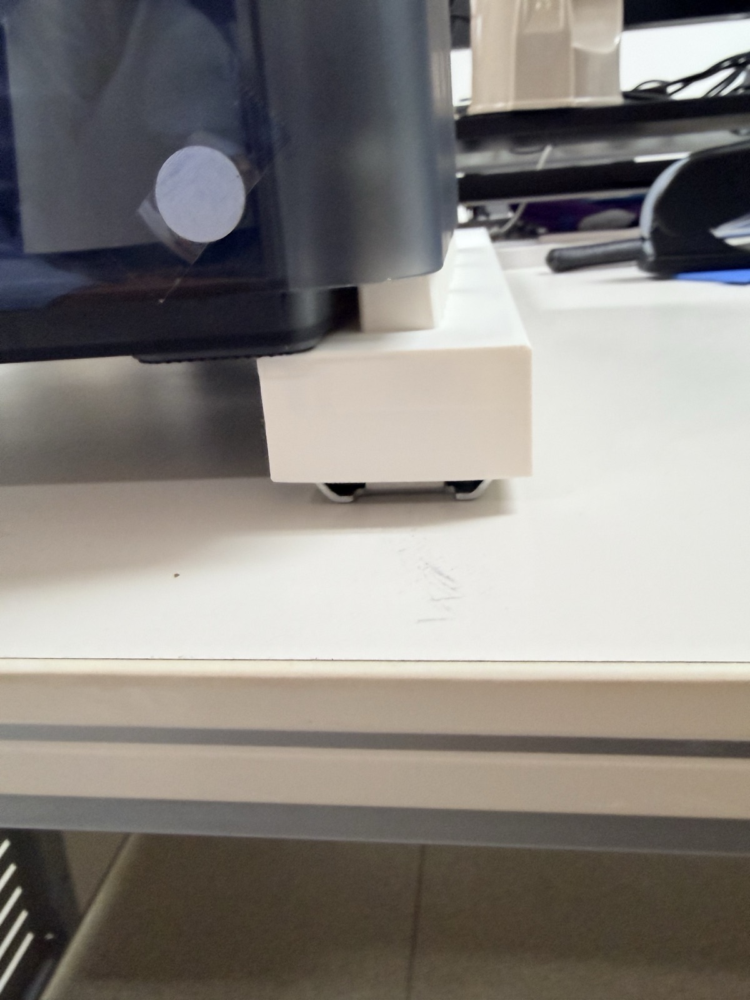
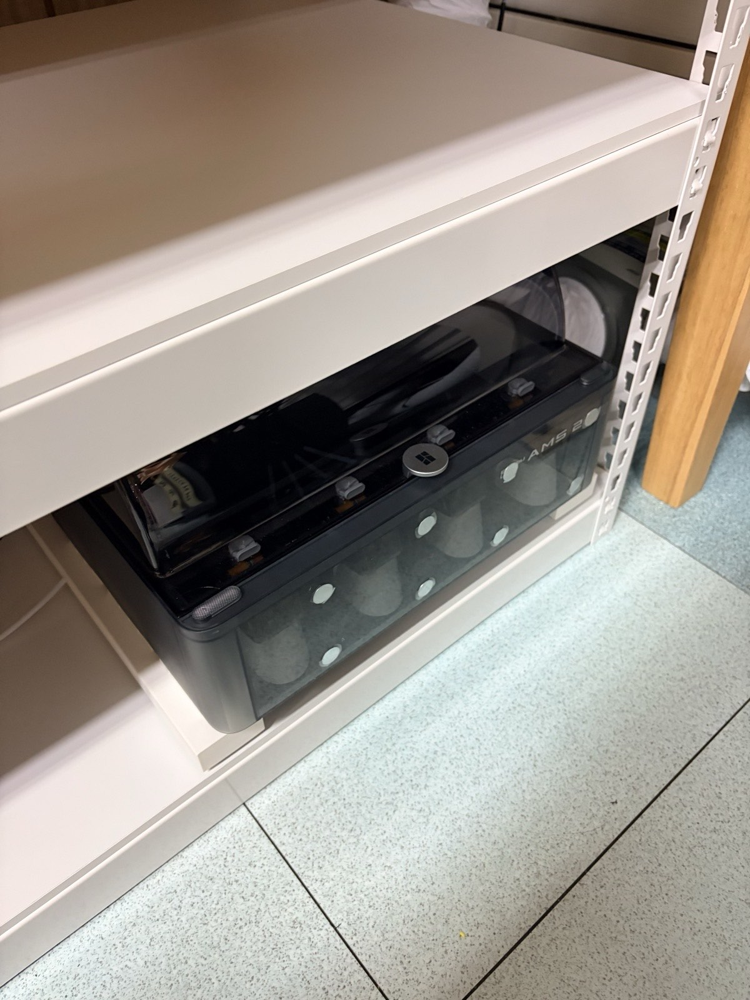
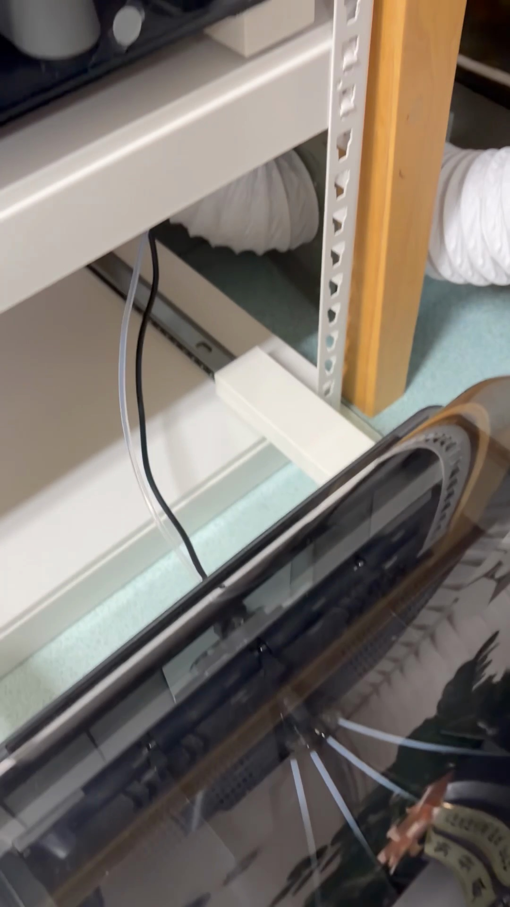
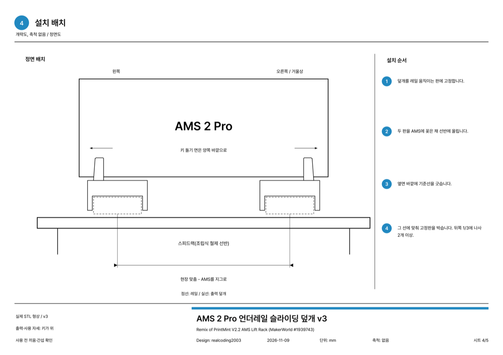

AMS 2 Pro 두 대를 스피드랙 아래 칸에 넣었다.
쓸 때는 서랍처럼 앞으로 쭉 빼고, 다 쓰면 다시 밀어 넣는다.
빼 놓은 채로 뚜껑도 활짝 열린다.

재료는 스피드랙, 언더레일, 그리고 직접 출력한 덮개가 전부다.
다 합쳐도 10만원이 안 들었다 ㅎㅎ

## 처음엔 이 모델을 만들려고 했다

처음 눈에 들어온 건 메이커월드의 [V2.2 AMS Lift Rack](https://makerworld.com/models/1939743)(PrintMint)이었다.
위 칸 AMS는 가스 스프링으로 들어 올리고, 아래 칸 AMS는 서랍 레일로 빼는 구조다.
잘 만든 모델이다.

근데 판이 여섯 장이다.
출력 시간이랑 필라멘트가 어마어마하게 나온다.

그래도 일단 뽑기 시작했다.
베이스, 리프터 바, AMS 받침까지 검정으로 쭉.

근데 뽑다 보니 이건 아니다 싶더라.
부속을 또 따로 사야 한다.
서랍 레일, 가스 스프링, 베어링, 볼트...
출력에 들어간 필라멘트까지 치면 재료비만 20~30만원.

AMS 받침대 하나에 이건 좀 아니지 ㅠㅠ
그래서 출력은 거기서 멈추고, 다른 방법으로 설계를 새로 하기로 했다.

## 스피드랙이랑 조합할 수 없을까

그러다 스피드랙이 떠올랐다.
조립식 철제 선반인데 우리나라에서 꽤 싸게 판다.

선반은 스피드랙으로 쓰고, 슬라이딩만 해결하면 되는 거다.

슬라이딩은 서랍용 언더레일로.
볼베어링 레일이라 부드럽고, 이것도 싸다.

그래서 이렇게 해 보기로 했다.

- 스피드랙 판 위에 **언더레일**을 좌우로 두 줄 눕혀서 깐다
- 레일의 움직이는 판 위에 출력한 **덮개**를 씌운다
- 덮개 윗면에는 원본 모델의 **AMS 연결부**(AMS 바닥 홈에 꽂히는 키)를 그대로 살린다

언더레일을 덮개로 가려 버리면 깔끔하게 나오지 않을까? 싶었다.

## 덮개는 이렇게 생겼다

뒤집힌 ㄷ자 모양이다.
아래 홈에 레일이 들어가고, 윗면에 키 3개가 솟아 있다.
이 키가 AMS 바닥 홈에 쏙 꽂힌다.

레일이 450 mm짜리라(실제로 재 보면 460 정도) 덮개도 길다.
한 번에 뽑기엔 길어서 앞 조각(250)과 뒤 조각(214.5)으로 나눴다.

두 조각은 나비 모양 쐐기로 잇는다.
쐐기는 덮개 아랫면 홈에 숨겨서 밖에서는 안 보인다.

뒤끝은 일부러 열어 뒀다.
막아 두면 레일을 당길 때 고정된 레일에 걸린다.

## 한 번 뽑아 보고 고친 것

첫 버전을 뽑아서 올려 보니까...
괜찮았다.
생각보다 훨씬 깔끔했다 ㅎㅎ

다만 키가 덮개 가운데에 있다 보니 덮개가 AMS 바깥으로 좀 튀어나왔다.
그래서 키를 덮개 바깥쪽 끝으로 옮겼다.
바깥쪽에 5 mm 정도만 남기고.

키가 바깥으로 간 만큼 덮개가 AMS 밑으로 들어가서, 옆으로 튀어나오는 게 확 줄었다.

출력은 A2L 한 판에 전부 올렸다.
왼쪽·오른쪽 앞 조각, 뒤 조각 두 개, 쐐기(하나는 여분).
22시간 정도, 필라멘트는 700 g 남짓이다.
256 mm 베드 프린터라면 두 판으로 나눠서 12시간 반 + 10시간 정도.

원본 랙의 여섯 판에 비하면 훨씬 가볍다.

## 설치

설치 순서는 이렇다.

1. 나비 쐐기로 앞·뒤 조각을 잇는다(고무망치로 톡톡)
2. 레일의 움직이는 판 구멍을 지그 삼아 덮개에 3.2 mm 구멍을 뚫고 피스로 고정한다
3. 덮개 단 레일 두 개를 AMS에 꽂은 채로 선반에 올린다
4. 레일 바깥에 선을 긋고, 그 선에 맞춰 고정판을 선반에 박는다

3~4번이 요령이다.
좌우 간격을 자로 재는 대신 AMS를 지그처럼 쓰는 거다.
AMS에 꽂힌 그대로 위치를 잡으니까 간격이 틀릴 일이 없다.

한 가지 주의할 건, 이음 앞뒤 25 mm 안에는 구멍을 뚫으면 안 된다.
그 아래에 쐐기 홈이 있어서 윗판이 얇다.

## 결과

밀어 넣으면 이렇게 선반 안에 쏙 들어간다.

당기면 쭉 나온다.
아래를 보면 레일 위에 흰 덮개가 씌워져 있는 게 보인다.
레일이 덮개에 가려져서 생각했던 대로 깔끔하다.

비용은 이렇게 들었다.

| 항목 | 비용 |
|---|---|
| 스피드랙 | 약 4만원 |
| 언더레일 2쌍 (AMS 2대분) | 약 4만원 |
| 덮개 출력 | PLA 700 g 남짓 |
| **합계** | **10만원 이하** |

재료 링크도 남겨 둔다.

- 스피드랙: [스피드랙 일반 수납선반](https://speedrack.co.kr/product/%EC%8A%A4%ED%94%BC%EB%93%9C%EB%9E%99-%EC%9D%BC%EB%B0%98-%EC%88%98%EB%82%A9%EC%84%A0%EB%B0%98/99/category/29/display/1/) — 공간에 맞춰 가로·깊이·높이를 골라 주문하면 된다
- 언더레일: [쿠팡에서 산 제품](https://www.coupang.com/vp/products/9745419126?vendorItemId=86042668434) — 3단 볼베어링 450 mm, 1조(2개)에 피스 포함. '식탁레일', '밥통레일'이라는 이름으로 다른 곳에서도 판다

20~30만원 들 걸 10만원 안에 끝냈다.
덤으로 하부 선반까지 생겼다 ㅋㅋ

## 앞으로

지금은 언더레일 두 쌍으로 AMS 2 Pro 두 대가 들어가 있다.
아래 칸에 두 대 정도 더 넣을 생각이다.
언더레일 한 쌍에 덮개 한 벌이면 한 대가 더 들어간다.

남는 칸은 필라멘트 보관함으로 쓰려고 한다.

## 도면이랑 모델 파일

메이커월드에 올려 뒀다.
A2L 한 판짜리와 256 mm 베드(P1S·X1·P2S 등)용 두 판짜리 프린트 프로파일, 그리고 치수 도면 PDF도 같이 넣었다.

- 메이커월드: [AMS 2 Pro Sliding Mount on Drawer Slides](https://makerworld.com/models/3574866-ams-2-pro-sliding-mount-on-drawer-slides)

키 모양은 원본 모델의 AMS 2 연결부를 그대로 썼다.
그래서 원본의 리믹스로 등록했다.
원작자는 PrintMint, 원본은 [V2.2 AMS Lift Rack](https://makerworld.com/models/1939743)이다.

레일 길이나 선반이 달라도 도면 치수를 보면 응용할 수 있을 거다.

## 정리하면

- AMS 리프트 랙을 그대로 만들면 부속까지 20~30만원
- 스피드랙 + 언더레일 + 출력한 덮개로 10만원 이하
- 좌우 간격은 AMS를 지그로 써서 맞춘다

비싼 부품 대신 주변에 있는 걸 조합하는 게 이런 맛이 있다 ㅎㅎ

다들 AMS는 어디에 두고 쓰세요?
더 좋은 수납 방법 있으면 댓글로 알려 주세요.

## 영상으로 보기

원본 랙을 뽑다가 멈춘 이야기부터 설치까지 쇼츠로 정리했다.
이번에도 내레이션은 내 목소리를 복제한 AI 음성이다 ㅎㅎ

  <iframe src="https://www.youtube.com/embed/cgMnIAW3yCA" title="AMS 2 Pro 슬라이딩 수납, 스피드랙 + 언더레일로 10만원 이하" style="position: absolute; inset: 0; width: 100%; height: 100%; border: 0;" allow="accelerometer; autoplay; clipboard-write; encrypted-media; gyroscope; picture-in-picture; web-share" allowfullscreen loading="lazy"></iframe>

- 유튜브: [AMS 2 Pro 슬라이딩 수납, 스피드랙 + 언더레일로 10만원 이하](https://www.youtube.com/shorts/cgMnIAW3yCA)
