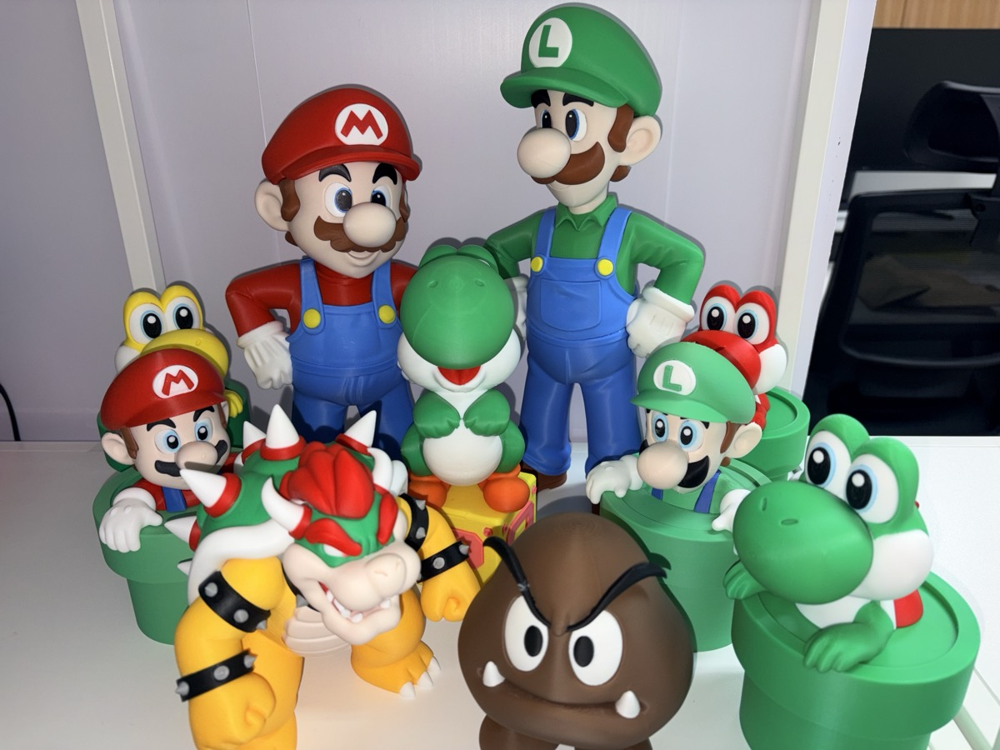
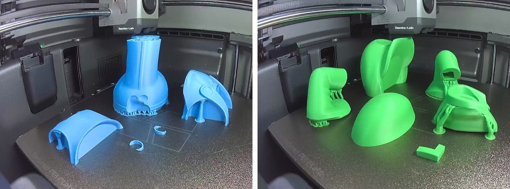
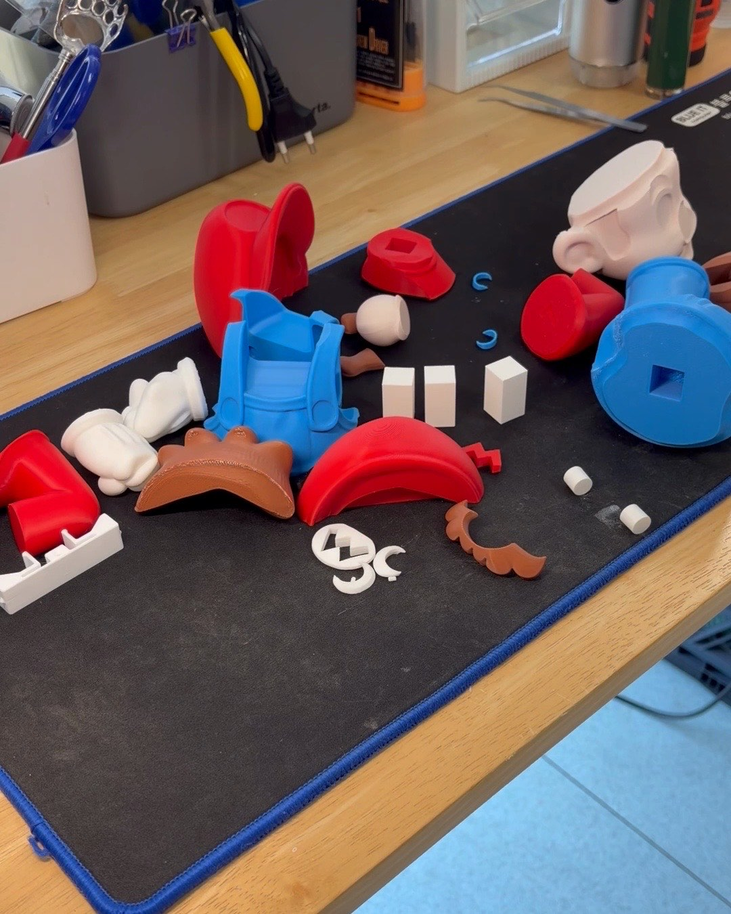
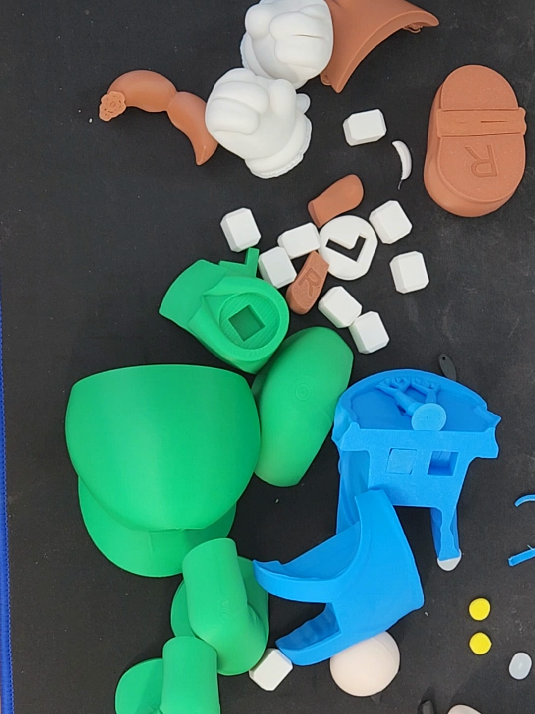
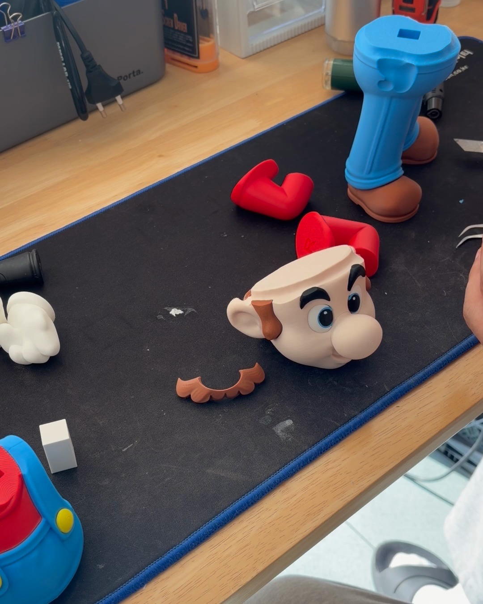
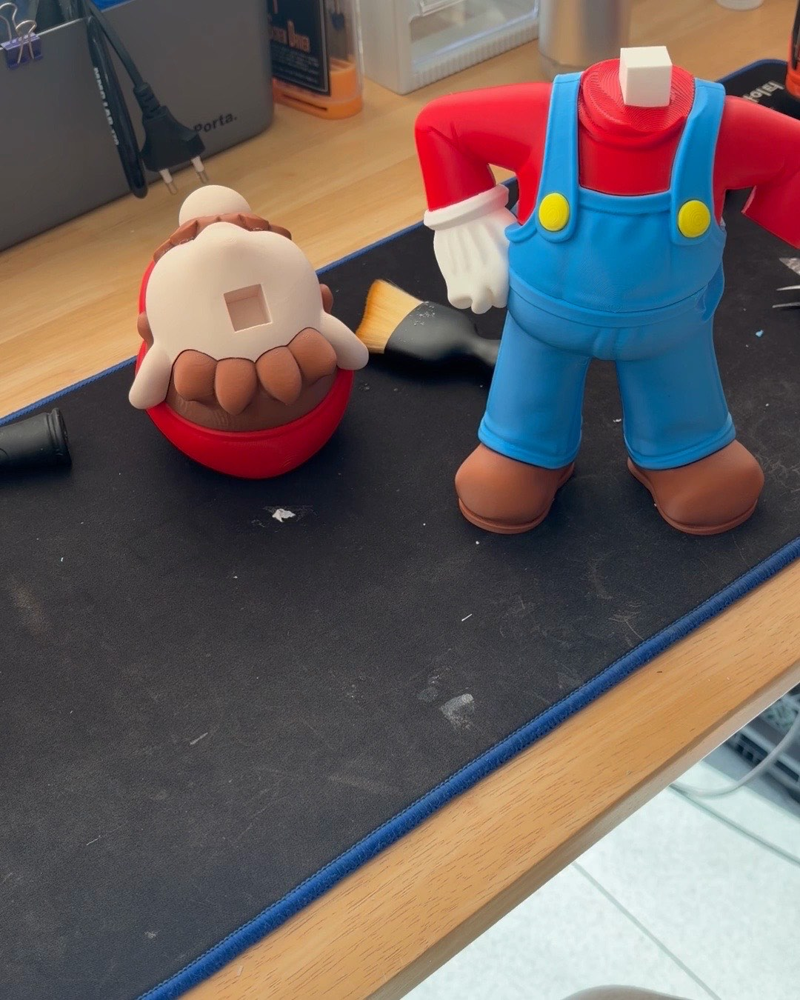
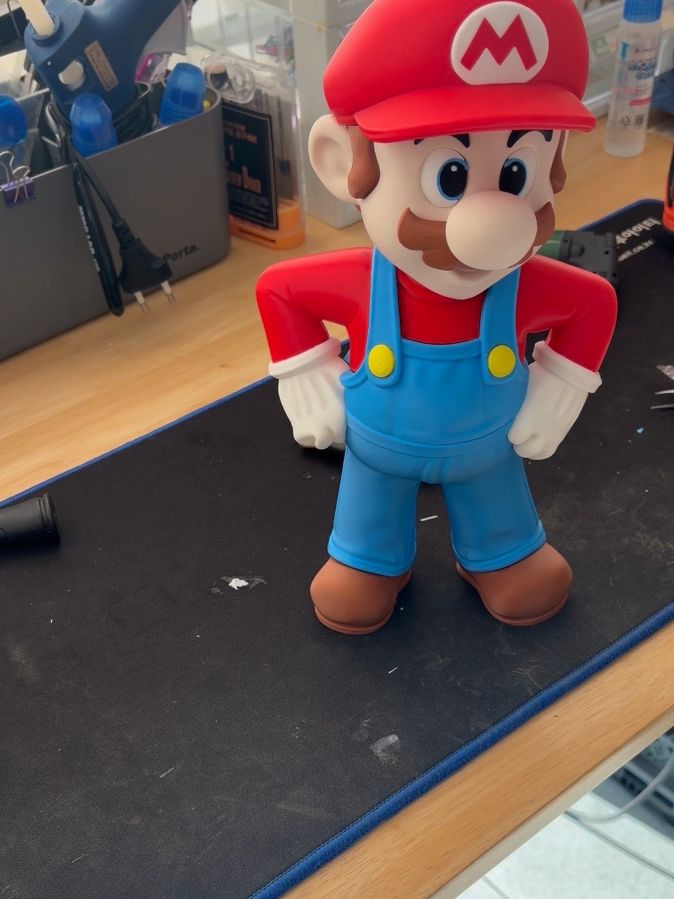
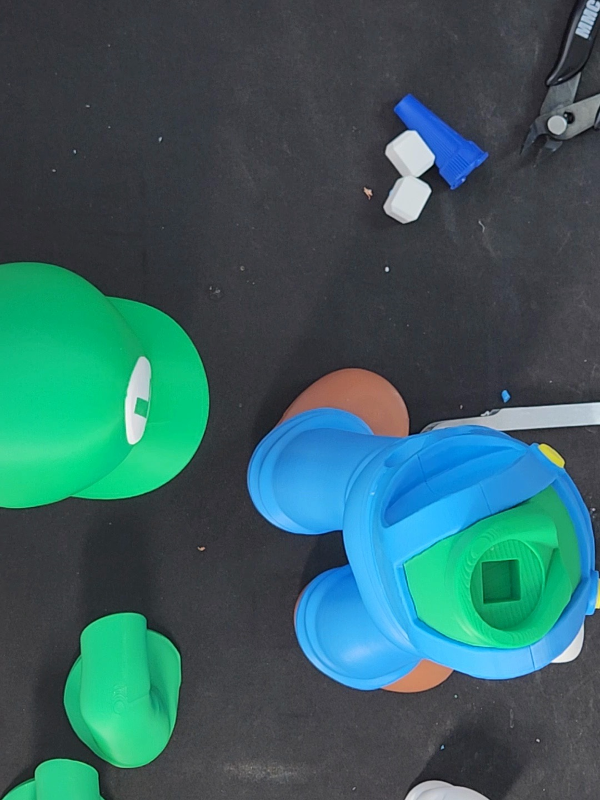
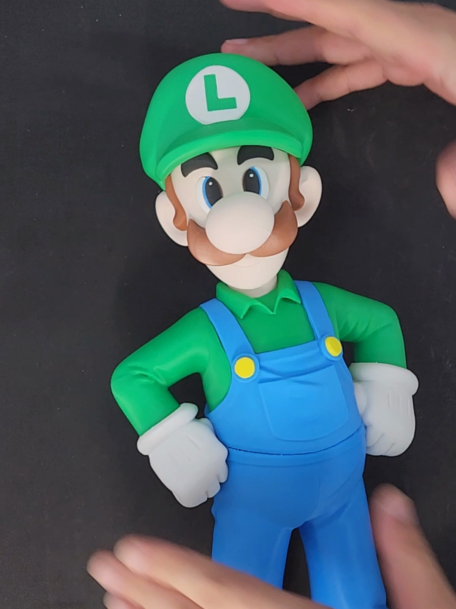
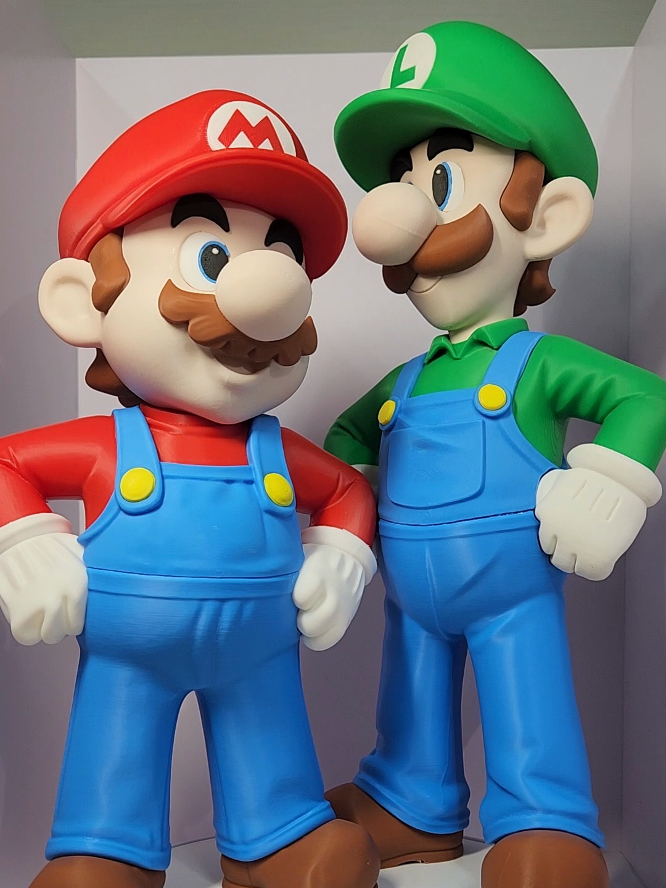

Once I finished [Bowser](/en/2026/11/07/bowser-multipart-assembly/), the shelf felt a little empty.
Bowser without Mario just seems wrong.

So this time it's Mario and Luigi.
I made the brothers together.

## Separate colors again

Like Bowser, both are multipart figures: printed in separate pieces by color, then joined afterward.

Each plate is a single color.
On the left are Mario's blue overalls and legs, on the right Luigi's green cap and shirt.
Blue, green, white, brown, yellow... every color got its own print run.

Mario first.
The red cap and arms, the blue overalls, the white gloves, the brown hair and mustache are all separate pieces.

The pieces connect with square white pins.
You push a pin into a hole and fix it with glue.
Because the pin is square, it doesn't spin around and stays put once it's in.

This is Luigi.
Apart from the green cap and shirt, the parts are almost the same as Mario's.

But the blue overalls had a ton of supports attached.
Removing them was more work than I expected...
I cleaned them up one by one with a knife and nippers, and quite a lot of time went by before I even started assembling.

## I changed how I filmed

I assembled Mario on November 7 and Luigi the next day.

For Mario, I propped my phone up at an angle on the desk.
For Luigi, I tried shooting from above...
and my hands kept drifting out of the frame.
When I attached the face pieces, I was working almost at the edge of the screen.

Put together, the footage comes to about 40 minutes for Mario, in two sessions, and 56 minutes for Luigi, in one.
All the support cleanup time ended up on Luigi's side.

## The face took the most work

Once again, the face took the longest.

The eyes are split into tiny white, blue, and black pieces.
I pick them up with tweezers and attach them one at a time.
Mario's face alone came to almost 6 minutes of video.

Only after the eyes are on and the mustache goes up does Mario's face finally appear.

## Mario without a head

Push the torso onto the legs, add the gloved arms, and this is what you get.
A Mario with no head.

The upside-down piece on the left is the head with the cap on.
You slide it onto the white pin sticking out of the neck, and that's it.

Mario is done.

## Luigi from above

Luigi goes together in the same order.
Shooting from above makes it easy to see the green torso going into the overalls.

After attaching the torso, I left it lying down for more than 10 minutes.
Let's say I was waiting for the glue to cure.

Finally, I attached the arms and head, stood him up, and Luigi was done.

## The brothers, side by side

I put the two on a turntable together.
Watching them turn slowly, I completely lost track of time.

Luigi is a little taller.
Just like in the games.

And then there's the photo at the very top.
I stood them next to the other characters I've printed one by one.
Bowser is there, and so is [the Goomba I printed on the H3C](/en/2026/11/08/bambulab-h3c-multicolor-figure/), and Yoshi too.
Now it finally feels like a family.

## A video to zone out to

I made this video a little differently.
It starts with the parts printing, then Mario on the left and Luigi on the right are assembled at the same time.
I didn't speed it up. The idea is to show each gluing step slowly.

I wanted to use the original Mario music for the background...
but I found out the original tune stays under copyright even if you recreate it in code.
So I made a new track that only keeps the 8-bit feel.

I hope it works as a video you can just leave on and zone out to.

  <iframe src="https://www.youtube.com/embed/sedkCEygUiM" title="Mario & Luigi, Built Side by Side | Calm 3D-Printed Figure Assembly" style="position: absolute; inset: 0; width: 100%; height: 100%; border: 0;" allow="accelerometer; autoplay; clipboard-write; encrypted-media; gyroscope; picture-in-picture; web-share" allowfullscreen loading="lazy"></iframe>

If you just want the short version, here is the Short.

  <iframe src="https://www.youtube.com/embed/ejELZAjMKug" title="Mario & Luigi, one piece at a time" style="position: absolute; inset: 0; width: 100%; height: 100%; border: 0;" allow="accelerometer; autoplay; clipboard-write; encrypted-media; gyroscope; picture-in-picture; web-share" allowfullscreen loading="lazy"></iframe>

- YouTube video: [Mario & Luigi, Built Side by Side | Calm 3D-Printed Figure Assembly](https://www.youtube.com/watch?v=sedkCEygUiM)
- YouTube Short: [Mario & Luigi, one piece at a time](https://www.youtube.com/shorts/ejELZAjMKug)

Who should I build next?
If there's a Mario character you'd like to see, let me know in the comments.
