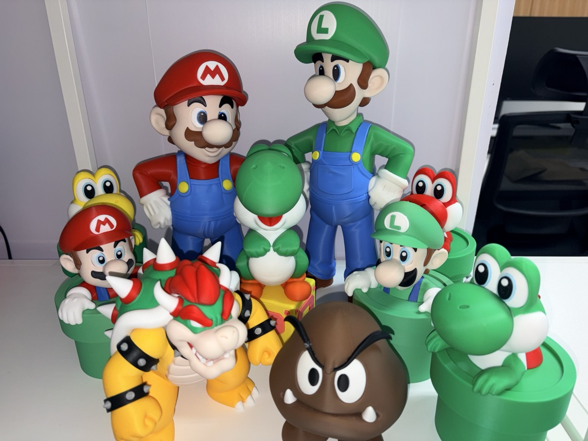
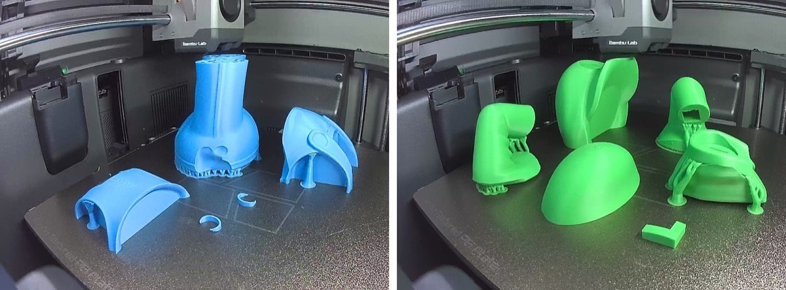
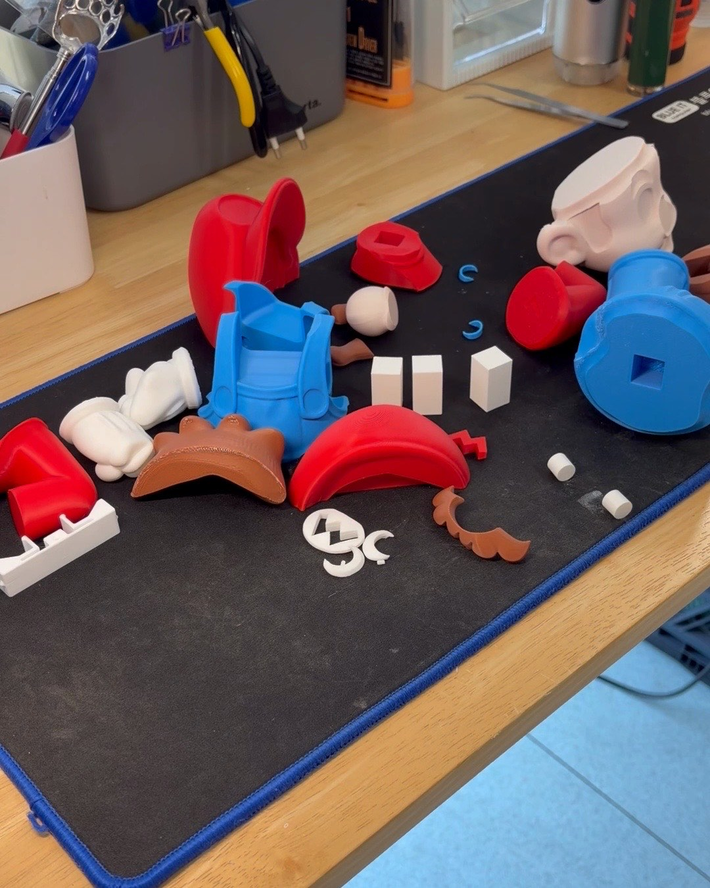
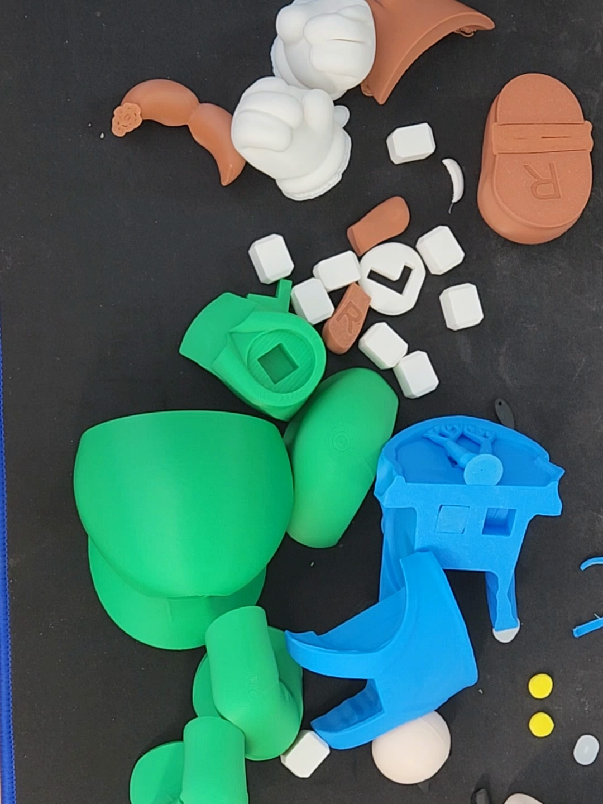
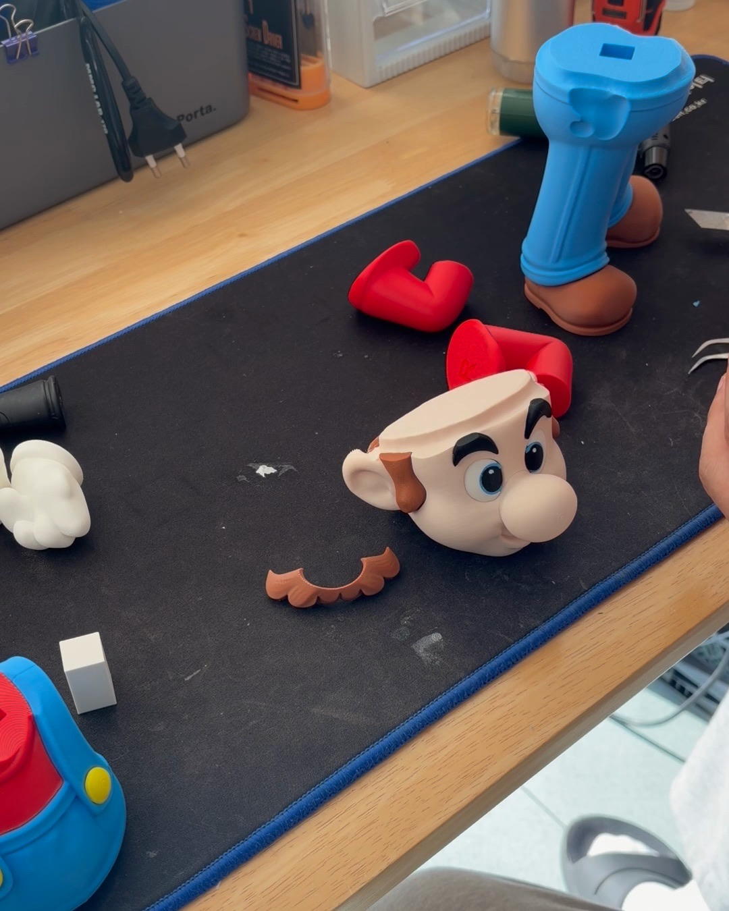
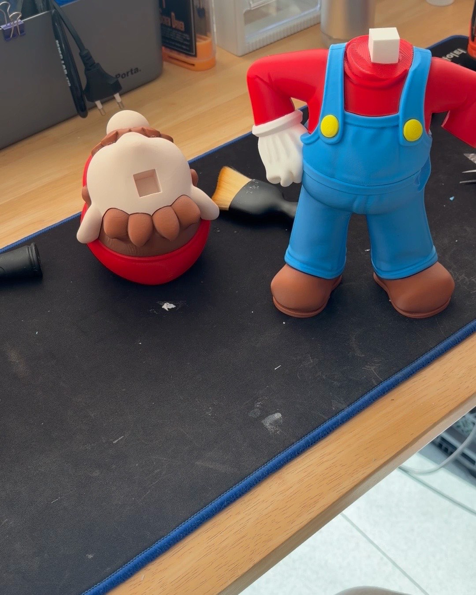
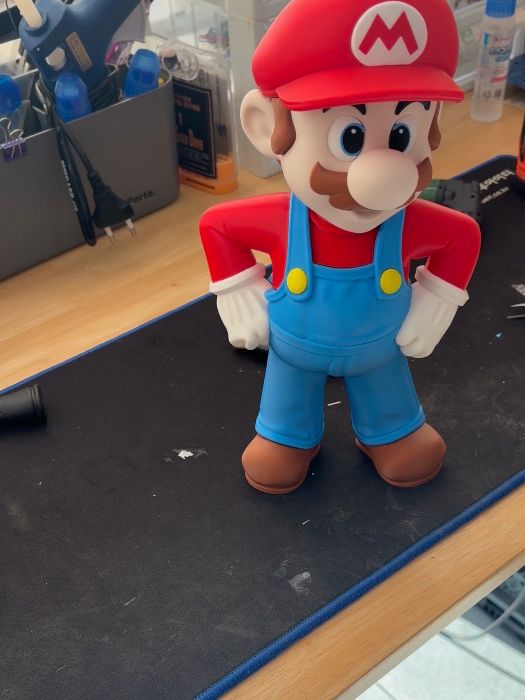
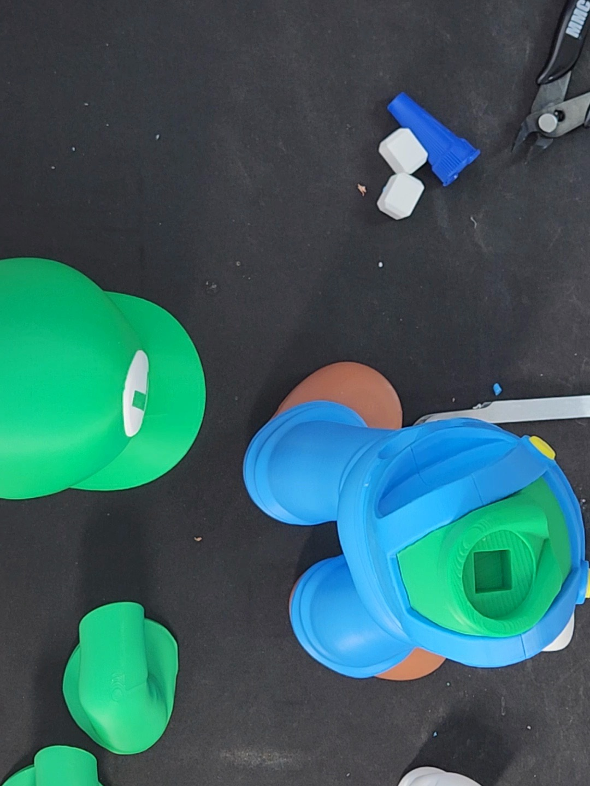
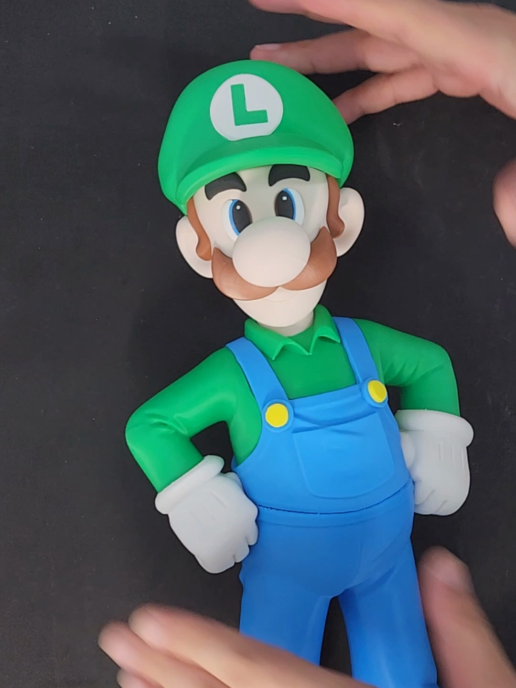
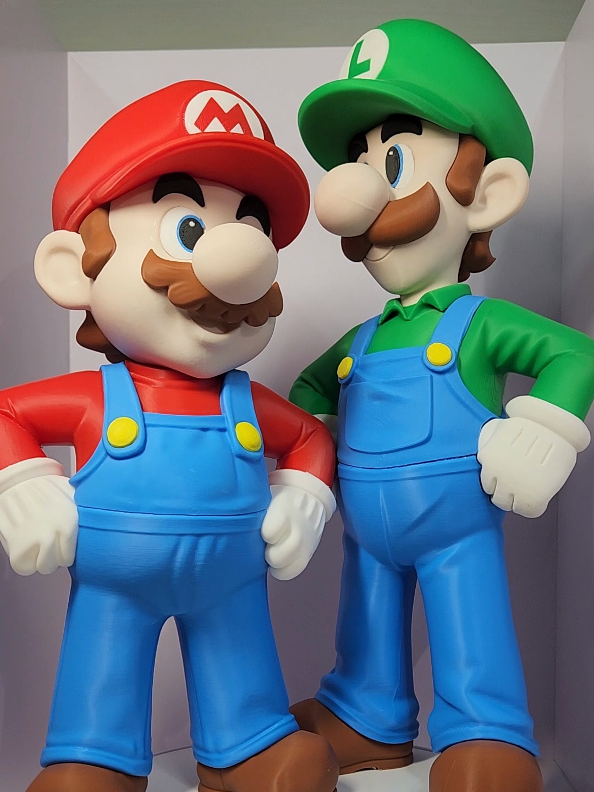

[クッパ](/ja/2026/11/07/bowser-multipart-assembly/)を作り終えたら、なんだか物足りなくなりました。
クッパがいるのにマリオがいないというのは、やっぱり変ですよね。

そこで今回はマリオとルイージです。
兄弟をまとめて作りました。

## 今回も色ごとに別々に

二人ともクッパと同じく、色ごとにパーツを分けてプリントし、あとで貼り合わせるマルチパーツのフィギュアです。

プレートごとに一色です。
左がマリオの青いオーバーオールと脚、右がルイージの緑の帽子とシャツです。
青、緑、白、茶色、黄色……色ごとに別々にプリントしました。

まずはマリオです。
赤い帽子と腕、青いオーバーオール、白い手袋、茶色の髪とヒゲまで、すべてバラバラになっています。

パーツ同士は四角い白いピンでつなぎます。
穴にピンを差し込み、接着剤で固定する方式です。
ピンが四角いので、差し込んでもくるくる回らず、きちんと位置が決まります。

こちらはルイージです。
緑の帽子とシャツ以外は、構成はマリオとほぼ同じです。

ただ、青いオーバーオールにサポートがびっしり付いていました。
これを取り除くのが思った以上に大変で...
カッターとニッパーでひとつずつ整えていたら、組み立てを始める前にかなりの時間がかかりました。

## 撮り方を変えてみました

マリオは11月7日に、ルイージは翌日に組み立てました。

マリオは、机の上にスマホを斜めに立てて撮りました。
ルイージは真上から撮ってみたのですが...
手がたびたび画面の外にはみ出してしまいました。
顔のパーツを貼るときは、ほとんど画面の端で作業していました。

撮れた映像だけを合わせると、マリオは2回に分けて約40分、ルイージは1回で56分です。
サポートの処理にかかった時間が、すべてルイージ側に入っているわけです。

## いちばん手間がかかったのは顔

今回もいちばん時間がかかったのは顔でした。

目は白、青、黒の小さなパーツに分かれています。
これをピンセットでひとつずつつまんで貼ります。
マリオの顔だけで、動画にして6分近くかかりました。

目をすべて貼ってヒゲまで載せると、ようやくマリオの顔になります。

## 頭のないマリオ

脚に胴体を差し込み、手袋をはめた腕まで貼ると、こんな姿になります。
頭だけがないマリオです。

左に逆さまに置いてあるのが、帽子をかぶった頭です。
首から出ている白いピンに頭をはめれば完成です。

マリオの完成です。

## 真上から見るとこんな感じ

ルイージも手順は同じです。
真上から撮ったので、オーバーオールの中に緑の胴体が収まっていく様子がよく見えます。

胴体を貼ったあとは、10分以上そのまま寝かせておきました。
接着剤が固まるのを待っていた、ということにしておいてください。

最後に腕と頭まで貼って立たせれば、ルイージの完成です。

## 兄弟が並んで

二人を一緒に回転台に載せてみました。
ゆっくり回るのを眺めていたら、時間がたつのを忘れてしまいました。

ルイージのほうが少し背が高いです。
原作どおりですね。

そして、いちばん上の写真です。
これまでにひとつずつプリントしてきた仲間たちと一緒に並べてみました。
クッパもいますし、[H3Cでプリントしたクリボー](/ja/2026/11/08/bambulab-h3c-multicolor-figure/)も、ヨッシーもいます。
ようやく家族らしくなってきました。

## 動画はぼんやり眺められるように

今回の動画は、少し違う作りにしてみました。
パーツがプリントされる場面から始まり、左ではマリオ、右ではルイージが同時に組み上がっていきます。
早送りはせず、貼り合わせる場面をゆっくり見せる方向です。

BGMにはマリオの原曲を使いたかったのですが...
調べてみると、原曲はコードで作り直しても著作権がそのまま残ることがわかりました。
そこで、8ビットの雰囲気だけを活かした曲を新しく作りました。

流しっぱなしにして、ぼんやり眺められる動画になればうれしいです。

  <iframe src="https://www.youtube.com/embed/sedkCEygUiM?cc_lang_pref=ja&cc_load_policy=1" title="マリオとルイージを並べて組み立て｜ぼんやり眺める3Dプリントフィギュア" style="position: absolute; inset: 0; width: 100%; height: 100%; border: 0;" allow="accelerometer; autoplay; clipboard-write; encrypted-media; gyroscope; picture-in-picture; web-share" allowfullscreen loading="lazy"></iframe>

短く見たい方は、ショート動画からどうぞ。

  <iframe src="https://www.youtube.com/embed/ejELZAjMKug?cc_lang_pref=ja&cc_load_policy=1" title="マリオとルイージ、ひとつずつ" style="position: absolute; inset: 0; width: 100%; height: 100%; border: 0;" allow="accelerometer; autoplay; clipboard-write; encrypted-media; gyroscope; picture-in-picture; web-share" allowfullscreen loading="lazy"></iframe>

- YouTube動画: [マリオとルイージを並べて組み立て｜ぼんやり眺める3Dプリントフィギュア](https://www.youtube.com/watch?v=sedkCEygUiM)
- YouTubeショート: [マリオとルイージ、ひとつずつ](https://www.youtube.com/shorts/ejELZAjMKug)

次は誰を作りましょうか。
マリオの仲間たちの中で見てみたいキャラクターがいたら、コメントで教えてください。
