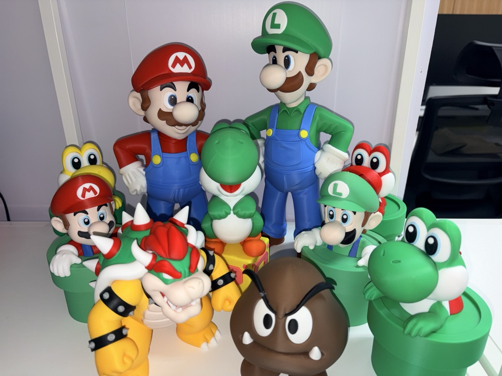
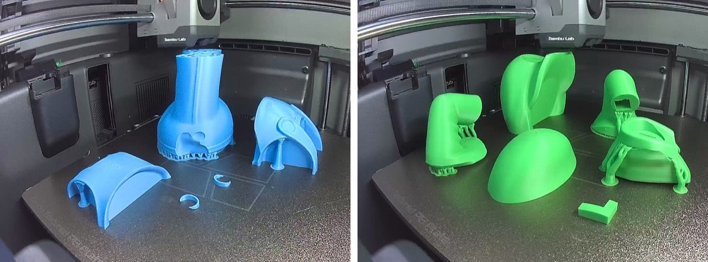
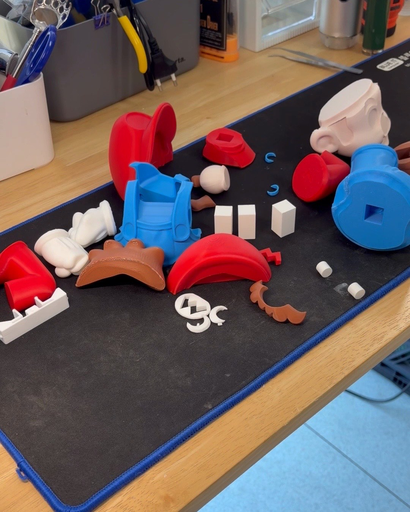
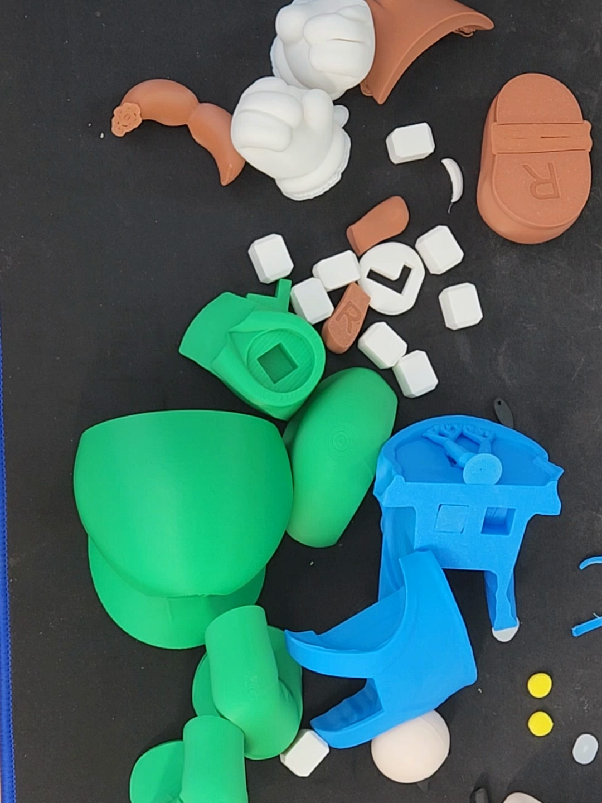
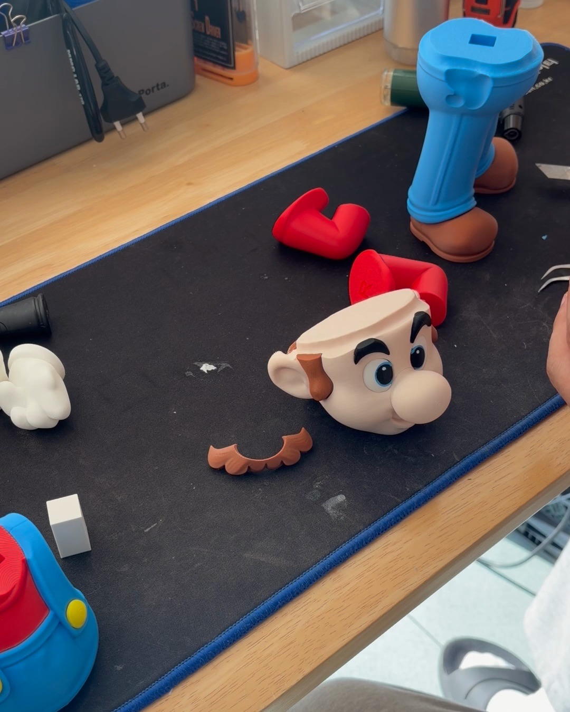
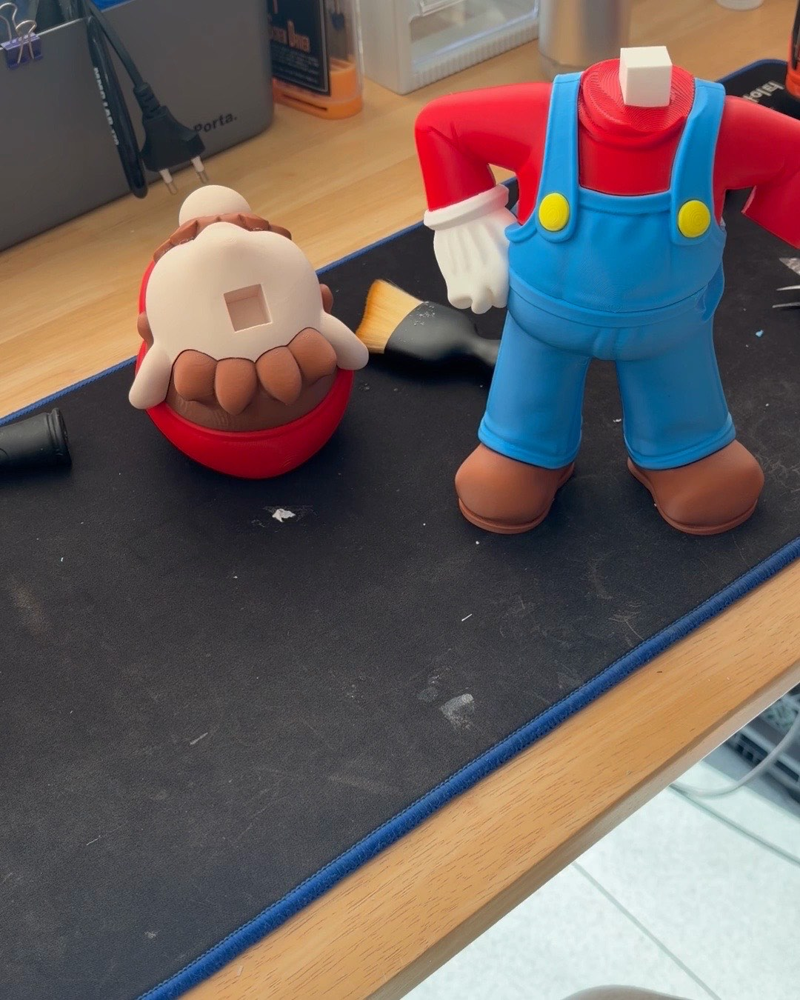
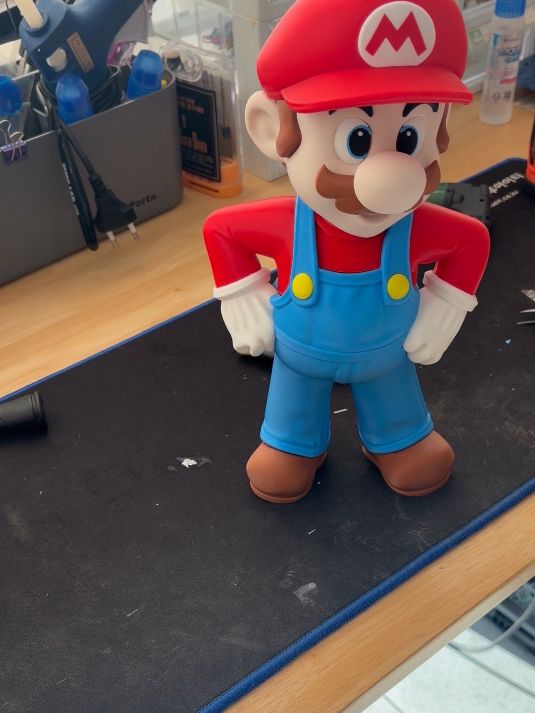
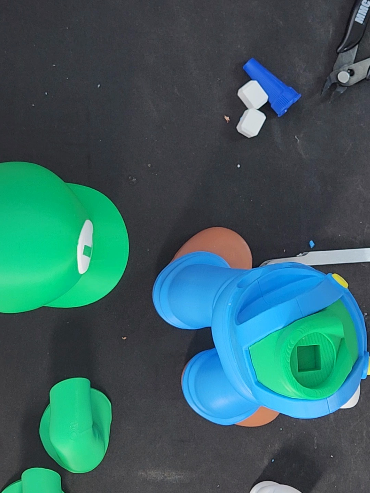
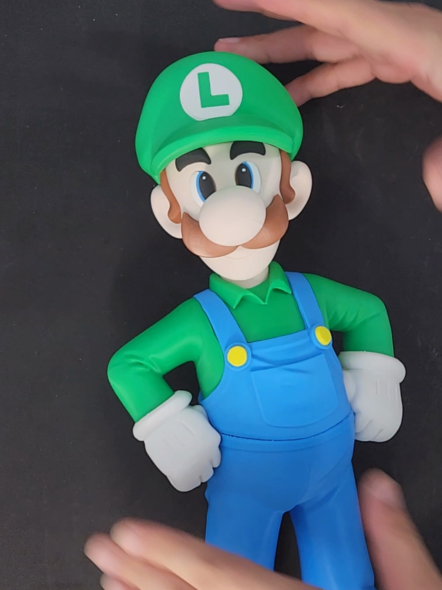
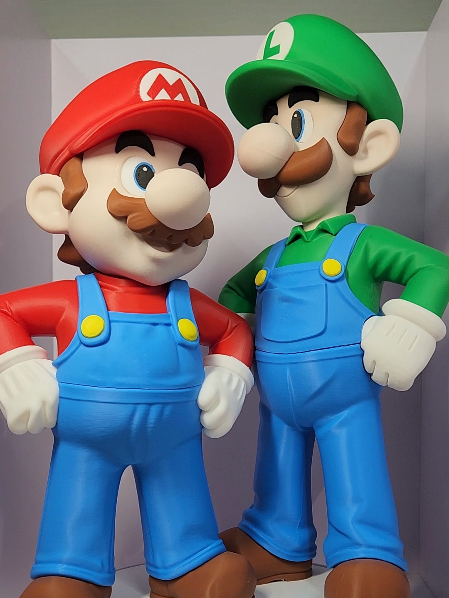

[쿠파](/2026/11/07/bowser-multipart-assembly/)를 만들고 나니까 허전하더라.
쿠파가 있는데 마리오가 없으면 좀 이상하잖아요 ㅋㅋ

그래서 이번엔 마리오와 루이지.
형제를 한꺼번에 만들었다.

## 이번에도 색깔별로 따로

둘 다 쿠파처럼 색깔별로 조각을 나눠서 뽑고, 나중에 붙이는 멀티파트 피규어다.

판마다 한 가지 색이다.
왼쪽이 마리오의 파란 멜빵이랑 다리, 오른쪽이 루이지의 초록 모자랑 셔츠.
파랑, 초록, 하양, 갈색, 노랑... 색깔마다 판을 따로 돌렸다.

먼저 마리오.
빨간 모자와 팔, 파란 멜빵바지, 하얀 장갑, 갈색 머리카락과 콧수염까지 다 따로 놀고 있다.

조각끼리는 네모난 하얀 핀으로 잇는다.
구멍에 핀을 끼우고 접착제로 고정하는 방식이다.
핀이 네모라서 끼우면 빙글 돌아가지 않고 제자리를 잡는다.

이건 루이지.
초록 모자랑 셔츠만 빼면 구성은 마리오랑 거의 같다.

근데 파란 멜빵바지에 서포트가 잔뜩 붙어 있다.
이거 떼어 내는 게 생각보다 일이었다...
칼이랑 니퍼로 하나하나 정리하느라 조립 시작도 전에 시간이 꽤 갔다 ㅠㅠ

## 찍는 방법을 바꿔 봤다

마리오는 11월 7일에, 루이지는 다음 날 조립했다.

마리오는 책상 위에 폰을 비스듬히 세워 두고 찍었다.
루이지는 위에서 내려다보게 찍어 봤는데...
손이 자꾸 화면 밖으로 나가더라 ㅋㅋ
얼굴 조각 붙일 때는 거의 화면 끝에서 하고 있었다.

찍힌 영상만 합쳐 보면 마리오는 두 번에 나눠서 40분쯤, 루이지는 한 번에 56분이다.
서포트 정리 시간이 루이지 쪽에 다 들어가 있는 거다.

## 제일 손이 많이 간 건 얼굴

이번에도 제일 오래 걸린 건 얼굴이었다.

눈이 하얀색, 파란색, 검은색 작은 조각으로 나뉘어 있다.
이걸 핀셋으로 하나씩 집어서 붙인다.
마리오 얼굴만 영상으로 6분 가까이 되더라.

눈을 다 붙이고 콧수염까지 올리면 그제야 마리오 얼굴이 나온다 ㅎㅎ

## 머리 없는 마리오

다리에 몸통을 꽂고, 장갑 낀 팔까지 붙이면 이런 모습이 된다.
머리만 없는 마리오 ㅋㅋ

왼쪽에 거꾸로 놓인 게 모자를 쓴 머리다.
목에 튀어나온 하얀 핀에 머리를 끼우면 끝.

마리오 완성.

## 루이지는 위에서 보면 이렇다

루이지도 순서는 같다.
위에서 찍으니까 멜빵바지 안에 초록 몸통이 들어가는 게 잘 보인다.

몸통을 붙이고 나서는 10분 넘게 그대로 눕혀 뒀다.
접착제 굳기를 기다린 거라고 해 두자 ㅋㅋ

마지막으로 팔이랑 머리까지 붙이고 세우면 루이지 완성.

## 형제가 나란히

둘을 회전판에 같이 올려 봤다.
천천히 돌아가는 걸 보고 있으니까 시간 가는 줄 모르겠더라.

루이지가 키가 조금 더 크다.
원작 그대로인 거다 ㅎㅎ

그리고 맨 위 사진.
그동안 하나둘 뽑은 친구들이랑 같이 세워 봤다.
쿠파도 있고, [H3C로 뽑은 굼바](/2026/11/08/bambulab-h3c-multicolor-figure/)도 있고, 요시도 있다.
이제야 좀 가족 같다.

## 영상은 멍하니 보기 좋게

이번 영상은 좀 다르게 만들어 봤다.
부품이 출력되는 장면부터 시작해서, 왼쪽에선 마리오, 오른쪽에선 루이지가 동시에 조립된다.
빨리 감지 않고 붙이는 장면을 천천히 보여 주는 쪽으로.

배경음악은 마리오 원곡을 쓰고 싶었는데...
알아보니 원곡은 코드로 다시 만들어도 저작권이 그대로더라.
그래서 8비트 느낌만 살린 곡을 새로 만들었다.

그냥 틀어 놓고 멍하니 보기 좋은 영상이 됐으면 좋겠다.

  <iframe src="https://www.youtube.com/embed/sedkCEygUiM?cc_lang_pref=ko&cc_load_policy=1" title="마리오와 루이지, 나란히 조립하기 | 멍때리기 좋은 3D 프린팅 피규어 조립" style="position: absolute; inset: 0; width: 100%; height: 100%; border: 0;" allow="accelerometer; autoplay; clipboard-write; encrypted-media; gyroscope; picture-in-picture; web-share" allowfullscreen loading="lazy"></iframe>

짧게 보고 싶으면 쇼츠로 ㅎㅎ

  <iframe src="https://www.youtube.com/embed/ejELZAjMKug?cc_lang_pref=ko&cc_load_policy=1" title="마리오와 루이지, 한 조각씩" style="position: absolute; inset: 0; width: 100%; height: 100%; border: 0;" allow="accelerometer; autoplay; clipboard-write; encrypted-media; gyroscope; picture-in-picture; web-share" allowfullscreen loading="lazy"></iframe>

- 유튜브 롱폼: [마리오와 루이지, 나란히 조립하기 | 멍때리기 좋은 3D 프린팅 피규어 조립](https://www.youtube.com/watch?v=sedkCEygUiM)
- 유튜브 쇼츠: [마리오와 루이지, 한 조각씩](https://www.youtube.com/shorts/ejELZAjMKug)

다음엔 누구를 만들어 볼까요?
마리오 친구들 중에 보고 싶은 캐릭터 있으면 댓글로 알려 주세요.
