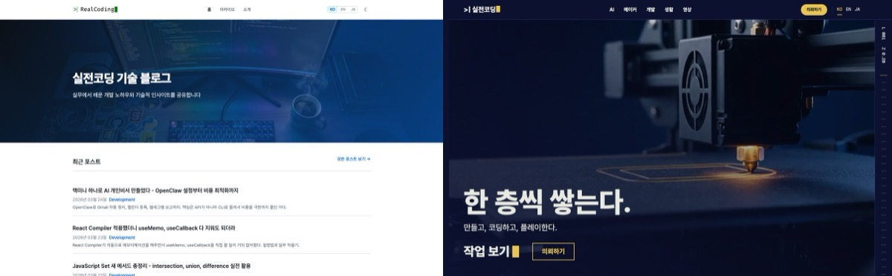

On the left, realcoding.blog as of yesterday.
On the right, today.

I tore the blog down and rebuilt it as a portal.
The name changed too, from "RealCoding Tech Blog" to **RealCoding Workshop**.

I started planning around 10:40 last night.
The production site switched to the new design around 11 this morning.
Roughly 12 hours.

I barely typed any code.
Claude Code made the plan, Codex wrote the code, and Higgsfield made the design boards and videos.
My job was answering questions, picking from options, and saying "okay, ship it."

It was not smooth, though.
I burned credits, the AI copied old bugs on purpose, and the production site had a broken layout within minutes of going live.
I'm writing all of that down too.

## Why I Tore It Down

This was originally a dev tips blog.
Built on Jekyll, with 155 posts written in Korean, English, and Japanese, so 465 posts in total.

This month, 3D printer posts started showing up.
Like the [H3C unboxing](/en/2026/11/07/bambulab-h3c-ams3-unboxing/).
I also want to write game guides, and take print requests and dev contract work.

The "tech blog" shape doesn't fit any of that.
3D printer posts get buried between dev posts in a chronological list, and there's no place for someone to send a request.

So I decided to make it a portal instead of a blog.

- **AI** — how I actually use AI, plus AX/DX (AI and digital) transformation for companies
- **Maker** — 3D printing work
- **Dev** — most of the original dev posts
- **Game** — guides for games I play (zero posts so far, so the menu is hidden)
- **Life** — everyday stuff
- **Requests** — 3D printing, dev contract work, AI adoption and AX inquiries

## Planning: My Job Was Choosing

I started by giving Claude Code a single line.
"I want to turn the blog into a portal. Something dynamic and technically ambitious. Let's get Higgsfield's help with the design."

It came back with a plan.
Site structure, tech choices, where the videos go, the stages, and the checkpoints where I have to approve before it continues.

Roles were split like this.

| Who | What they did |
|---|---|
| Claude Code (main) | Planning, task breakdown, review verdicts, talking to me |
| Design agent | Tech choices, big judgment calls |
| Codex | Writing the actual code |
| Higgsfield | Design boards, home video |
| Me | Answering, choosing, approving deploys and paid generation |

I switched to **Astro**.
Jekyll has no bundler, so the scripts for the home page animation would ship on every post page too.
I wanted a flashy home and light post pages, which meant being able to separate the two.
I kept "stay on Jekyll" only as the fallback in case preserving URLs failed.

### Nine Design Boards

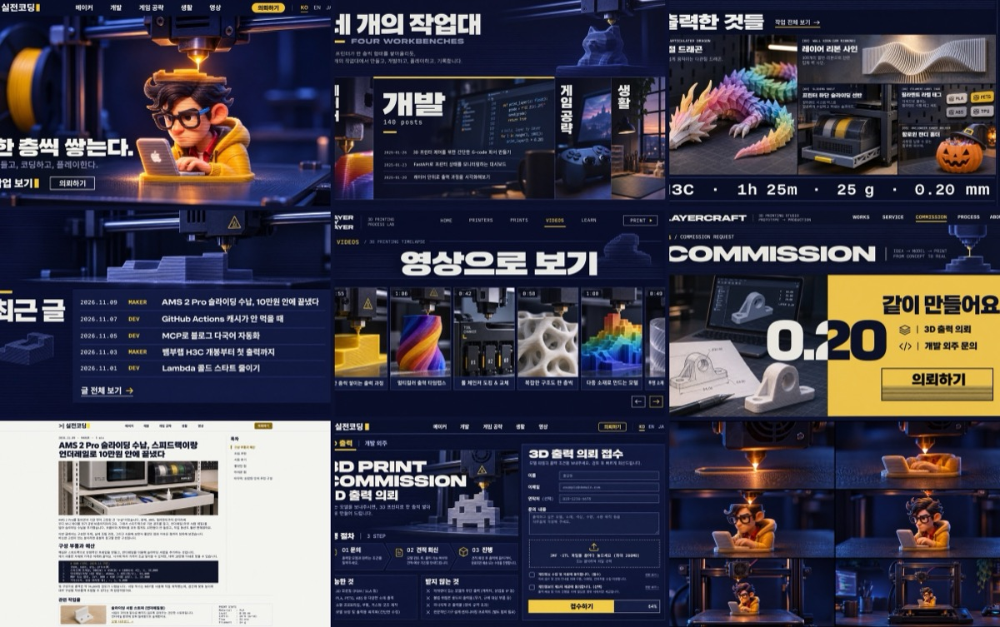

For design I used Higgsfield's website builder.
But I didn't build and deploy the site there.
I took **only the design brief and reference boards**, and implemented it in our own code.

The concept is "build it one layer at a time."
Layers of a 3D print, layers of code, levels of a game.
Ultramarine ink for color, with the yellow of the character's hoodie as the accent.

I approved the nine boards on the spot.
So far so good...

**Mistake number one.**
While generating the boards, I lost a job ID.
A generation request returns a list like `["job-id"]`, and I tried to parse it as a dictionary and dropped the ID.
I couldn't find the result, so I generated the same thing again.
5.5 credits, gone.

Since then I have a rule: save the raw response to a file before parsing it.

## Not Losing a Single One of 465 URLs

The real work of moving a blog isn't the design.
It's the **URLs**.

People arriving from search land on old URLs.
Comments use Utterances, which attaches them by URL.
Change one character in a URL and that post's comments vanish.

So before any design work, I took a baseline of the production site.

- **480** URLs in the production sitemap
- **647** redirect pages from old URLs to new ones
- **7** paths with comments

Then the traps showed up.

**Trap 1. Dates are UTC.**
Jekyll builds the date in a URL from UTC.
So for a post written before 9 AM Korean time, the filename date and the URL date are off by one day.
There were 33 such posts.
I made Astro reproduce the same offset on purpose.

**Trap 2. 20 English and Japanese posts with no prefix.**
Some old English and Japanese posts used URLs shaped like the Korean ones, with no `/en/`.
I moved them to clean URLs and left redirect pages at the old ones.

**Trap 3. The AI copied the old bugs too.**
This was the funniest one.
I told Codex to make it "come out identical to the production site," and it did exactly that.
It wrote 127 lines of code that imitate the **bugs** of the old renderer.
Things like code blocks inside lists never closing, and a `|` inside link text turning into a table.

The URL comparison passed everything.
But this can't be right...
I removed the imitation code and fixed the buggy source myself, 3 posts across 3 languages, so 9 files.

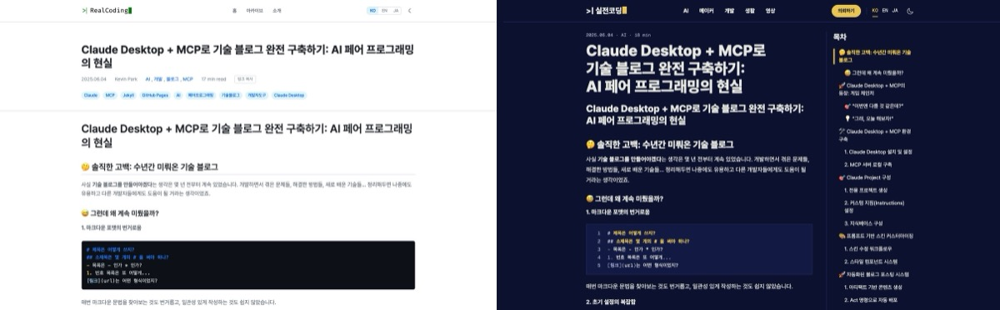

Verification was all numbers.
I built a script that compares the production site and the new build URL by URL, and the results were:

- 480 URLs missing: **0**
- Redirect target mismatches out of 647: **0**
- Per-language alternate URL (hreflang) differences: **0**
- Comment paths: 7 of 7 match

After switching to production, I ran the same checks against the live site again.

One bonus finding.
The cover images for 3 posts in last year's AI blog series never existed.
They were 404 on production too.
Broken for over a year and I never noticed.
At least I found them during the renewal.

## Light Post Pages

The home page plays video, but post pages get none of the animation scripts.
Just theme switching, code copy, table of contents, and image zoom.
Mermaid diagrams and comments load only when they get near the viewport.

The biggest win was images.
One post had a **2.5MB PNG** as its cover.
At build time I generate four WebP sizes, 480, 768, 960, and 1440px, and serve whichever fits the screen.
That image became **55KB**.

Lighthouse mobile scores (production, same measurement method):

| Page | Before | After |
|---|---|---|
| Post with many mermaid diagrams | 60 | 92 |
| AMS post (photo-heavy) | 91 | 98 |
| Home | — | 100 |
| AI page | — | 100 |

The mermaid post used to take 34 seconds before the big diagram showed up.
That's on a simulated slow mobile connection, but 34 seconds... everyone would have just left.

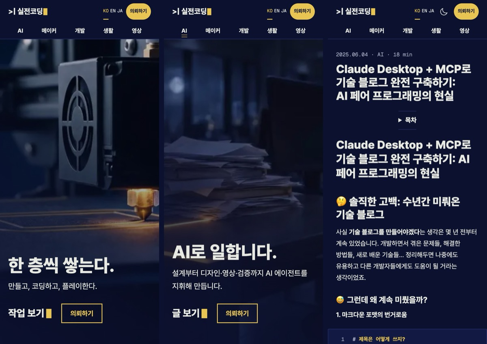

Two more mistakes here.

**Codex made English titles 11px.**
Very long English titles overflowed the mobile screen, so it shrank the text to fit the width.
No overflow, but also unreadable.
I set a minimum font size, and instead allowed very long titles up to 4 lines.
Then I opened all 465 posts at two mobile widths and confirmed zero overflowing posts.

**100 locally, shifted layout in production.**
Locally the images arrive instantly, so I couldn't catch the layout shift that happens when images arrive late.
After deploying and measuring again, the photo-heavy post scored 70, with a layout shift (CLS) of 0.302.
The cause was `width: auto` on the first photo.
I fixed it in a hotfix right after the switch: 98 points, zero shift.

## Home Video from Higgsfield

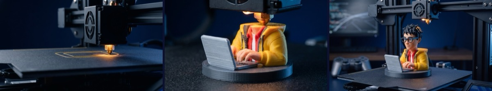

The home hero is a 15-second video that plays forward and backward as you scroll.
A nozzle stacks layers on an empty build plate, the RealCoding character takes shape, and the camera pulls back to reveal the whole workshop.

How I made it:

1. Generate and check three keyframe images first (start, middle, end)
2. Feed the start and end frames to Kling 4.0 to generate the 15-second video
3. Encode for the web, with tight keyframe spacing so scrubbing back and forth by scroll doesn't stutter

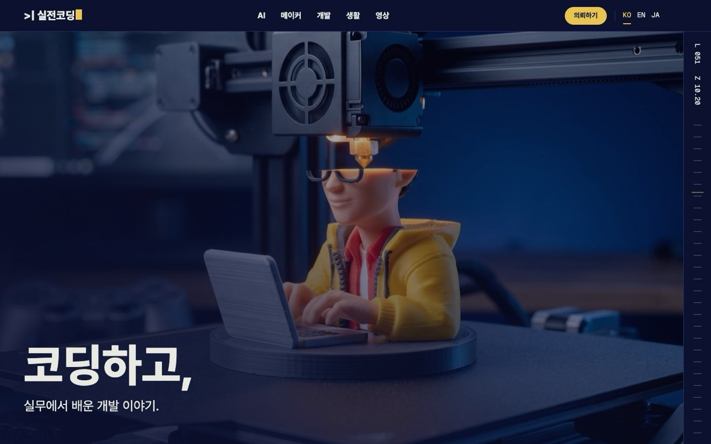

I put no text or logo in the video.
The site has three languages, so text is overlaid in code.

My initial plan included an animation library like GSAP.
Once I actually built it, CSS sticky plus a short script was enough.
The smooth-scroll library (Lenis) runs only on the home page.
With mobile data saver or "reduce motion" enabled, a still image replaces the video.

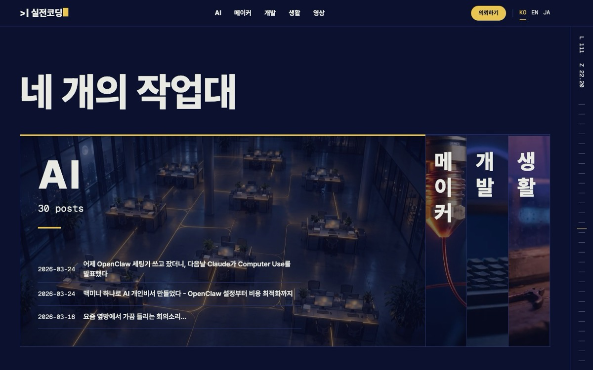

Each area also got a 6-second loop.
Maker, Dev, Game, Life, and the Requests section.

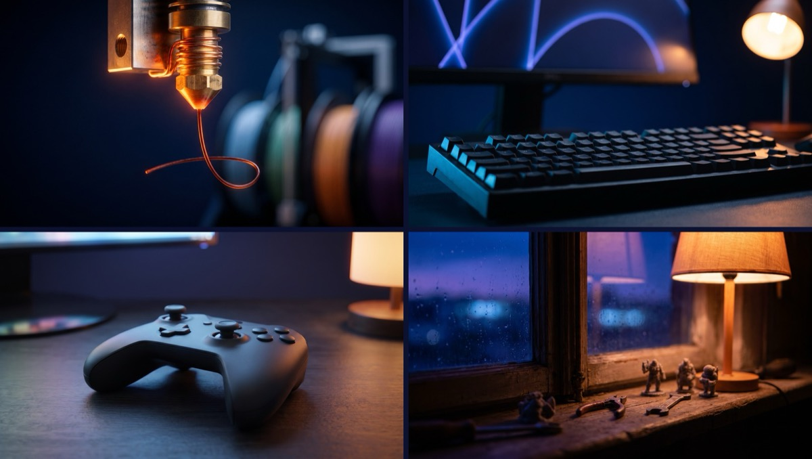

The Game area keyframes came out with Xbox-colored buttons, a PlayStation light bar, and real app icons.
Someone else's trademarks baked into my home background is a problem, so I regenerated them.

### The Credit Ledger

| Item | Credits |
|---|---|
| 9 design boards | 24.75 |
| Regenerating boards after losing the job ID | 5.5 |
| 9 home keyframes (including trademark regeneration) | 30 |
| 6 home videos (one 15s + five 6s) | 146.25 |
| AX video, take 1 (3D printer version, ended up unused) | ~81 |
| AX video, take 2 (night office) | ~77 |
| **Total** | **~365** |

About 90 of those credits went to things I threw away.
Roughly a quarter.

## Going Live, and the Bug That Followed

The switch went like this.

1. Tag the old Jekyll state for recovery
2. Merge the new site into master
3. Change the GitHub Pages build from the default Jekyll build to GitHub Actions
4. Push

Once it deployed, I ran the full check against production.
480 URLs, 647 redirects, 7 comment paths, all fine.

Then I found something odd while looking at the home page.
In the workbench section, the background photo of a collapsed area tile was spilling outside the tile.
I took a screenshot and sent it right over.
A few lines of CSS that fit the photo size to the tile were missing.

Add the layout shift (CLS 0.302) from earlier and that's two hotfixes.
I redeployed within 15 minutes of the switch.

The automated checks passed thousands of items, and still missed something a human eye catches immediately.
That's the part I remember most.

### Feedback That Kept Coming

After the switch, I kept seeing things to fix.

**Fixed top menu.**
The menu now stays pinned when you scroll.
On mobile I removed the hamburger menu and show the menu items in two rows, always visible.

That caused a new problem.
Arrive on the Requests page with a link like `#ax`, and the form title hides under the fixed menu.
I first tried to fix the scroll position with a script, and it didn't work.
The browser's scroll to the hash happens after the script runs, and overwrites the position I corrected.
In the end, one line of CSS did it.

```css
/* A scroll margin larger than the viewport gets clamped to 0, so the page stops at the very top */
.request-page :is(#print, #dev, #ax) { scroll-margin-top: 200vh; }
```

**AI menu.**
After finishing the renewal, I noticed that AX/DX transformation, which is what I mainly do at my company, was missing entirely.
I use AI at close to a professional level, and none of it showed on the site.

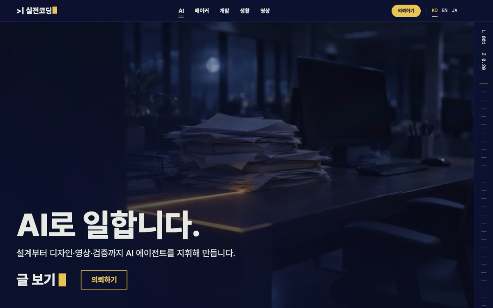

So I put AI first in the menu, built a separate `/ai/` page, and added an "AI adoption / AX" tab to the Requests page.

Something funny happened here.
The main agent told Codex "there are 29 AI posts," but when Codex counted for itself, it found 30.
Codex stopped and asked why the numbers didn't match.
Turned out the main agent had missed one `AI Agents` tag.
The AIs caught each other's mistake.

**I made the AX video twice.**

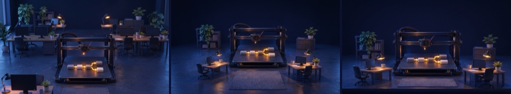

Take 1's concept was "print the workflow."
A 3D printer printing a business flowchart one layer at a time.

I tried to generate three keyframes as three different scenes, and **all three came out as the end scene**.
That's the image above.
I had used a bash associative array to hold a table of per-scene prompts, but bash 3.2, the default on macOS, doesn't have that feature.
The table broke and every prompt got overwritten by the last value.
4 credits gone. I switched to a function and generated again.

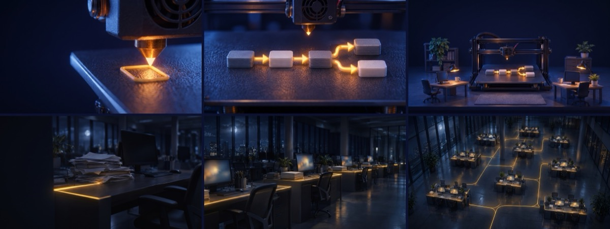

I finished the take 1 video and attached it, and then it looked far too similar to the home video.
3D printer on the home page, 3D printer on the AX page.
So I said "let's go with a different style."

Take 2 is **"the night office wakes up."**
Papers piled on desks in a dark office, and yellow light flowing between the desks, switching on the whole floor one section at a time.
That's what I think AX transformation really is.

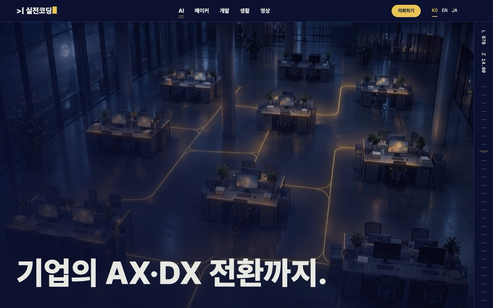

I left take 1 (about 81 credits) unused in the work folder.

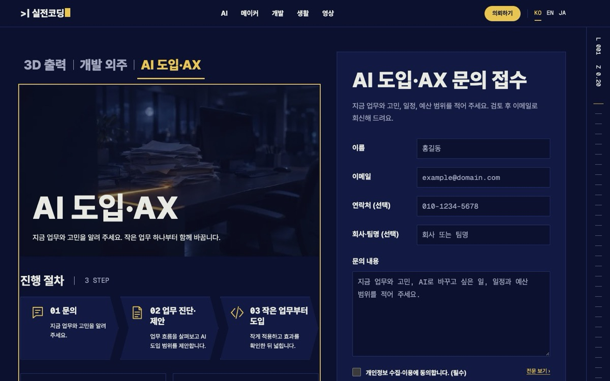

## All the Things We Got Wrong

All in one place:

| What went wrong | Why | Cost |
|---|---|---|
| Lost the design board job ID | Misread the generation response format | 5.5 credits |
| Copied old rendering bugs | Took "identical" too literally | Deleted 127 lines of imitation code, fixed 9 source files |
| Long English titles at 11px | Prevented overflow, ignored readability | Added a minimum font size |
| 100 locally, 0.302 layout shift in production | Local images arrive instantly, hiding it | Hotfix after the switch |
| Photo spilled out of a collapsed tile | Missing photo size constraint | Reported from my own screenshot, hotfix |
| Broken images and fonts in preview | Files generated only at build time weren't served by the dev server | Added handling for the dev server |
| Form title hidden when arriving via `#ax` | Script ran before the browser's scroll | Solved with one line of CSS |
| Told Codex 29 AI posts (actually 30) | Missed one tag | Codex stopped and checked |
| Three AX keyframes were the same scene | macOS bash 3.2 has no associative arrays | 4 credits |
| Discarded AX take 1 | Same 3D printer visual language as the home video | ~81 credits |

The checking tools were wrong too.
The smooth-scroll library intercepted the check script's scrolling and made things look like failures, and a selector meant for the top logo also matched the footer logo.
A red light doesn't always mean a product bug.
You have to doubt the check results once in a while too.

## What I Took Away

**Code written by AI still needs to be verified with numbers.**
465 posts, 480 URLs, 647 redirects.
No human eye can check all of that.
So I built the comparison script first and ran it until the numbers hit zero.

**But numbers alone aren't enough.**
On a site that passed thousands of checks, I spotted the photo spilling out of the collapsed tile first, with my own eyes.
The AX video being too similar to the home one doesn't show up in any check either.

**What humans do is direction and taste.**
Turning the blog into a portal.
Pinning the menu to the top.
Making the AX video a different style.
And approving paid generation and production deploys.

Last June, when I [fixed the blog with Claude Desktop and MCP](/en/2025/06/04/building-tech-blog-with-claude-mcp/), I was writing code alongside a single AI.
This time several agents split the roles, and I mostly supervised.
That's how much the way I work changed in a year and a half.

The AX transformation work I do at my company is the same story in the end.
AI does the work, and humans set the direction and verify.

Some things are still left.

- A request intake server — for now requests arrive by email
- Game guides — zero posts, so the menu stays hidden
- Cleaning up the old Jekyll files — keeping them for a month, just in case

If you've moved a blog like this, tell me about it in the comments.
I bet the URL-preservation misery is similar for everyone...

## The video version

I turned this renewal into a video, too — made the same way. The narration is an AI voice that borrows only the timbre of my own voice, and Codex assembled the edit.

<div style="position: relative; width: 100%; aspect-ratio: 16 / 9; margin: 1.5rem auto;">
  <iframe src="https://www.youtube.com/embed/a74rXmOkw3s" title="I Rebuilt My Blog Into a Portal in 12 Hours With AI Agents" style="position: absolute; inset: 0; width: 100%; height: 100%; border: 0;" allow="accelerometer; autoplay; clipboard-write; encrypted-media; gyroscope; picture-in-picture; web-share" allowfullscreen loading="lazy"></iframe>
</div>

And a one-minute Short:

<div style="position: relative; width: 100%; max-width: 360px; aspect-ratio: 9 / 16; margin: 1.5rem auto;">
  <iframe src="https://www.youtube.com/embed/IrJNWTfm8oM" title="AI Agents Rebuilt My Blog in 12 Hours" style="position: absolute; inset: 0; width: 100%; height: 100%; border: 0;" allow="accelerometer; autoplay; clipboard-write; encrypted-media; gyroscope; picture-in-picture; web-share" allowfullscreen loading="lazy"></iframe>
</div>
