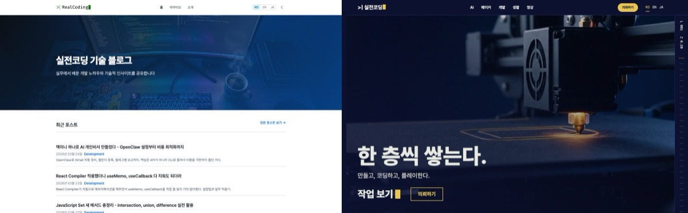

左が昨日までのrealcoding.blogです。
右が今日の姿です。

ブログをポータルに作り替えました。
名前も「実戦コーディング技術ブログ」から**実戦コーディング工房**に変えました。

企画を始めたのは昨夜10時40分ごろでした。
本番サイトが新しいデザインに切り替わったのが、今日の午前11時ごろ。
だいたい12時間です。

コードはほとんど自分では書いていません。
Claude Codeが計画を立て、Codexがコードを書き、Higgsfieldがデザインボードと映像を作りました。
私の役目は、質問に答えて、見て選んで、「公開していいよ」と言うことでした。

ただ、順調ではありませんでした。
クレジットは溶かすし、AIが昔のバグまでコピーしてくるし、本番に出した途端に崩れた画面も出ました。
その話も全部書いておきます。

## なぜ作り替えたのか

このブログはもともと開発Tipsのブログでした。
Jekyllで作っていて、155本の記事を韓国語・英語・日本語で書いたので、合計465本が溜まっていました。

ところが今月から、3Dプリンターの記事が増え始めました。
[H3C開封レビュー](/ja/2026/11/07/bambulab-h3c-ams3-unboxing/)のような記事です。
ゲーム攻略も書きたいし、出力の依頼や開発の外注も受けたくなりました。

「技術ブログ」という枠には、どうにも収まりません。
3Dプリンターの記事は時系列の一覧で開発記事に埋もれてしまいますし、依頼を受ける窓口もありませんでした。

そこで、ブログではなくポータルに変えることにしました。

- **AI** — AIを実際にどう使っているか、企業のAX・DX（AI・デジタル）転換
- **メイカー** — 3Dプリンティングの作品
- **開発** — もともとあった開発記事の大半
- **ゲーム** — プレイしているゲームの攻略（まだ0本なのでメニューからは隠してあります）
- **日常** — 暮らしの記録
- **ご依頼** — 3D出力、開発の外注、AI導入・AXの相談

## 企画：私の仕事は選ぶことでした

最初、Claude Codeにはこれだけ投げました。
「ブログをポータルにしたい。動きがあって、技術がたっぷり入ったホームページがいい。デザインはHiggsfieldの力を借りよう」

すると企画案が出てきました。
サイト構造、技術選定、映像を置く場所、進行ステップ、そして私が承認すべき停止ポイントまで。

役割分担はこうなりました。

| 誰が | やったこと |
|---|---|
| Claude Code（メイン） | 企画、作業の分割、検収の判定、私との対話 |
| 設計担当エージェント | 技術選定、大きな判断 |
| Codex | 実際のコード作成 |
| Higgsfield | デザインボード、ホーム映像 |
| 私 | 答える、選ぶ、デプロイと有料生成の承認 |

技術は**Astro**に乗り換えました。
Jekyllのままだとバンドラがないので、ホーム用の演出スクリプトが記事ページにもすべて読み込まれてしまいます。
ホームは華やかに、記事ページは軽くするには、両者を分けられる必要がありました。
Jekyllを維持する案は、「URLの維持に失敗したときに戻る案」としてだけ残しました。

### デザインボード9枚

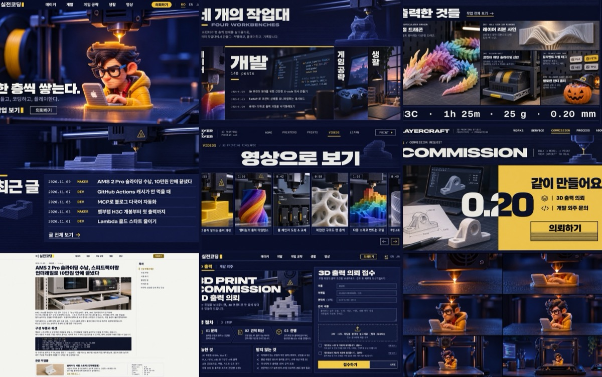

デザインにはHiggsfieldのウェブサイトビルダーを使いました。
ただし、そこでサイトを作って公開したわけではありません。
**デザインブリーフとリファレンスボードまで**を出してもらい、実際の実装はこちらのコードで行いました。

コンセプトは「一層ずつ積む」です。
3D出力の層、コードの層、ゲームのレベルを重ねています。
色はウルトラマリンのインクに、キャラクターのフードの黄色をアクセントにしました。

ボード9枚を見て、すぐに承認しました。
ここまではよかったのですが……。

**最初の失敗です。**
ボードを生成している途中で、ジョブ番号をひとつ失くしました。
生成リクエストを送ると`["job-id"]`のようなリストが返ってくるのですが、それを辞書として読もうとして番号を取り逃がしたんです。
結果が見つからず、同じものをもう一度生成しました。
5.5クレジットがそのまま消えました。

以来、生成レスポンスは解釈する前に、まず原文をファイルに保存するのをルールにしました。

## 465本のURLを一本も失わない

ブログの引っ越しで本当に大変なのは、デザインではありませんでした。
**URL**です。

検索から来る人は、古いURLで入ってきます。
コメントはUtterancesを使っていて、URLを基準に紐づいています。
URLが一文字でも変わると、その記事のコメントは消えます。

そこで、デザインより先に本番サイトの基準線を取りました。

- 本番sitemapのURL **480件**
- 旧URLから新URLへの転送ページ **647件**
- コメントが付いているパス **7件**

そして落とし穴が出てきました。

**落とし穴1：日付がUTCです。**
JekyllはURLの日付をUTC基準で作ります。
そのため、韓国時間（日本と同じUTC+9）の午前9時前に書いた記事は、ファイル名の日付とURLの日付が1日ずれます。
そういう記事が33本ありました。
Astroでも、わざと同じようにずらして作りました。

**落とし穴2：プレフィックスのない英語・日本語記事が20本。**
昔の英語・日本語記事の一部が、`/en/`なしで韓国語記事と同じ形のURLを使っていました。
整理したURLに移し、旧URLには転送ページを残しました。

**落とし穴3：AIが昔のバグまでコピーしました。**
これがいちばん笑えました。
Codexに「本番サイトと同じになるように」と作らせたら、本当に同じにしてきたんです。
古いレンダラの**バグまで**真似するコードを、127行も書いてきました。
リスト内のコードブロックが閉じないバグや、リンク文字列の中の`|`が表に変わるバグなどです。

URLの比較はすべて通りました。
でも、これは違いますよね……。
真似するコードは外して、バグのあった原文3本（3言語なので9ファイル）を直接直しました。

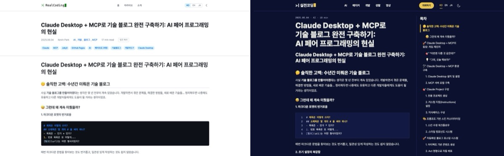

検証はすべて数字で行いました。
本番サイトと新しいビルドをURL単位で全数比較するスクリプトを作り、

- 480件のURLの欠落 **0**
- 転送647件の宛先の不一致 **0**
- 言語別の対応URL（hreflang）の差 **0**
- コメントパス7件が一致

本番切り替えの後も、実際のサイトに対して同じ検査をもう一度回しました。

おまけでひとつ見つけました。
去年書いたAIブログシリーズ3本のサムネイル画像が、そもそも存在していなかったのです。
本番サイトでも404でした。
1年以上壊れていたのに気づいていませんでした。
リニューアル中に見つかっただけ、まだよかったです。

## 記事ページは軽く

ホームでは映像が動きますが、記事ページには演出スクリプトを一切入れていません。
テーマ切り替え、コードのコピー、目次、画像の拡大くらいです。
mermaidの図とコメントは、画面の近くに来たときだけ読み込みます。

いちばん効果が大きかったのは画像でした。
ある記事では、サムネイルが**2.5MBのPNG**でした。
ビルド時にWebPで480・768・960・1440pxの4サイズを作り、画面に合ったものを配信するようにしました。
その画像は**55KB**になりました。

Lighthouseのモバイルスコアはこうなりました（本番サイト、同じ測定方式）。

| ページ | 以前 | 以後 |
|---|---|---|
| mermaid図の多い記事 | 60 | 92 |
| AMS記事（写真の多い記事） | 91 | 98 |
| ホーム | — | 100 |
| AI画面 | — | 100 |

mermaidの記事は、以前は大きな画像が表示されるまで34秒かかっていました。
遅いモバイル回線の想定ではありますが、34秒もあったらみんな離脱していたでしょうね。

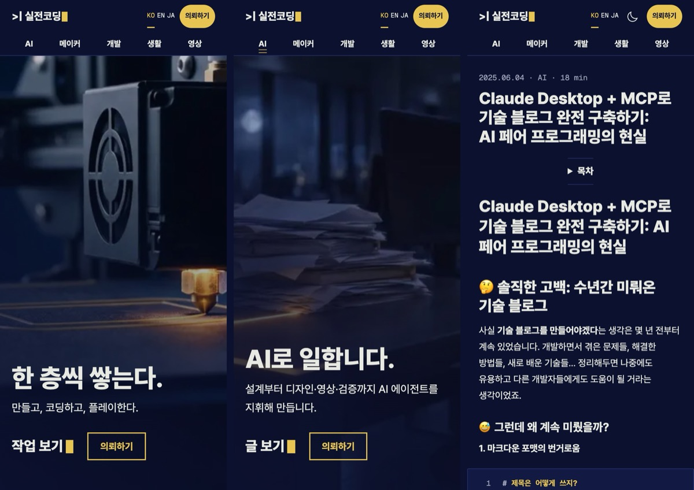

ここでも失敗が2つありました。

**Codexが英語タイトルを11pxにしました。**
とても長い英語タイトルがモバイル画面からはみ出すので、画面幅に合わせて文字を縮めてしまったんです。
はみ出しはしませんが、読めません。
文字サイズに最小値を設け、その代わり非常に長いタイトルは4行まで許容しました。
そのうえで465本すべてをモバイル幅2種類で開き、はみ出す記事が0本であることを確認しました。

**ローカルでは100点なのに、本番では画面がずれました。**
ローカルの測定では画像がすぐ届いてしまうため、画像が遅れて届いたときに起きるレイアウトのずれを捉えられませんでした。
本番に出してから測り直すと、写真の多い記事が70点、レイアウトのずれ（CLS）は0.302。
最初の写真に`width: auto`を指定していたのが原因でした。
これは本番切り替え直後のホットフィックスで直し、98点、ずれ0になりました。

## ホーム映像はHiggsfieldで

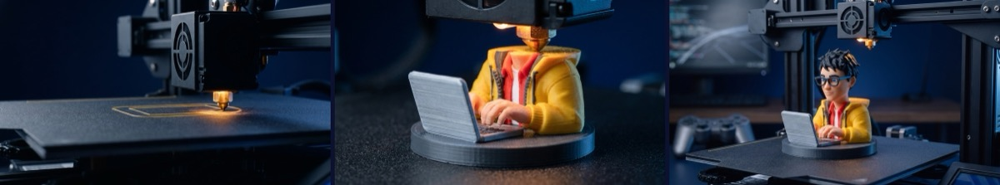

ホームの最初の画面は、スクロールすると前後に動く15秒の映像です。
空のビルドプレートでノズルが層を積み、実戦コーディングのキャラクターが完成し、カメラが引くと工房全体が見えてきます。

作った手順はこうです。

1. キーフレーム画像3枚（開始・中間・終了）を先に出して確認
2. 開始と終了のフレームを入れて、Kling 4.0で15秒の映像を生成
3. Web用にエンコード：スクロールで前後に巻き戻しても途切れないよう、キーフレーム間隔を細かく

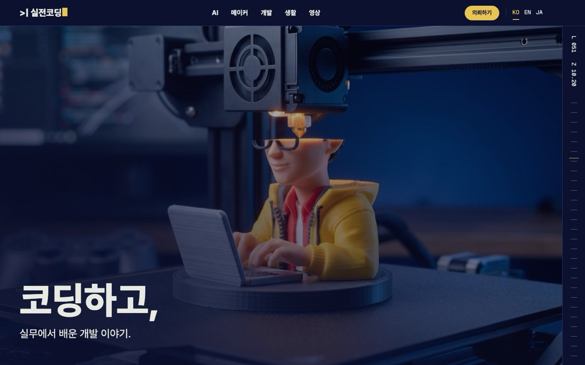

文字とロゴは映像に入れませんでした。
韓国語・英語・日本語の3言語なので、文字はコードで映像の上に重ねます。

最初の企画では、GSAPのような演出ライブラリを入れるつもりでした。
でも実際に作ってみると、CSSのstickyと短いスクリプトで足りました。
スムーズスクロールのライブラリ（Lenis）も、ホームでしか使っていません。
モバイルのデータ節約モードや「視差効果を減らす」設定のときは、映像の代わりに静止画が出ます。

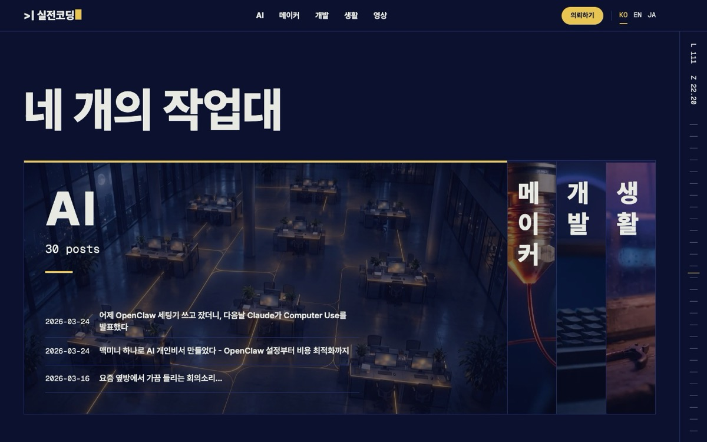

領域ごとに、6秒のループ映像も入れました。
メイカー・開発・ゲーム・日常、そしてご依頼セクションまで。

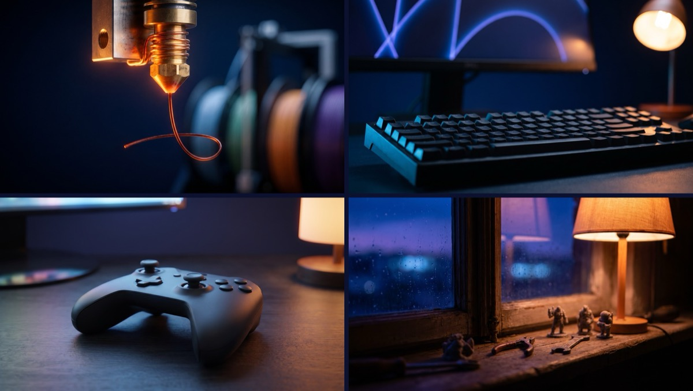

ゲーム領域のキーフレームには、Xbox色のボタン、プレイステーションのライトバー、実在するアプリアイコンのようなものが出てきました。
他社の商標がホームの背景に入っては困るので、出し直しました。

### クレジット家計簿

| 項目 | クレジット |
|---|---|
| デザインボード9枚 | 24.75 |
| ボードのジョブ番号を失くして再生成 | 5.5 |
| ホームのキーフレーム9枚（商標の問題による再生成を含む） | 30 |
| ホーム映像6本（15秒1本＋6秒5本） | 146.25 |
| AX映像1回目（3Dプリンター版、結局使わず） | 約81 |
| AX映像2回目（夜のオフィス） | 約77 |
| **合計** | **約365** |

このうち使わずに捨てたのが約90クレジットです。
4分の1くらいですね。

## 本番切り替えと、すぐに出たバグ

切り替えの手順はこうでした。

1. 旧Jekyllの状態に復旧用のタグを打っておく
2. 新しいサイトをmasterにマージ
3. GitHub PagesのビルドをJekyll標準ビルドからGitHub Actionsに変更
4. push

デプロイされたら、本番サイトで全数検査を回しました。
480件のURL、転送647件、コメント7件、すべて正常です。

ところが、私がホームを見ていて変なものを見つけました。
作業台セクションで折りたたまれている領域パネルの背景写真が、パネルの外にはみ出していたんです。
スクリーンショットを撮って、すぐ投げました。
写真のサイズをパネルに合わせるCSSが数行、抜けていました。

先ほど書いた画面のずれ（CLS 0.302）と合わせて、ホットフィックスは2件。
切り替えから15分もたたないうちに、また出し直しました。

自動検査は数千件をすべて通ったのに、人の目にはすぐ見えるものを捉えられなかったわけです。
これがいちばん印象に残っています。

### その後に続いたフィードバック

切り替えてからは、直すところが次々に見えてきました。

**上部メニューの固定。**
スクロールしてもメニューが上に張り付くようにしました。
モバイルでもハンバーガーメニューをなくし、メニュー項目を2段で常に見えるようにしました。

すると新しい問題が出ました。
ご依頼画面に`#ax`のようなリンクで入ると、フォームの見出しが固定メニューの下に隠れてしまうんです。
最初はスクリプトでスクロール位置を合わせ直そうとしましたが、うまくいきませんでした。
ブラウザがハッシュ位置へスクロールするのがスクリプトより後に起きるため、直した位置を上書きされてしまいます。
結局、CSS一行で終わりました。

```css
/* スクロール余白を画面より大きくすると、移動位置が0で切られてページの先頭で止まる */
.request-page :is(#print, #dev, #ax) { scroll-margin-top: 200vh; }
```

**AIメニュー。**
リニューアルを一通り終えてみたら、肝心の、私が会社で主にやっているAX・DX転換の話がまるごと抜けていました。
AIをほとんどプロのように使っているのに、それがサイトにまったく表れていなかったんです。

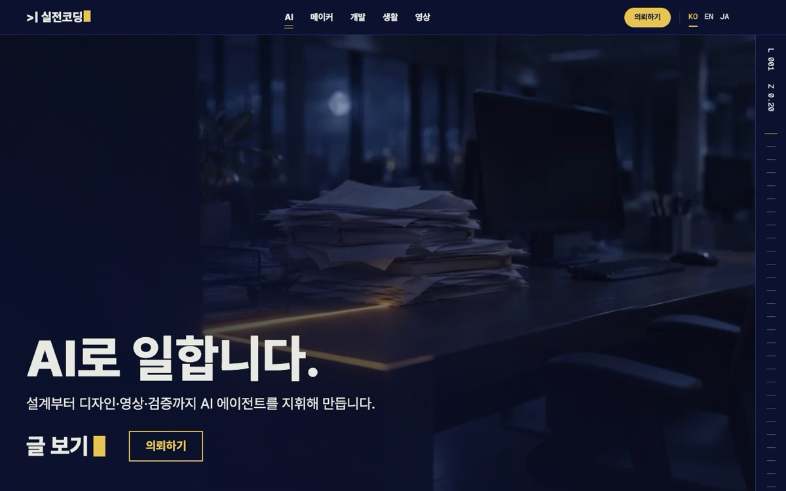

そこでAIをメニューの先頭に入れ、`/ai/`画面を別に作り、ご依頼画面に「AI導入・AX」タブを追加しました。

このとき面白いことがありました。
メインのエージェントがCodexに「AI記事は29本」と指示したのですが、Codexが自分で数えたら30本でした。
それでCodexは作業を止めて、数が合わないと聞いてきました。
調べてみると、メインが`AIエージェント`タグをひとつ落としていたのでした。
AI同士で互いの間違いを見つけてくれたわけです。

**AX映像は2回作りました。**

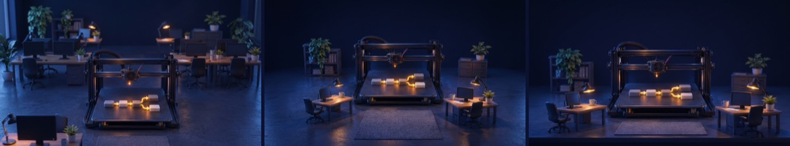

1回目のコンセプトは「業務フローを出力する」でした。
3Dプリンターが業務フロー図を一層ずつ出力していく絵です。

ところが、キーフレーム3枚を別々のシーンで出そうとしたのに、**3枚とも終了シーン**になりました。
上の画像がそれです。
シーンごとのプロンプトを表で持たせようとbashの連想配列を使ったのですが、Macに標準で入っているbash 3.2にはその機能がありません。
表が壊れて、プロンプトがすべて最後の値で上書きされたんです。
4クレジット溶かして、関数に変えて出し直しました。

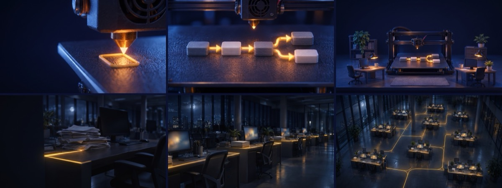

そうして1回目の映像を完成させて貼ってみたのですが、見てみるとホーム映像にそっくりでした。
ホームも3Dプリンター、AXも3Dプリンター。
そこで「別のスタイルにしよう」と言いました。

2回目は**「夜のオフィスが目覚める」**です。
暗いオフィスの机の上に書類が積まれていて、黄色い光が机の間を流れながら、フロア全体がひとつずつ灯っていきます。
AX転換とは結局こういうものだと思っています。

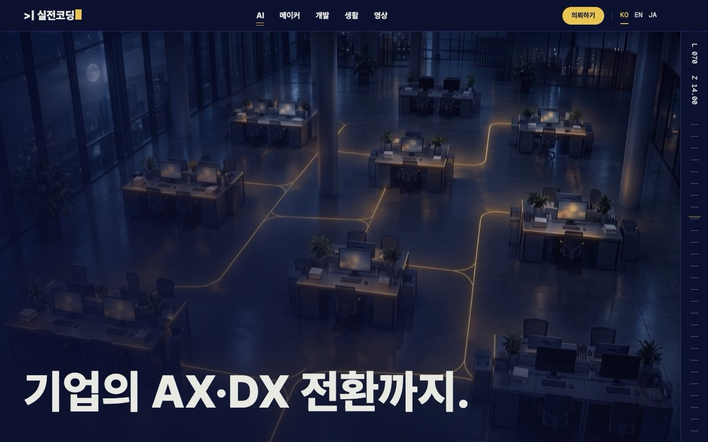

1回目の映像（約81クレジット）は使わず、作業フォルダに残してあります。

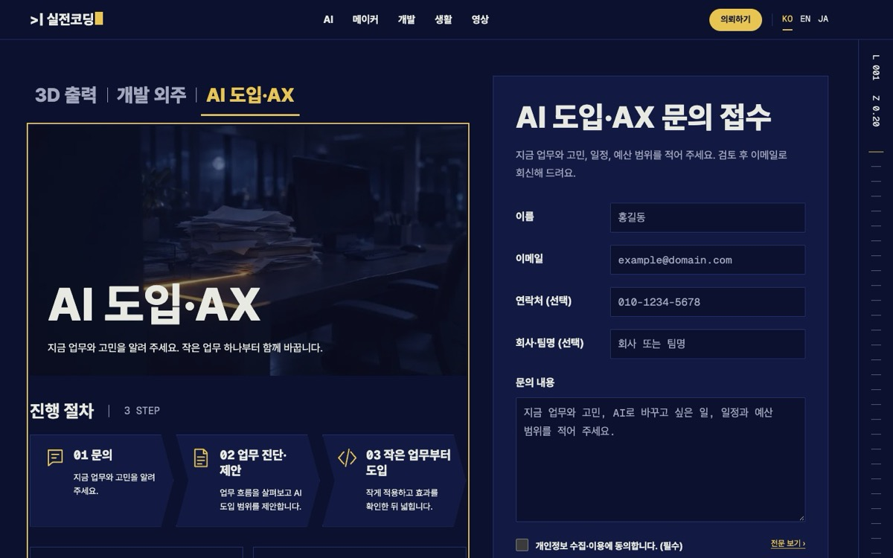

## 間違いのまとめ

一度にまとめるとこうなります。

| 何が間違っていたか | なぜ | 代償 |
|---|---|---|
| デザインボードのジョブ番号を失くした | 生成レスポンスの形式を読み違えた | 5.5クレジット |
| 旧レンダリングのバグまでコピー | 「同じに」を文字通りに受け取りすぎた | 真似コード127行を削除、原文9ファイルを修正 |
| 長い英語タイトルが11px | はみ出しを防いだだけで可読性を見ていなかった | 最小文字サイズを追加 |
| ローカル100点、本番で画面のずれ0.302 | ローカルは画像が即座に届くので捉えられなかった | 本番切り替え後にホットフィックス |
| 折りたたみパネルの外に写真がはみ出した | 写真サイズの固定漏れ | 私のスクリーンショットで発覚、ホットフィックス |
| プレビューで画像・フォントが壊れた | ビルド時にしか作らないファイルを開発サーバーが配信できない | 開発サーバー用の処理を追加 |
| `#ax`リンクで入るとフォーム見出しが隠れる | スクリプトがブラウザのスクロールより先に実行される | CSS一行で解決 |
| AI記事を29本と指示（実際は30本） | タグをひとつ落とした | Codexが止まって確認 |
| AXキーフレーム3枚が同じシーン | Macのbash 3.2に連想配列がない | 4クレジット |
| AX映像の1回目を破棄 | ホーム映像と同じ3Dプリンターの文法 | 約81クレジット |

検査ツールも間違えました。
スムーズスクロールのライブラリが検査スクリプトのスクロールを横取りして失敗のように見えたり、上部ロゴを探すセレクタがフッターのロゴまで拾ったりしました。
赤信号が出たからといって、必ずしも製品のバグとは限りません。
検査結果も、一度は疑ってみる必要があります。

## やってみて感じたこと

**AIが書いたコードも、数字で確認する必要があります。**
465本、URL480件、転送647件。
人の目ではとても全部は見られません。
だから比較スクリプトを先に作り、その数字が0になるまで回しました。

**でも、数字だけでは足りません。**
数千件の検査を通ったサイトで、折りたたみパネルの外にはみ出した写真は、私の目が先に見つけました。
AX映像がホームに似すぎているというのも、検査では出てきません。

**人がやるのは、方向と好みです。**
ブログをポータルに変えようということ。
メニューは上に固定しようということ。
AX映像は別のスタイルにしようということ。
そして、お金が出る生成と本番デプロイは私が承認することです。

去年6月に[Claude Desktop + MCPでブログを直したとき](/ja/2025/06/04/building-tech-blog-with-claude-mcp/)は、AI一つと一緒にコードを書きました。
今回はエージェントが複数、役割を分けて働き、私はほとんど監督だけでした。
1年半で、働き方がこれだけ変わりました。

会社で進めているAX転換も、結局はこの話だと思っています。
AIが仕事をして、人は方向を決めて確認する。

まだ残っていることもあります。

- ご依頼の受付サーバー — 今はメールで受けています
- ゲーム攻略 — 0本なのでメニューが隠れています
- 旧Jekyllファイルの整理 — 念のため1か月は残しておきます

似たようなブログの引っ越しをされた方がいたら、ぜひコメントで教えてください。
特にURLを守るあたりの苦労は、みなさん似ているのではないでしょうか。

P.S. このリニューアルの過程は、動画にもしている最中です。
できたらここに貼る予定です。
