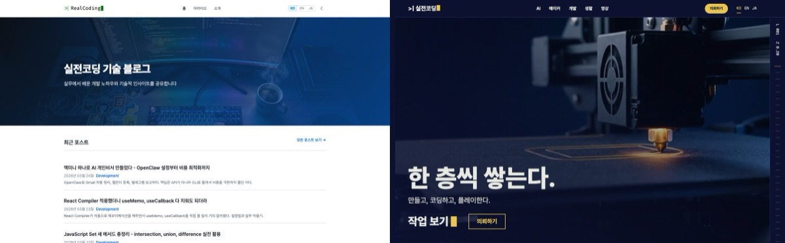

왼쪽이 어제까지의 realcoding.blog.
오른쪽이 오늘이다.

블로그를 포털로 갈아엎었다.
이름도 "실전코딩 기술 블로그"에서 **실전코딩 작업실**로 바꿨다.

기획을 시작한 게 어젯밤 10시 40분쯤이었다.
운영 사이트가 새 디자인으로 바뀐 게 오늘 오전 11시쯤.
대략 12시간이다.

코드는 내가 거의 안 쳤다.
Claude Code가 계획을 세우고, Codex가 코드를 짜고, Higgsfield가 디자인 보드와 영상을 만들었다.
나는 질문에 답하고, 보고 고르고, "올려도 돼" 하는 역할이었다.

근데 순탄하진 않았다 ㅋㅋ
크레딧도 날리고, AI가 옛날 버그까지 복사해 오고, 운영에 올리자마자 깨진 화면도 나왔다.
그 얘기까지 다 적어 본다.

## 왜 갈아엎었나

이 블로그는 원래 개발 팁 블로그였다.
Jekyll로 만들었고, 글 155편을 한국어·영어·일본어로 써서 465편이 쌓여 있었다.

근데 이번 달부터 3D 프린터 글이 생기기 시작했다.
[H3C 개봉기](/2026/11/07/bambulab-h3c-ams3-unboxing/) 같은 거.
게임 공략도 쓰고 싶고, 출력 의뢰나 개발 외주도 받고 싶었다.

"기술 블로그" 틀에는 이게 다 안 맞더라.
3D 프린터 글은 시간순 목록에서 개발 글 사이에 묻히고, 의뢰를 받을 창구도 없었다.

그래서 블로그가 아니라 포털로 바꾸기로 했다.

- **AI** — AI를 실제로 어떻게 쓰는지, 기업 AX·DX 전환
- **메이커** — 3D 프린팅 작업물
- **개발** — 원래 있던 개발 글 대부분
- **게임** — 플레이하는 게임 공략(아직 0편이라 메뉴에서 숨겨 놨다)
- **생활** — 일상
- **의뢰** — 3D 출력, 개발 외주, AI 도입·AX 문의

## 기획: 내가 한 일은 고르는 거였다

처음에 Claude Code한테 이렇게만 던졌다.
"블로그를 포털로 바꾸고 싶다. 역동적이고 기술이 많이 들어간 홈페이지면 좋겠다. 디자인은 힉스필드 도움을 받자."

그러니까 기획안이 나왔다.
사이트 구조, 기술 선택, 영상 자리, 진행 단계, 그리고 내가 승인해야 하는 멈춤 지점까지.

역할은 이렇게 나뉘었다.

| 누가 | 한 일 |
|---|---|
| Claude Code (메인) | 기획, 작업 쪼개기, 검수 판정, 나랑 대화 |
| 설계 담당 에이전트 | 기술 선택, 큰 판단 |
| Codex | 실제 코드 작성 |
| Higgsfield | 디자인 보드, 홈 영상 |
| 나 | 답하기, 고르기, 배포·유료 생성 승인 |

기술은 **Astro**로 갈아탔다.
Jekyll을 그대로 쓰면 번들러가 없어서 홈 연출용 스크립트가 글 페이지에도 다 실린다.
홈은 화려하게, 글 페이지는 가볍게 하려면 둘을 나눌 수 있어야 했다.
Jekyll을 유지하는 안은 "주소 보존에 실패하면 되돌아갈 안"으로만 남겨 뒀다.

### 디자인 보드 9장

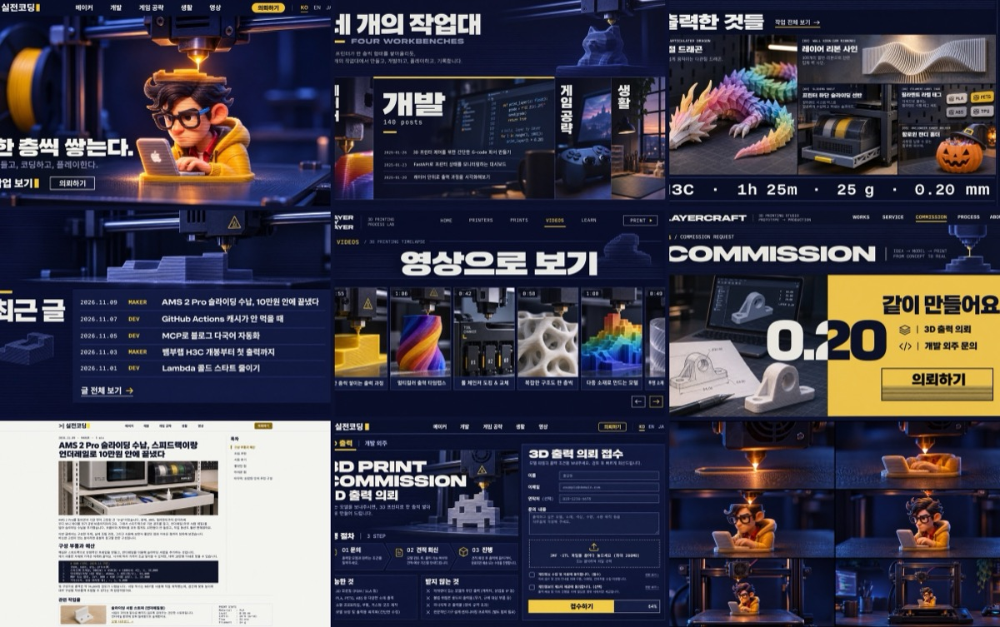

디자인은 Higgsfield 웹사이트 빌더를 썼다.
근데 사이트를 거기서 만들어 배포하진 않았다.
**디자인 브리프와 레퍼런스 보드까지만** 뽑고, 실제 구현은 우리 쪽 코드로 했다.

콘셉트는 "한 층씩 쌓는다".
3D 출력의 층 = 코드의 층 = 게임의 레벨.
색은 울트라마린 잉크에 캐릭터 후드의 노란색을 포인트로 잡았다.

보드 9장을 보고 바로 승인했다.
여기까진 좋았는데...

**첫 번째 실수.**
보드를 생성하다가 작업 번호 하나를 잃어버렸다.
생성 요청을 보내면 `["작업번호"]` 같은 목록이 돌아오는데, 그걸 사전 형태로 읽으려다 번호를 놓친 거다.
결과를 찾을 수가 없어서 같은 걸 다시 생성했다.
5.5크레딧이 그냥 날아갔다 ㅠㅠ

이후로는 생성 응답을 해석하기 전에 원문부터 파일에 저장하는 걸 규칙으로 박아 뒀다.

## 465편의 주소를 하나도 안 잃기

블로그 이사의 진짜 일은 디자인이 아니더라.
**주소**다.

검색으로 들어오는 사람은 옛 주소로 들어온다.
댓글은 Utterances를 쓰는데, 주소를 기준으로 붙는다.
주소가 한 글자만 바뀌어도 그 글의 댓글이 사라진다.

그래서 디자인보다 먼저 운영 사이트의 기준선을 떴다.

- 운영 sitemap 주소 **480개**
- 옛 주소 → 새 주소 이동 페이지 **647건**
- 댓글이 달린 경로 **7개**

그리고 함정이 나왔다.

**함정 1. 날짜가 UTC다.**
Jekyll은 주소의 날짜를 UTC 기준으로 만든다.
그래서 한국 시간 오전 9시 전에 쓴 글은 파일명 날짜랑 주소 날짜가 하루 어긋난다.
이런 글이 33편이었다.
Astro에서도 일부러 똑같이 어긋나게 만들었다 ㅋㅋ

**함정 2. 접두사 없는 영어·일본어 글 20편.**
옛날 영어·일본어 글 일부가 `/en/` 없이 한국어 글이랑 같은 모양의 주소를 쓰고 있었다.
정리된 주소로 옮기고, 옛 주소에는 이동 페이지를 남겼다.

**함정 3. AI가 옛날 버그까지 복사했다.**
이게 제일 웃겼다.
Codex한테 "운영 사이트랑 똑같이 나오게" 만들라고 했더니, 정말 똑같이 만들었다.
옛 렌더러의 **버그까지** 흉내 내는 코드를 127줄이나 써 온 거다.
목록 안의 코드 블록이 안 닫히는 버그, 링크 글자 속 `|`가 표로 바뀌는 버그 같은 것들.

주소 비교는 다 통과했다.
근데 이건 아니잖아...
흉내 코드는 빼고, 버그가 있던 원문 3편(3개 언어라 9파일)을 직접 고쳤다.

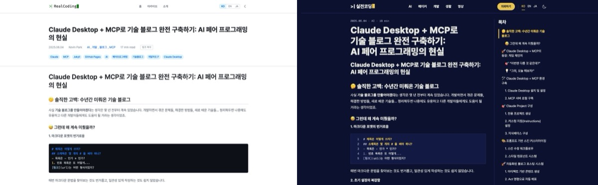

검증은 전부 숫자로 했다.
운영 사이트와 새 빌드를 주소 단위로 전수 비교하는 스크립트를 만들어서,

- 480개 주소 누락 **0**
- 이동 647건 대상 불일치 **0**
- 언어별 대응 주소(hreflang) 차이 **0**
- 댓글 경로 7개 일치

운영 전환 후에도 실제 사이트에 대고 같은 검사를 다시 돌렸다.

덤으로 하나 발견했다.
작년에 쓴 AI 블로그 시리즈 3편의 대표 이미지가 원래 없었다.
운영 사이트에서도 404였다.
1년 넘게 깨져 있었는데 몰랐던 거다 ㅋㅋ
리뉴얼하다 찾았으니 그나마 다행이다.

## 글 페이지는 가볍게

홈은 영상이 돌아가지만, 글 페이지에는 연출 스크립트를 하나도 안 넣었다.
테마 전환, 코드 복사, 목차, 이미지 확대 정도만.
mermaid 다이어그램이랑 댓글은 화면 근처에 왔을 때만 불러온다.

제일 효과가 컸던 건 이미지다.
어떤 글은 대표 이미지가 **2.5MB짜리 PNG**였다.
빌드할 때 WebP로 480·768·960·1440px 네 가지 크기를 만들어서, 화면에 맞는 걸 내려보내게 했다.
그 이미지가 **55KB**가 됐다.

Lighthouse 모바일 점수(운영 사이트, 같은 측정 방식)로 보면 이렇다.

| 페이지 | 이전 | 이후 |
|---|---|---|
| mermaid 다이어그램 많은 글 | 60 | 92 |
| AMS 글 (사진 많은 글) | 91 | 98 |
| 홈 | — | 100 |
| AI 화면 | — | 100 |

mermaid 글은 예전에 큰 그림이 뜨기까지 34초가 걸렸었다.
느린 모바일 가정이긴 하지만 34초면... 다들 그냥 나갔겠지 ㅠㅠ

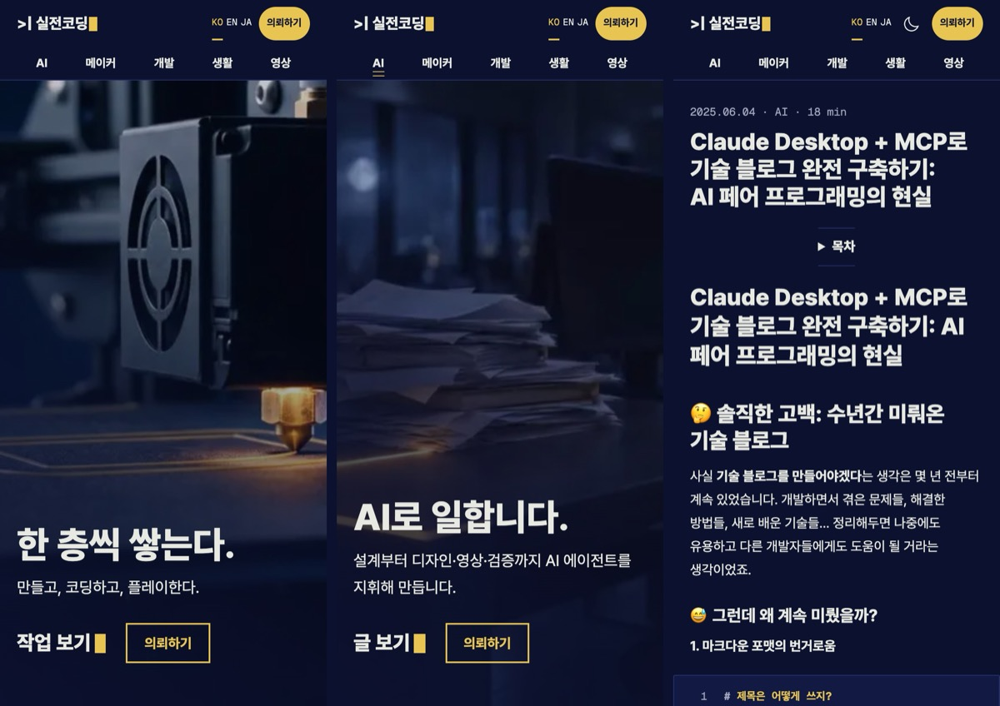

여기서도 실수가 두 개 있었다.

**Codex가 영어 제목을 11px로 만들었다.**
아주 긴 영어 제목이 모바일 화면을 넘치니까, 화면 폭에 맞춰 글자를 줄여 버린 거다.
넘치진 않는데 읽을 수가 없다 ㅋㅋ
글자 크기에 최소값을 걸고, 대신 아주 긴 제목은 4줄까지 허용했다.
그다음 465편 전부를 모바일 폭 두 가지로 열어서 넘치는 글이 0편인지 확인했다.

**로컬에서는 100점인데 운영에서는 화면이 밀렸다.**
로컬 측정에서는 이미지가 바로 와 버리니까, 이미지가 늦게 올 때 생기는 화면 밀림을 못 잡더라.
운영에 올리고 다시 재 보니 사진 많은 글이 70점, 화면 밀림(CLS) 0.302.
첫 사진에 `width: auto`를 준 게 원인이었다.
이건 운영 전환 직후 핫픽스로 고쳤고, 98점에 밀림 0이 됐다.

## 홈 영상은 Higgsfield로

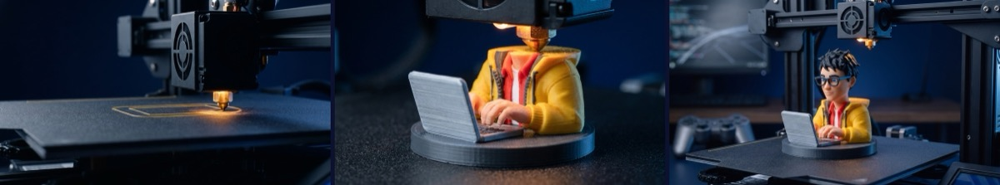

홈 첫 화면은 스크롤하면 앞뒤로 움직이는 15초짜리 영상이다.
빈 빌드판에서 노즐이 층을 쌓고, 실전코딩 캐릭터가 완성되고, 카메라가 빠지면서 작업실 전체가 보인다.

만든 순서는 이렇다.

1. 키프레임 이미지 3장(시작·중간·끝)을 먼저 뽑아서 확인
2. 시작·끝 프레임을 넣어 Kling 4.0으로 15초 영상 생성
3. 웹용으로 인코딩: 스크롤로 앞뒤로 감아도 끊기지 않게 키프레임 간격을 촘촘하게

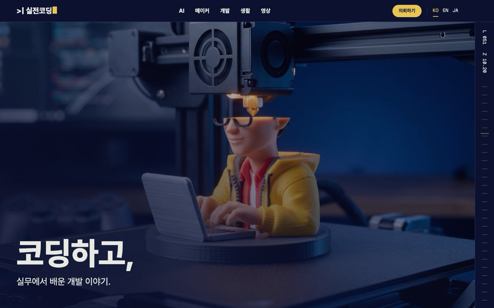

글자랑 로고는 영상에 넣지 않았다.
한국어·영어·일본어 세 언어라서, 글자는 코드로 영상 위에 얹는다.

처음 기획엔 GSAP 같은 연출 라이브러리를 넣을 생각이었다.
근데 막상 만들어 보니 CSS sticky랑 짧은 스크립트로 충분하더라.
부드러운 스크롤 라이브러리(Lenis)도 홈에서만 쓴다.
모바일 데이터 절약 모드나 "움직임 줄이기" 설정이면 영상 대신 정지 이미지가 나온다.

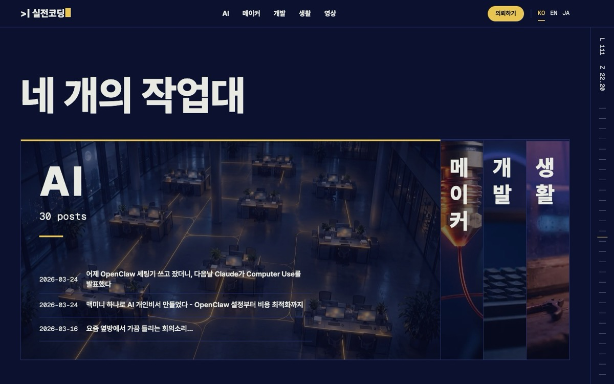

영역마다 6초짜리 반복 영상도 넣었다.
메이커·개발·게임·생활, 그리고 의뢰 섹션까지.

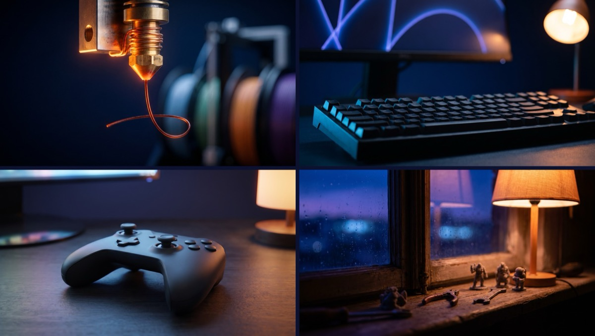

게임 영역 키프레임에서는 Xbox 색 버튼, 플레이스테이션 라이트바, 실제 앱 아이콘 같은 게 나왔다.
남의 상표가 홈 배경에 박히면 곤란하니까 다시 뽑았다.

### 크레딧 가계부

| 항목 | 크레딧 |
|---|---|
| 디자인 보드 9장 | 24.75 |
| 보드 작업 번호 잃어버려서 다시 생성 | 5.5 |
| 홈 키프레임 9장 (상표 문제 재생성 포함) | 30 |
| 홈 영상 6편 (15초 1편 + 6초 5편) | 146.25 |
| AX 영상 1차 (3D 프린터 버전, 결국 안 씀) | 약 81 |
| AX 영상 2차 (밤의 사무실) | 약 77 |
| **합계** | **약 365** |

이 중에 안 쓰고 버린 게 약 90크레딧이다.
4분의 1쯤 ㅋㅋ

## 운영 전환, 그리고 바로 나온 버그

전환은 이렇게 했다.

1. 옛 Jekyll 상태에 복구용 태그를 박아 둠
2. 새 사이트를 master에 합침
3. GitHub Pages 빌드 방식을 Jekyll 기본 빌드에서 GitHub Actions로 변경
4. push

배포되고 운영 사이트에서 전수 검사를 돌렸다.
480개 주소, 647건 이동, 댓글 7개 다 정상.

근데 내가 홈을 보다가 이상한 걸 찾았다.
작업대 섹션에서 접혀 있는 영역 조각의 배경 사진이 조각 밖으로 삐져나와 있더라.
스크린샷을 찍어서 바로 던졌다.
사진 크기를 조각에 맞추는 CSS 몇 줄이 빠져 있었다.

앞에서 말한 화면 밀림(CLS 0.302)까지 핫픽스 2건.
전환하고 15분도 안 돼서 다시 올렸다.

자동 검사는 수천 건을 다 통과했는데, 사람 눈에 바로 보이는 건 못 잡은 거다.
이게 제일 기억에 남는다.

### 그 뒤로 이어진 피드백

전환하고 나서 보니 고칠 게 계속 보였다.

**상단 메뉴 고정.**
스크롤해도 메뉴가 위에 붙어 있게 했다.
모바일에서도 햄버거 메뉴를 없애고 메뉴 항목을 두 줄로 항상 보이게 했다.

그랬더니 새 문제가 생겼다.
의뢰 화면에 `#ax` 같은 링크로 들어오면, 폼 제목이 고정 메뉴 밑에 가려진다.
처음엔 스크립트로 스크롤을 다시 맞추려고 했는데 안 되더라.
브라우저가 해시 위치로 스크롤하는 게 스크립트보다 나중에 일어나서, 고쳐 놓은 위치를 다시 덮어 버린다.
결국 CSS 한 줄로 끝났다.

```css
/* 스크롤 여백을 화면보다 크게 주면 이동 위치가 0으로 잘려 페이지 맨 위에서 멈춘다 */
.request-page :is(#print, #dev, #ax) { scroll-margin-top: 200vh; }
```

**AI 메뉴.**
리뉴얼을 다 해 놓고 보니까, 정작 내가 회사에서 주로 하는 AX·DX 전환 얘기가 통째로 빠져 있었다.
AI를 거의 프로처럼 쓰고 있는데 그게 사이트에 하나도 안 드러나는 거다.

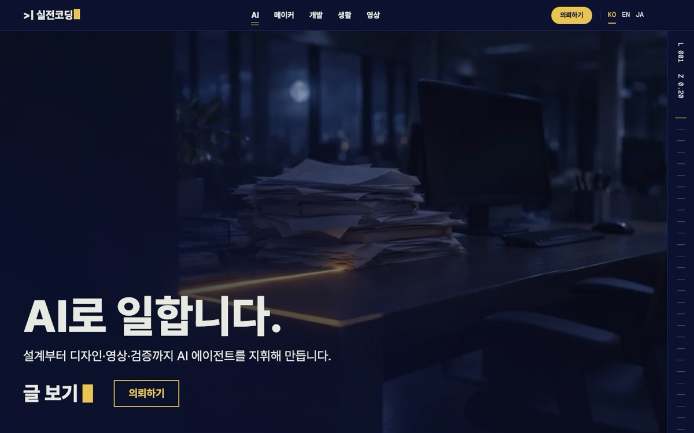

그래서 AI를 메뉴 맨 앞에 넣고, `/ai/` 화면을 따로 만들고, 의뢰 화면에 "AI 도입·AX" 탭을 추가했다.

이때 재밌는 일이 있었다.
메인 에이전트가 Codex한테 "AI 글은 29편"이라고 지시했는데, Codex가 직접 세어 보니 30편이었다.
그래서 Codex가 작업을 멈추고 숫자가 안 맞는다고 물어봤다.
알고 보니 메인이 `AI에이전트` 태그 하나를 빠뜨린 거였다.
AI끼리 서로 틀린 걸 잡아 준 거다 ㅎㅎ

**AX 영상은 두 번 만들었다.**

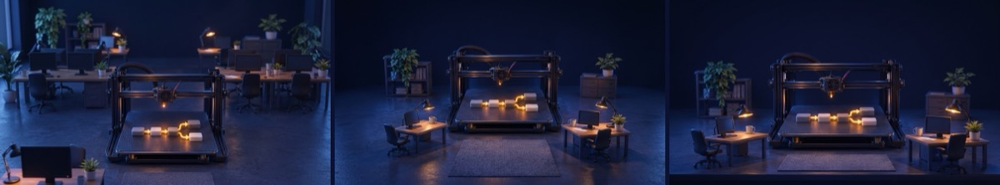

1차 콘셉트는 "업무 흐름을 출력한다"였다.
3D 프린터가 업무 흐름도를 한 층씩 출력하는 그림.

근데 키프레임 3장을 서로 다른 장면으로 뽑으려 했는데 **셋 다 끝 장면**이 나왔다.
위 사진이 그거다.
장면별 프롬프트를 표로 들고 있으려고 bash 연관 배열을 썼는데, 맥에 기본으로 깔린 bash 3.2에는 그 기능이 없다.
표가 깨져서 프롬프트가 전부 마지막 값으로 덮인 거다.
4크레딧 날리고, 함수로 바꿔서 다시 뽑았다 ㅠㅠ

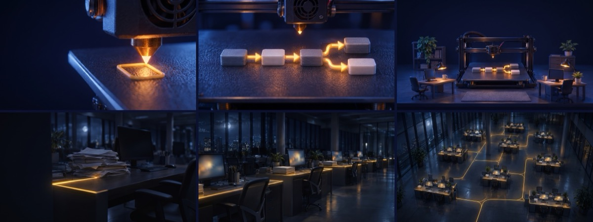

그렇게 1차 영상을 완성해서 붙였는데, 보니까 홈 영상이랑 너무 비슷했다.
홈도 3D 프린터, AX도 3D 프린터.
그래서 "다른 스타일로 가자"고 했다.

2차는 **"밤의 사무실이 깨어난다"**.
어두운 사무실 책상 위에 서류가 쌓여 있고, 노란 빛이 책상 사이를 흐르면서 층 전체가 하나씩 켜진다.
AX 전환이 결국 이런 거라고 생각한다.

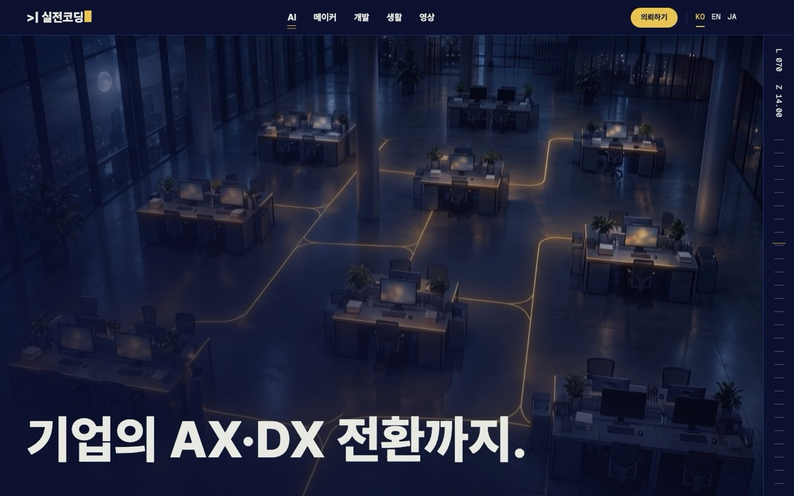

1차 영상(약 81크레딧)은 안 쓰고 작업 폴더에 남겨 뒀다.

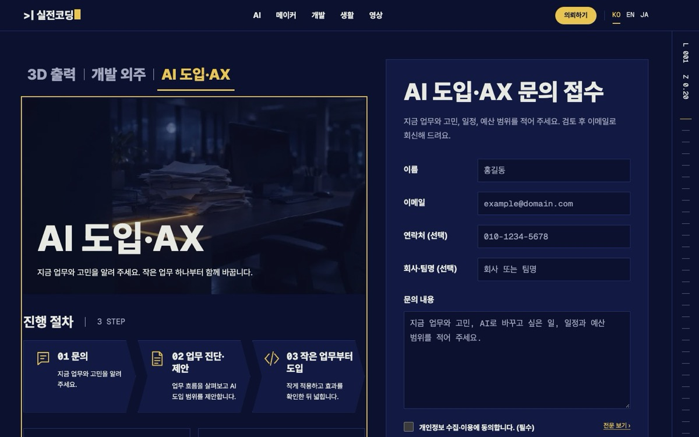

## 틀렸던 것 모음

한 번에 모아 보면 이렇다.

| 무엇이 틀렸나 | 왜 | 대가 |
|---|---|---|
| 디자인 보드 작업 번호를 잃어버림 | 생성 응답 형식을 잘못 읽음 | 5.5크레딧 |
| 옛 렌더링 버그까지 복사 | "똑같이"를 너무 글자 그대로 받아들임 | 흉내 코드 127줄 삭제, 원문 9파일 수정 |
| 긴 영어 제목이 11px | 넘침만 막고 가독성은 안 봄 | 최소 글자 크기 추가 |
| 로컬 100점, 운영 화면 밀림 0.302 | 로컬은 이미지가 즉시 와서 못 잡음 | 운영 전환 후 핫픽스 |
| 접힌 조각 밖으로 사진이 넘침 | 사진 크기 고정 누락 | 내 스크린샷 제보, 핫픽스 |
| 미리보기에서 깨진 이미지·글꼴 | 빌드에서만 만드는 파일을 개발 서버가 못 줌 | 개발 서버용 처리 추가 |
| `#ax` 링크로 들어오면 폼 제목이 가림 | 스크립트가 브라우저 스크롤보다 먼저 실행 | CSS 한 줄로 해결 |
| AI 글 29편이라고 지시 (실제 30편) | 태그 하나 누락 | Codex가 멈추고 확인 |
| AX 키프레임 3장이 같은 장면 | 맥 bash 3.2에 연관 배열 없음 | 4크레딧 |
| AX 1차 영상을 버림 | 홈 영상과 같은 3D 프린터 문법 | 약 81크레딧 |

검사 도구도 틀렸다.
부드러운 스크롤 라이브러리가 검사 스크립트의 스크롤을 가로채서 실패처럼 보이기도 했고, 상단 로고를 찾는 선택자가 바닥글 로고까지 잡기도 했다.
빨간 불이 떴다고 무조건 제품 버그는 아니더라.
검사 결과도 한 번은 의심해 봐야 한다.

## 해 보고 느낀 것

**AI가 짠 코드도 숫자로 확인해야 한다.**
465편, 주소 480개, 이동 647건.
사람 눈으로는 절대 다 못 본다.
그래서 비교 스크립트를 먼저 만들고, 그 숫자가 0이 될 때까지 돌렸다.

**근데 숫자만으로는 부족하다.**
수천 건 검사를 통과한 사이트에서, 접힌 조각 밖으로 넘친 사진은 내 눈에 먼저 보였다.
AX 영상이 홈이랑 너무 비슷하다는 것도 검사로는 안 나온다.

**사람이 하는 일은 방향과 취향이다.**
블로그를 포털로 바꾸자는 것.
메뉴는 위에 고정하자는 것.
AX 영상은 다른 스타일로 가자는 것.
그리고 돈 나가는 생성이랑 운영 배포는 내가 승인하는 것.

작년 6월에 [Claude Desktop + MCP로 블로그를 고쳤을 때](/2025/06/04/building-tech-blog-with-claude-mcp/)는 AI 하나랑 같이 코드를 짰었다.
이번엔 에이전트 여러 개가 역할을 나눠서 일했고, 나는 거의 감독만 했다.
1년 반 사이에 일하는 방식이 이만큼 바뀌었다.

회사에서 하는 AX 전환도 결국 이 얘기라고 생각한다.
AI가 일을 하고, 사람은 방향을 정하고 확인한다.

아직 남은 것도 있다.

- 의뢰 접수 서버 — 지금은 메일로 받는다
- 게임 공략 — 0편이라 메뉴가 숨어 있다 ㅋㅋ
- 옛 Jekyll 파일 정리 — 혹시 몰라 한 달은 남겨 둔다

비슷하게 블로그를 옮겨 본 분 있으면 댓글로 얘기해 주세요.
특히 주소 지키기 쪽 삽질은 다들 비슷할 것 같은데...

## 영상으로도 만들었다

이 리뉴얼 과정을 영상으로도 만들었다.
영상도 같은 방식이다. 내레이션은 내 목소리 음색만 가져온 AI 음성이고, 조립은 Codex가 했다.
영어가 기본이라 한국어 자막이 같이 나온다.

<div style="position: relative; width: 100%; aspect-ratio: 16 / 9; margin: 1.5rem auto;">
  <iframe src="https://www.youtube.com/embed/a74rXmOkw3s?cc_lang_pref=ko&cc_load_policy=1" title="블로그를 12시간 만에 포털로, 코드는 AI 에이전트가 짰습니다" style="position: absolute; inset: 0; width: 100%; height: 100%; border: 0;" allow="accelerometer; autoplay; clipboard-write; encrypted-media; gyroscope; picture-in-picture; web-share" allowfullscreen loading="lazy"></iframe>
</div>

1분짜리 쇼츠도 있다.

<div style="position: relative; width: 100%; max-width: 360px; aspect-ratio: 9 / 16; margin: 1.5rem auto;">
  <iframe src="https://www.youtube.com/embed/IrJNWTfm8oM?cc_lang_pref=ko&cc_load_policy=1" title="AI 에이전트가 12시간 만에 블로그를 갈아엎었다" style="position: absolute; inset: 0; width: 100%; height: 100%; border: 0;" allow="accelerometer; autoplay; clipboard-write; encrypted-media; gyroscope; picture-in-picture; web-share" allowfullscreen loading="lazy"></iframe>
</div>
