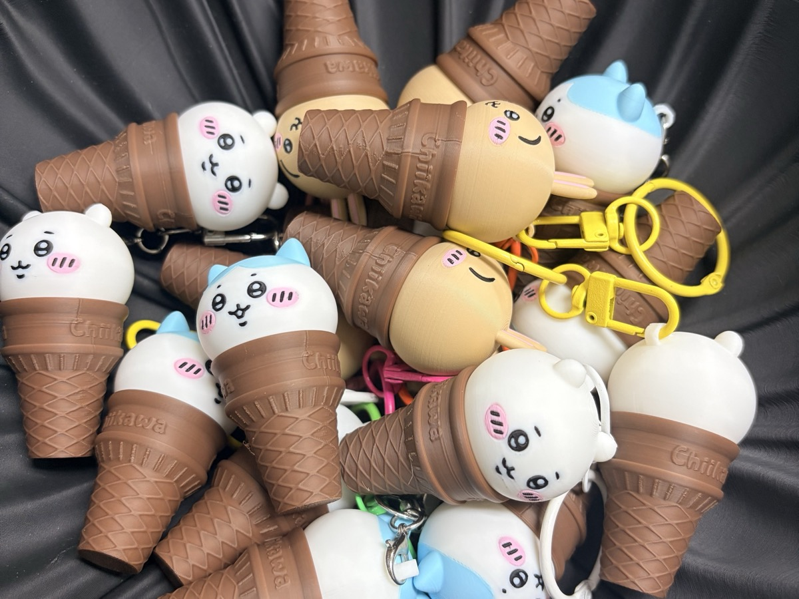
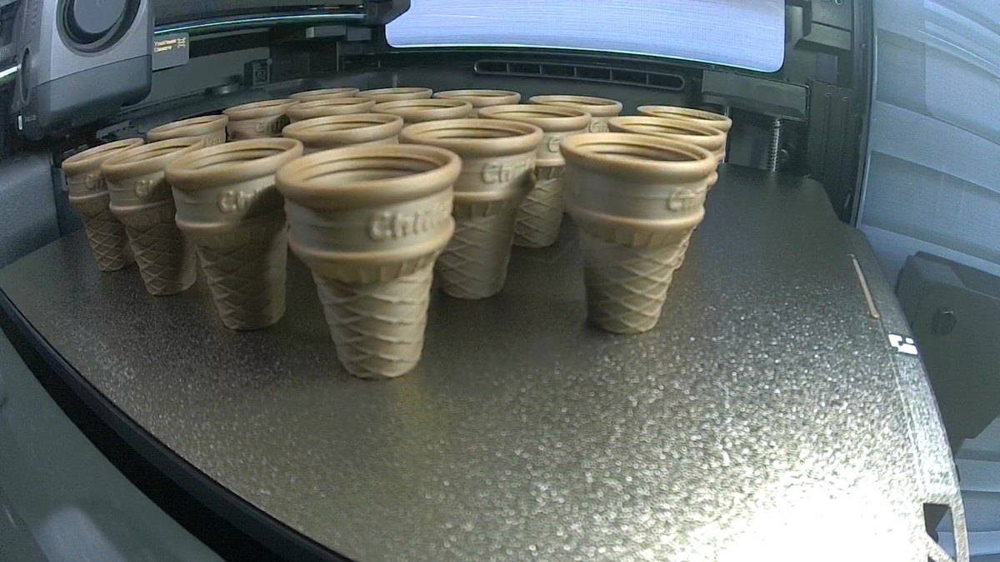
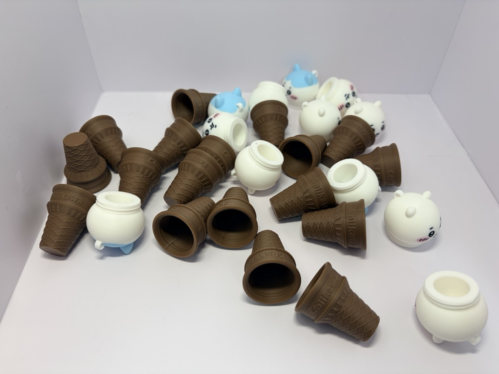
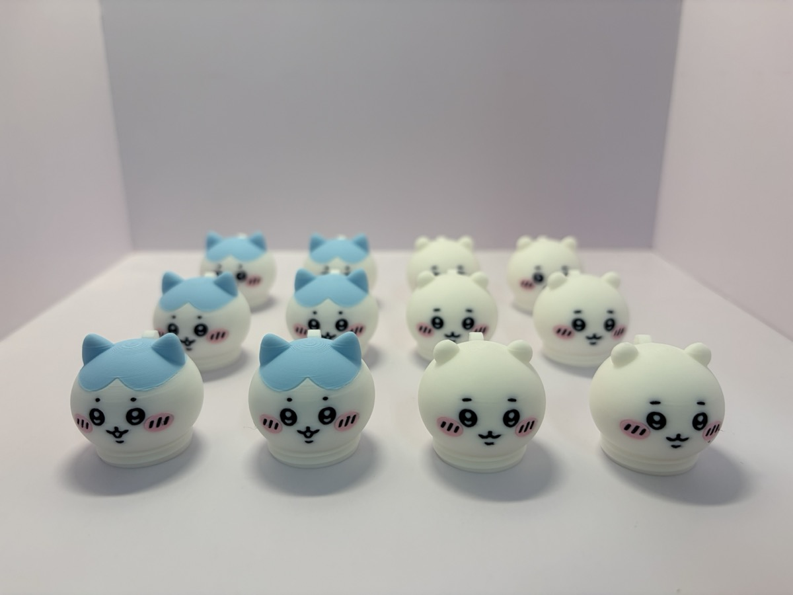
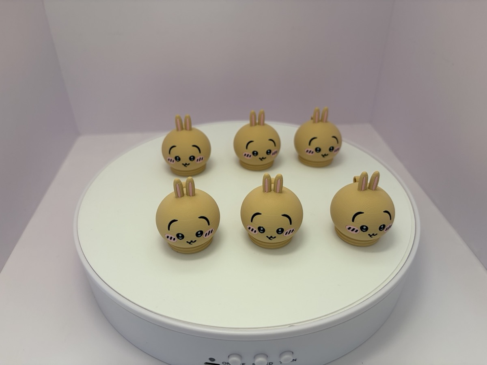
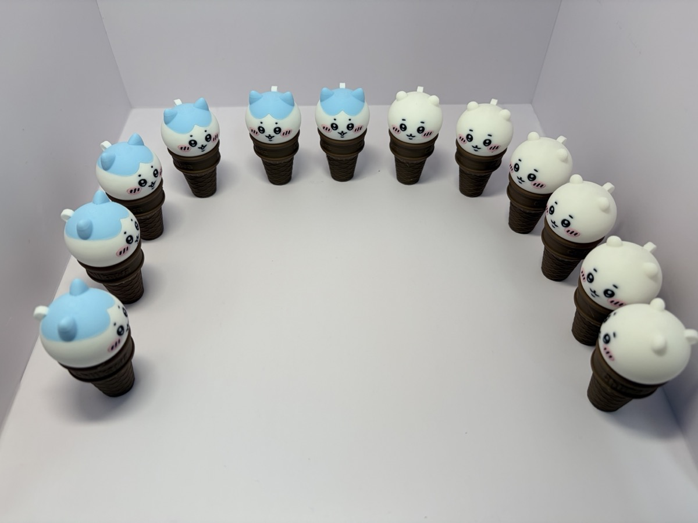
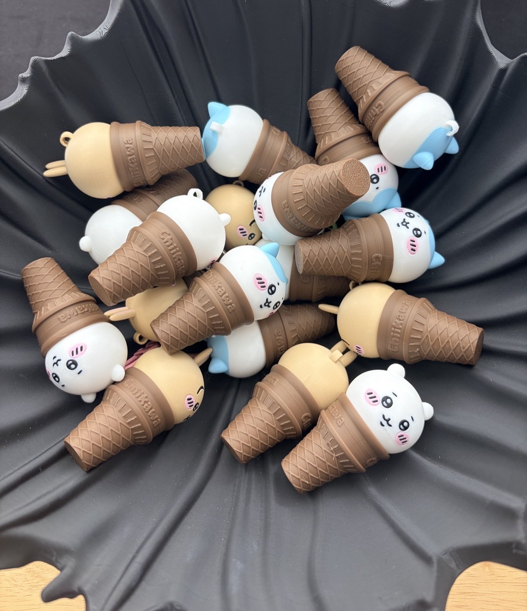
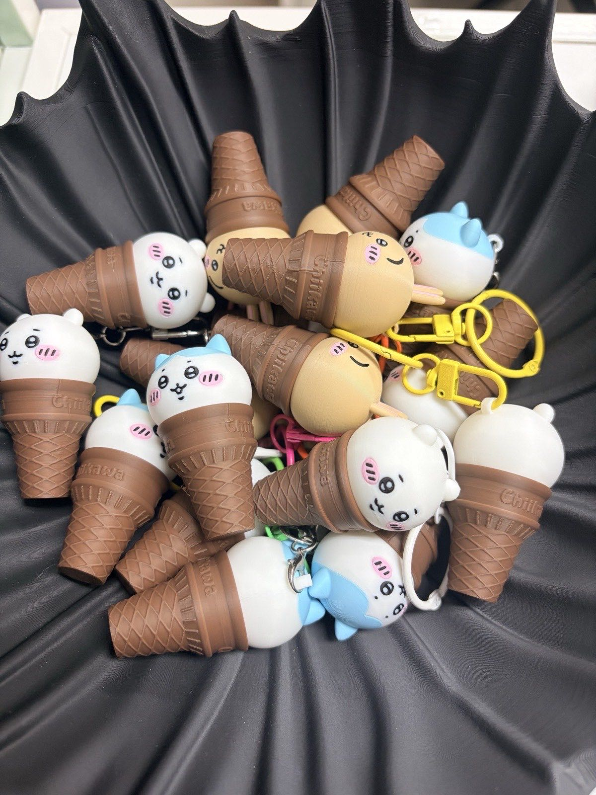

This time it's Chiikawa.
Chiikawa, Hachiware, and Usagi.
A keychain where each of the three sits on top of an ice cream cone.

I made them as gifts: six of each character, 18 in total.

## A tiny case that opens with a twist

The model is an ice cream cone keychain by Aoaobear on MakerWorld.
The original title is "吉伊卡哇甜筒·随身小补给钥匙扣", which roughly means "Chiikawa ice cream cone, a little snack case you can carry around."

The design is clever.
The character's head screws onto the cone like a cap.
The inside is hollow, so you can keep something small in it.
There's a loop on top of the head, so all you need is a keyring clip.

The original project prints one of each character, three in total.
I bumped every plate up to six of each.

## Cones on the X2D, 18 in one plate

The cones are a single brown color.
So I put all 18 on one plate on the X2D.

The "Chiikawa" lettering on the side and the waffle pattern came out nice and crisp.

Here are the cones and heads laid out together.
You can see the heads are hollow too.

## Heads in full color on the H3C

The heads have a lot of colors.
White faces, black eyes, pink cheeks.
Hachiware has a light blue top, and Usagi has a beige body with pink ears.

So the heads went to the H3C.
Just like with the [H3C multicolor figures](/en/2026/11/08/bambulab-h3c-multicolor-figure/), each color gets its own nozzle, so lots of colors aren't a problem.

Six Chiikawa and six Hachiware on one plate.
The slicer estimate was 6 hours 16 minutes.
I started it around 1 a.m. and took it out in the morning.

The faces are small, but the eyes, mouths, and cheeks came out clean with no smudging.
I think the 0.12 mm layer height helped too.

Usagi got its own plate of six.
That one was 3 hours 14 minutes by the slicer estimate.

## Twist the heads onto the cones

Twist a head onto a cone and you get this.
Lined up like this, it looks like a little ice cream shop :)

With the Usagi done too, I put all 18 together in a black bowl.

Add the keyring clips and the gifts are ready.
The colorful clips make them look even more like the real thing.

## Summary

- 18 ice cream cone keychains of Chiikawa, Hachiware, and Usagi (six of each)
- Cones: 18 in one plate on the X2D (single brown color)
- Heads: multicolor on the H3C (12 Chiikawa and Hachiware on one plate, 6 Usagi on another)
- Each head twists off to open a tiny case for snacks

I hope the people who get them like them.

Have you ever made a gift with a 3D printer?
Let me know what you printed in the comments. I'd love some ideas.

## Watch the video

I put the whole thing, from printing to the finished keychains, into a quiet short.
The background music is a calm 8-bit track I made myself.

  <iframe src="https://www.youtube.com/embed/RseZJz4l1g4" title="Chiikawa Ice Cream Keychains: 18 Gifts, 3D Printed" style="position: absolute; inset: 0; width: 100%; height: 100%; border: 0;" allow="accelerometer; autoplay; clipboard-write; encrypted-media; gyroscope; picture-in-picture; web-share" allowfullscreen loading="lazy"></iframe>

- YouTube Short: [Chiikawa Ice Cream Keychains: 18 Gifts, 3D Printed](https://www.youtube.com/shorts/RseZJz4l1g4)

## Credits

- Model: ["吉伊卡哇甜筒·随身小补给钥匙扣"](https://makerworld.com/models/2682289) by Aoaobear on MakerWorld
- Character: Chiikawa © nagano / chiikawa committee. This is a fan-made model, not official merchandise.
