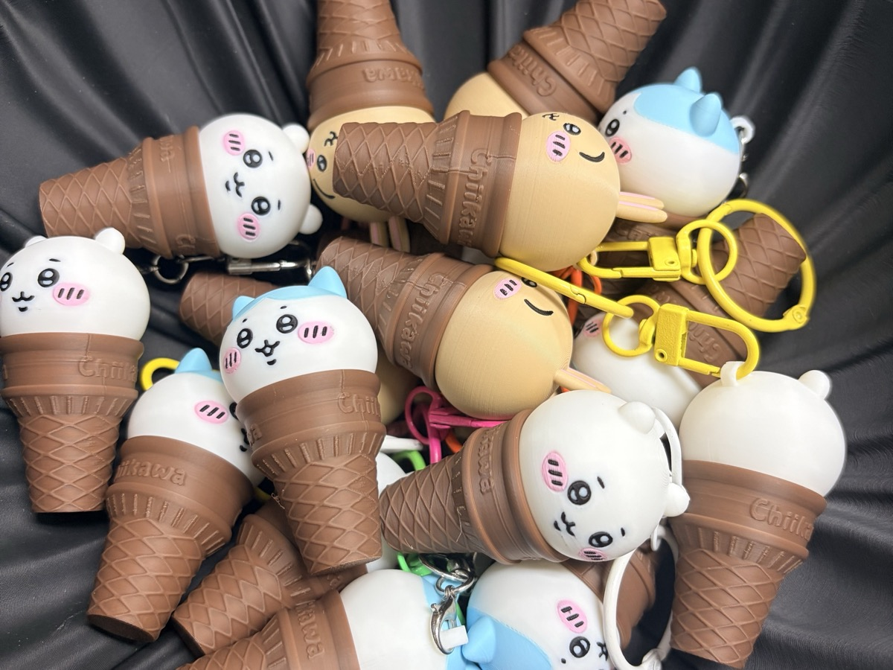
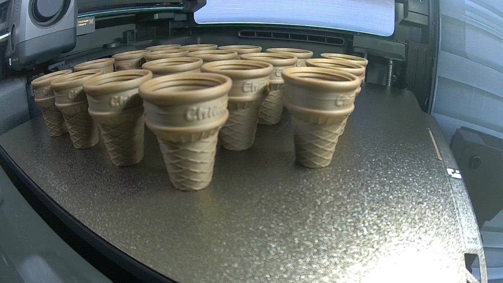
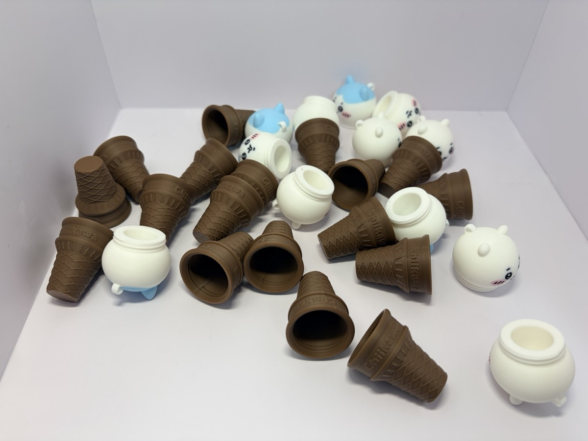
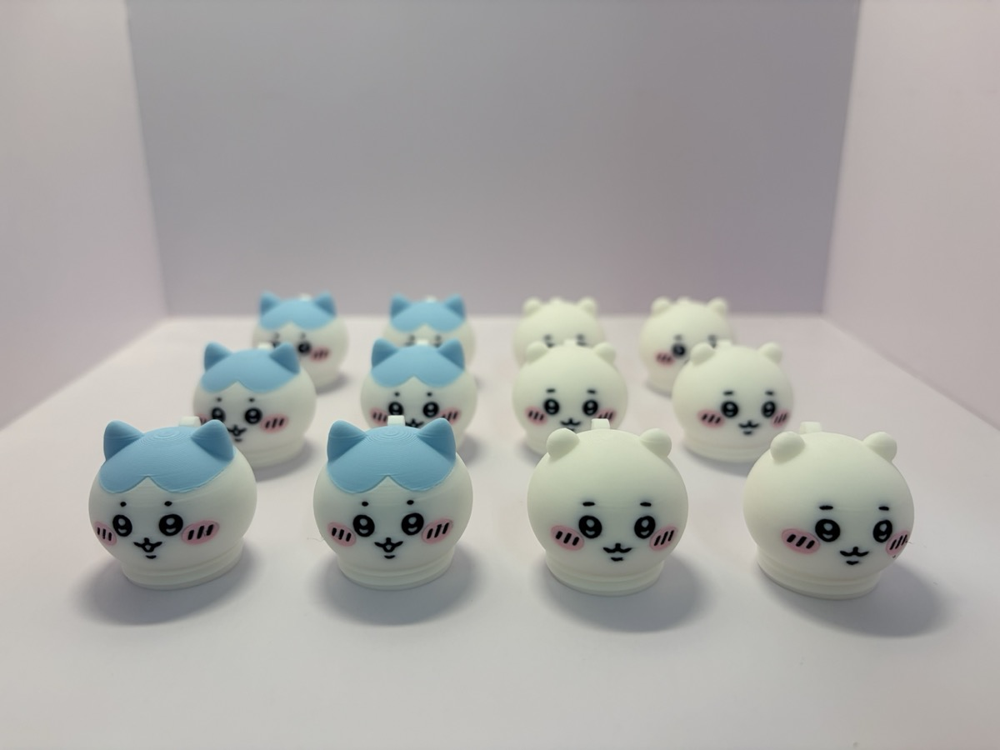
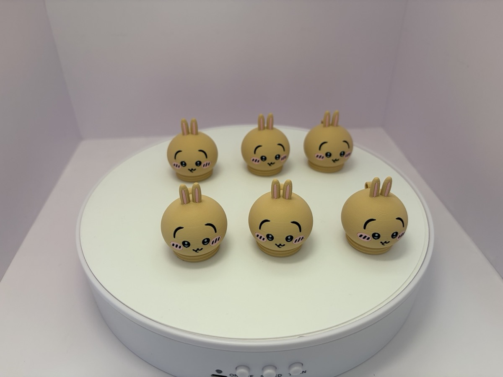
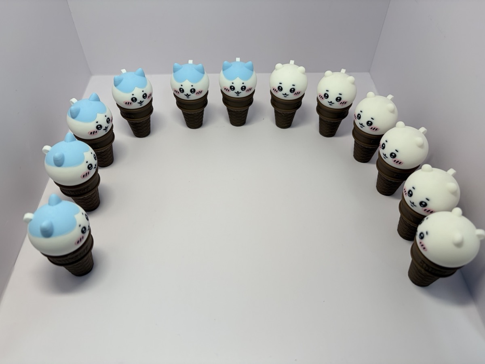
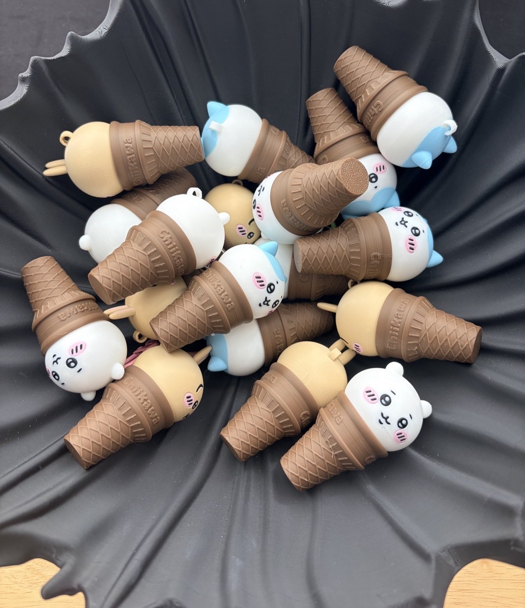
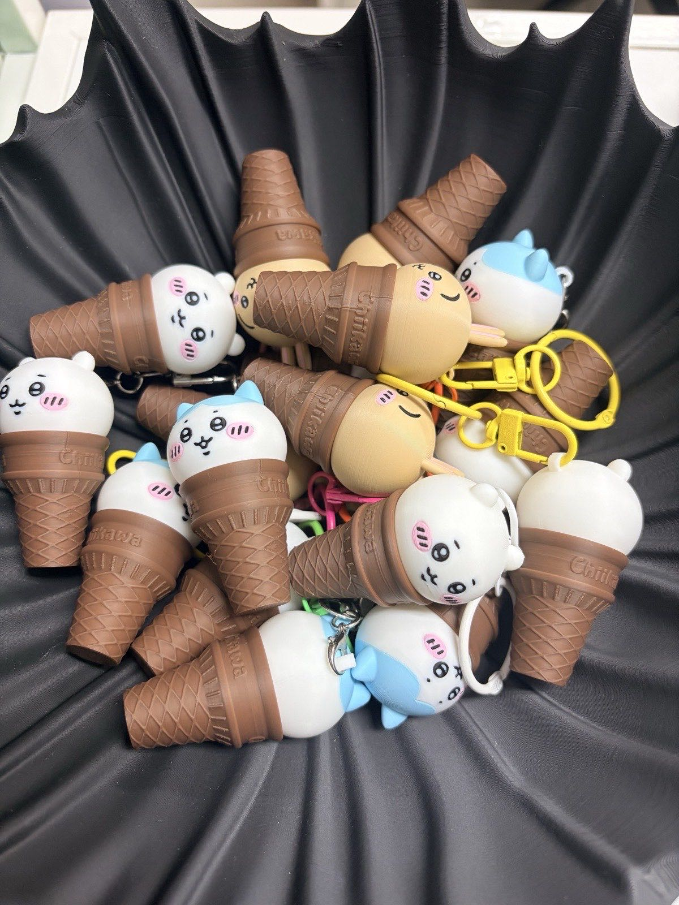

今回はちいかわです。
ちいかわ、ハチワレ、うさぎ。
3人がアイスクリームのコーンの上にひとりずつ乗っているキーホルダーです。

プレゼント用に、キャラクターごとに6個ずつ、合計18個を出力しました。

## 頭をひねって開ける小さなケース

モデルはMakerWorldに公開されているAoaobearさんのアイスクリームキーホルダーです。
元のタイトルは「吉伊卡哇甜筒·随身小补给钥匙扣」。
「ちいかわのアイスクリームコーン、持ち歩ける小さなおやつケースのキーホルダー」くらいの意味です。

構造がおもしろいです。
キャラクターの頭がコーンにネジのようにねじ込まれます。
中が空洞になっているので、小さなものを入れて持ち歩けます。
頭の上に輪っかがあるので、キーホルダーの金具を付ければ完成です。

元のプロジェクトはキャラクターごとに1個ずつ、3個分です。
これをプレートごとに6個ずつに増やして出力しました。

## コーンはX2Dで、18個を1枚に

コーンは茶色1色です。
なので、X2Dで1枚のプレートに18個すべて並べました。

側面には「Chiikawa」の文字が入っていて、ワッフル模様もかなりくっきり出ています。

コーンと頭を並べるとこんな感じです。
頭も中が空洞になっているのがわかります。

## 頭はH3Cでマルチカラー出力

頭は色が多いです。
白い顔に黒い目、ピンクのほっぺ。
ハチワレは水色の頭、うさぎはベージュの体にピンクの耳。

なので、頭はH3Cで出力しました。
[H3Cのマルチカラーフィギュア](/ja/2026/11/08/bambulab-h3c-multicolor-figure/)のときと同じで、色ごとに別のノズルを使うので、色が多くても負担がありません。

ちいかわ6個、ハチワレ6個を1枚のプレートで。
スライサーの予想では6時間16分です。
夜中の1時ごろにスタートして、朝に取り出しました。

顔は小さいのに、目も口もほっぺもにじまずにきれいに出ました。
積層ピッチを0.12 mmと細かくしたおかげもあると思います。

うさぎは別のプレートで6個。
こちらはスライサーの予想で3時間14分でした。

## コーンに頭をはめると

頭をコーンにひねってはめると、こうなります。
並べてみると、小さなアイスクリーム屋さんみたいです。

うさぎまで18個すべてはめて、黒いボウルに入れました。

キーホルダーの金具を付ければ、プレゼントの準備は完了です。
カラフルな金具を付けると、ぐっとそれらしくなります。

## まとめ

- ちいかわ・ハチワレ・うさぎのアイスクリームキーホルダー18個（キャラクターごとに6個）
- コーンはX2Dで18個を1枚に（茶色1色）
- 頭はH3Cでマルチカラー出力（ちいかわとハチワレ12個を1枚、うさぎ6個を1枚）
- 頭をひねって開ける小さなケースなので、おやつなどを入れて持ち歩けます

受け取った人が喜んでくれるといいなと思います。

3Dプリンターでプレゼントを作ったことはありますか？
何を出力したか、コメントで教えていただけると参考にします。

## 動画で見る

出力の様子から完成まで、静かなショート動画にまとめました。
BGMは自分で作った穏やかな8ビットの曲です。

  <iframe src="https://www.youtube.com/embed/RseZJz4l1g4?cc_lang_pref=ja&cc_load_policy=1" title="ちいかわアイスクリームキーホルダー18個、プレゼント用に3Dプリント" style="position: absolute; inset: 0; width: 100%; height: 100%; border: 0;" allow="accelerometer; autoplay; clipboard-write; encrypted-media; gyroscope; picture-in-picture; web-share" allowfullscreen loading="lazy"></iframe>

- YouTubeショート: [ちいかわアイスクリームキーホルダー18個、プレゼント用に3Dプリント](https://www.youtube.com/shorts/RseZJz4l1g4)

## クレジット

- モデル: MakerWorld [「吉伊卡哇甜筒·随身小补给钥匙扣」](https://makerworld.com/models/2682289) by Aoaobear
- キャラクター: ちいかわ © nagano / chiikawa committee — 公式グッズではなく、ファンが作ったモデルです
