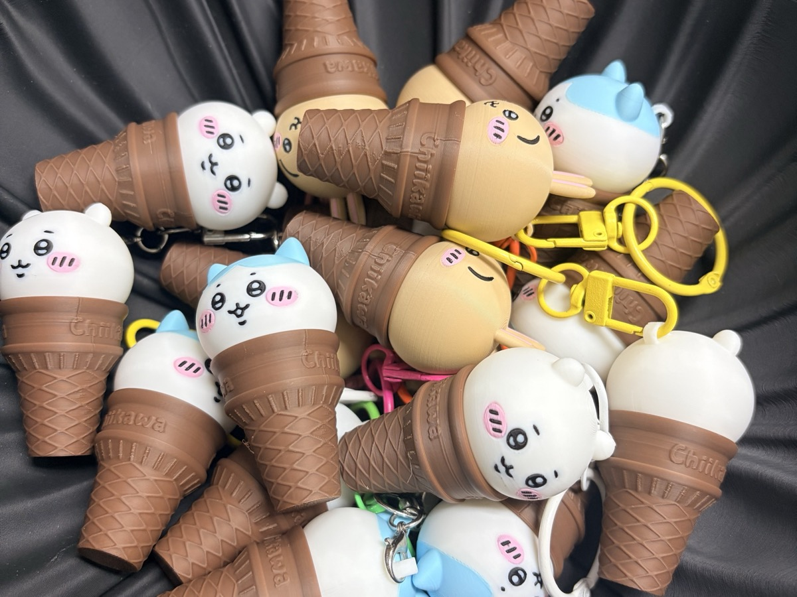
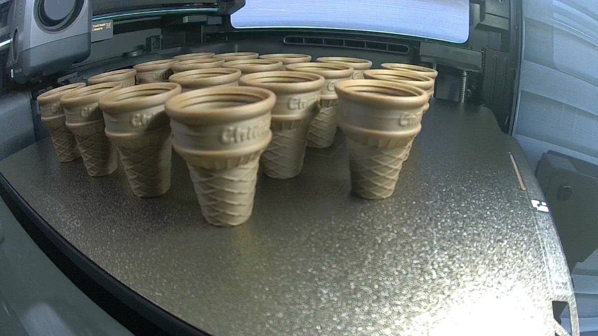
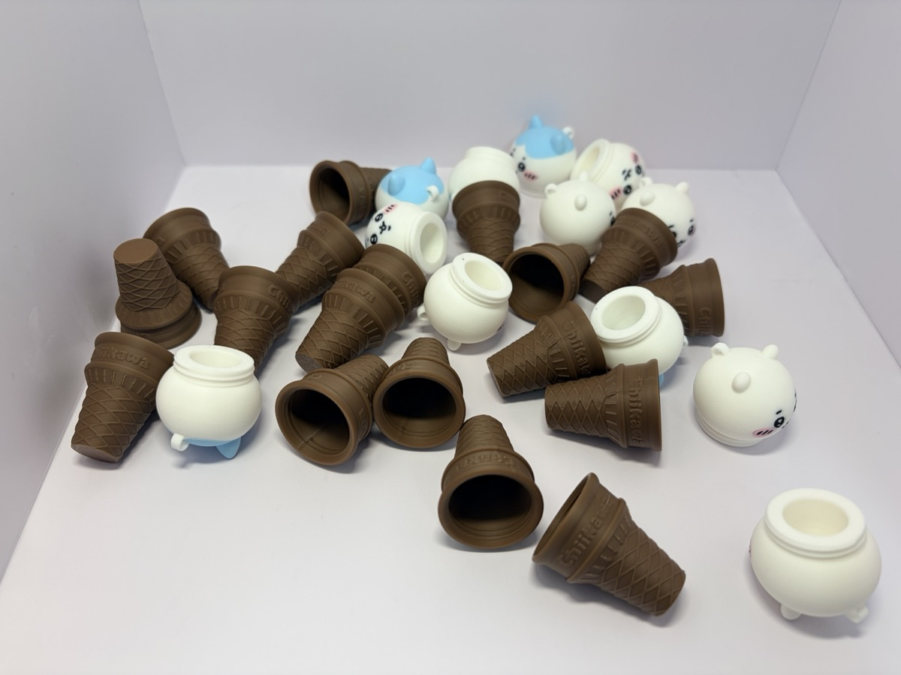
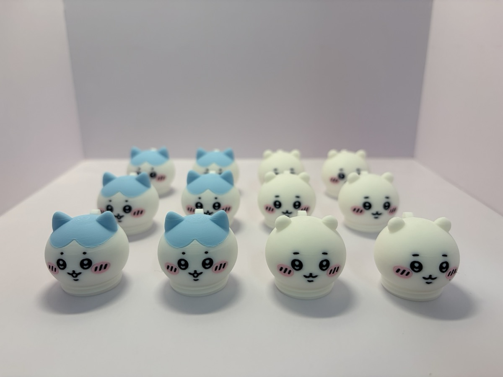
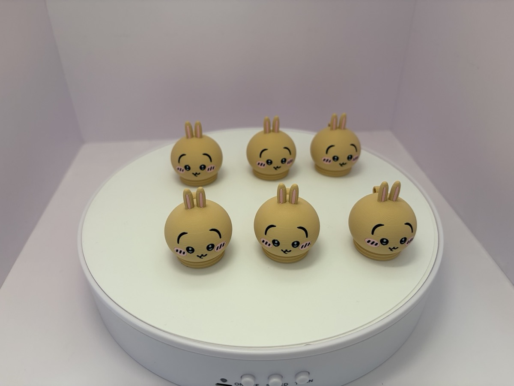
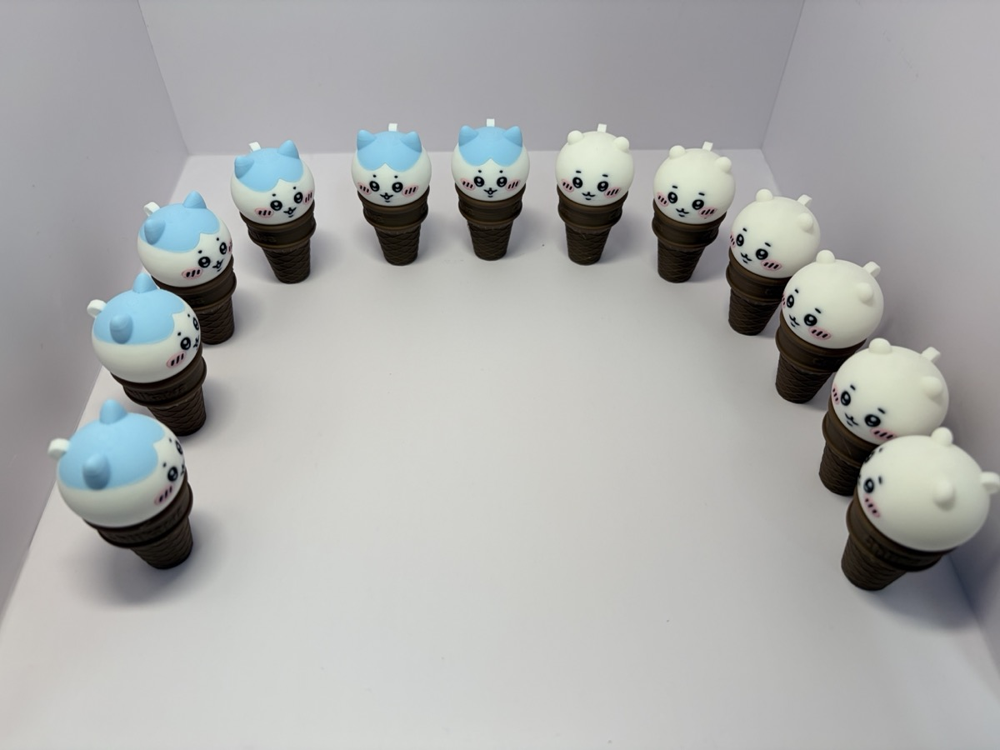
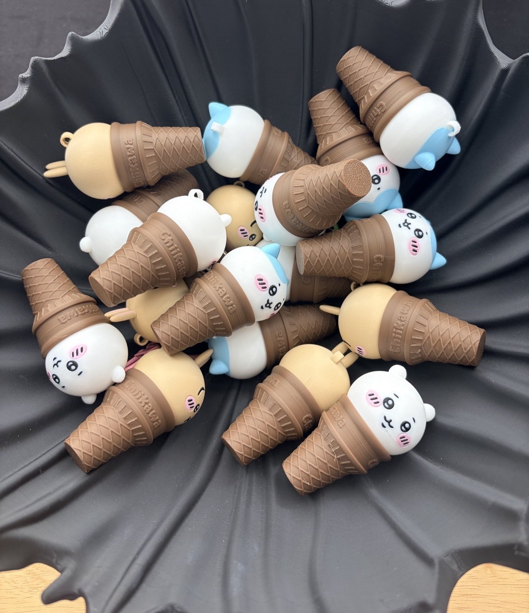
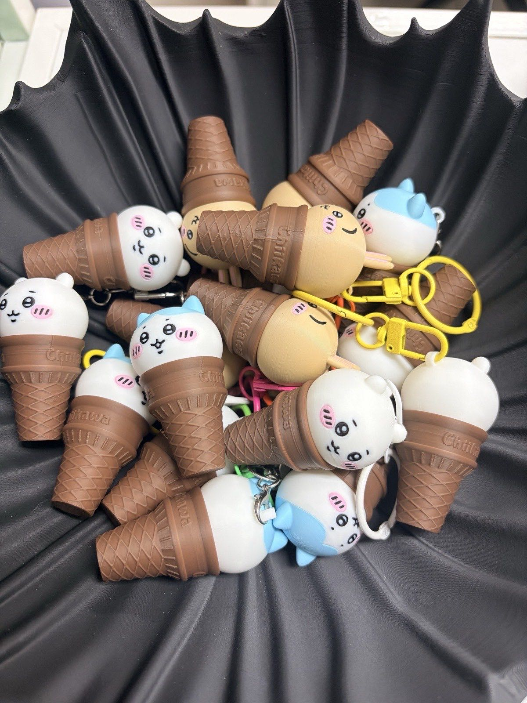

이번엔 치이카와다.
치이카와, 하치와레, 우사기.
3인방이 아이스크림콘 위에 하나씩 올라가 있는 키링이다.

선물용으로 캐릭터마다 6개씩, 모두 18개를 뽑았다 ㅎㅎ

## 머리를 돌려서 여는 작은 통

모델은 MakerWorld에 올라온 Aoaobear 님의 아이스크림콘 키링이다.
원래 이름은 「吉伊卡哇甜筒·随身小补给钥匙扣」.
치이카와 아이스크림콘, 들고 다니는 작은 간식 통 키링... 정도의 뜻이다.

구조가 재밌다.
캐릭터 머리가 콘에 나사처럼 돌려서 끼워진다.
속이 비어 있어서 작은 걸 넣어 다닐 수 있다.
머리 위에는 고리가 있어서 키링 고리만 달면 끝이다.

원본 프로젝트는 캐릭터마다 1개씩, 3개짜리다.
이걸 판마다 6개씩으로 늘려서 뽑았다.

## 콘은 X2D, 18개 한 판

콘은 갈색 한 가지 색이다.
그래서 X2D로 한 판에 18개를 다 올렸다.

옆면에 Chiikawa 글자가 들어가 있고, 와플 무늬도 꽤 또렷하게 나온다.

콘이랑 머리를 늘어놓으면 이렇다.
머리도 속이 비어 있는 게 보인다.

## 머리는 H3C로 다색 출력

머리는 색이 많다.
흰 얼굴에 검정 눈, 분홍 볼.
하치와레는 하늘색 머리, 우사기는 베이지 몸에 분홍 귀.

그래서 머리는 H3C로 뽑았다.
[H3C 다색 피규어](/2026/11/08/bambulab-h3c-multicolor-figure/) 때처럼 색마다 노즐을 따로 쓰니까, 색이 많아도 부담이 없다.

치이카와 6개, 하치와레 6개를 한 판에.
슬라이서 예상으로 6시간 16분이다.
새벽 1시쯤 걸어 놓고 아침에 꺼냈다.

얼굴이 작은데도 눈, 입, 볼이 번지지 않고 깔끔하게 나왔다.
층 높이를 0.12 mm로 곱게 잡은 덕도 있는 것 같다.

우사기는 따로 한 판에 6개.
이건 슬라이서 예상 3시간 14분.

## 콘에 머리를 끼우면

머리를 콘에 돌려 끼우면 이렇게 된다.
줄 세워 놓으니 아이스크림 가게 같다 ㅋㅋ

우사기까지 18개를 다 끼워서 검정 보울에 담았다.

키링 고리까지 달면 선물 준비 끝.
알록달록한 고리를 다니까 더 그럴듯하다 ㅎㅎ

## 정리하면

- 치이카와·하치와레·우사기 아이스크림콘 키링 18개(캐릭터별 6개)
- 콘은 X2D로 18개 한 판(갈색 한 가지 색)
- 머리는 H3C로 다색 출력(치이카와·하치와레 12개 한 판, 우사기 6개 한 판)
- 머리를 돌려서 여는 작은 통이라 간식 같은 걸 넣어 다닐 수 있다

받는 사람들이 좋아해 줬으면 좋겠다.

3D 프린터로 선물 만들어 보신 적 있으세요?
어떤 걸 뽑았는지 댓글로 알려주시면 저도 참고해 볼게요.

## 영상으로 보기

출력되는 모습부터 완성까지 조용한 쇼츠로 담았다.
배경음악은 직접 만든 잔잔한 8비트 곡이다.

  <iframe src="https://www.youtube.com/embed/RseZJz4l1g4?cc_lang_pref=ko&cc_load_policy=1" title="치이카와 아이스크림콘 키링 18개, 선물하려고 3D 프린터로 뽑았어요" style="position: absolute; inset: 0; width: 100%; height: 100%; border: 0;" allow="accelerometer; autoplay; clipboard-write; encrypted-media; gyroscope; picture-in-picture; web-share" allowfullscreen loading="lazy"></iframe>

- 유튜브 쇼츠: [치이카와 아이스크림콘 키링 18개, 선물하려고 3D 프린터로 뽑았어요](https://www.youtube.com/shorts/RseZJz4l1g4)

## 출처

- 모델: MakerWorld [「吉伊卡哇甜筒·随身小补给钥匙扣」](https://makerworld.com/models/2682289) by Aoaobear
- 캐릭터: 치이카와 © nagano / chiikawa committee — 공식 상품이 아니라 팬이 만든 모델이다
