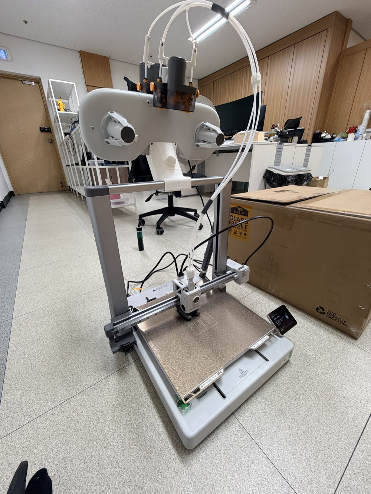

I got the Bambu Lab A2L at the end of October.

I posted the [H3C unboxing](/en/2026/11/07/bambulab-h3c-ams3-unboxing/) first, but
the A2L actually arrived before it.

It looks like a scaled-up A1, a bed-slinger.
The bed is 330 × 320 mm, so large prints fit on a single plate.

Here's the conclusion up front.

The feature set is a bit thin.
But the value is the best of any printer I'm using right now.
So I'm quite happy with it.

If you're on the fence about the A2L, I'll go through it step by step:
unboxing, setup, and what I liked and didn't after using it.

## What is the A2L?

| Item | A2L |
|---|---|
| Build volume | 330 × 320 × 325 mm |
| Type | Open-frame bed-slinger, bed moves back and forth (no chamber) |
| Max speed | 500 mm/s |
| Max nozzle temp | 300 ℃ |
| Max bed temp | 80 ℃ |
| Nozzle | 0.4 mm stainless steel by default (0.2, 0.6, 0.8 mm supported) |
| Build plate | Textured PEI |
| Multicolor | AMS lite (Combo); 2nd-gen AMS also works · up to 19 colors |
| Noise | 49 dB in quiet mode |
| Size · weight | 544 × 529 × 505 mm · 12.8 kg |
| Price | $469 standalone · $569 AMS lite Combo (₩599,000 / ₩749,000) |

The US official prices are $469 standalone and $569 for the Combo.
The Korean figures in parentheses are from the Bambu Lab Korea official store as of November 12, 2026 (VAT included).

Officially, the build area is 105% larger than 256 mm-class printers.
Next to a 256 mm bed like the P2S, it's clearly bigger.

It launched in June this year.

## Unboxing

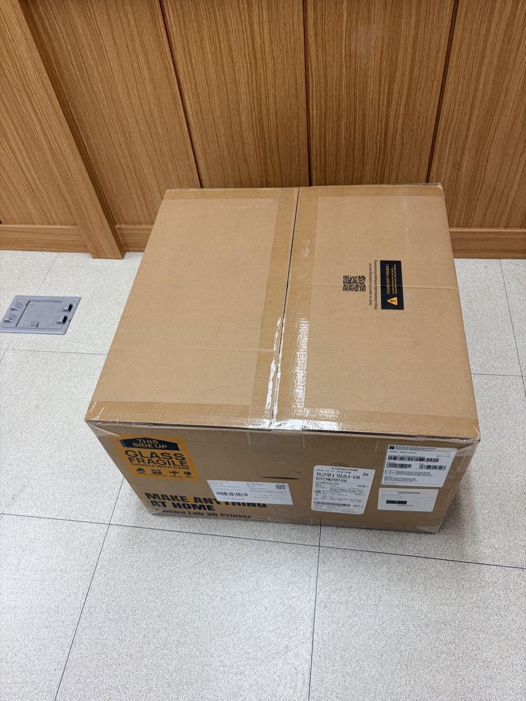

One box.
A big GLASS FRAGILE sticker is on the side.

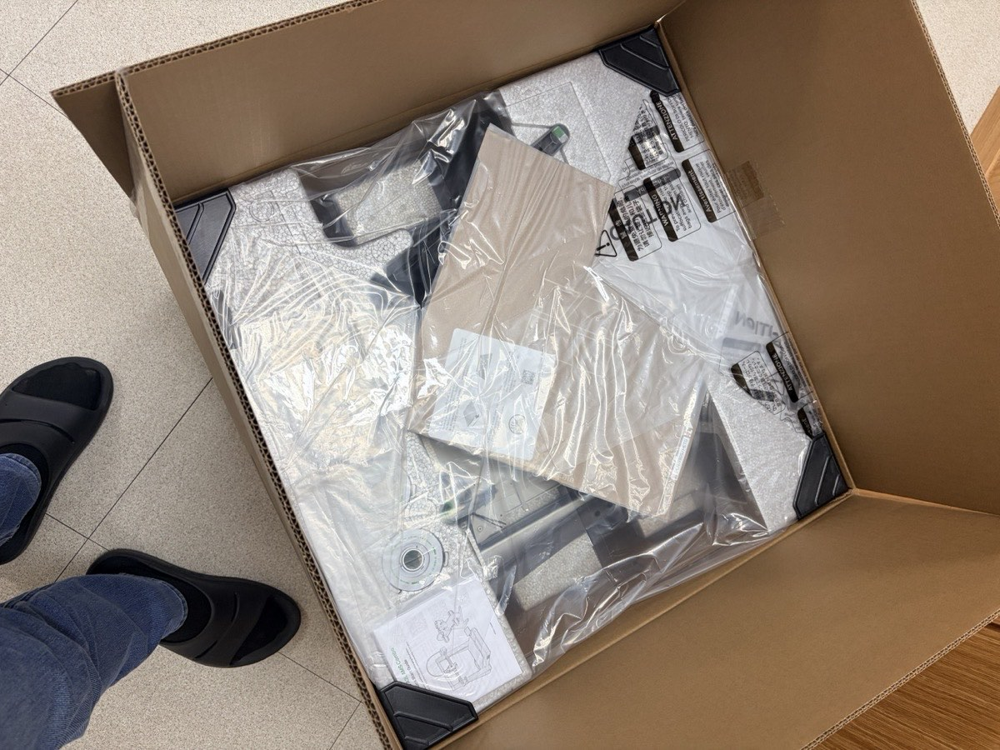

Lift the lid and it's packed with parts wrapped in plastic.

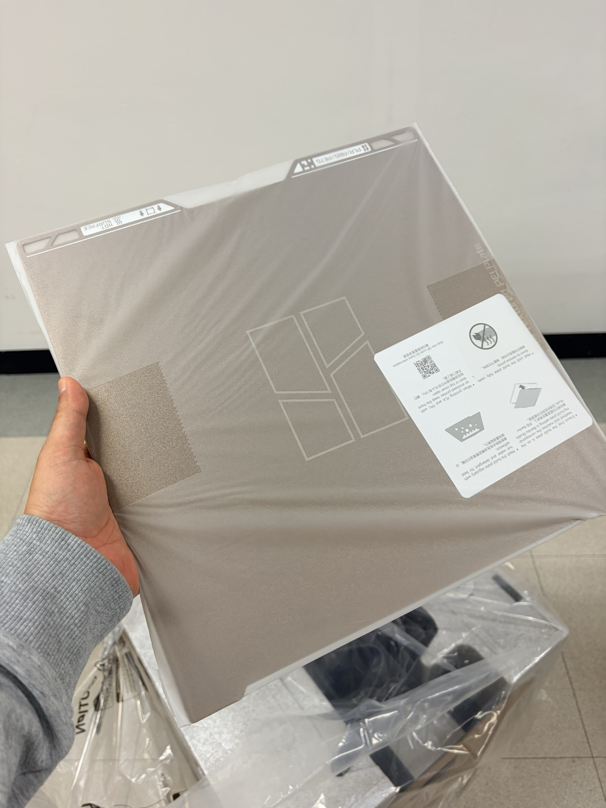

The textured PEI plate sits on top.

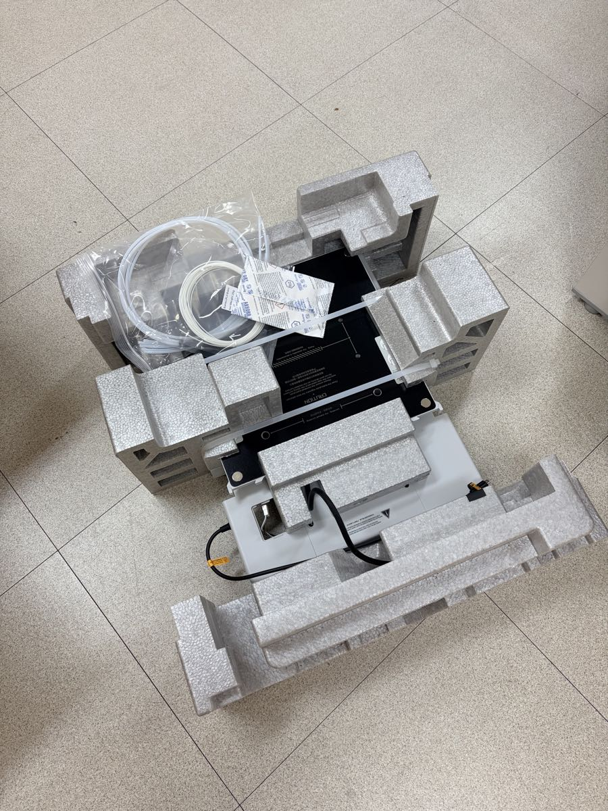

Pull out the foam and the base and accessories are sitting in their own compartments.

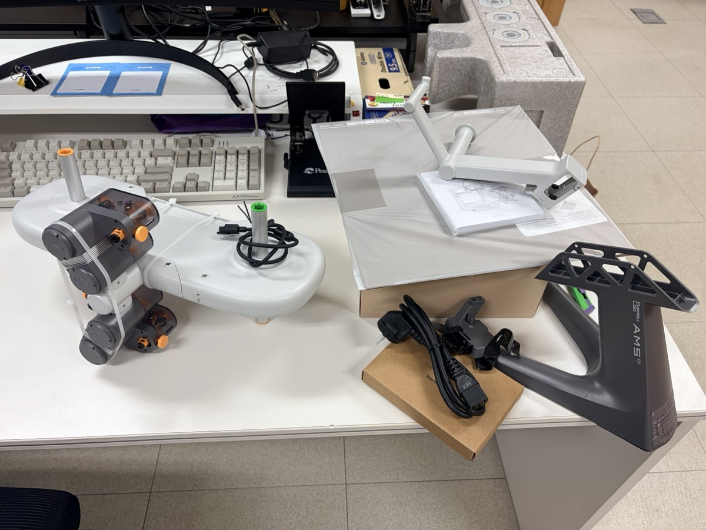

I took out the AMS lite too.
It has a central hub with spool arms on both sides.
The dark gray piece is the AMS lite's own stand, and the white one on the right is the spool holder for the printer.

According to the official store, the package includes the printer, a toolbox, the build plate, and a spool holder.
The Combo adds the AMS lite.

## Assembly takes about 20 minutes

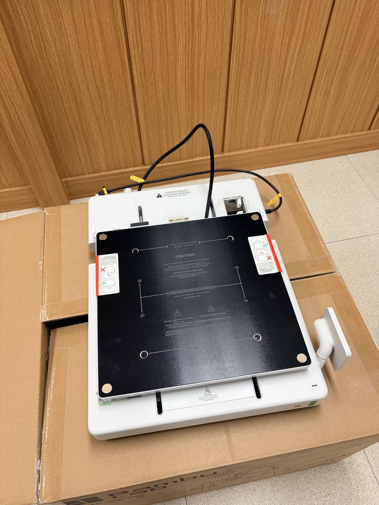

The A2L isn't a take-it-out-and-print machine.
There's a bit of assembly.

You stand the frame up on the base, secure it with screws, and plug in the cables.

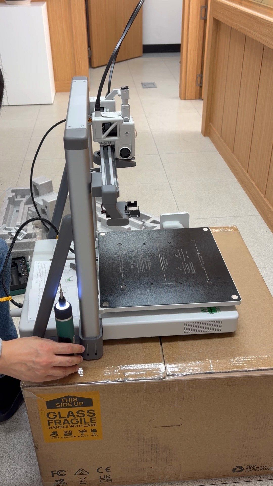

All the tools are in the toolbox.
There are quite a lot of screws, though, so an electric screwdriver makes it much easier.

Going by my footage, assembling the printer took a bit over 20 minutes.
Follow the manual in order and nothing is difficult.

## I put the AMS lite on top

Normally the AMS lite sits on its own stand next to the printer.
I decided to mount it on top of the printer instead.
That way it doesn't take up space beside it.

I printed the mount parts ahead of time on the X2D.

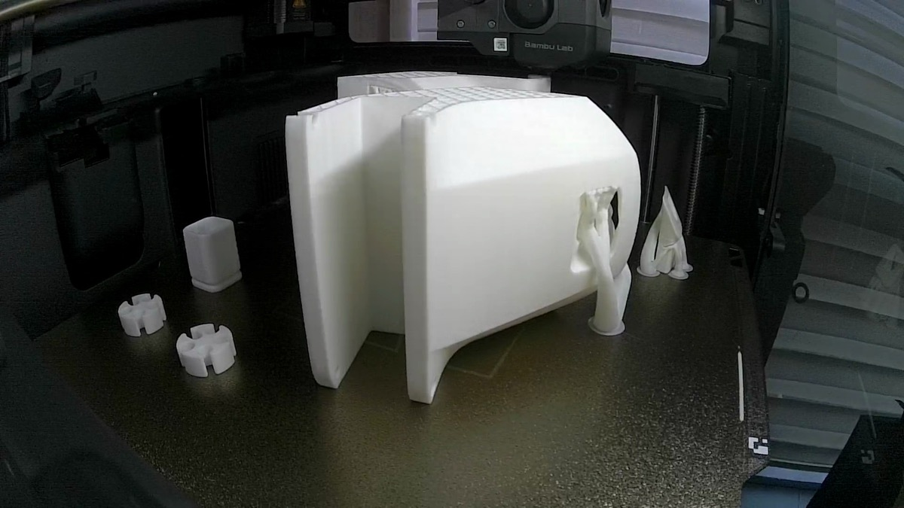

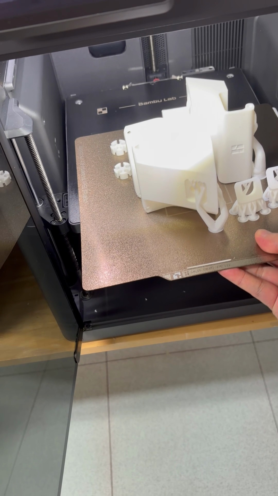

The shape is complicated, so it came out covered in tree supports.

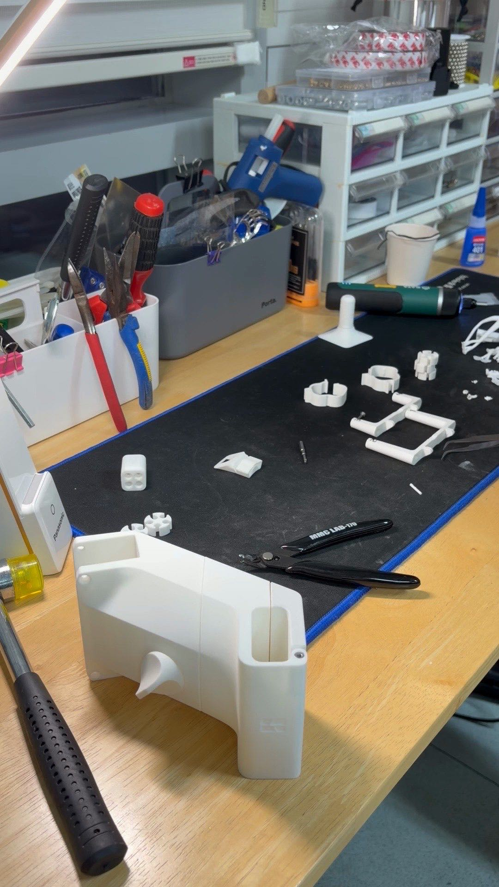

The video of me removing the supports alone runs 12 minutes.

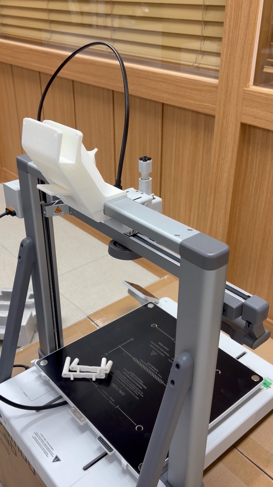

With the supports gone, I slid the mount onto the top beam.

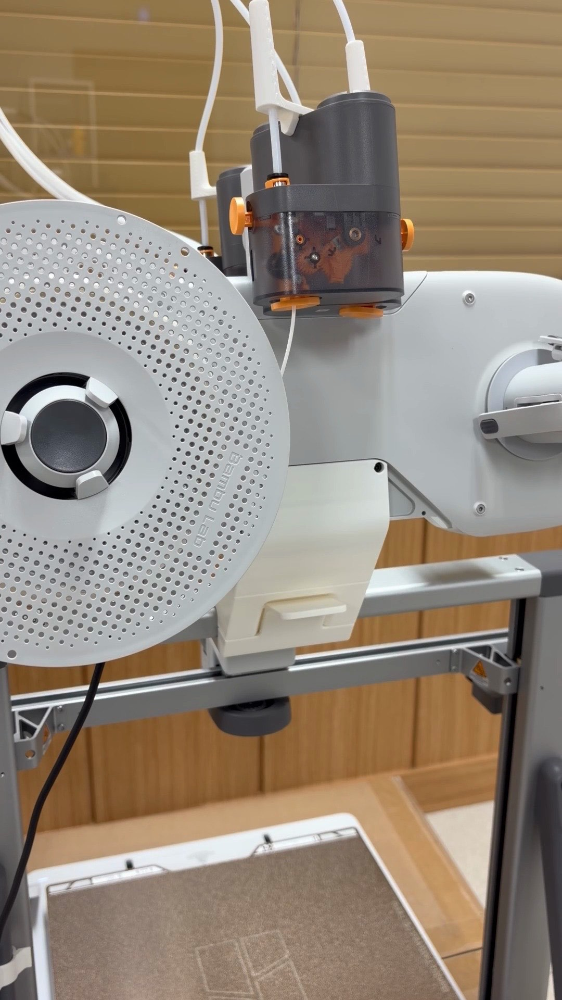

Then set the AMS lite on top.

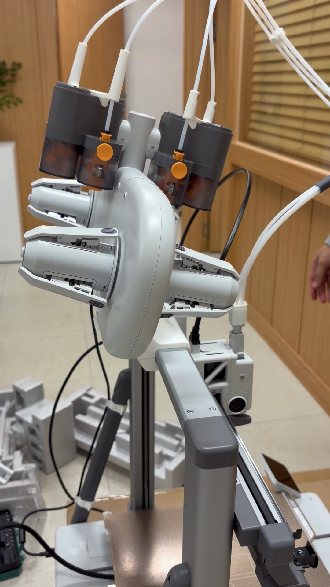

Last, plug in the four PTFE tubes and you're done.

## Power on and first calibration

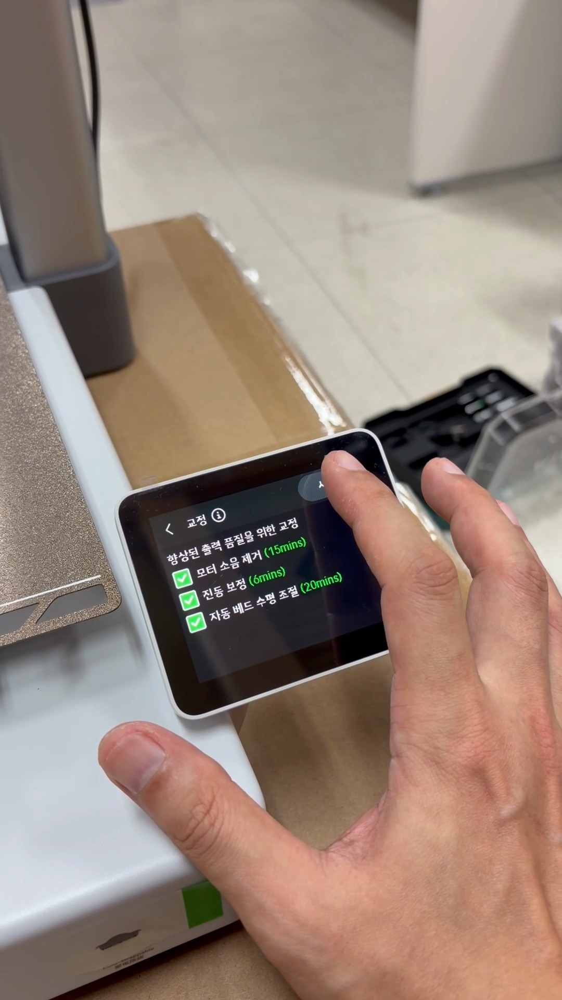

When you power on and go through the initial setup on the touchscreen, the calibration screen comes up.

These are the estimated times it shows:

- Motor noise cancellation: 15 minutes
- Vibration compensation: 6 minutes
- Auto bed leveling: 20 minutes

That adds up to a bit over 40 minutes.
Plan on waiting that long the first time.

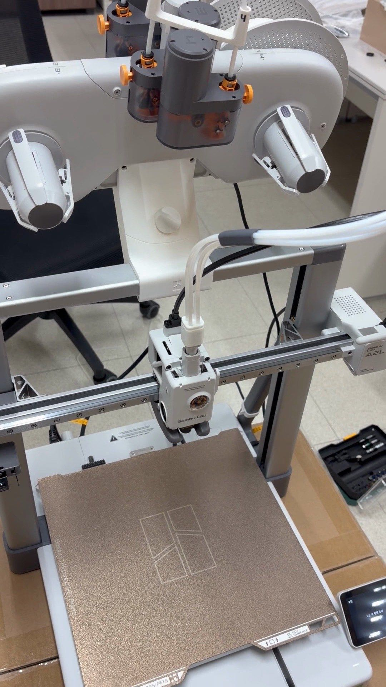

All set.

## What I like

### Big prints on a single plate

The best thing is, of course, the bed size.

When I built the [AMS 2 Pro sliding storage](/en/2026/11/09/ams2-pro-sliding-speedrack-underrail/), I fit all the cover parts onto a single A2L plate.
It took about 22 hours and a bit over 700 g of filament.
On a 256 mm bed, that would have had to be split across two plates.

Not having to split and glue parts together matters more than you'd think.

### Perfect for single-color prints

The A2L has a single nozzle.
Multicolor works with the AMS lite, but every color change costs you wasted filament and time.

For large single-color prints, none of that applies.
For big single-color work, I don't think anything beats it.

If multicolor is your main thing, a tool changer like the [H3C](/en/2026/11/07/bambulab-h3c-ams3-unboxing/) is much more convenient.

### Price

A 330 mm bed for $469.
Even the AMS lite Combo is $569.

Getting this much build volume at this price is the A2L's biggest selling point, I think.

## What I don't like

### No chamber

It's open-frame, so there's no enclosure.
The max bed temperature is also 80 ℃.

The official guidance centers on common materials like PLA and PETG, and ABS and ASA aren't on the supported list.
If you use high-temperature materials often, look at a printer with a chamber.

### Don't expect much from the camera

This is the biggest letdown.

There is a camera, but
timelapse and live video are practically nonexistent.
The official spec is low-frame-rate 1080p, which is far from enough to watch a print live.

When I try to download even a slow recording from the cloud, it almost never comes through.

That's why all the print videos in this post were shot with other printers.

### The cloud only handles sending prints

Sending prints through the cloud works well.
Beyond that, the features are weak.

The official page lists print monitoring such as nozzle clumping and air-printing detection.
But for checking on a print visually and capturing video myself, it falls well short.

## Who it's for

**Good fit**

- You want to print large pieces in one go without splitting them
- You mostly print single-color in PLA or PETG
- You need a big bed at around $469
- You're looking for your first large-format printer

**Not a good fit**

- You often use high-temperature materials like ABS or ASA
- You want to make content from timelapses
- Multicolor is your main use (a tool changer is better)
- Remote video monitoring matters to you

## Summary

The feature set is clearly lacking.
No chamber, and the camera is barely there.

Still, you get a 330 mm bed for $469.
For big single-color prints, I don't think anything beats this value.

I'm quite happy with mine.

If you use an A2L, do your timelapses download properly?
Let me know in the comments if it's just me.
