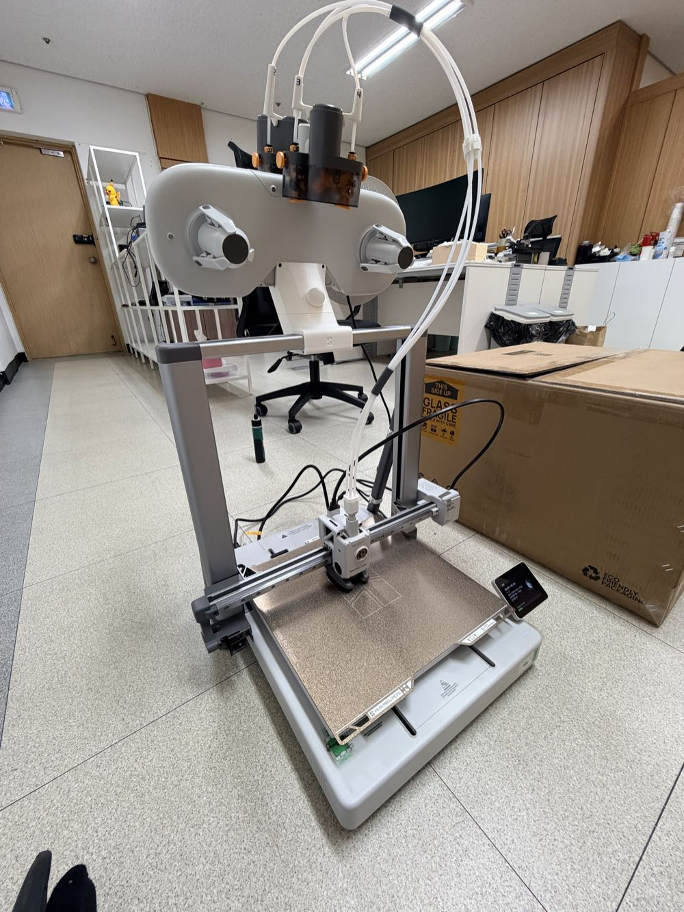

10月末にBambu Lab A2Lを購入しました。

先に[H3Cの開封レビュー](/ja/2026/11/07/bambulab-h3c-ams3-unboxing/)を公開しましたが、
実は順番でいうとA2Lのほうが先に届いていました。

見た目はA1を大きくしたような、ベッドが前後に動くタイプのプリンターです。
ベッドは330 × 320 mmなので、大きな造形物も1枚のプレートに載せられます。

先に結論をお伝えします。

オプションは少し足りません。
でも、コスパは今使っているプリンターの中で一番です。
そのため、かなり満足して使っています。

A2Lを買おうか迷っている方の参考になるように、
開封から設置、使ってみて感じた長所と短所まで、順番に書いていきます。

## A2Lはどんなプリンター?

| 項目 | A2L |
|---|---|
| 造形サイズ | 330 × 320 × 325 mm |
| 方式 | ベッドが前後に動くオープン型(チャンバーなし) |
| 最高速度 | 500 mm/s |
| ノズル最高温度 | 300 ℃ |
| ベッド最高温度 | 80 ℃ |
| ノズル | 0.4 mmステンレスが標準(0.2・0.6・0.8 mm対応) |
| ビルドプレート | テクスチャードPEI |
| マルチカラー | AMS lite(コンボ)、第2世代AMSも接続可能 · 最大19色 |
| 騒音 | 静音モードで49 dB |
| サイズ · 重量 | 544 × 529 × 505 mm · 12.8 kg |
| 価格 | 単体 599,000ウォン · AMS liteコンボ 749,000ウォン |

価格は2026年11月12日時点のBambu Lab韓国公式ストアの金額です(VAT込み)。
米国の公式価格は単体が$469、コンボが$569です。

公式の紹介によると、256 mmクラスのプリンターより造形スペースが105%広いそうです。
P2Sのような256 mmベッドと並べると、たしかに広いです。

発売は今年の6月です。

## 箱を開ける

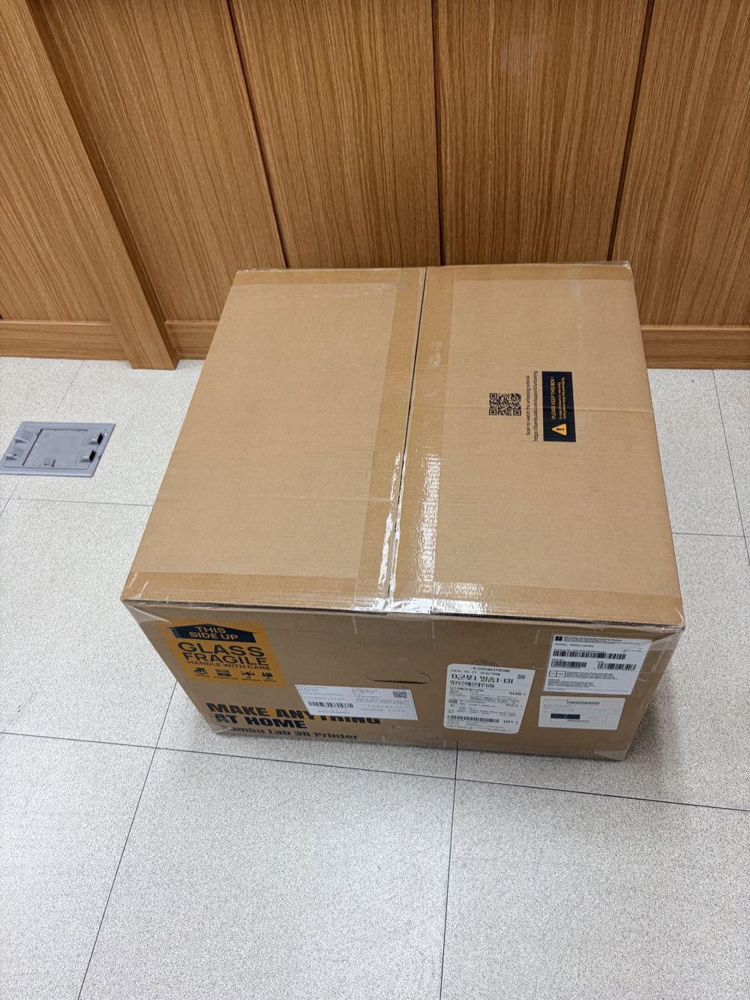

箱はひとつです。
側面にGLASS FRAGILEのステッカーが大きく貼ってあります。

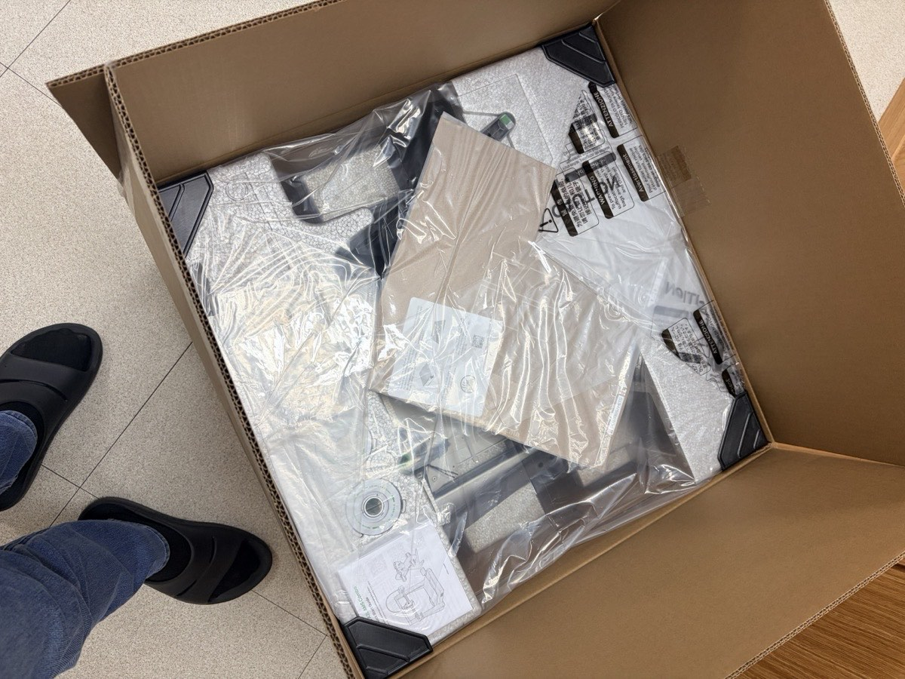

ふたを開けると、ビニールに包まれた部品がぎっしり入っています。

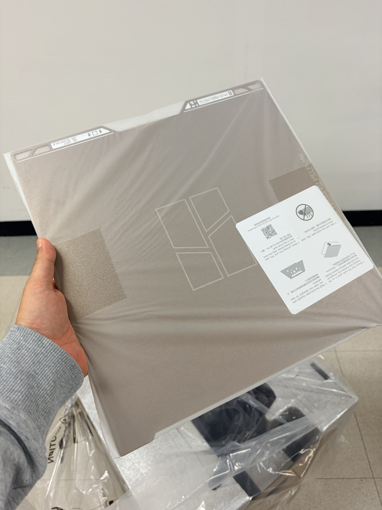

いちばん上にあるのはテクスチャードPEIのプレートです。

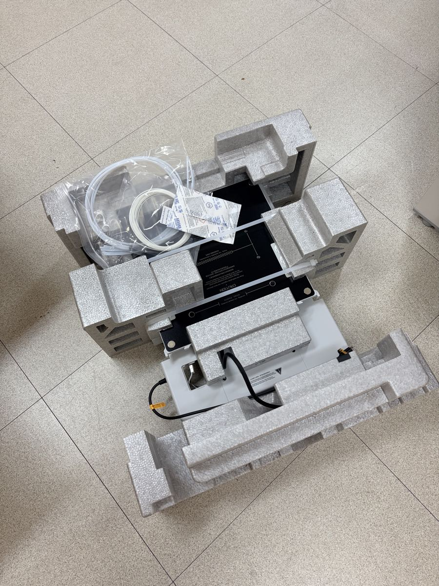

発泡スチロールを外すと、ベースと付属品が区画ごとに収まっています。

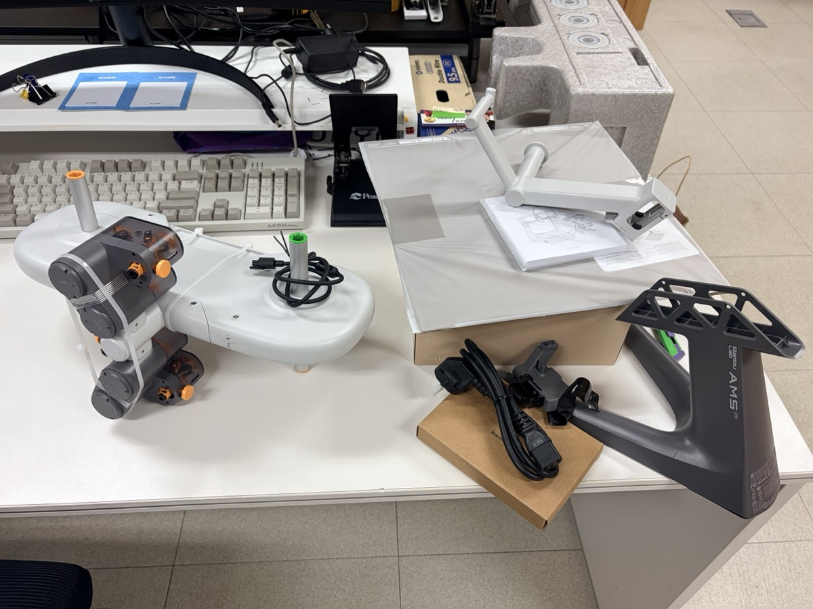

AMS liteも取り出しました。
中央のハブの両側に、スプールを掛けるアームが付いた構造です。
濃いグレーがAMS lite専用のスタンド、右側の白いものが本体用のスプールホルダーです。

公式ストアによると、同梱されているのは本体、ツールボックス、ビルドプレート、スプールホルダーです。
コンボの場合は、ここにAMS liteが加わります。

## 組み立ては20分ほど

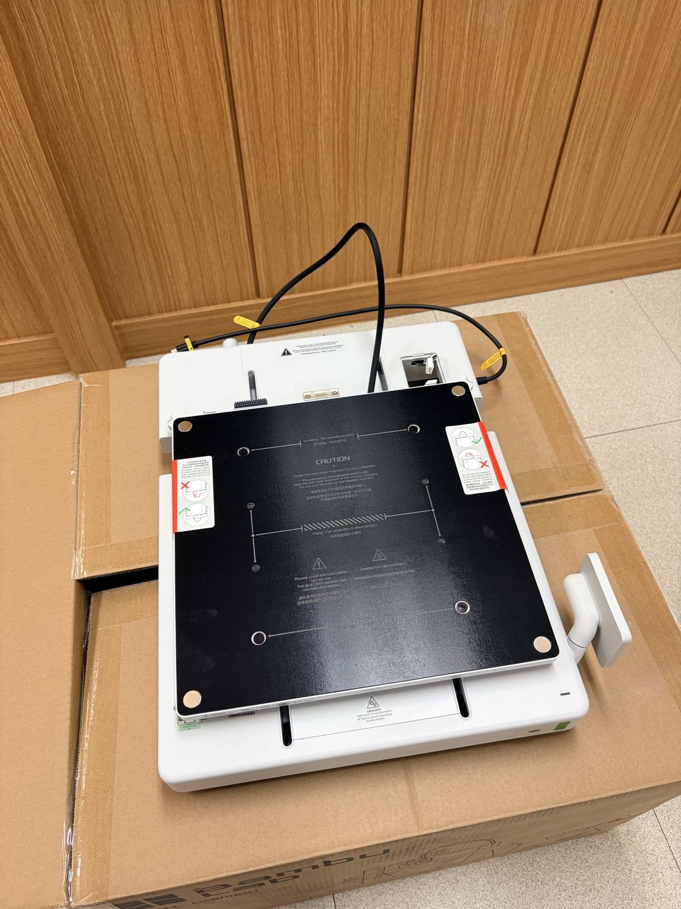

A2Lは、取り出してすぐ使えるタイプのプリンターではありません。
少しだけ組み立てが必要です。

ベースにフレームを立ててネジで固定し、ケーブルを差し込めば完了です。

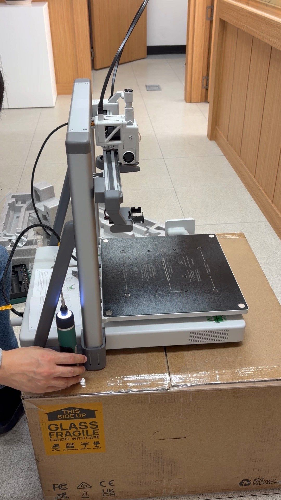

工具はすべてツールボックスに入っています。
ただ、ネジがかなり多いので、電動ドライバーがあるとずっと楽です。

撮影した映像を見返すと、本体の組み立てには20分ほどかかっていました。
説明書の順番どおりに進めれば、難しいところはありません。

## AMS liteは上に載せました

AMS liteは本来、専用スタンドに挿してプリンターの横に置きます。
私はプリンターの上に載せることにしました。
上に載せれば、横のスペースを取らずに済むからです。

ホルダーの部品は、あらかじめX2Dで出力しておきました。

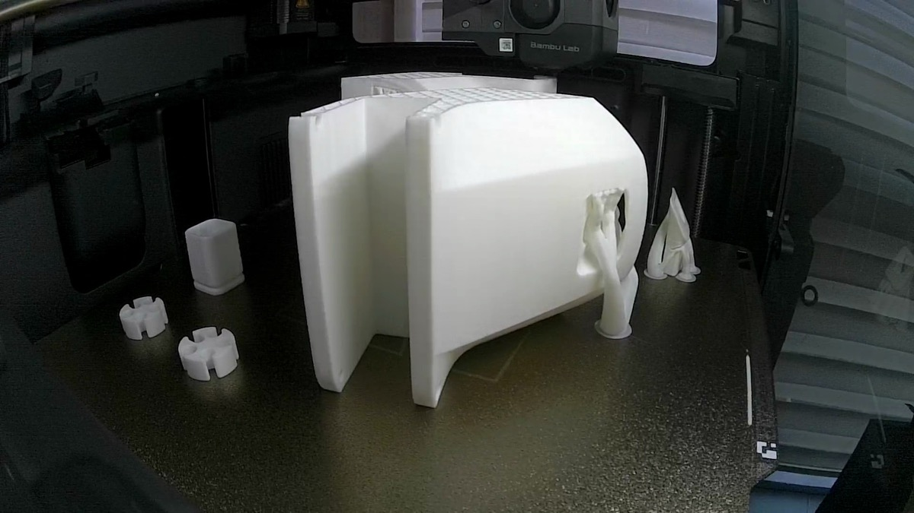

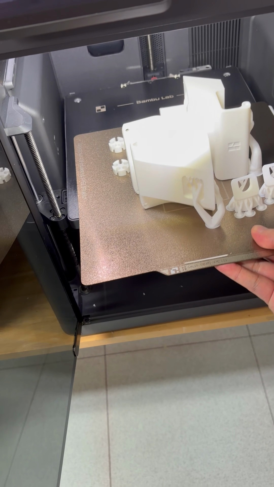

形が複雑なので、ツリーサポートがたくさん付いて出てきました。

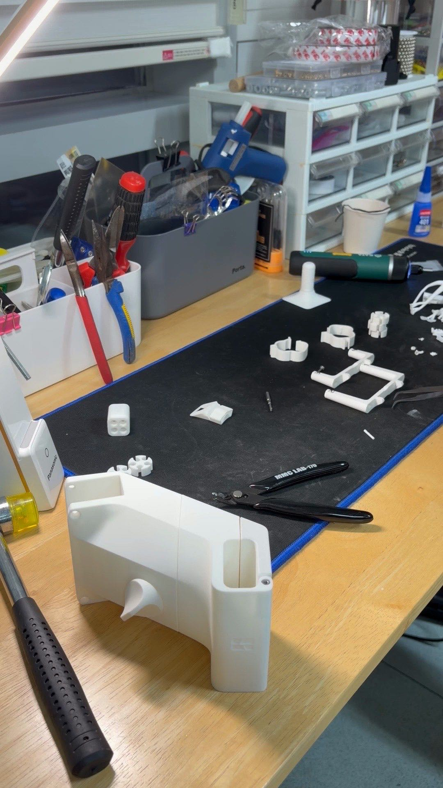

サポートを外す動画だけで12分あります。

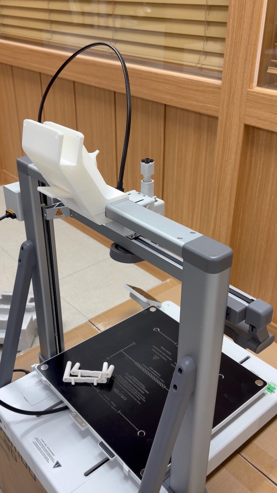

サポートを外し終えたホルダーを、上部のビームにはめます。

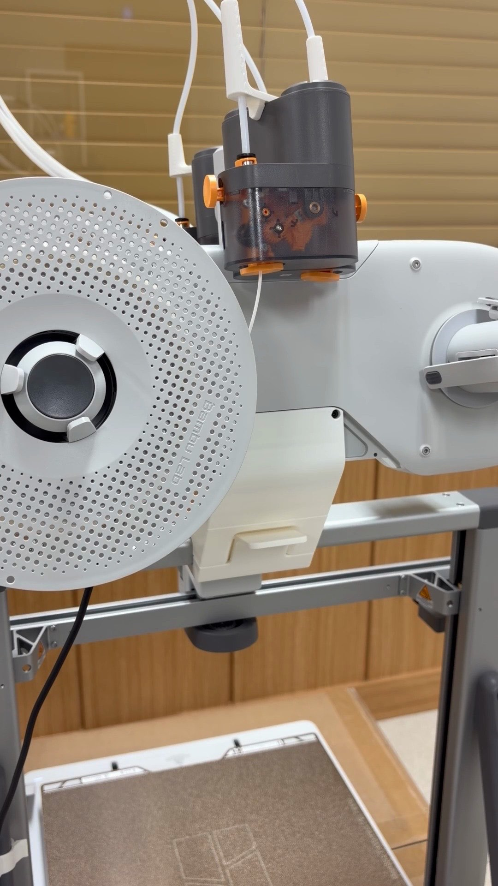

その上にAMS liteを載せました。

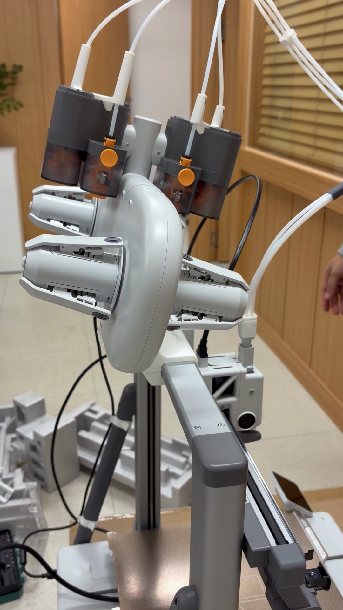

最後にPTFEチューブを4本差し込めば完成です。

## 電源を入れて最初のキャリブレーション

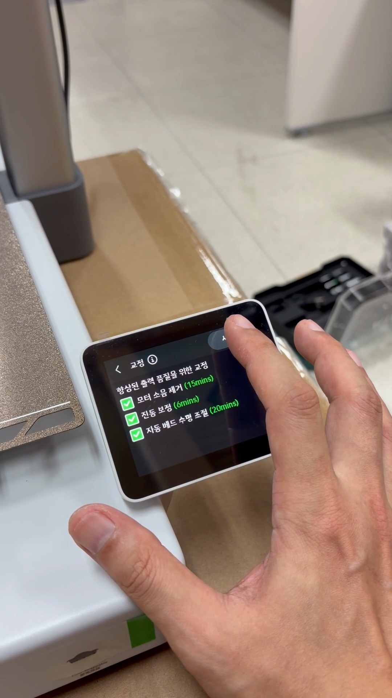

電源を入れ、タッチスクリーンで初期設定を進めると、キャリブレーション画面が表示されます。

画面に出た予想時間は次のとおりです。

- モーター騒音の除去 15分
- 振動補正 6分
- 自動ベッドレベリング 20分

すべて合わせると40分ほどです。
最初の1回だけは、このくらい待つものと考えておけば大丈夫です。

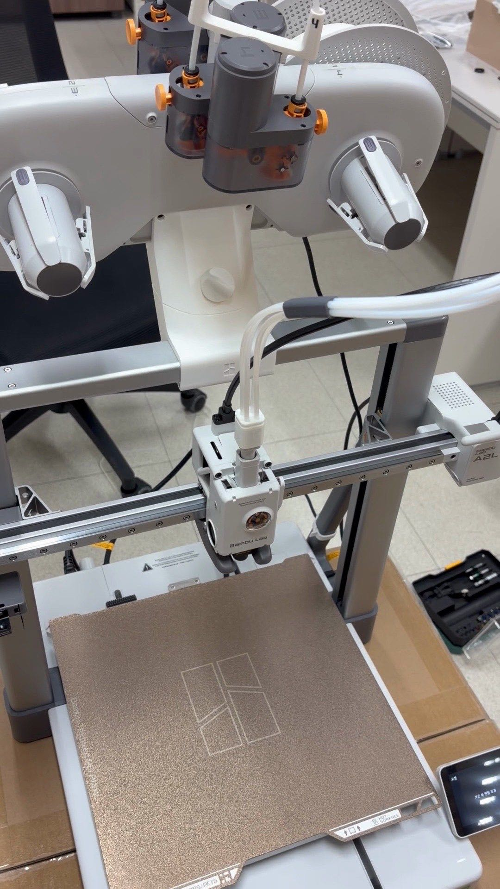

準備完了です。

## 使ってみて良かった点

### 大きな造形物も1枚で

いちばん良いのは、やはりベッドの大きさです。

[AMS 2 Proのスライド式収納](/ja/2026/11/09/ams2-pro-sliding-speedrack-underrail/)を作ったとき、カバーの部品をA2Lの1枚のプレートにすべて載せました。
所要時間は22時間ほど、フィラメントは700 g強です。
256 mmのベッドだったら、2枚に分けなければならない量です。

分割して接着する手間が減るのは、思った以上に大きいです。

### 単色出力にぴったり

A2Lはノズルがひとつです。
AMS liteで多色出力もできますが、色を替えるたびに捨てるフィラメントと時間が発生します。

単色で大きく出力するときは、その心配がありません。
大きな単色出力には、これ以上のものはないと感じます。

多色が中心なら、[H3C](/ja/2026/11/07/bambulab-h3c-ams3-unboxing/)のようなツールチェンジャーのほうがずっと便利です。

### 価格

330 mmのベッドで599,000ウォン。
AMS liteコンボでも749,000ウォンです。

このサイズをこの価格で出力できることが、A2Lの最大の長所だと思います。

## 残念な点

### チャンバーがない

オープン型なので、カバーがありません。
ベッドの最高温度も80 ℃です。

公式の案内もPLA・PETGなどの一般的な素材が中心で、ABS・ASAは対応リストに入っていません。
高温素材をよく使うなら、チャンバー付きの機種を選ぶのが正解です。

### カメラには期待しないほうがいい

これがいちばん残念です。

カメラは付いているのですが、
タイムラプスやリアルタイム映像は、ほぼないも同然です。
公式スペックからして低フレームレートの1080pなので、リアルタイム映像で出力の様子を見るには全然足りません。

低速でも撮影された映像をクラウドからダウンロードしようとすると、ほとんど落とせません。

そのため、この記事に入っている出力動画は、すべて別のプリンターで撮ったものです。

### クラウドは出力の送信まで

クラウドから出力を送る機能は問題なく動きます。
ただ、それ以外の機能は弱いです。

公式の紹介を見ると、ノズルの詰まりやエアプリンティングの検知といった出力の監視機能は入っています。
しかし、自分で画面を見て状態を確認し、映像まで残す用途にはかなり不足しています。

## こんな方に向いています

**向いている場合**

- 大きな造形物を分割せず、一度に出力したい
- 主にPLA・PETGで単色出力をする
- 60万ウォン台で大きなベッドが必要
- 初めての大型プリンターを探している

**向いていない場合**

- ABS・ASAなどの高温素材をよく使う
- タイムラプスでコンテンツを作りたい
- 多色出力が中心(ツールチェンジャー機のほうが向いています)
- リモートで映像を確認する機能が重要

## まとめ

オプションは、はっきり言って物足りません。
チャンバーはなく、カメラもあってないようなものです。

それでも、330 mmのベッドを599,000ウォンで使えます。
大きな単色出力には、これ以上のコスパはないと思います。

私はかなり満足して使っています。

A2Lをお使いの方、タイムラプスはきちんと取得できていますか?
私だけなのかどうか、コメントで教えてください。
