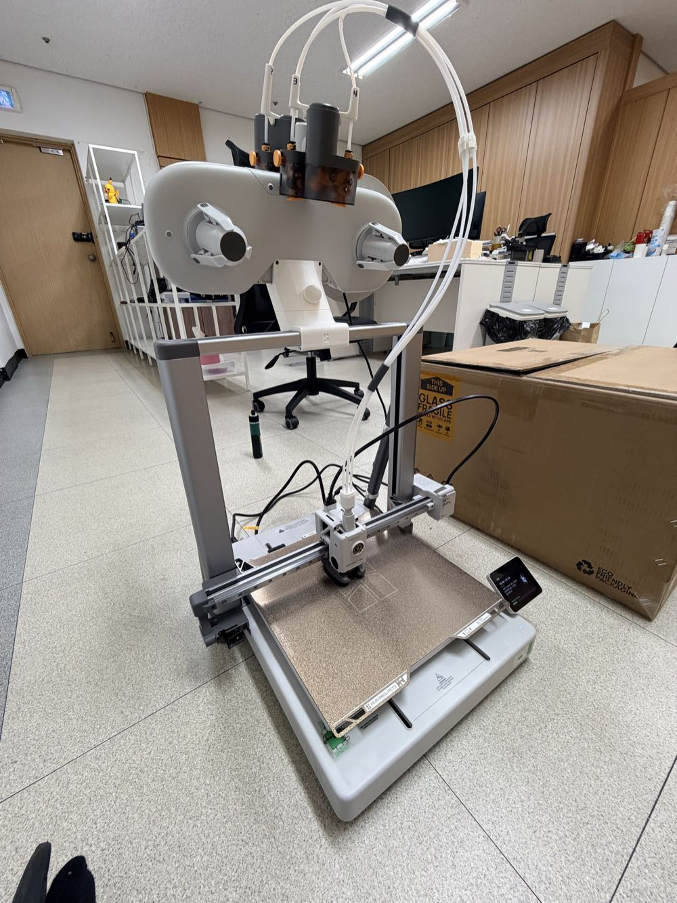

10월 말에 뱀부랩 A2L을 들였다.

[H3C 개봉기](/2026/11/07/bambulab-h3c-ams3-unboxing/)를 먼저 올렸는데...
사실 순서로 치면 A2L이 먼저 왔다 ㅎㅎ

생긴 건 A1을 키운 것 같은 베드 이동식 프린터다.
베드가 330 × 320 mm라서 큰 출력물을 한 판에 올릴 수 있다.

결론부터 말하면 이렇다.

옵션은 좀 부족하다.
근데 가성비는 지금 쓰는 프린터 중에 제일 좋다.
그래서 꽤 만족하면서 쓰고 있다.

A2L 살까 말까 고민하는 분들이 미리 볼 수 있게
개봉부터 설치, 써 보고 느낀 장단점까지 하나씩 적어 본다.

## A2L은 어떤 프린터?

| 항목 | A2L |
|---|---|
| 출력 크기 | 330 × 320 × 325 mm |
| 방식 | 베드가 앞뒤로 움직이는 오픈형 (챔버 없음) |
| 최대 속도 | 500 mm/s |
| 노즐 최고 온도 | 300 ℃ |
| 베드 최고 온도 | 80 ℃ |
| 노즐 | 0.4 mm 스테인리스 기본 (0.2·0.6·0.8 mm 지원) |
| 빌드 플레이트 | 텍스처 PEI |
| 멀티 컬러 | AMS lite (콤보), 2세대 AMS도 연결 가능 · 최대 19색 |
| 소음 | 저소음 모드 49 dB |
| 크기 · 무게 | 544 × 529 × 505 mm · 12.8 kg |
| 가격 | 단품 599,000원 · AMS lite 콤보 749,000원 |

가격은 2026년 11월 12일 뱀부랩 한국 공식 스토어 기준이다(VAT 포함).
미국 공식가는 단품 $469, 콤보 $569.

공식 소개로는 256 mm급 프린터보다 출력 공간이 105% 크다고 한다.
P2S 같은 256 mm 베드랑 나란히 놓고 보면 확실히 넓다.

출시는 올해 6월이다.

## 박스 개봉

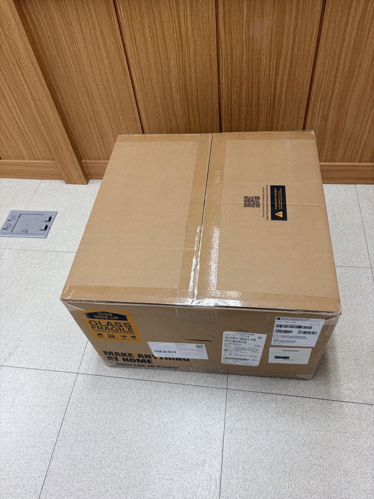

박스는 하나.
옆면에 GLASS FRAGILE 스티커가 크게 붙어 있다.

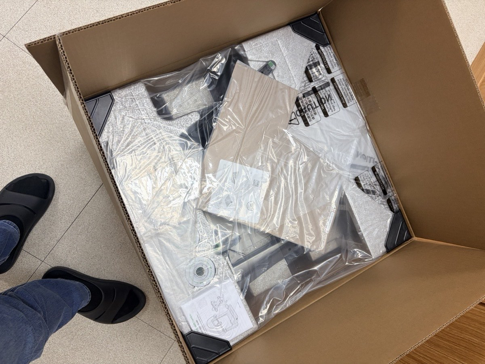

뚜껑을 열면 비닐에 싸인 부품들이 꽉 차 있다.

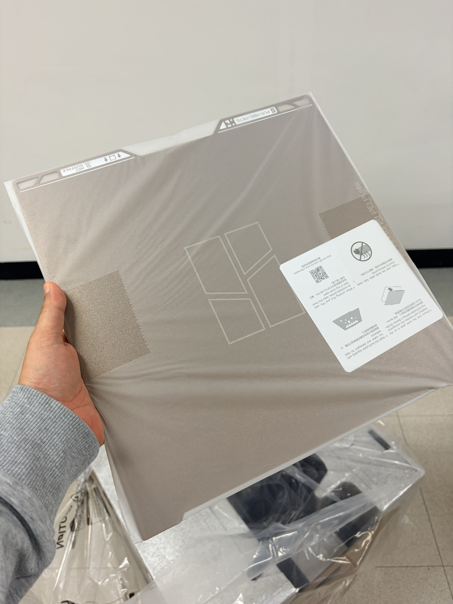

맨 위에는 텍스처 PEI 판.

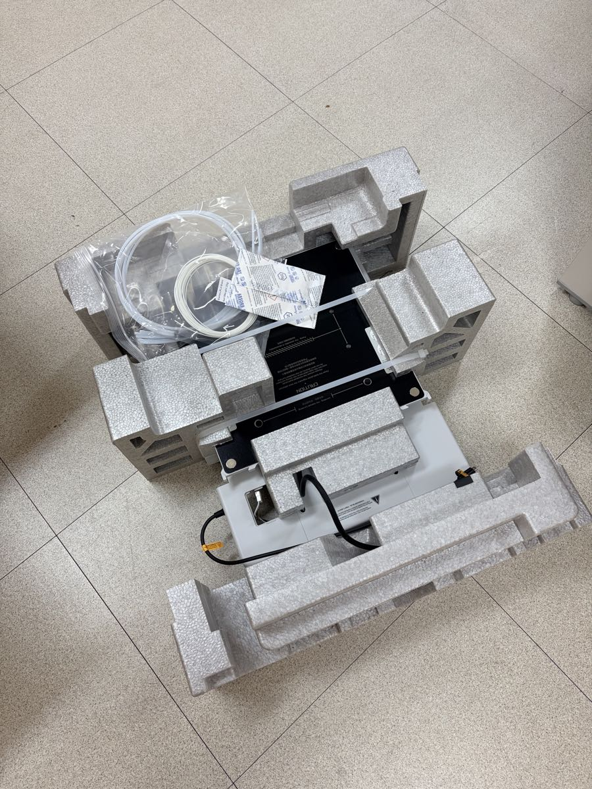

스티로폼을 걷어 내면 베이스랑 부속품이 칸칸이 들어 있다.

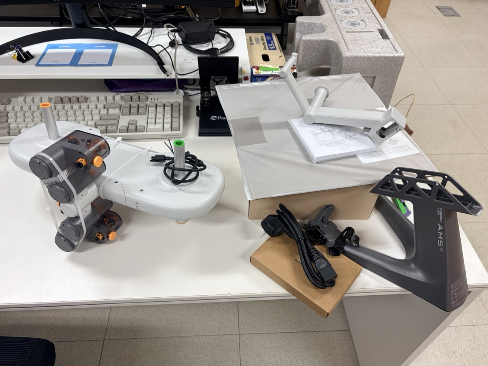

AMS lite도 꺼냈다.
가운데 허브에 스풀 거는 팔이 양쪽으로 달린 구조다.
짙은 회색이 AMS lite 전용 스탠드, 오른쪽 흰색은 본체용 스풀 홀더.

구성은 공식 스토어 기준으로 본체, 툴박스, 빌드 플레이트, 스풀 홀더.
콤보면 여기에 AMS lite가 더해진다.

## 조립은 20분 남짓

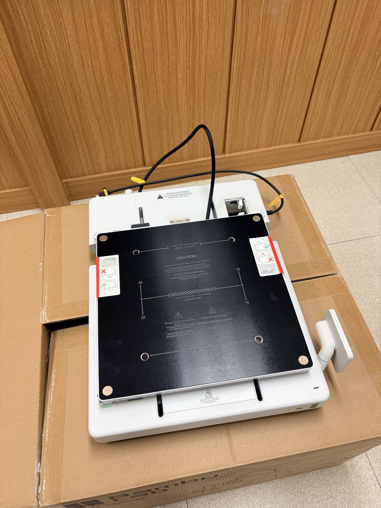

A2L은 꺼내자마자 바로 쓰는 프린터가 아니다.
조립을 조금 해야 한다.

베이스에 프레임을 세워서 나사로 고정하고, 케이블을 꽂아 주면 된다.

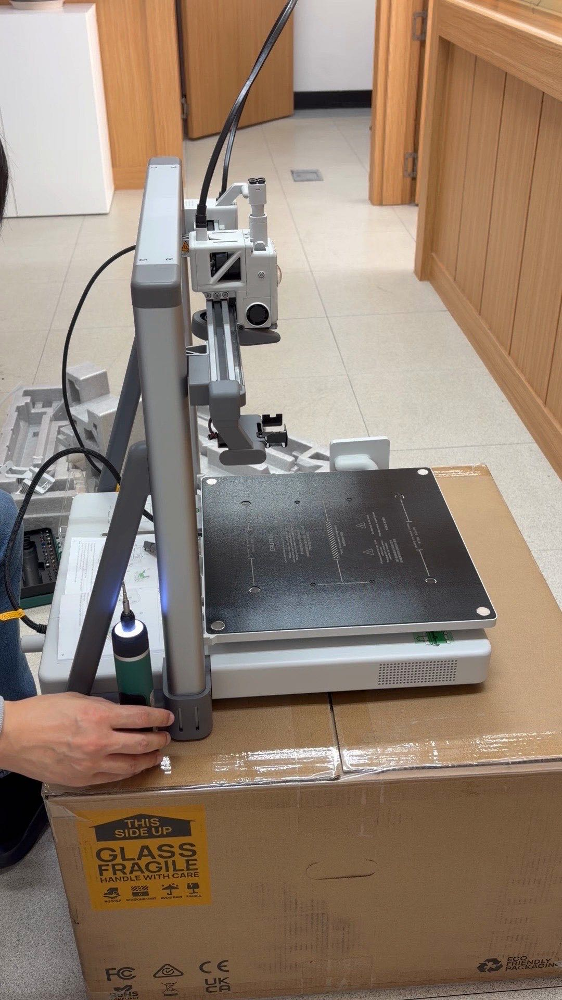

공구는 툴박스에 다 들어 있다.
근데 나사가 꽤 많아서 전동 드라이버가 있으면 훨씬 편하다.

찍어 둔 영상을 보니 본체 조립에 20분 남짓 걸렸다.
설명서 순서대로만 하면 어려운 건 없다.

## AMS lite는 위로 올렸다

AMS lite는 원래 전용 스탠드에 꽂아서 프린터 옆에 세운다.
나는 프린터 위에 얹기로 했다.
위로 올리면 옆자리를 따로 안 차지하니까.

거치대 부품은 X2D로 미리 뽑아 뒀다.

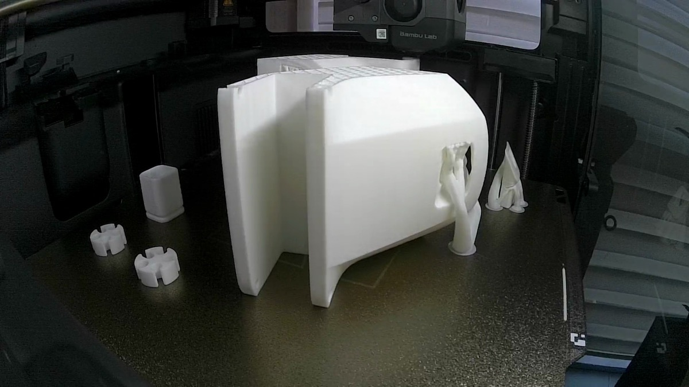

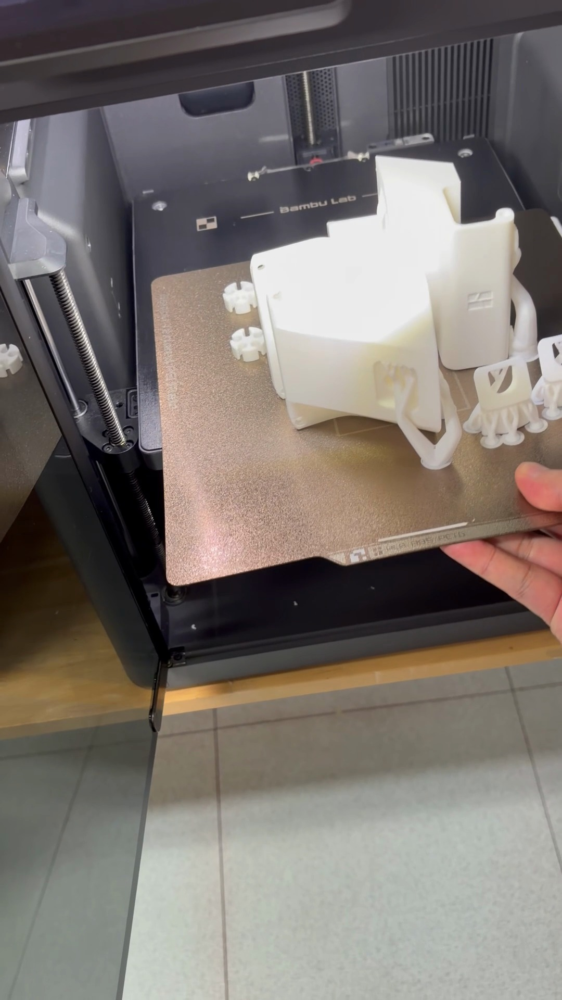

모양이 복잡해서 트리 서포트를 잔뜩 달고 나왔다.

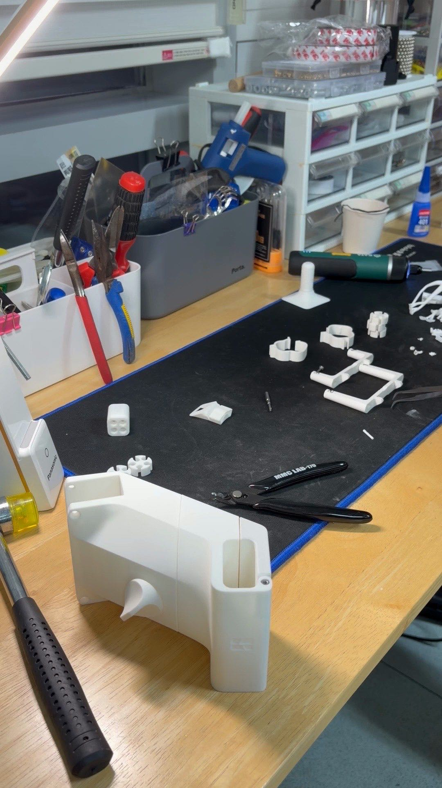

서포트 떼는 영상만 12분이다 ㅋㅋ

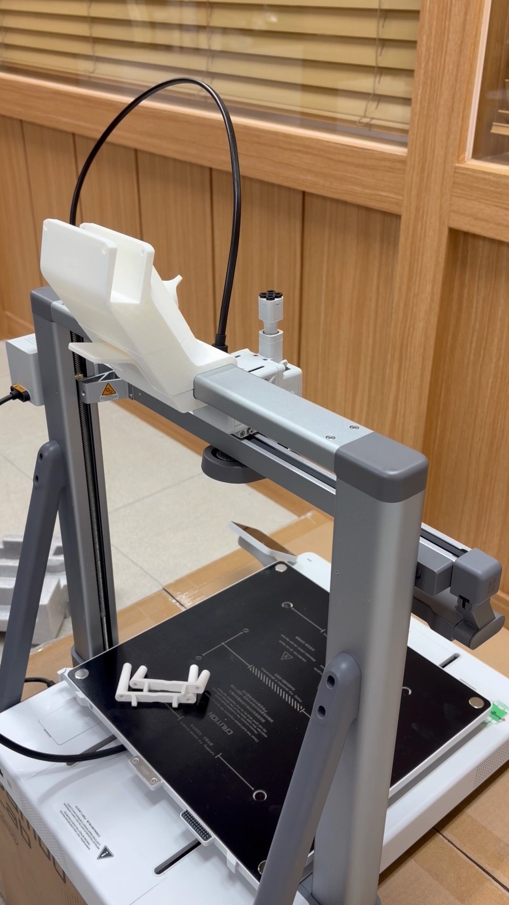

다 뗀 거치대를 상단 빔에 끼우고.

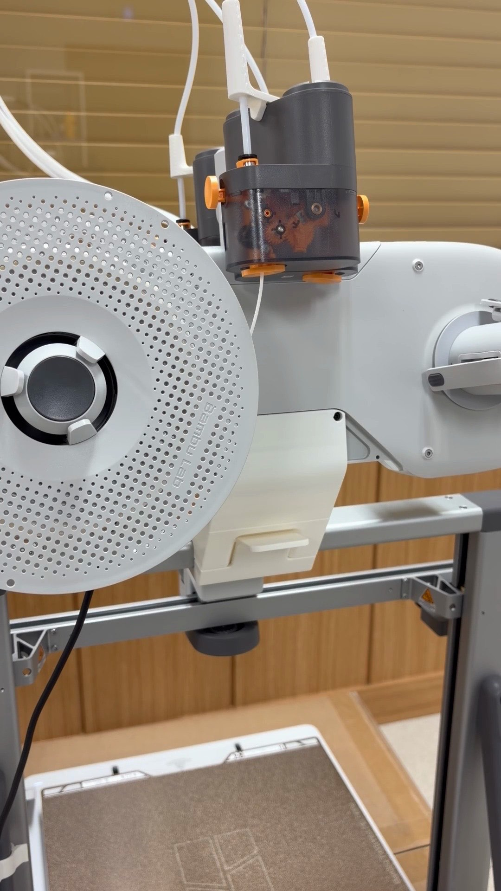

그 위에 AMS lite를 올렸다.

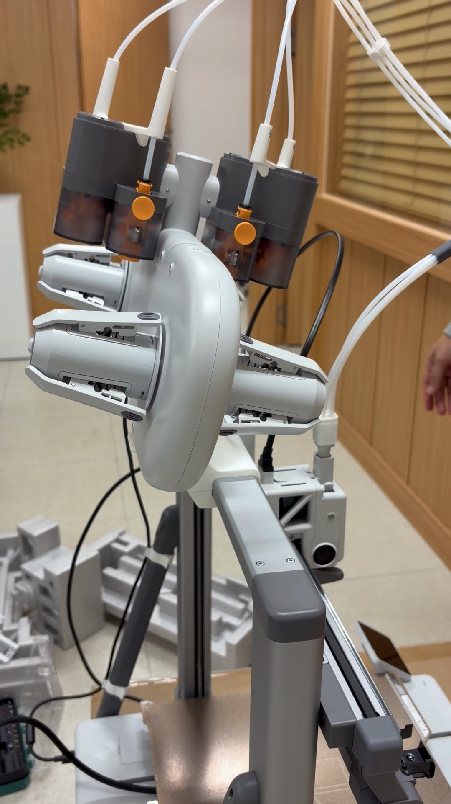

마지막으로 PTFE 튜브 4개를 꽂아 주면 끝.

## 전원 켜고 첫 교정

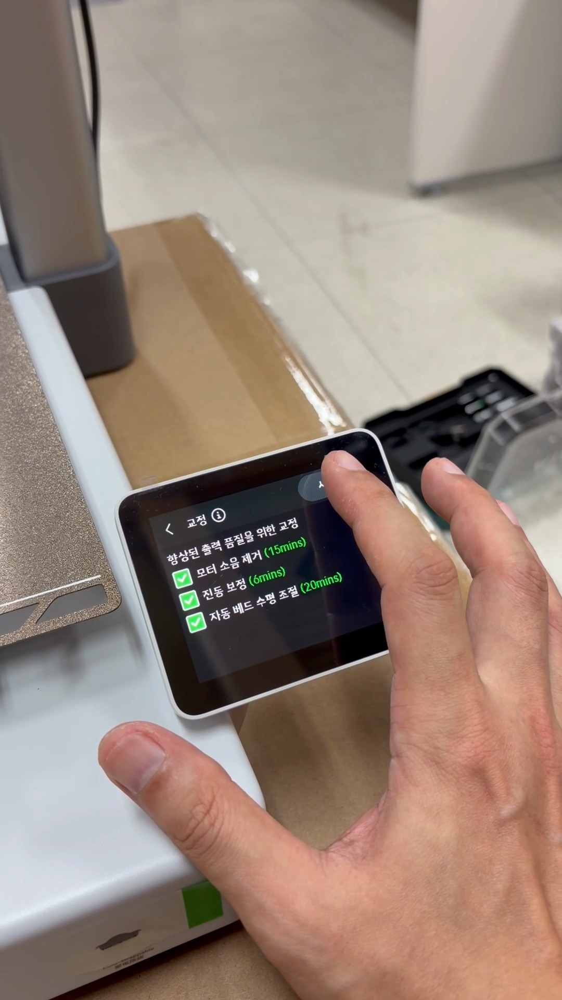

전원을 넣고 터치스크린에서 초기 설정을 하다 보면 교정 화면이 나온다.

화면에 뜬 예상 시간은 이렇다.

- 모터 소음 제거 15분
- 진동 보정 6분
- 자동 베드 수평 조절 20분

다 합치면 40분 남짓.
처음 한 번은 이 정도 기다린다고 생각하면 된다.

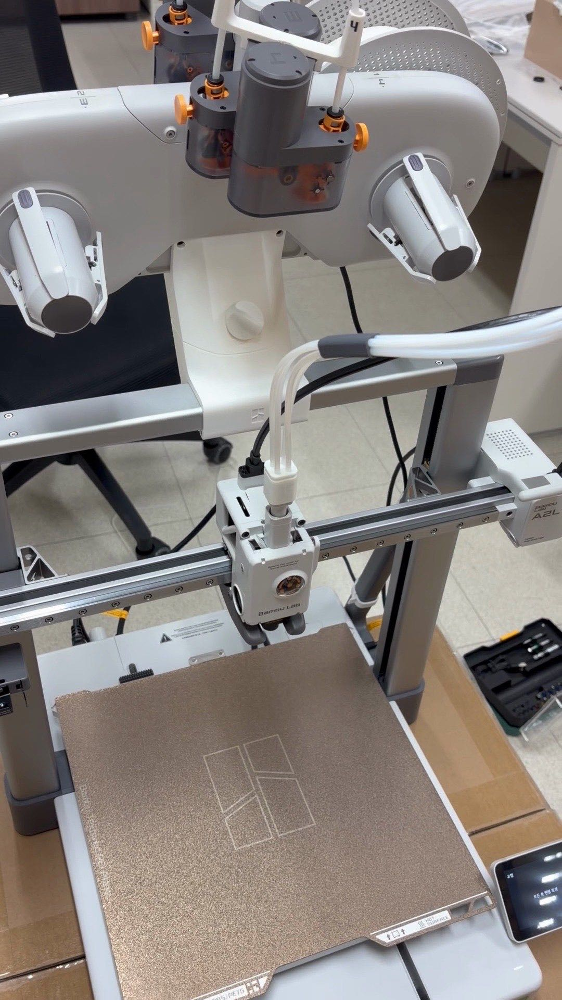

준비 끝!

## 써 보니 좋은 점

### 큰 출력물도 한 판에

제일 좋은 건 역시 베드 크기다.

[AMS 2 Pro 슬라이딩 수납](/2026/11/09/ams2-pro-sliding-speedrack-underrail/)을 만들 때 덮개 부품을 A2L 한 판에 전부 올렸었다.
22시간 정도, 필라멘트는 700 g 남짓.
256 mm 베드였으면 두 판으로 나눠야 했던 양이다.

쪼개서 붙일 일이 줄어든다는 게 생각보다 크다.

### 단색 출력에 딱

A2L은 노즐이 하나다.
AMS lite로 다색 출력도 되긴 하는데, 색을 바꿀 때마다 버리는 필라멘트와 시간이 생긴다.

단색으로 크게 뽑을 때는 이런 걱정이 없다.
큰 단색 출력에는 이만한 게 없다는 생각이 든다.

다색 위주라면 [H3C](/2026/11/07/bambulab-h3c-ams3-unboxing/) 같은 툴 체인저가 훨씬 편하다.

### 가격

330 mm 베드에 599,000원.
AMS lite 콤보도 749,000원이다.

이 크기를 이 가격에 뽑을 수 있다는 게 A2L의 제일 큰 장점 같다 ㅎㅎ

## 아쉬운 점

### 챔버가 없다

오픈형이라 덮개가 없다.
베드 최고 온도도 80 ℃다.

공식 안내도 PLA·PETG 같은 일반 소재 중심이고, ABS·ASA는 지원 목록에 없다.
고온 소재를 자주 쓸 거면 챔버 있는 기종을 보는 게 맞다.

### 카메라는 기대하지 말자

이게 제일 아쉽다.

카메라가 달려 있긴 한데...
타임랩스나 실시간 영상은 사실상 없는 거나 마찬가지다.
공식 사양부터 저프레임 1080p라서, 실시간 화면으로 출력 상태를 보기엔 많이 부족하다.

느리게라도 찍힌 영상을 클라우드에서 내려받으려고 하면 거의 안 받아진다 ㅠㅠ

그래서 이 글에 들어간 출력 영상도 전부 다른 프린터로 찍은 거다.

### 클라우드는 출력까지만

클라우드로 출력 보내는 건 잘 된다.
근데 그 외 기능은 약하다.

공식 소개를 보면 노즐 뭉침이나 에어 프린팅 감지 같은 출력 감시 기능은 들어 있다.
다만 내가 직접 화면으로 확인하고 영상까지 챙기는 용도로는 많이 모자라다.

## 이런 분께 맞다

**맞는 경우**

- 큰 출력물을 쪼개지 않고 한 번에 뽑고 싶다
- 주로 PLA·PETG로 단색 출력을 한다
- 60만원대에서 큰 베드가 필요하다
- 첫 대형 프린터를 찾고 있다

**안 맞는 경우**

- ABS·ASA 같은 고온 소재를 자주 쓴다
- 타임랩스로 콘텐츠를 만들고 싶다
- 다색 출력이 주력이다 (툴 체인저 기종이 낫다)
- 원격으로 영상 확인하는 기능이 중요하다

## 정리하면

옵션은 확실히 아쉽다.
챔버도 없고, 카메라는 있으나 마나다.

그래도 330 mm 베드를 599,000원에 쓸 수 있다.
큰 단색 출력에는 이만한 가성비가 없다고 본다.

나는 꽤 만족하면서 쓰고 있다 ㅎㅎ

A2L 쓰시는 분들, 타임랩스 잘 받아지시나요?
저만 이런 건지 댓글로 알려주세요.
