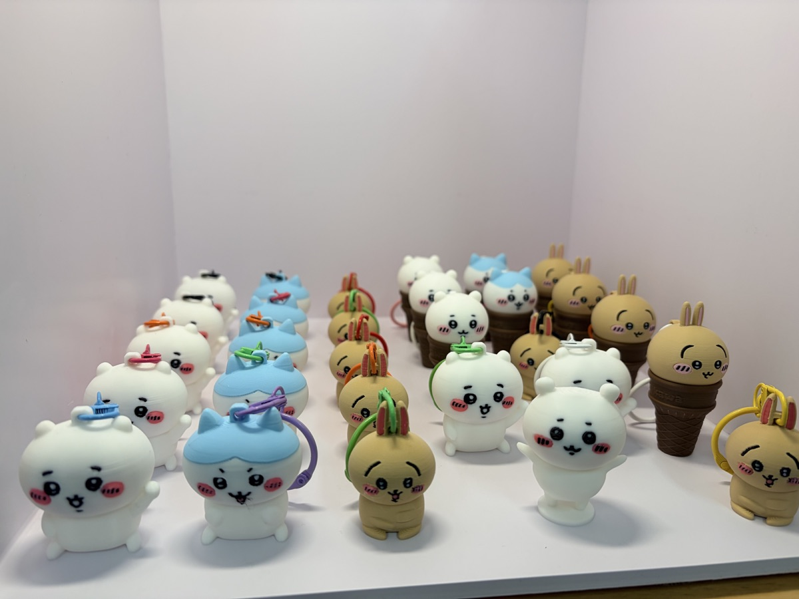
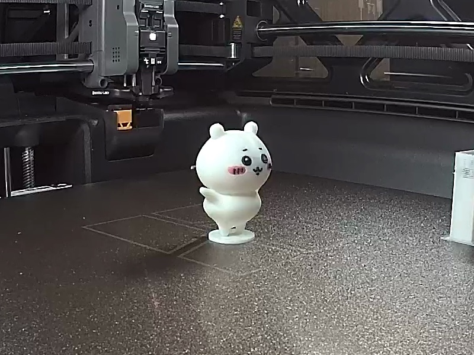
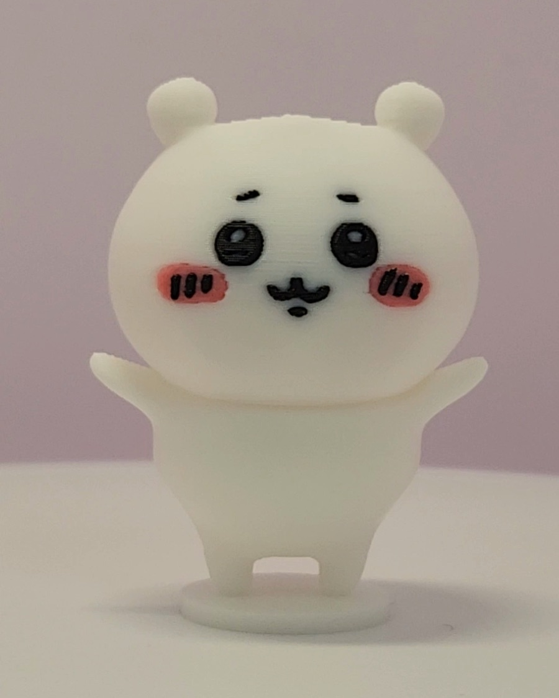
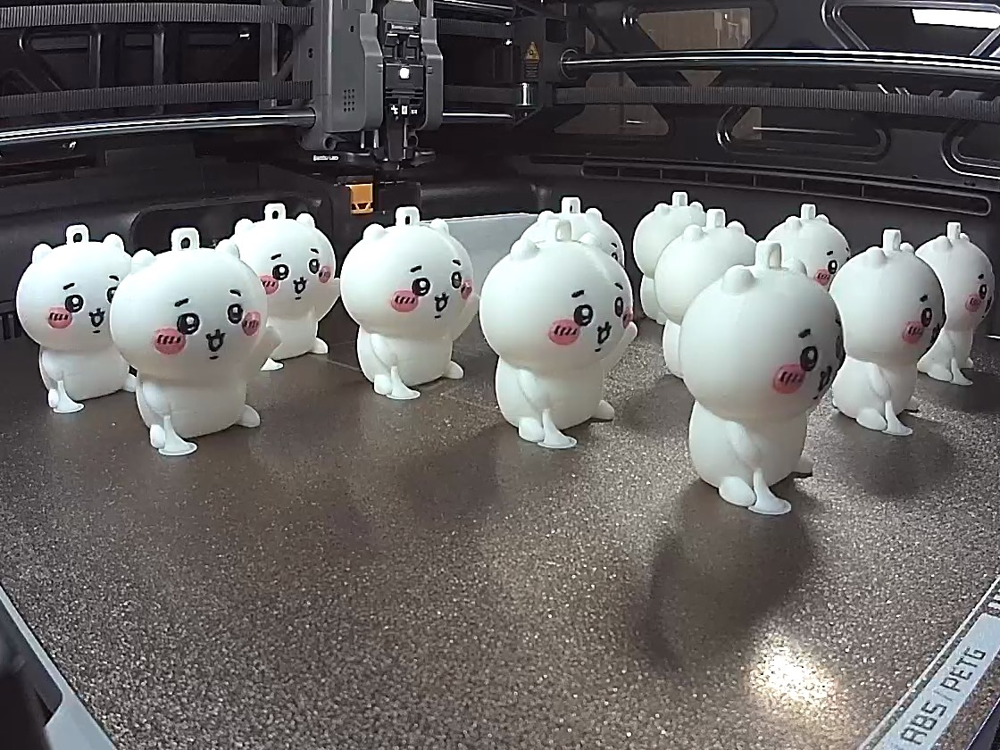
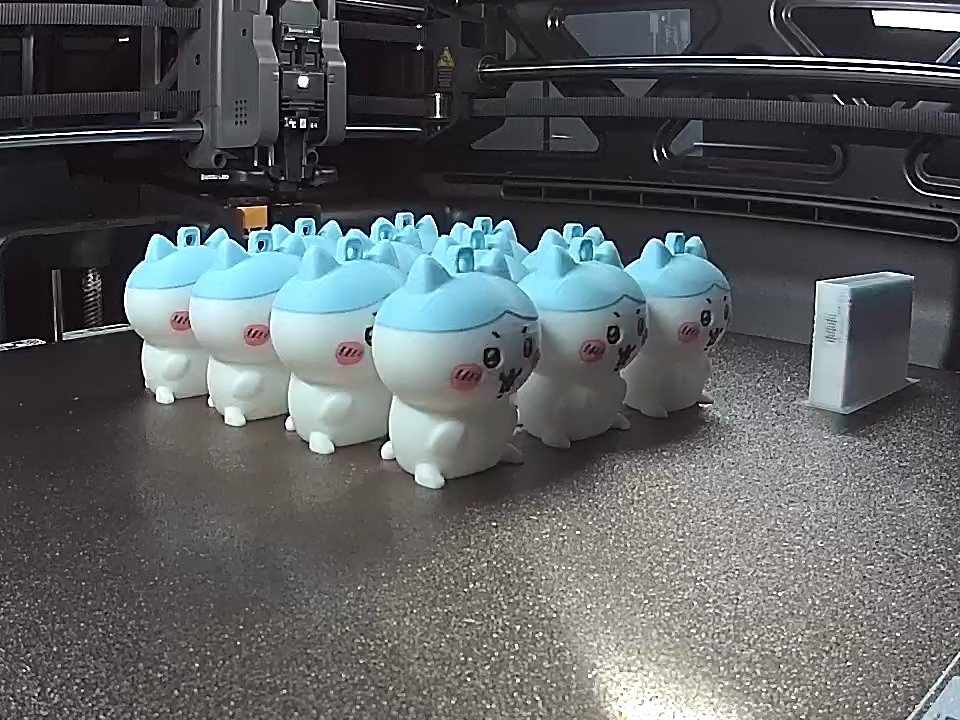
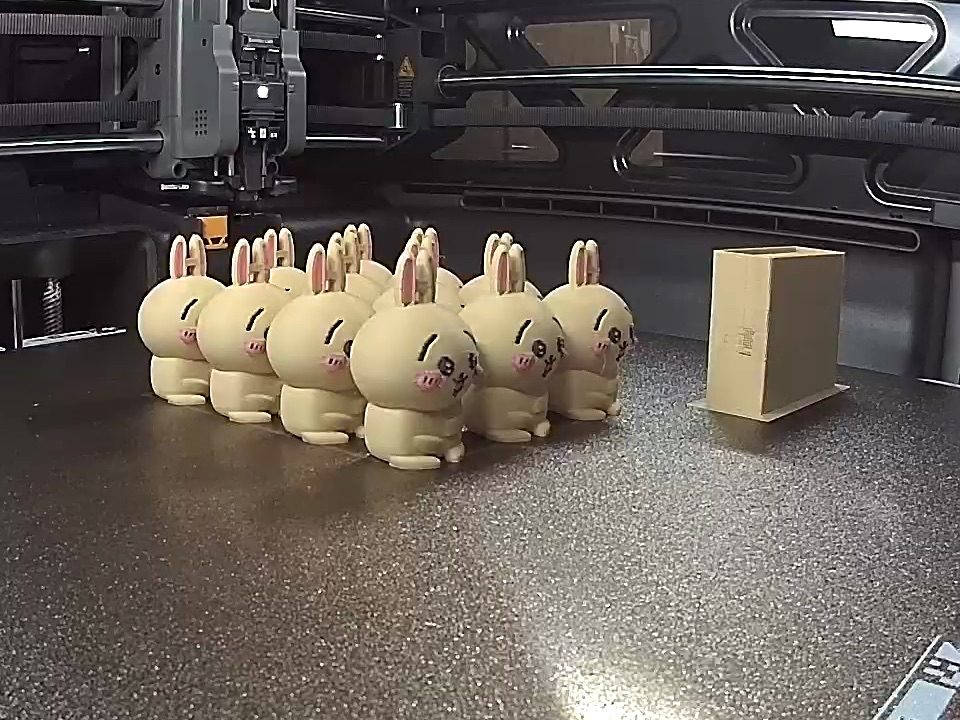
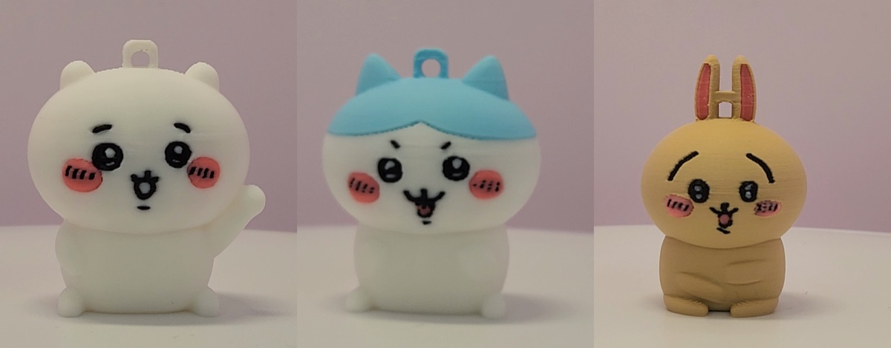
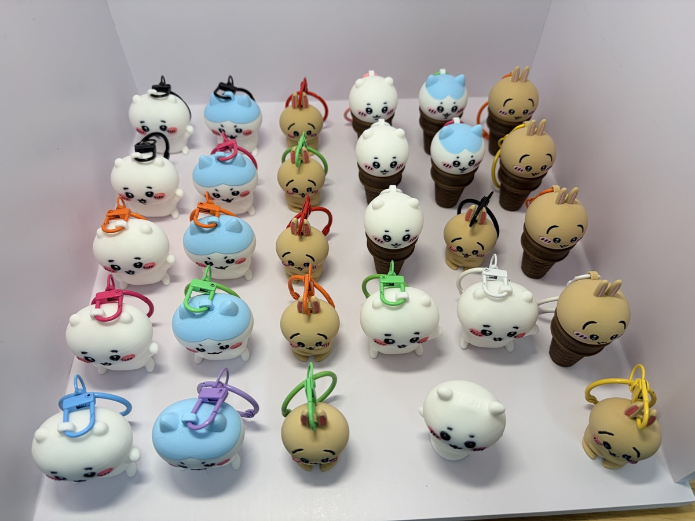
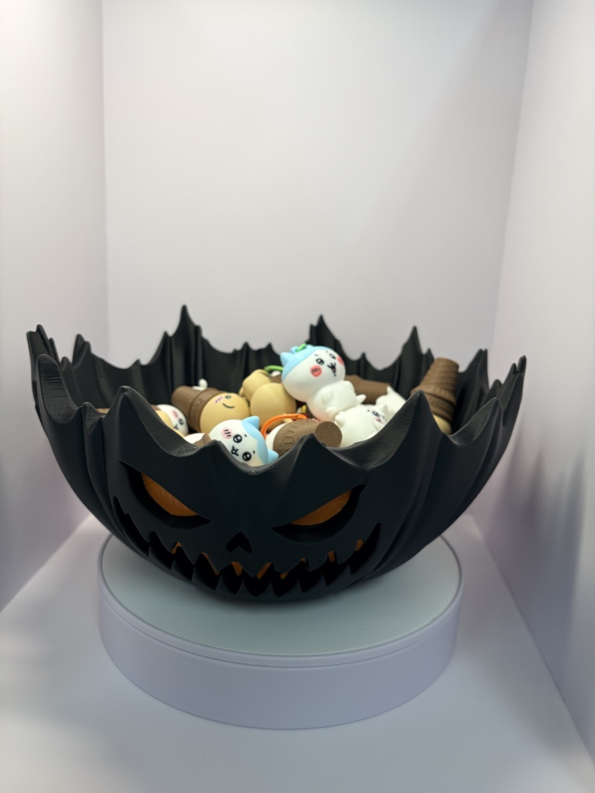
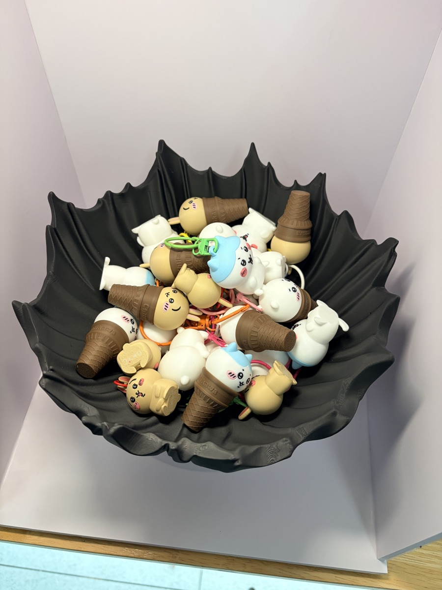

More Chiikawa :)

This is part 2, following the [ice cream cone keychains](/en/2026/11/11/chiikawa-ice-cream-keychain/).
No cones this time, just the trio sitting down.

Chiikawa, Hachiware, and Usagi.
Twelve of each for 36 keychains, plus one standing Chiikawa figure.
Once again, they're gifts for the people around me.

## The sitting trio

The models are from 椰菜哟's Chiikawa series on MakerWorld.
Each character has its own model, and each comes with a keychain profile.
There's a small loop on top of the head, so all you need is a keyring clip.

About five colors in total.
White bodies, black eyes, pink cheeks.
Hachiware has a light blue top, and Usagi has a beige body with pink ears.

Back in the day, that many colors would have made me sigh before I even started.
But now I have the H3C :)

## First, one standing Chiikawa

It started with a single standing Chiikawa.
It's a multicolor figure by AtamiSquare, scaled down to about 5 cm to match the keychains.
The slicer estimate was 42 minutes and 21 g of filament.
Arms wide open, like it's saying "I'm here!"

The face is tiny, but the eyes, mouth, and cheeks are crisp with no smudging.
After printing just this one, though...
it looked a little lonely on its own.

## 12 per plate, the Chiikawa factory is open

So I invited some friends.
Twelve per plate, one plate per character.

The first plate was 12 Chiikawa.
I started it in the evening, right after taking the standing figure off.
The slicer estimate was 5 hours 2 minutes and about 139 g of filament.

The second plate was 12 Hachiware.
I swapped plates around 3 a.m.... Chiikawa really does cost you sleep.
The slicer estimate was 5 hours 1 minute and about 137 g.

Last came 12 Usagi.
These were printed a bit finer, at a 0.16 mm layer height.
So about 6 hours by the slicer estimate, and 99 g of filament.

Overnight, the H3C turned into a Chiikawa factory.
Every time I took a plate out, twelve little faces stared back at me at once. That's a lot of pressure.

## A full plate of multicolor, no worries

This was the best part of the whole project.
I could fill an entire plate with tiny multicolor figures without worrying about it.

On a single-nozzle printer, it would have been a different story.
Every color change means pulling the old filament out of the nozzle and pushing the new color in.
Put 12 small figures on one plate, and that color swap repeats on every layer.
Time and filament just drain away.

The H3C has a separate nozzle for each color, so that doesn't happen.
Print time drops to less than a third, too.
When I compared the same keychain in my [unboxing post](/en/2026/11/07/bambulab-h3c-ams3-unboxing/), the P2S took 6 hours 40 minutes and the H3C took 1 hour 25 minutes.
Filament wasted on color changes (flush): 72 g on the P2S, 0 g on the H3C.

So filling the plate is no burden at all.
That's how I could run three plates of 12 back to back.
I felt the same with the [H3C multicolor figures](/en/2026/11/08/bambulab-h3c-multicolor-figure/): for small multicolor figures like these, the H3C is just so easy.

## Even cuter when they spin

I put each one on a turntable and filmed it in 360 degrees.
Round and chubby from every angle.

Chiikawa raises a hand to say hi,
Hachiware smiles with its mouth open,
and Usagi is, as always, excited about something.

Watching them spin round and round, you lose track of time.
The 360-degree shots are in the video.

## Clips on, everyone in line

I attached a colorful keyring clip to each one.
The ice cream cone crew from last time joined the lineup too.
It looks like roll call :)

## The Halloween bowl becomes a Chiikawa basket

With everything gathered, I needed somewhere to keep them.
Conveniently, the [bowl I printed for Halloween](https://www.youtube.com/shorts/DsGxGqEg4P4) was sitting around doing nothing.

Pour them all in, and it turns into a Chiikawa prize bin.
It's a scary pumpkin-face bowl, but with this inside, it's not scary at all.

## Summary

- 36 sitting Chiikawa, Hachiware, and Usagi keychains (12 of each) + 1 standing Chiikawa figure
- All multicolor on the H3C, 12 keychains per plate
- A separate nozzle for each color means a full plate of tiny multicolor figures with no worries, in less than a third of the time
- Each keychain plate: 5–6 hours and 100–140 g of filament by the slicer estimate (details in Print info below)
- Clips attached, ready to hand out as gifts

I hope whoever gets one hangs it on their bag.

If you could pick one of the three, who would it be?
Me... I couldn't choose, so I printed 12 of each.

## Watch the video

I put everything, from the prints to the 360-degree spins and the print info, into a quiet short.
The background music is the same calm 8-bit track I made for part 1.

  <iframe src="https://www.youtube.com/embed/Vrkuof5NQJM" title="Chiikawa Keychains Part 2: 36 Friends, One H3C" style="position: absolute; inset: 0; width: 100%; height: 100%; border: 0;" allow="accelerometer; autoplay; clipboard-write; encrypted-media; gyroscope; picture-in-picture; web-share" allowfullscreen loading="lazy"></iframe>

- YouTube Short: [Chiikawa Keychains Part 2: 36 Friends, One H3C](https://www.youtube.com/shorts/Vrkuof5NQJM)

## Print info

| Print | Qty | Layer height | Time (est.) | Filament (est.) |
|---|---|---|---|---|
| Standing Chiikawa (5 cm tall) | 1 | 0.20 mm | 42 min | 21 g |
| Chiikawa keychain | 12 | 0.20 mm | 5 h 2 min | 139 g |
| Hachiware keychain | 12 | 0.20 mm | 5 h 1 min | 137 g |
| Usagi keychain | 12 | 0.16 mm | 5 h 57 min | 99 g |
| Total | 37 | | 16 h 41 min | 396 g |

- Printer: Bambu Lab H3C (0.4 mm nozzle, one plate at a time)
- Filament: Bambu PLA Basic in white, black, pink, light blue, and beige
- Times and weights are Bambu Studio slicer estimates. The Chiikawa plate and the standing figure were re-sliced with H3C settings because the original print settings weren't saved, so the real numbers may differ slightly.

## Credits

- Keychain models: 椰菜哟's Chiikawa series (keychain version) on MakerWorld
- Standing figure: by AtamiSquare on MakerWorld
- Character: Chiikawa © nagano / chiikawa committee. These are fan-made models, not official merchandise.
