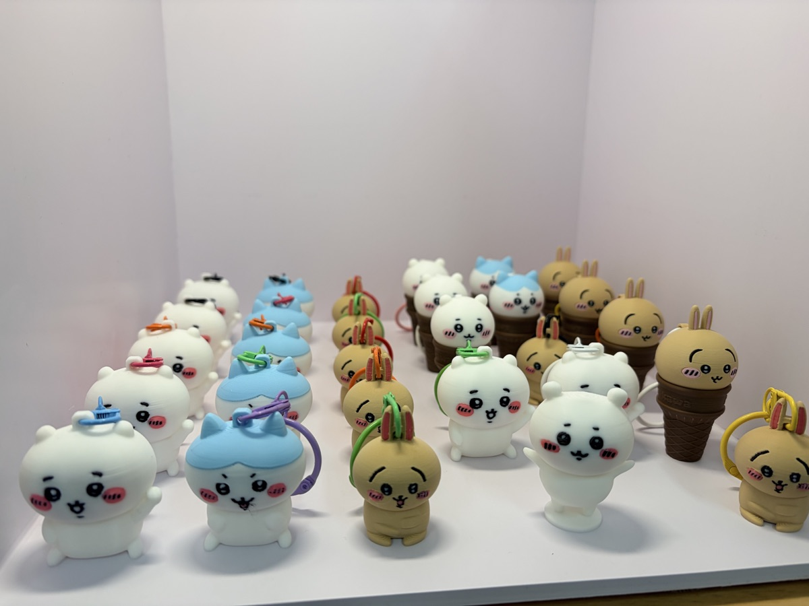
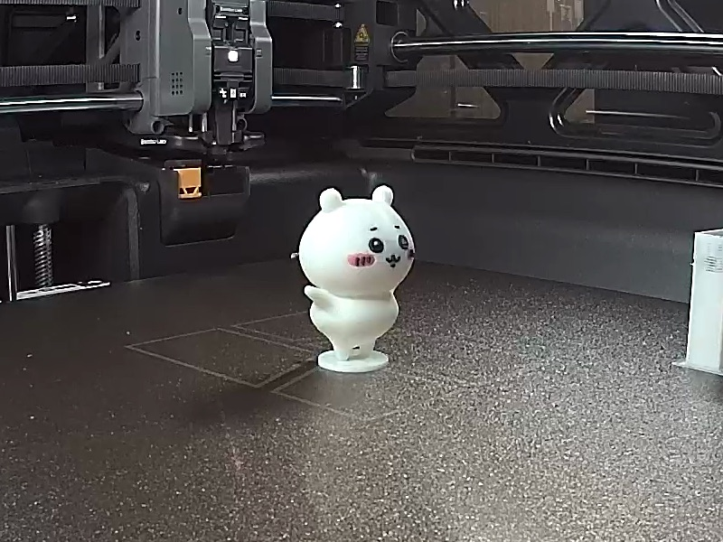
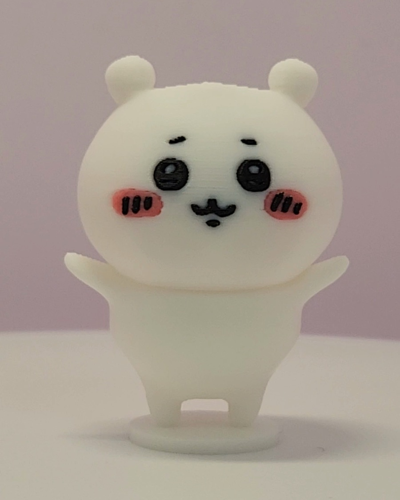
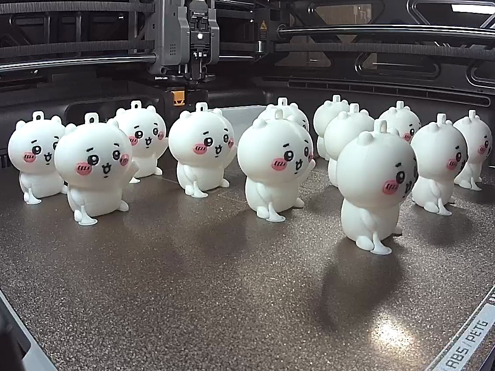
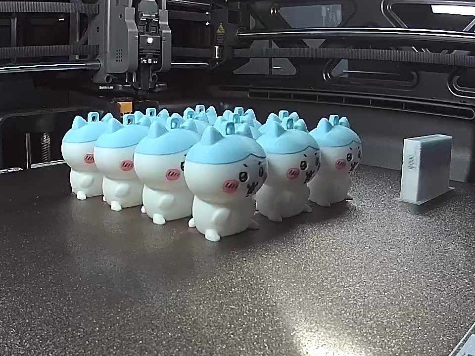
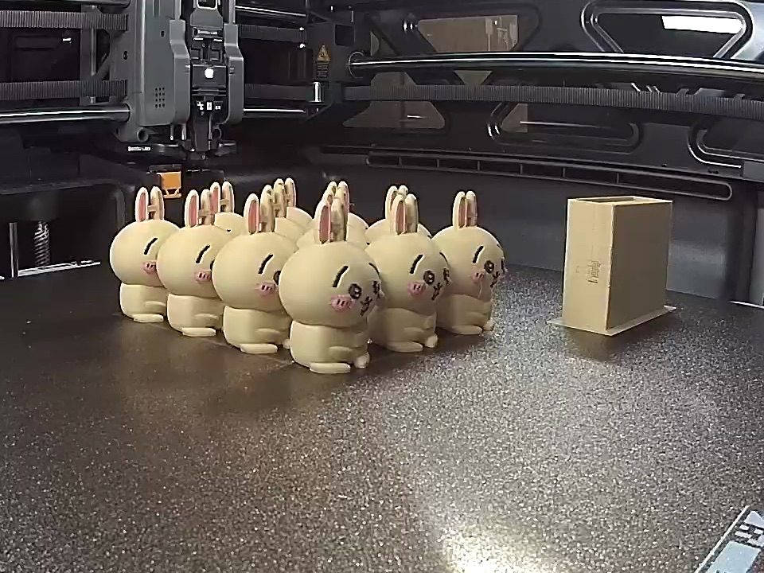
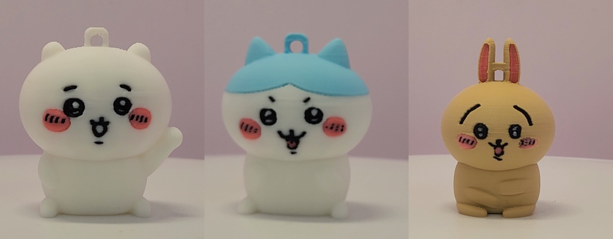
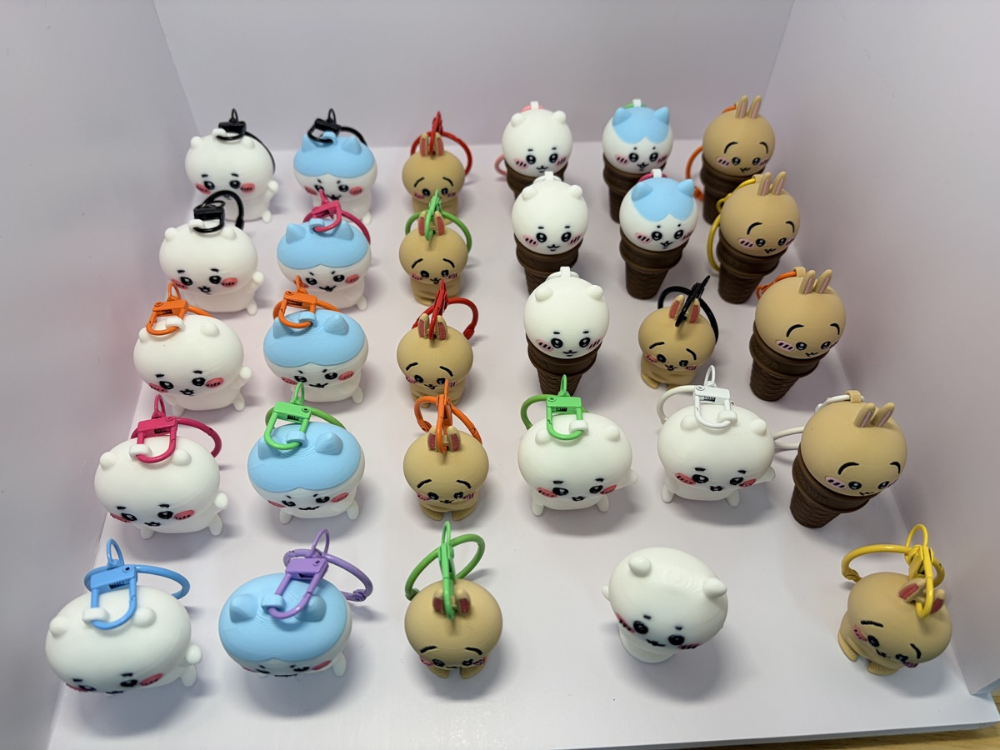
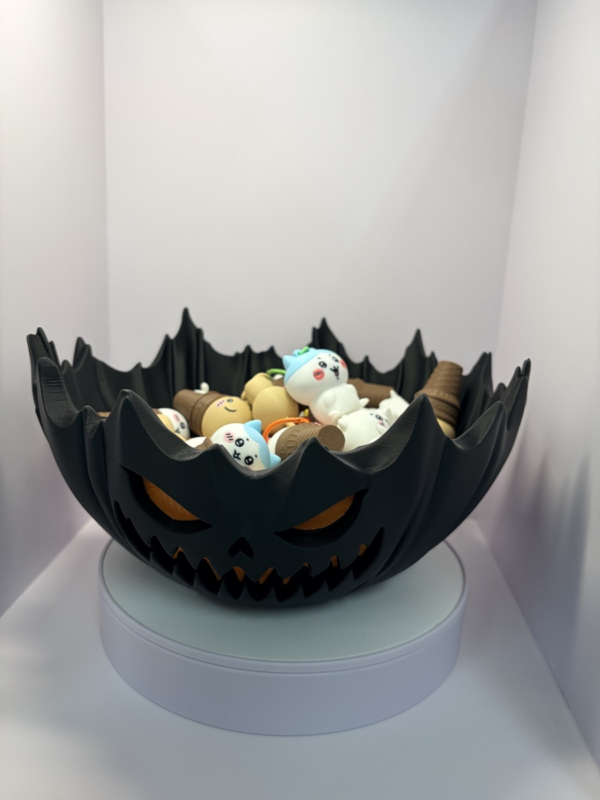
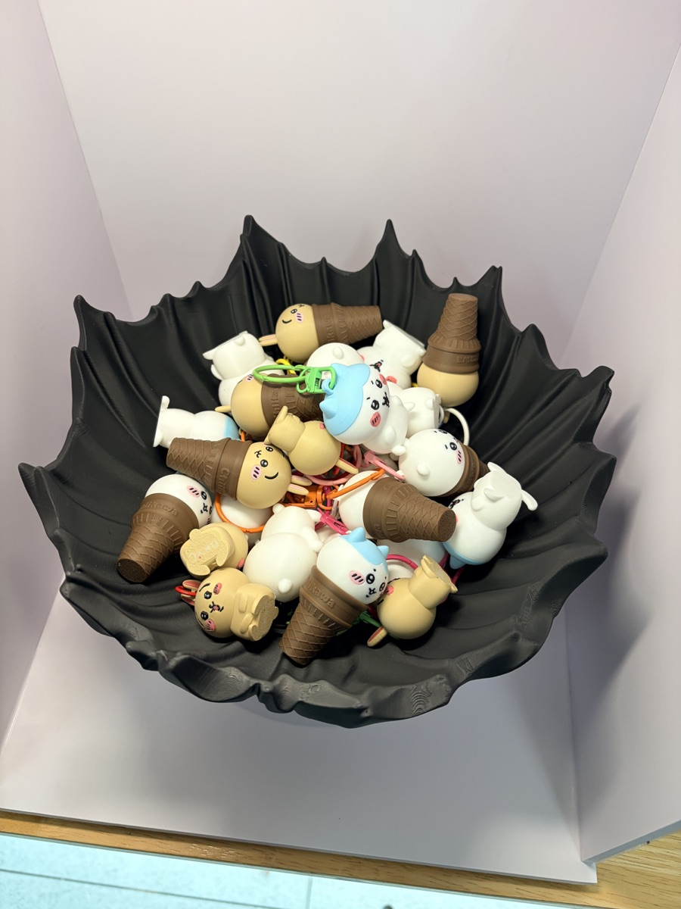

またちいかわです。

[前回のアイスクリームキーホルダー](/ja/2026/11/11/chiikawa-ice-cream-keychain/)に続く第2弾です。
今回はコーンなしで、座っている3人です。

ちいかわ、ハチワレ、うさぎ。
キャラクターごとに12個ずつで36個、そこに立っているちいかわのフィギュアを1つ。
今回も周りの人に配るプレゼント用です。

## 今回は座っている3人

モデルはMakerWorldにある椰菜哟さんのちいかわシリーズです。
キャラクターごとにモデルが分かれていて、それぞれキーホルダー版のプロファイルが入っています。
頭の上に小さな輪が付いているので、キーホルダー金具を付けるだけで完成です。

色は全部で5色ほど。
白い体、黒い目、ピンクのほっぺ。
ハチワレは水色の頭、うさぎはベージュの体にピンクの耳です。

以前なら、これだけ色が多いと始める前からため息が出ていました。
でも今はH3Cがあります。

## まずは立っているちいかわを1つ

始まりは立っているちいかわ1つでした。
AtamiSquareさんのマルチカラーフィギュアで、キーホルダーと背丈をそろえるために約5 cmに縮小して出力しました。
スライサーの予測は42分、フィラメントは21 gです。
両手を広げて立つ姿が、まさに「来たよ！」という感じです。

顔は小さいのに、目も口もほっぺもにじまずくっきり出ています。
ただ、これ1つを出力してみると……
1人だけではちょっと寂しそうに見えました。

## 1枚に12個ずつ、ちいかわ工場が稼働

そこで仲間を呼びました。
1枚に12個ずつ、キャラクターごとに1枚です。

1枚目はちいかわ12個。
夕方、立っているちいかわを取り出してすぐに始めました。
スライサーの予測は5時間2分、フィラメントは約139 gです。

2枚目はハチワレ12個。
プレートを入れ替えたのは夜中の3時ごろ……ちいかわのためなら睡眠も削れます。
スライサーの予測は5時間1分、フィラメントは約137 gです。

最後はうさぎ12個。
うさぎは積層ピッチ0.16 mmで、少し細かく出力しました。
そのためスライサーの予測は約6時間、フィラメントは99 gです。

一晩でH3Cがちいかわ工場になりました。
プレートを取り出すたびに12人が一斉にこちらを見てくるので、地味にプレッシャーです。

## マルチカラーの心配なしに1枚たっぷり

今回いちばん良かったのはここです。
小さなフィギュアをマルチカラーで、1枚いっぱいに心配なく出力できること。

ノズルが1つのプリンターだったら話は違っていたはずです。
色が変わるたびに、ノズル内のフィラメントを抜いて新しい色を押し込む必要があるからです。
小さなフィギュアを1枚に12個並べると、その色替えが層ごとに繰り返されます。
時間もフィラメントもどんどん減っていきます。

H3Cは色ごとにノズルが分かれているので、そうはなりません。
出力時間も3分の1もかかりません。
[開封記](/ja/2026/11/07/bambulab-h3c-ams3-unboxing/)で同じキーホルダーを比べたときも、P2Sは6時間40分、H3Cは1時間25分でした。
色替えで捨てるフィラメント（フラッシュ）は、P2Sが72 g、H3Cは0 gです。

だからプレートをぎっしり埋めても、まったく負担になりません。
12個ずつ3枚を続けて出力できたのもそのおかげです。
[H3Cのマルチカラーフィギュア](/ja/2026/11/08/bambulab-h3c-multicolor-figure/)のときも感じましたが、こういう小さなマルチカラーフィギュアはH3Cが本当に楽です。

## 回すともっとかわいい

ターンテーブルに1つずつ乗せて、360度で撮ってみました。
横から見ても後ろから見ても、まんまるです。

ちいかわは片手を上げてあいさつ、
ハチワレは口を開けてにっこり、
うさぎはいつもどおり、何かに浮かれています。

くるくる回るのをぼーっと眺めていると、時間を忘れます。
この360度のシーンは動画に入れました。

## 金具を付けて整列

カラフルなキーホルダー金具を1つずつ付けました。
前回のアイスクリーム組も呼んで、一緒に並べました。
まるで点呼のようです。

## ハロウィンのボウルがちいかわのかごに

全部集めると、しまっておく場所が必要になりました。
ちょうど[ハロウィンに出力したボウル](https://www.youtube.com/shorts/DsGxGqEg4P4)が空いていました。

流し込むと、ちいかわのガチャ箱のようになりました。
怖いかぼちゃ顔のボウルなのに、中身がこれなので全然怖くありません。

## まとめ

- 座ったちいかわ・ハチワレ・うさぎのキーホルダー36個（各12個）＋立っているちいかわフィギュア1個
- すべてH3Cでマルチカラー出力、キーホルダーは1枚に12個ずつ
- 色ごとにノズルが分かれているので、小さなマルチカラーフィギュアも1枚いっぱいに心配なく、出力時間も3分の1もかからない
- キーホルダーは1枚あたりスライサー予測で5〜6時間、フィラメント100〜140 g（詳しくは下の出力情報）
- 金具を付けて、周りに配るプレゼントに

もらった人がバッグに付けて持ち歩いてくれたらうれしいです。

みなさんなら、3人のうち誰を選びますか？
私は……選べなかったので12個ずつ出力しました。

## 動画で見る

出力から360度回る様子、出力情報まで、静かなショート動画にまとめました。
英語のナレーションが基本で、日本語の吹き替えと字幕もあります。
BGMは第1弾のときに自作した、穏やかな8ビット曲です。

  <iframe src="https://www.youtube.com/embed/Vrkuof5NQJM?cc_lang_pref=ja&cc_load_policy=1" title="ちいかわキーホルダー第2弾、座った3人を36個H3Cで出力" style="position: absolute; inset: 0; width: 100%; height: 100%; border: 0;" allow="accelerometer; autoplay; clipboard-write; encrypted-media; gyroscope; picture-in-picture; web-share" allowfullscreen loading="lazy"></iframe>

- YouTubeショート：[ちいかわキーホルダー第2弾、座った3人を36個H3Cで出力](https://www.youtube.com/shorts/Vrkuof5NQJM)

## 出力情報

| 出力物 | 個数 | 積層ピッチ | 時間（予測） | フィラメント（予測） |
|---|---|---|---|---|
| 立っているちいかわ（高さ5 cm） | 1 | 0.20 mm | 42分 | 21 g |
| ちいかわキーホルダー | 12 | 0.20 mm | 5時間2分 | 139 g |
| ハチワレキーホルダー | 12 | 0.20 mm | 5時間1分 | 137 g |
| うさぎキーホルダー | 12 | 0.16 mm | 5時間57分 | 99 g |
| 合計 | 37 | | 16時間41分 | 396 g |

- プリンター：Bambu Lab H3C（0.4 mmノズル、1枚ずつ出力）
- フィラメント：Bambu PLA Basic（白、黒、ピンク、水色、ベージュ）
- 時間と重さはBambu Studioのスライサー予測値です。ちいかわの1枚と立っているフィギュアは実際の出力設定が残っていなかったため、H3Cの設定でスライスし直した値で、実際とは少し違う場合があります。

## クレジット

- キーホルダーモデル：MakerWorldの椰菜哟さんのちいかわシリーズ（キーホルダー版）
- 立っているフィギュア：MakerWorldのAtamiSquareさん
- キャラクター：ちいかわ © nagano / chiikawa committee。公式グッズではなく、ファンが作ったモデルです。
