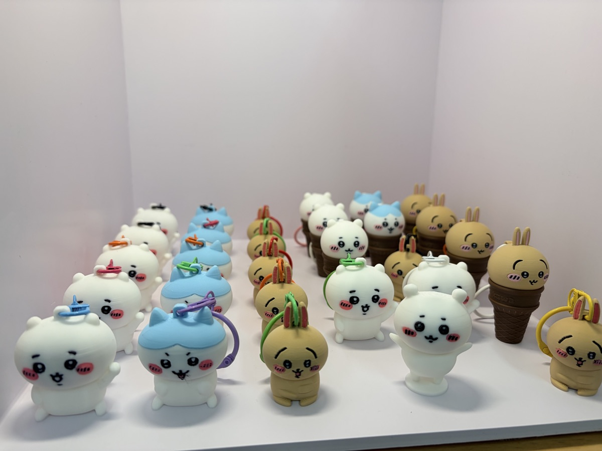
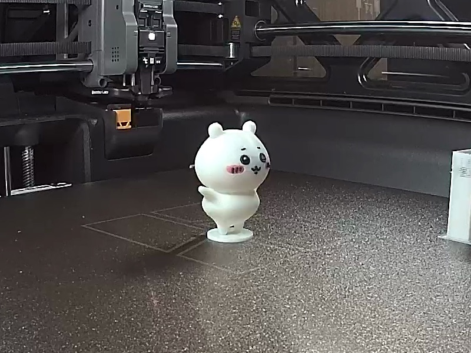
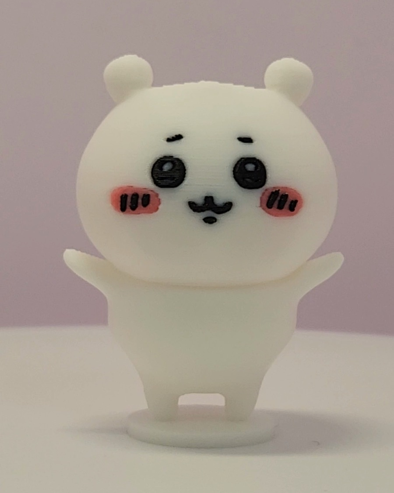
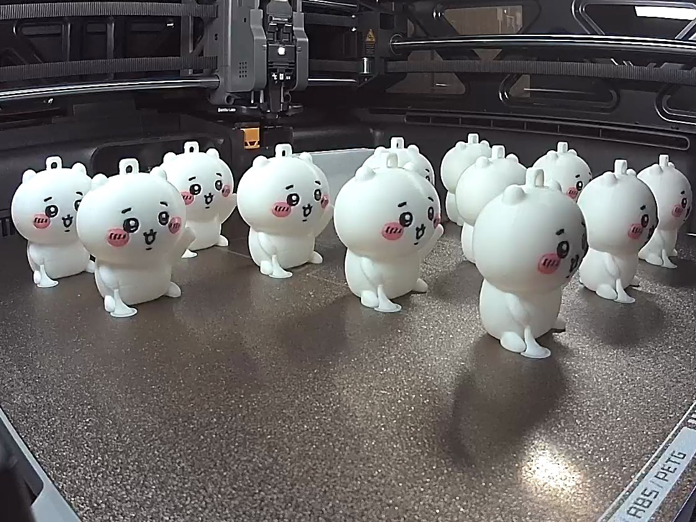
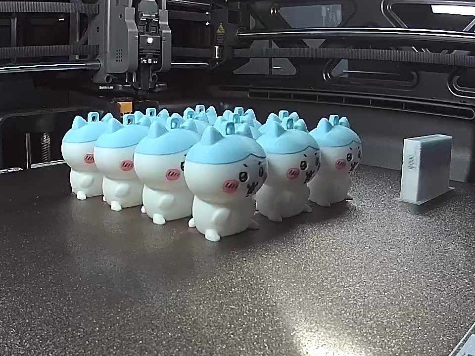
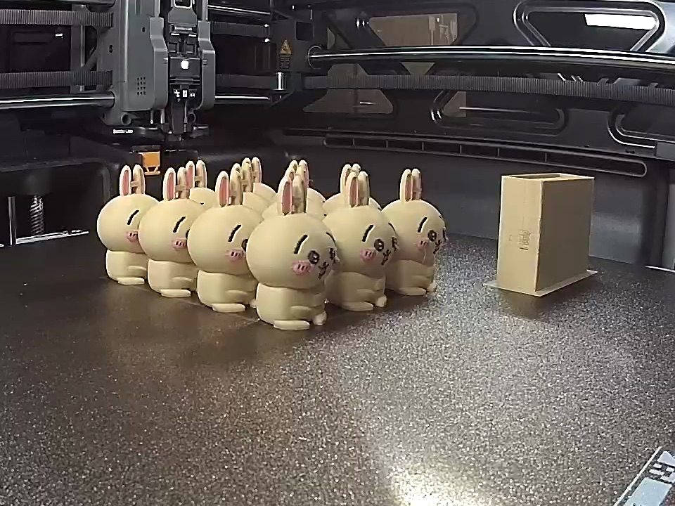
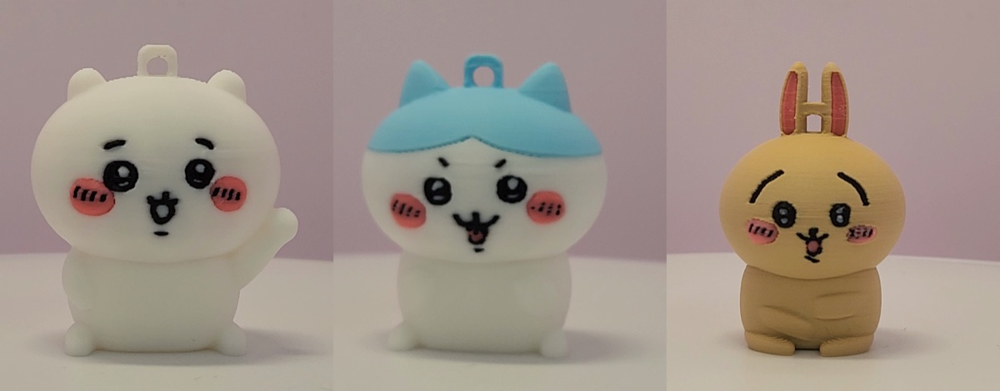
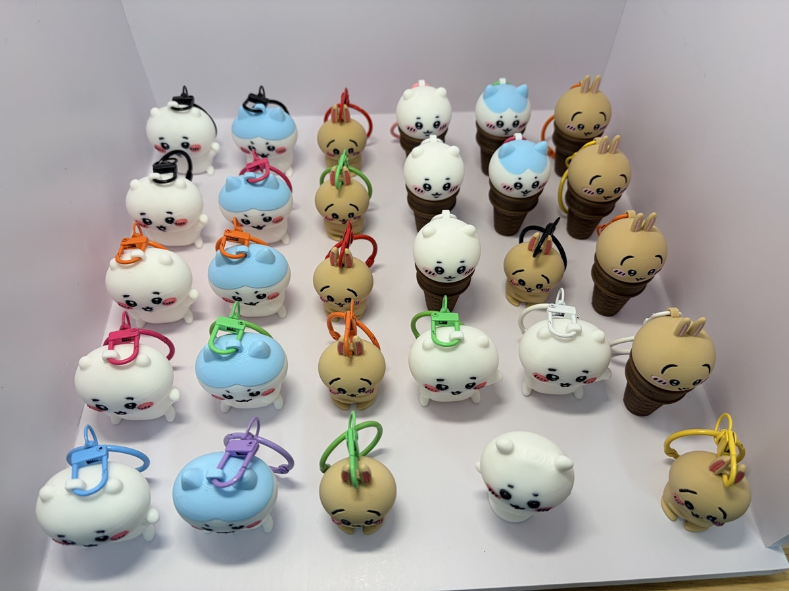
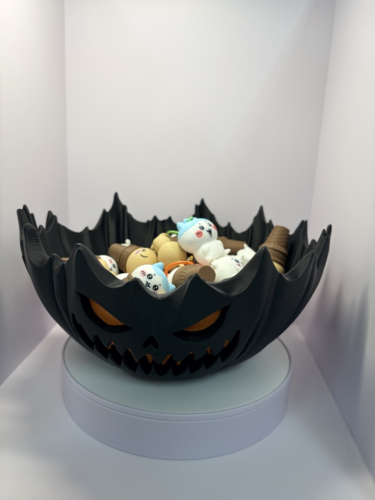
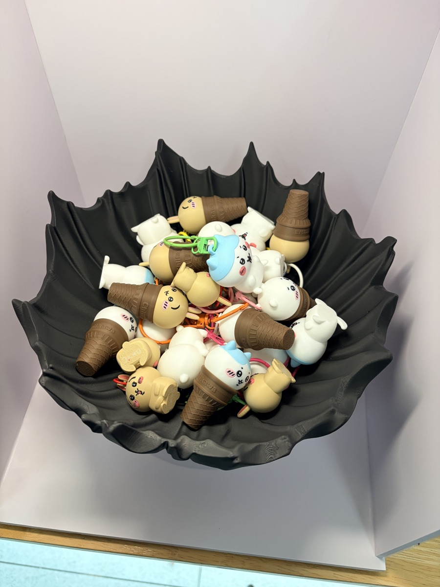

또 치이카와다 ㅎㅎ

[지난번 아이스크림콘 키링](/2026/11/11/chiikawa-ice-cream-keychain/)에 이어 2탄.
이번엔 콘 없이, 그냥 앉아 있는 3인방이다.

치이카와, 하치와레, 우사기.
캐릭터마다 12개씩 36개, 거기에 서 있는 치이카와 피규어 하나.
이번에도 주변에 나눠 줄 선물용이다.

## 이번엔 앉아 있는 3인방

모델은 MakerWorld에 올라온 椰菜哟 님의 치이카와 시리즈다.
캐릭터마다 모델이 따로 있고, 각각 키링 버전 프로필이 들어 있다.
머리 위에 작은 고리가 달려 있어서 키링 고리만 끼우면 끝이다.

색은 다섯 가지 정도.
흰 몸, 검정 눈, 분홍 볼.
하치와레는 하늘색 머리, 우사기는 베이지 몸에 분홍 귀.

색이 이렇게 많으면 예전엔 한숨부터 나왔다.
근데 이번엔 H3C가 있다 ㅎㅎ

## 먼저 서 있는 치이카와 하나

시작은 서 있는 치이카와 하나였다.
AtamiSquare 님의 다색 피규어인데, 키링이랑 키를 맞추려고 5 cm 정도로 줄여서 뽑았다.
슬라이서 예상 42분, 필라멘트는 21 g.
두 팔 벌리고 서 있는 게 딱 "나 왔어!" 하는 느낌.

얼굴이 작은데도 눈, 입, 볼이 번지지 않고 또렷하다.
이거 하나 뽑고 나니까...
혼자 두기엔 좀 외로워 보이더라 ㅋㅋ

## 한 판에 12개씩, 치이카와 공장 가동

그래서 친구들을 불렀다.
한 판에 12개씩, 캐릭터별로 한 판.

첫 판은 치이카와 12개.
저녁에 서 있는 치이카와 꺼내고 바로 걸었다.
슬라이서 예상으로 5시간 2분, 필라멘트는 139 g 정도.

두 번째 판은 하치와레 12개.
새벽 3시쯤 판을 갈아 끼웠다... 치이카와 앞에서는 잠도 줄어든다 ㅋㅋ
슬라이서 예상으로 5시간 1분, 필라멘트는 137 g 정도다.

마지막은 우사기 12개.
우사기는 층 높이를 0.16 mm로 조금 더 곱게 잡았다.
그래서 슬라이서 예상 6시간 정도, 필라멘트는 99 g.

하룻밤 사이에 H3C가 치이카와 공장이 됐다.
판 하나 꺼낼 때마다 12마리가 한꺼번에 쳐다보는데, 이게 은근 압박이다 ㅋㅋ

## 다색 걱정 없이 한 판 듬뿍

이번에 뽑으면서 제일 좋았던 게 이거다.
조그만 피규어를 다색으로, 한 판 가득 걱정 없이 뽑을 수 있다는 거.

노즐 하나짜리 프린터였으면 얘기가 달랐을 거다.
색이 바뀔 때마다 노즐 속 필라멘트를 빼내고 새 색을 밀어 넣어야 하니까.
작은 피규어 12개를 한 판에 올리면 그 색 교체가 층마다 반복된다.
시간도 필라멘트도 줄줄 샌다.

H3C는 색마다 노즐이 따로라서 그럴 일이 없다.
출력 시간도 3분의 1도 안 걸린다.
[개봉기](/2026/11/07/bambulab-h3c-ams3-unboxing/) 때 같은 키링으로 비교해 봤을 때도 P2S는 6시간 40분, H3C는 1시간 25분이었다.
색 바꿀 때 버리는 필라멘트(플러시)는 P2S 72 g, H3C 0 g.

그러니까 판을 꽉 채우는 게 전혀 부담이 안 된다.
12개씩 세 판을 연달아 걸 수 있었던 것도 그 덕이다.
[H3C 다색 피규어](/2026/11/08/bambulab-h3c-multicolor-figure/) 때도 느꼈지만, 이런 작은 다색 피규어는 H3C가 진짜 편하다.

## 돌려 보면 더 귀엽다

턴테이블에 하나씩 올려서 360도로 찍어 봤다.
옆에서 봐도 뒤에서 봐도 동글동글하다.

치이카와는 한 손 들고 인사하고,
하치와레는 입 벌리고 웃고,
우사기는 늘 그렇듯 뭔가 신나 있다.

빙글빙글 도는 걸 가만히 보고 있으면 시간 가는 줄 모른다.
이 360도 장면은 영상에 넣었다.

## 고리 달고 줄 세우기

알록달록한 키링 고리를 하나씩 달았다.
지난번 아이스크림콘 친구들도 같이 불러서 줄 세웠다.
출석 체크하는 것 같다 ㅎㅎ

## 할로윈 보울이 치이카와 바구니로

다 모아 놓으니 담아 둘 데가 필요했다.
마침 [할로윈 때 뽑은 보울](https://www.youtube.com/shorts/DsGxGqEg4P4)이 놀고 있었다.

쏟아 넣으니까 치이카와 뽑기통이 됐다 ㅋㅋ
무서운 호박 얼굴 보울인데 안에 든 게 이러니까 하나도 안 무섭다.

## 정리하면

- 치이카와·하치와레·우사기 앉은 키링 36개(캐릭터별 12개) + 서 있는 치이카와 피규어 1개
- 전부 H3C로 다색 출력, 키링은 한 판에 12개씩
- 색마다 노즐이 따로라 작은 다색 피규어도 한 판 가득 걱정 없고, 출력 시간도 3분의 1도 안 걸린다
- 키링 판마다 슬라이서 예상 5~6시간, 필라멘트 100~140 g(자세한 건 아래 출력 정보)
- 고리 달아서 주변에 나눠 줄 선물로

받는 사람이 고리를 가방에 걸고 다녀 주면 좋겠다.

여러분이라면 셋 중에 누구를 고르실 건가요?
저는... 셋 다 못 고르겠어서 12개씩 뽑은 거다 ㅎㅎ

## 영상으로 보기

출력부터 360도로 도는 모습, 출력 정보까지 조용한 쇼츠로 담았다.
내레이션은 영어가 기본이고, 한국어 더빙과 자막도 있다.
배경음악은 1탄 때 직접 만든 잔잔한 8비트 곡이다.

  <iframe src="https://www.youtube.com/embed/Vrkuof5NQJM?cc_lang_pref=ko&cc_load_policy=1" title="치이카와 키링 2탄, 앉은 3인방 36개를 H3C로 뽑았어요" style="position: absolute; inset: 0; width: 100%; height: 100%; border: 0;" allow="accelerometer; autoplay; clipboard-write; encrypted-media; gyroscope; picture-in-picture; web-share" allowfullscreen loading="lazy"></iframe>

- 유튜브 쇼츠: [치이카와 키링 2탄, 앉은 3인방 36개를 H3C로 뽑았어요](https://www.youtube.com/shorts/Vrkuof5NQJM)

## 출력 정보

| 출력물 | 개수 | 층 높이 | 시간(예상) | 필라멘트(예상) |
|---|---|---|---|---|
| 서 있는 치이카와(높이 5 cm) | 1 | 0.20 mm | 42분 | 21 g |
| 치이카와 키링 | 12 | 0.20 mm | 5시간 2분 | 139 g |
| 하치와레 키링 | 12 | 0.20 mm | 5시간 1분 | 137 g |
| 우사기 키링 | 12 | 0.16 mm | 5시간 57분 | 99 g |
| 합계 | 37 | | 16시간 41분 | 396 g |

- 프린터: Bambu Lab H3C (0.4 mm 노즐, 판마다 한 번에)
- 필라멘트: Bambu PLA Basic — 흰색, 검정, 분홍, 하늘색, 베이지
- 시간·무게는 Bambu Studio 슬라이서 예상값이다. 치이카와 판과 서 있는 피규어는 실제 출력 설정이 남아 있지 않아서 H3C 설정으로 다시 슬라이스한 값이라, 실제와 조금 다를 수 있다.

## 출처

- 키링 모델: MakerWorld 椰菜哟 님의 치이카와 시리즈(키링 버전)
- 서 있는 피규어: MakerWorld AtamiSquare 님
- 캐릭터: 치이카와 © nagano / chiikawa committee — 공식 상품이 아니라 팬이 만든 모델이다
