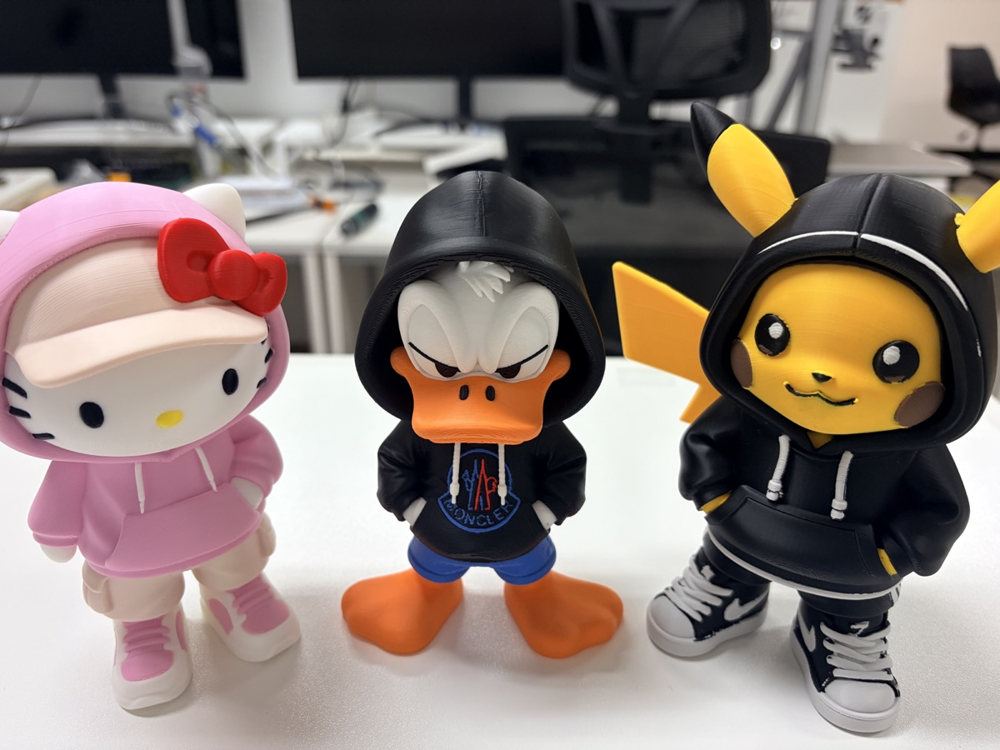
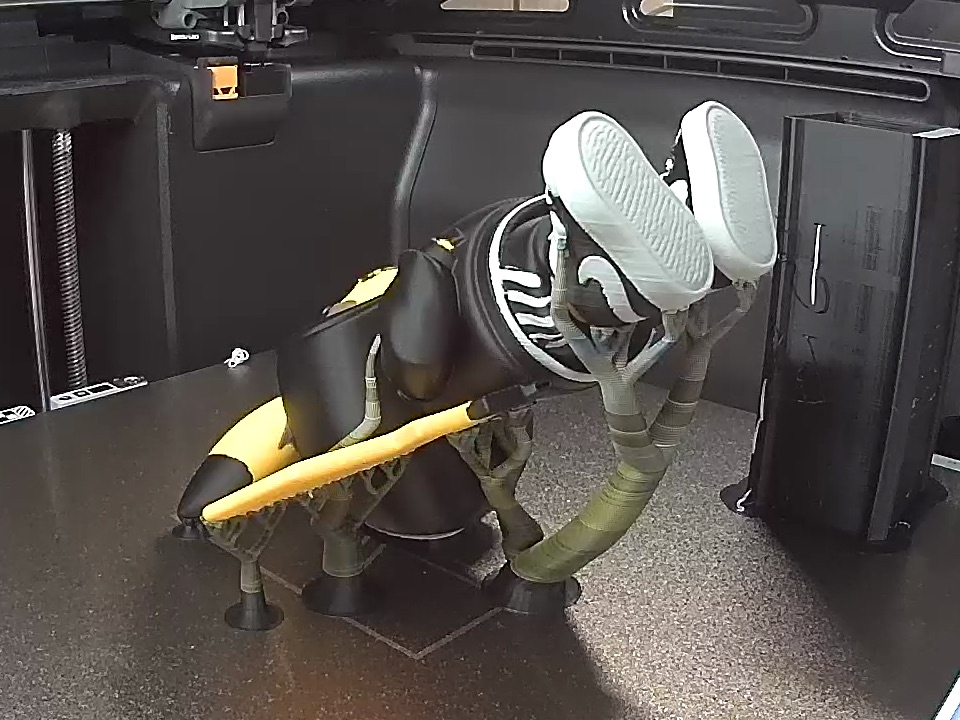
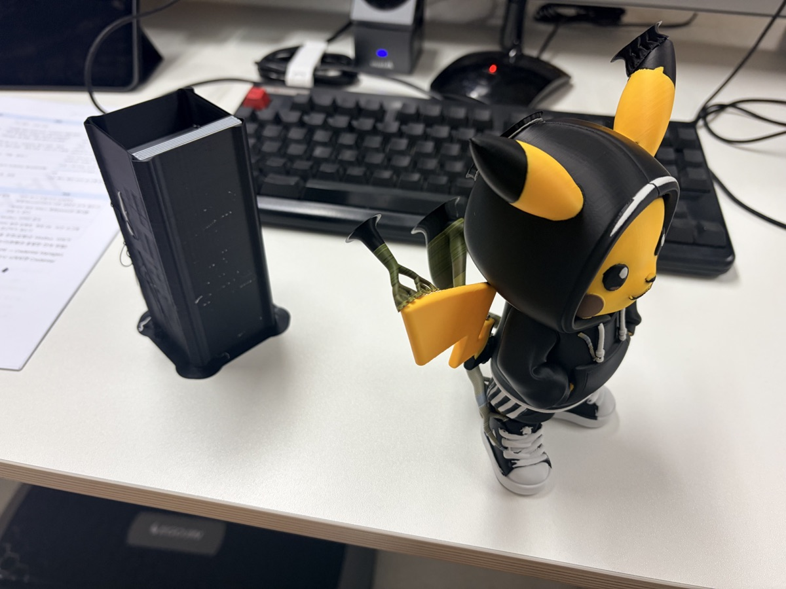
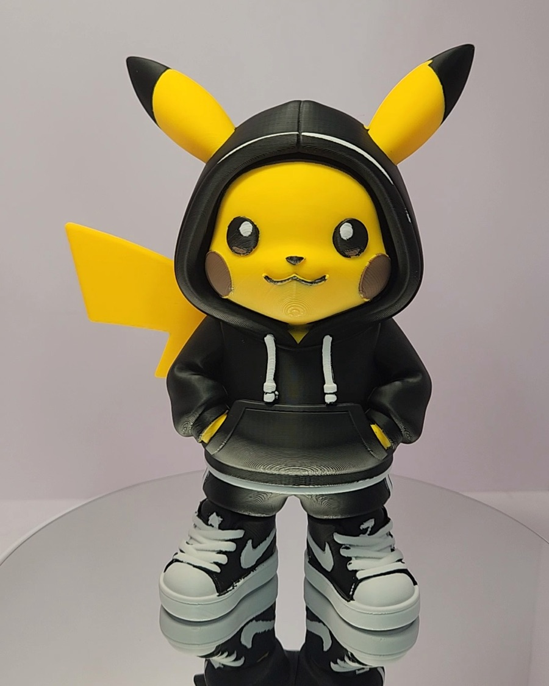
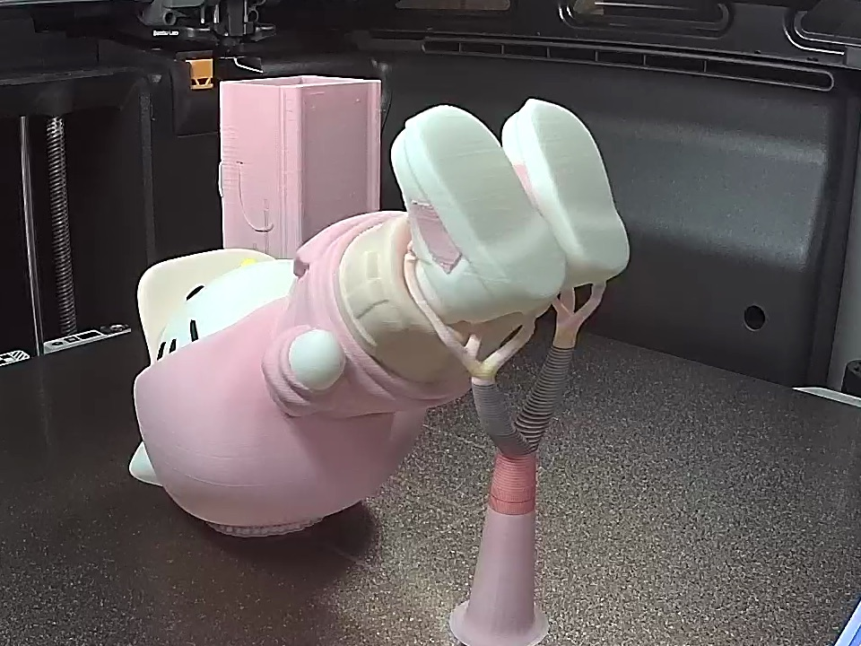
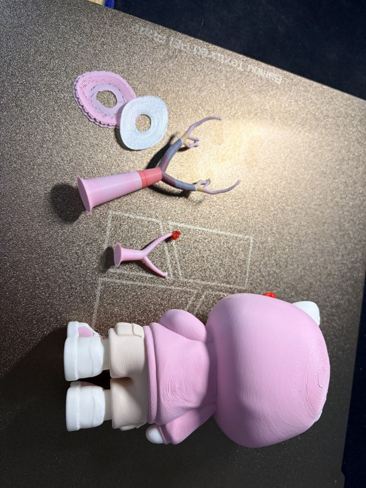
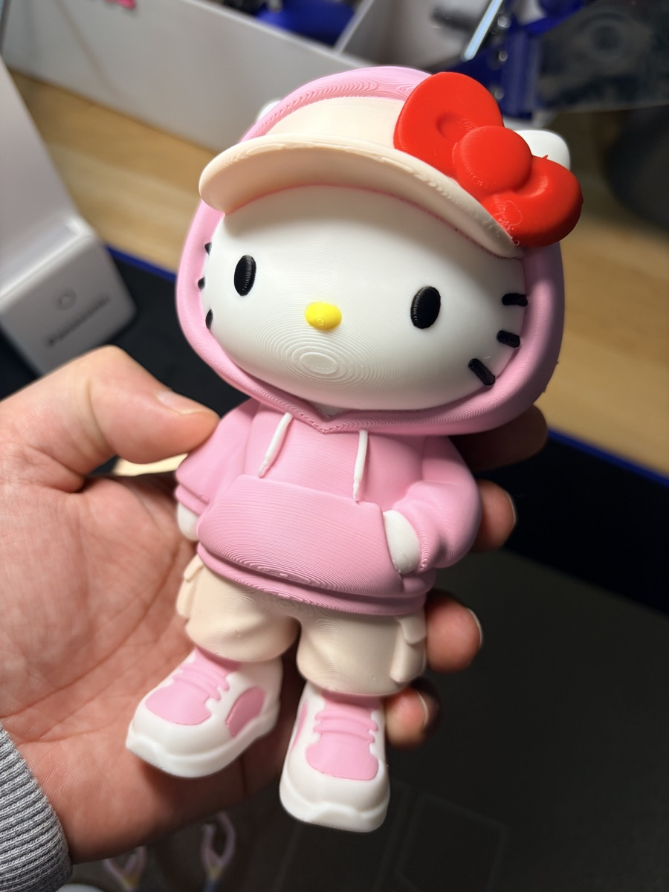
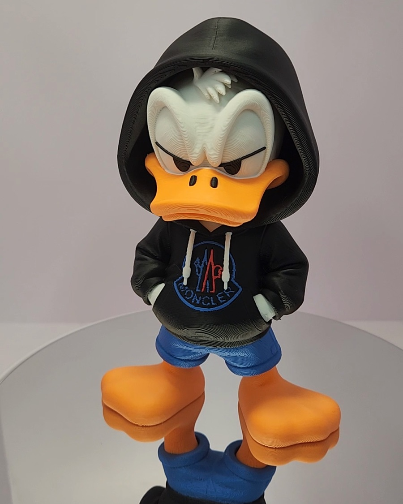

[Last time, I showed you Donald Duck in a hoodie](/en/2026/11/08/bambulab-h3c-multicolor-figure/).
This time I printed two more friends in the same style.

Hello Kitty and Pikachu.
Both wear hoodies, and both came off the H3C in a single multicolor print.

## Pikachu, lying down with tree supports

Pikachu is a multicolor figure by Markosov on MakerWorld.
I printed it lying down, so it picked up quite a few tree supports.

I used a fine 0.12 mm layer height, and it's about 13 cm tall.
The slicer estimate was 20 hours 42 minutes. Almost a full day.

This is how it looked right off the plate.
The black column next to it is the prime tower used for color changes.

With the supports off, it looks like this.
Black hoodie, yellow face, brown cheeks, and gray striped sneakers, all exactly as painted.
Even the hoodie strings have their own color.

## Hello Kitty, pink hoodie and a cap

Hello Kitty is a multicolor figure by Vibrano.
Pink hoodie, a cap, a red bow, and pink sneakers.
It has even more colors than Pikachu.

The original is 20 cm tall, but I scaled it down to about 11 cm.
That brought the slicer estimate down to 8 hours 42 minutes.
Six colors ended up in the print: pink, white, apricot, red, black, and yellow.

This one was also printed lying down. Next to it are the supports I took off.

Here's the size in hand.
The edges of the cap brim and the bow came out clean.

## Lots of colors, still one print

Not long ago, I wouldn't have dared to print this many colors.
On a single-nozzle printer, every color change means pulling one filament out and pushing the next one in, so more colors means more time and more wasted filament.

The H3C has a separate nozzle for each color, so that doesn't happen.
When I compared the same keychain in my [unboxing post](/en/2026/11/07/bambulab-h3c-ams3-unboxing/), the P2S took 6 hours 40 minutes and the H3C took 1 hour 25 minutes.
These days I only look for multicolor models on MakerWorld.

## Three hoodie friends

Add Donald, and there are three hoodie friends now.
Lined up together, they look pretty good :)

## Summary

- After Donald in a hoodie, I added Hello Kitty and Pikachu
- Both printed in one multicolor go on the H3C, lying down with tree supports
- A separate nozzle for each color makes lots of colors easy

Who should get a hoodie next?

## Watch the video

I put the prints, the 360-degree spins, and the print info into a short.

  <iframe src="https://www.youtube.com/embed/s_4SvIQ1ux0" title="Hoodie Friends: Hello Kitty & Pikachu Join Donald, Printed on the H3C" style="position: absolute; inset: 0; width: 100%; height: 100%; border: 0;" allow="accelerometer; autoplay; clipboard-write; encrypted-media; gyroscope; picture-in-picture; web-share" allowfullscreen loading="lazy"></iframe>

- YouTube Short: [Hoodie Friends: Hello Kitty & Pikachu Join Donald, Printed on the H3C](https://www.youtube.com/shorts/s_4SvIQ1ux0)

## Print info

| Print | Qty | Layer height | Time (est.) | Filament (est.) |
|---|---|---|---|---|
| Pikachu hoodie (13 cm tall) | 1 | 0.12 mm | 20 h 42 min | 339 g |
| Hello Kitty hoodie (11 cm tall) | 1 | 0.16 mm | 8 h 42 min | 68 g |
| Total | 2 | | 29 h 24 min | 407 g |

- Printer: Bambu Lab H3C (0.4 mm nozzle, each figure multicolor in one print)
- Filament: Bambu PLA Basic. Pikachu uses 4 colors (black, yellow, brown, gray) plus Support for PLA (included, 14 g); Hello Kitty uses 6 colors (pink, white, apricot, red, black, yellow)
- Times and weights are Bambu Studio slicer estimates. Hello Kitty was re-sliced with H3C settings at the scaled-down size, so the real numbers may differ slightly.
- Donald is in the [previous post](/en/2026/11/08/bambulab-h3c-multicolor-figure/) (about 8 hours).

## Credits

- Pikachu: by Markosov on MakerWorld
- Hello Kitty: by Vibrano on MakerWorld
- Characters: Pikachu © Nintendo / Creatures Inc. / GAME FREAK inc., Hello Kitty © Sanrio. These are fan-made models, not official merchandise.
