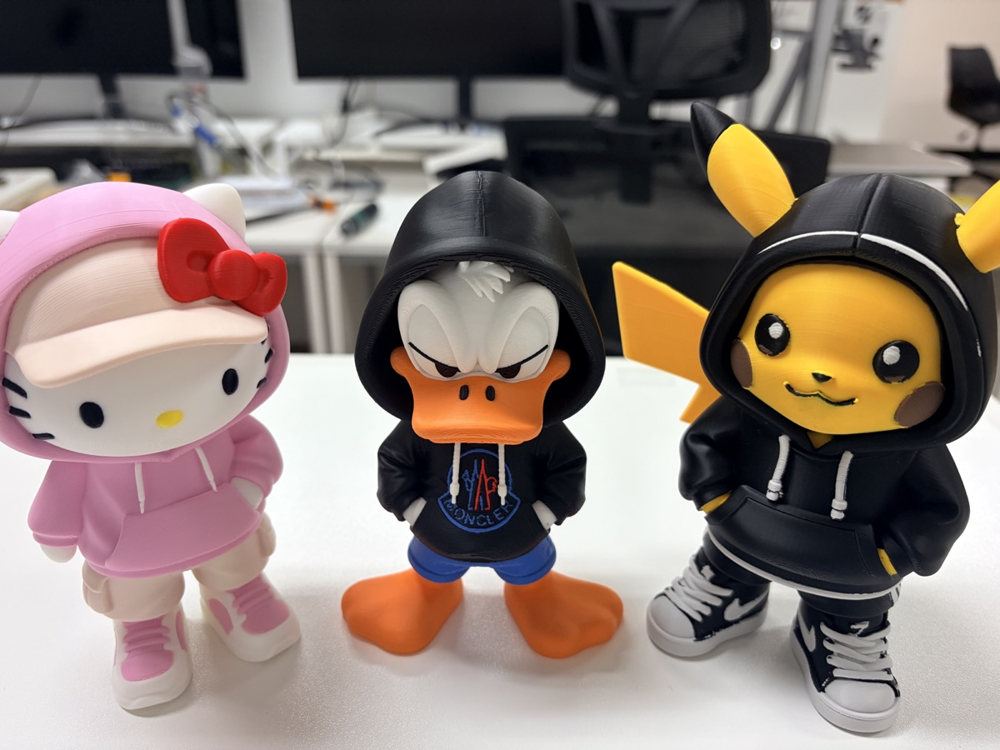
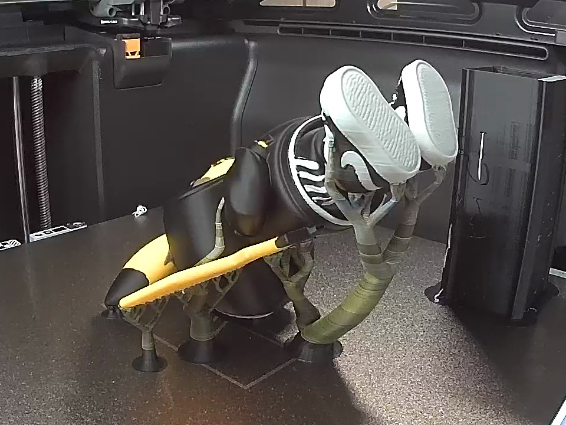
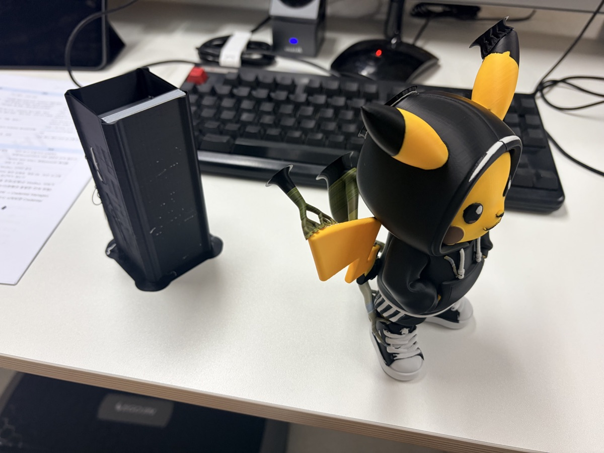
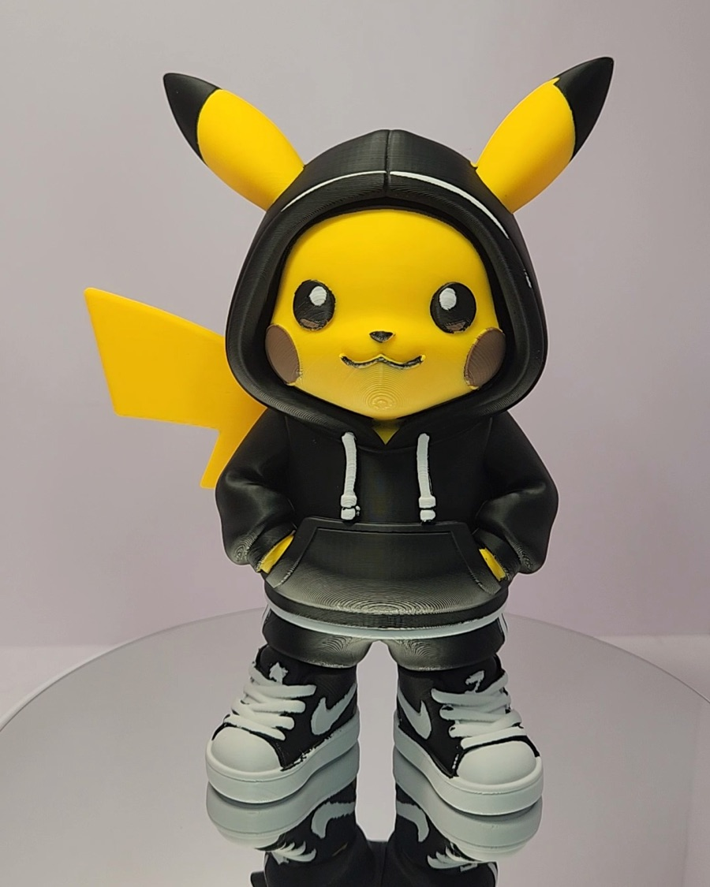
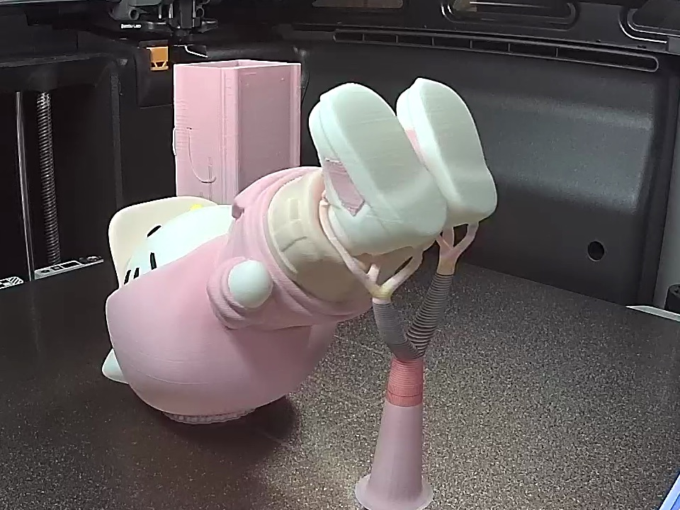
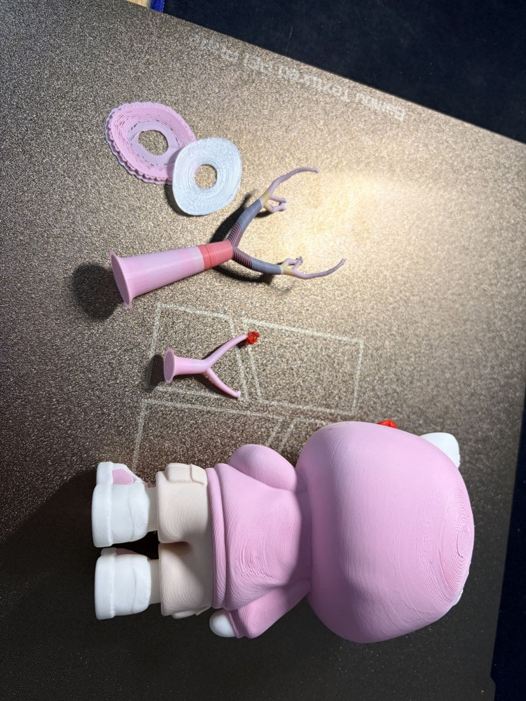
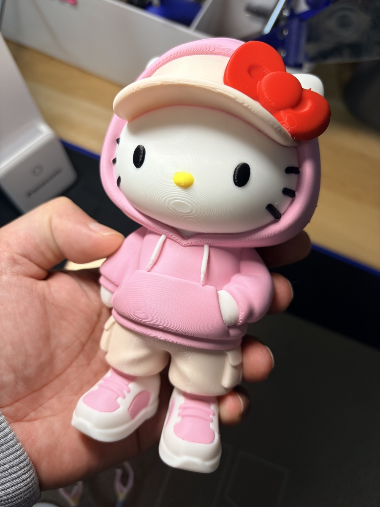
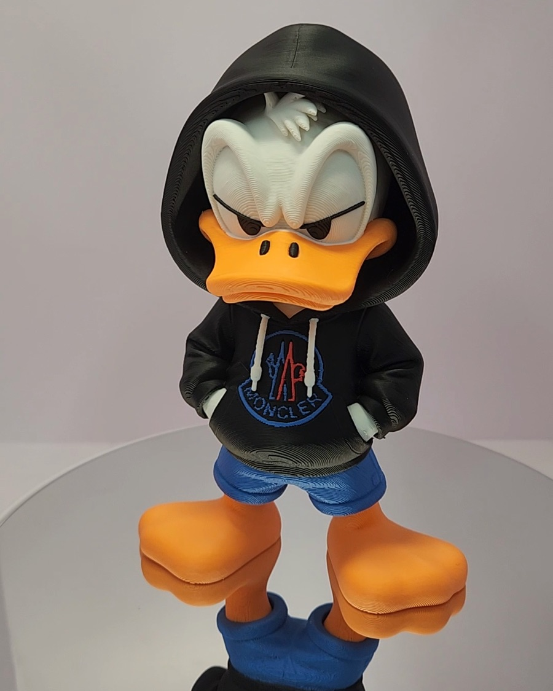

[前回はフードを着たドナルドを紹介しました](/ja/2026/11/08/bambulab-h3c-multicolor-figure/)。
今回は同じスタイルの仲間を2人、追加で出力しました。

ハローキティとピカチュウです。
どちらもフードを着ていて、どちらもH3Cでマルチカラーを一度に出力しました。

## ピカチュウは寝かせてツリーサポートで

ピカチュウはMakerWorldにあるMarkosovさんのマルチカラーフィギュアです。
寝かせた姿勢で出力したので、ツリーサポートがけっこう付きました。

積層ピッチ0.12 mmで細かく出力し、高さは約13 cmです。
スライサーの予測は20時間42分。ほぼ丸一日かかった計算です。

プレートから取り出した直後はこんな感じです。
横に立っている黒い柱は、色替えに使うプライムタワーです。

サポートを外すとこうなります。
黒いフードに黄色い顔、茶色のほっぺ、灰色のストライプのスニーカーまで、塗り分けたとおりに出ました。
フードのひもにも別の色が入っています。

## ハローキティはピンクのフードに帽子まで

ハローキティはVibranoさんのマルチカラーフィギュアです。
ピンクのフードに帽子、赤いリボン、ピンクのスニーカー。
ピカチュウよりも色が多いです。

元の高さは20 cmですが、約11 cmに縮小して出力しました。
そのためスライサーの予測は8時間42分です。
実際に使われた色は、ピンク、白、アプリコット、赤、黒、黄色の6色です。

こちらも寝かせた姿勢で出力しました。横にあるのが外したサポートです。

手に持つとこのくらいの大きさです。
帽子のつばとリボンの境目もきれいに出ました。

## 色が多くても一度に

少し前なら、これだけの色数は手を出す気にもなれなかったと思います。
ノズルが1つのプリンターは色が変わるたびにフィラメントを抜いて入れ替える必要があり、色が増えるほど時間も捨てるフィラメントも増えます。

H3Cは色ごとにノズルが分かれているので、そうはなりません。
[開封記](/ja/2026/11/07/bambulab-h3c-ams3-unboxing/)で同じキーホルダーを比べたときも、P2Sは6時間40分、H3Cは1時間25分でした。
最近はMakerWorldでもマルチカラーのモデルばかり探しています。

## フード姿の仲間が3人

もともといたドナルドを合わせると、フード姿の仲間は3人になりました。
並べてみると、なかなかいい感じです。

## まとめ

- フードを着たドナルドに続いて、ハローキティとピカチュウを追加
- どちらもH3Cでマルチカラーを一度に、寝かせた姿勢でツリーサポート
- 色ごとにノズルが分かれているので、色が多くても負担がない

次は誰にフードを着せてみましょうか？

## 動画で見る

出力から360度回る様子、出力情報まで、ショート動画にまとめました。
英語のナレーションが基本で、日本語の吹き替えと字幕もあります。

  <iframe src="https://www.youtube.com/embed/s_4SvIQ1ux0?cc_lang_pref=ja&cc_load_policy=1" title="フード姿の仲間たち、キティとピカチュウもH3Cでマルチカラー出力" style="position: absolute; inset: 0; width: 100%; height: 100%; border: 0;" allow="accelerometer; autoplay; clipboard-write; encrypted-media; gyroscope; picture-in-picture; web-share" allowfullscreen loading="lazy"></iframe>

- YouTubeショート：[フード姿の仲間たち、キティとピカチュウもH3Cでマルチカラー出力](https://www.youtube.com/shorts/s_4SvIQ1ux0)

## 出力情報

| 出力物 | 個数 | 積層ピッチ | 時間（予測） | フィラメント（予測） |
|---|---|---|---|---|
| ピカチュウ（高さ13 cm） | 1 | 0.12 mm | 20時間42分 | 339 g |
| ハローキティ（高さ11 cm） | 1 | 0.16 mm | 8時間42分 | 68 g |
| 合計 | 2 | | 29時間24分 | 407 g |

- プリンター：Bambu Lab H3C（0.4 mmノズル、1体ずつマルチカラーで一度に）
- フィラメント：Bambu PLA Basic。ピカチュウは4色（黒・黄・茶・灰）＋サポート専用フィラメント（Support For PLA、14 gを含む）、ハローキティは6色（ピンク・白・アプリコット・赤・黒・黄）
- 時間と重さはBambu Studioのスライサー予測値です。ハローキティは縮小したサイズでH3Cの設定に合わせてスライスし直した値なので、実際とは少し違う場合があります。
- ドナルドは[前回の記事](/ja/2026/11/08/bambulab-h3c-multicolor-figure/)にあります（約8時間）。

## クレジット

- ピカチュウ：MakerWorldのMarkosovさん
- ハローキティ：MakerWorldのVibranoさん
- キャラクター：ピカチュウ © Nintendo / Creatures Inc. / GAME FREAK inc.、ハローキティ © Sanrio。公式グッズではなく、ファンが作ったモデルです。
