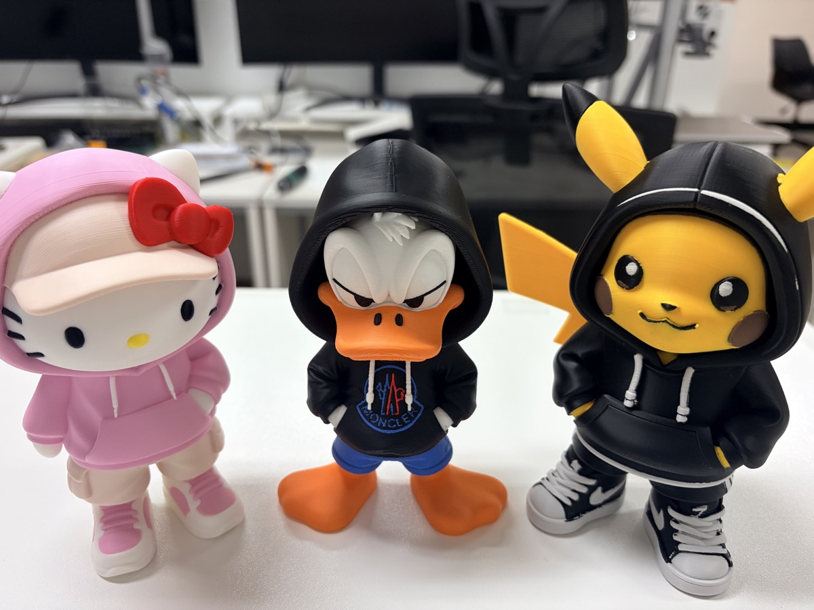
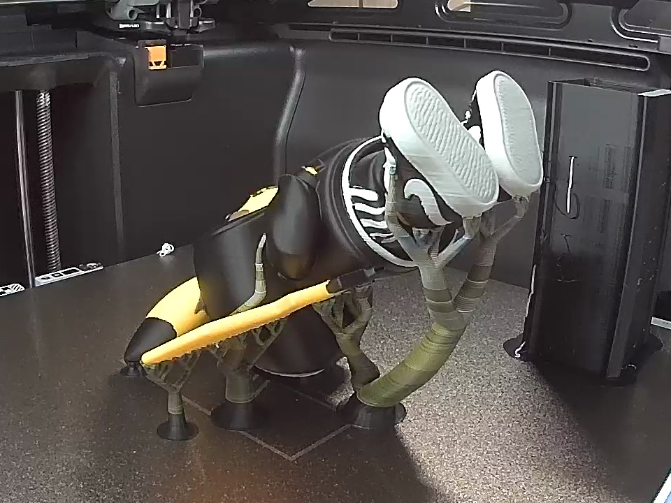
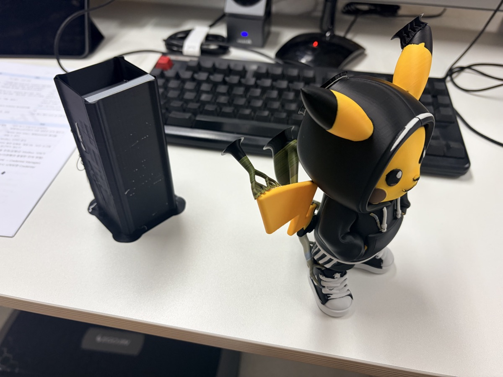
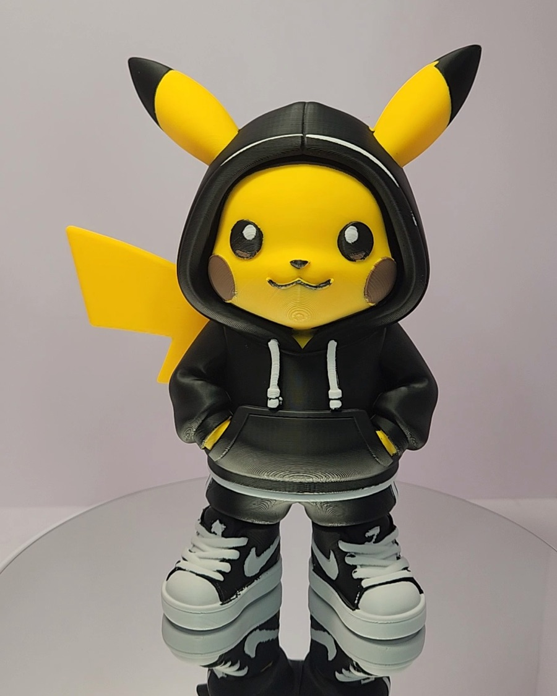
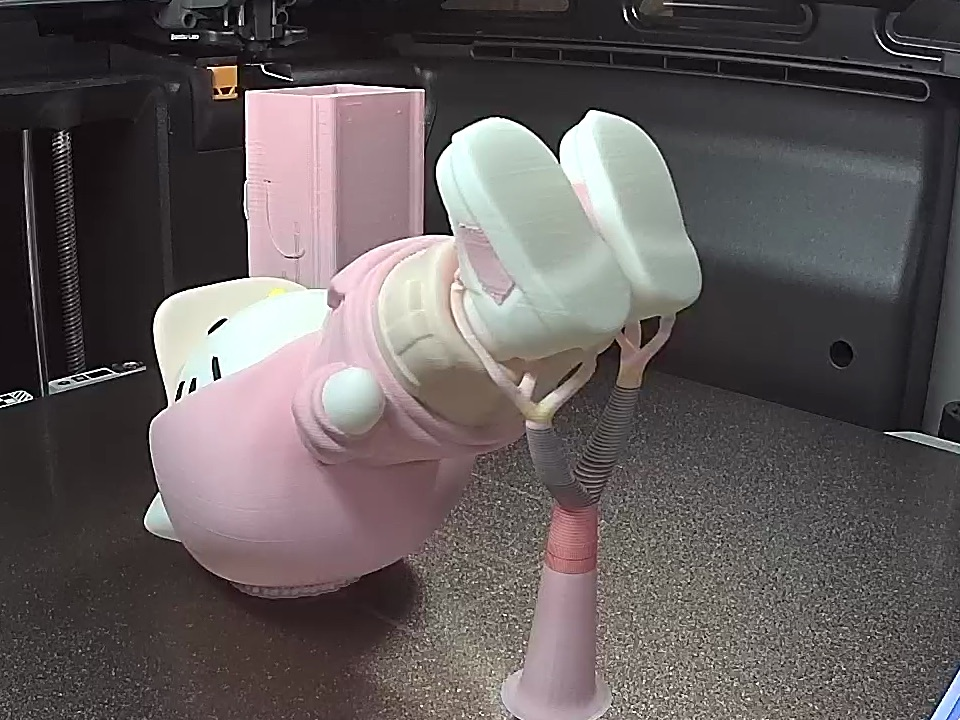
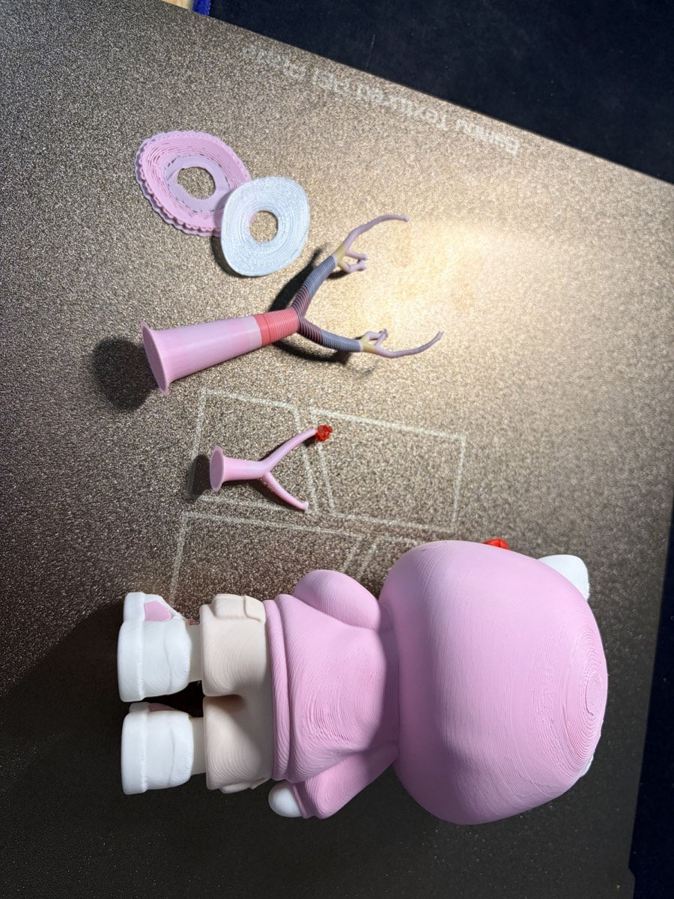
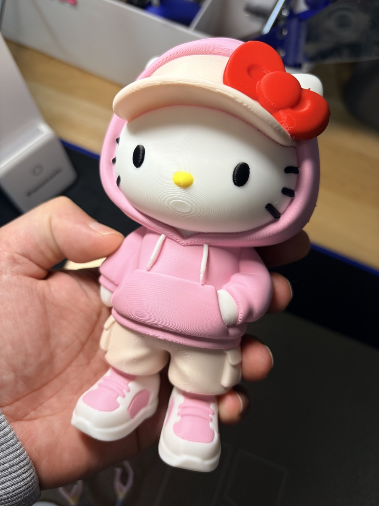
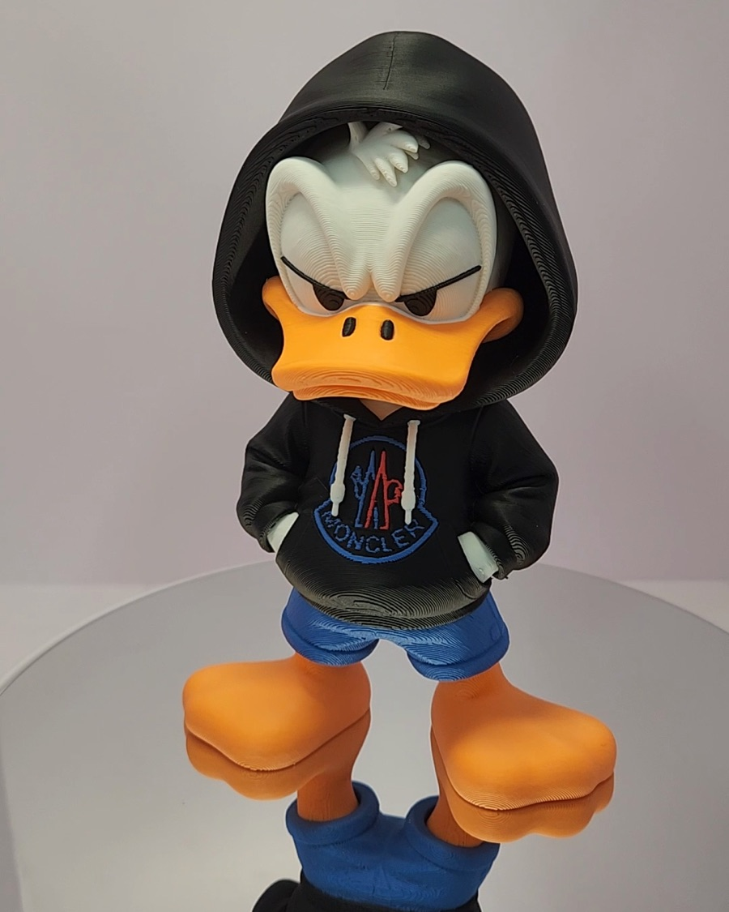

[지난번에 후드 입은 도널드](/2026/11/08/bambulab-h3c-multicolor-figure/)를 소개했었다.
이번엔 같은 스타일 친구를 둘 더 뽑았다.

헬로키티랑 피카추.
둘 다 후드를 입고 있고, 둘 다 H3C로 다색을 한 번에 출력했다.

## 피카추, 누워서 트리 서포트로

피카추는 MakerWorld에 올라온 Markosov 님의 다색 피규어다.
누운 자세로 뽑았더니 트리 서포트가 꽤 붙었다.

층 높이 0.12 mm로 곱게 뽑았고, 높이는 13 cm 정도다.
슬라이서 예상으로 20시간 42분. 하루 가까이 걸린 셈이다.

판에서 막 꺼냈을 때는 이렇다.
옆에 서 있는 검은 기둥은 색을 바꿀 때 쓰는 프라임 타워다.

서포트를 떼어 내면 이렇게 된다.
검정 후드에 노란 얼굴, 갈색 볼, 회색 줄무늬 운동화까지 칠한 그대로 나왔다.
후드 끈도 따로 색이 들어가 있다.

## 헬로키티, 분홍 후드에 모자까지

헬로키티는 Vibrano 님의 다색 피규어다.
분홍 후드에 모자, 빨간 리본, 분홍 운동화.
색이 피카추보다 더 많다.

원래 높이는 20 cm인데, 11 cm 정도로 줄여서 뽑았다.
그래서 슬라이서 예상은 8시간 42분.
실제로 쓰인 색은 분홍, 흰색, 살구, 빨강, 검정, 노랑 여섯 가지다.

이것도 누운 자세로 뽑았다. 옆에 있는 게 떼어 낸 서포트다.

손에 들면 이 정도 크기다.
모자 챙이랑 리본 경계가 깔끔하게 나왔다.

## 색이 많아도 한 번에

예전 같으면 이 정도 색은 엄두가 안 났을 거다.
노즐 하나짜리 프린터는 색이 바뀔 때마다 필라멘트를 빼고 넣어야 해서, 색이 늘수록 시간과 버리는 필라멘트가 같이 늘어난다.

H3C는 색마다 노즐이 따로라 그럴 일이 없다.
[개봉기](/2026/11/07/bambulab-h3c-ams3-unboxing/)에서 같은 키링으로 비교해 봤을 때도 P2S는 6시간 40분, H3C는 1시간 25분이었다.
요즘은 MakerWorld에서도 다색 모델만 골라 보게 된다.

## 후디 친구 셋

원래 있던 도널드까지 합치면 후디 친구가 셋이다.
나란히 세워 두니 꽤 그럴듯하다 ㅎㅎ

## 정리하면

- 후드 입은 도널드에 이어 헬로키티, 피카추를 추가
- 둘 다 H3C로 다색 한 번에, 누운 자세에 트리 서포트
- 색이 많아도 노즐이 색마다 따로라 부담이 없다

다음엔 누구한테 후드를 입혀 볼까요?

## 영상으로 보기

출력부터 360도로 도는 모습, 출력 정보까지 짧은 쇼츠로 담았다.
내레이션은 영어가 기본이고, 한국어 더빙과 자막도 있다.

  <iframe src="https://www.youtube.com/embed/s_4SvIQ1ux0?cc_lang_pref=ko&cc_load_policy=1" title="후드 입은 친구들, 헬로키티와 피카추도 H3C로 다색 한 번에" style="position: absolute; inset: 0; width: 100%; height: 100%; border: 0;" allow="accelerometer; autoplay; clipboard-write; encrypted-media; gyroscope; picture-in-picture; web-share" allowfullscreen loading="lazy"></iframe>

- 유튜브 쇼츠: [후드 입은 친구들, 헬로키티와 피카추도 H3C로 다색 한 번에](https://www.youtube.com/shorts/s_4SvIQ1ux0)

## 출력 정보

| 출력물 | 개수 | 층 높이 | 시간(예상) | 필라멘트(예상) |
|---|---|---|---|---|
| 피카추 후디(높이 13 cm) | 1 | 0.12 mm | 20시간 42분 | 339 g |
| 헬로키티 후디(높이 11 cm) | 1 | 0.16 mm | 8시간 42분 | 68 g |
| 합계 | 2 | | 29시간 24분 | 407 g |

- 프린터: Bambu Lab H3C (0.4 mm 노즐, 하나씩 다색 한 번에)
- 필라멘트: Bambu PLA Basic — 피카추 4색(검정·노랑·갈색·회색) + 서포트 전용 필라멘트(Support For PLA, 14 g 포함), 헬로키티 6색(분홍·흰색·살구·빨강·검정·노랑)
- 시간·무게는 Bambu Studio 슬라이서 예상값이다. 헬로키티는 줄여서 뽑은 크기로 H3C 설정에 맞춰 다시 슬라이스한 값이라 실제와 조금 다를 수 있다.
- 도널드는 [지난 글](/2026/11/08/bambulab-h3c-multicolor-figure/)에 있다(8시간 안팎).

## 출처

- 피카추: MakerWorld Markosov 님
- 헬로키티: MakerWorld Vibrano 님
- 캐릭터: 피카추 © Nintendo / Creatures Inc. / GAME FREAK inc., 헬로키티 © Sanrio — 공식 상품이 아니라 팬이 만든 모델이다
