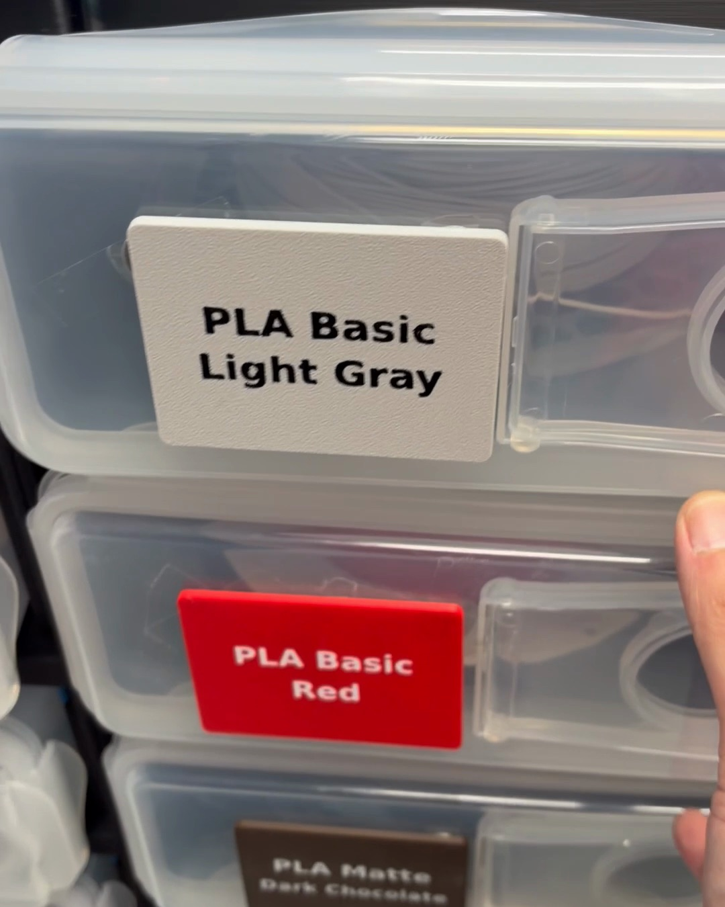

I keep my filament in cereal containers, one spool per container, stacked up.
Every container has a name tag.
PLA Basic Red, PLA Matte Charcoal, PETG Basic Black...

These tags are magnetic.
You can pull them off and stick them somewhere else.

When I take a spool out and load it into the AMS, the tag comes along and goes on the front of the AMS.
When the spool is used up and goes back in its container, the tag goes back too.
The tag follows the filament.

## A name alone doesn't tell you the color

There are already plenty of cereal-container filament bins and name tags on MakerWorld.
That is where I started too.

But in use, a name was not enough.
PLA Basic Gray, Dark Gray, Blue Grey.
The words give you a rough idea, but you can't tell what color will actually come out.
The color on the spool and the color of the print differ, too.

It gets worse in multicolor printing.
With 6 to 8 colors in one figure, you end up opening bins again and again, thinking "not this gray, a slightly bluer gray..."

So I printed the tags **in the filament itself**.
The PLA Basic Red tag is printed in PLA Basic Red.
The tag is its own print sample.
You don't even have to read the name. Pick by color.

## Magnets make it detachable

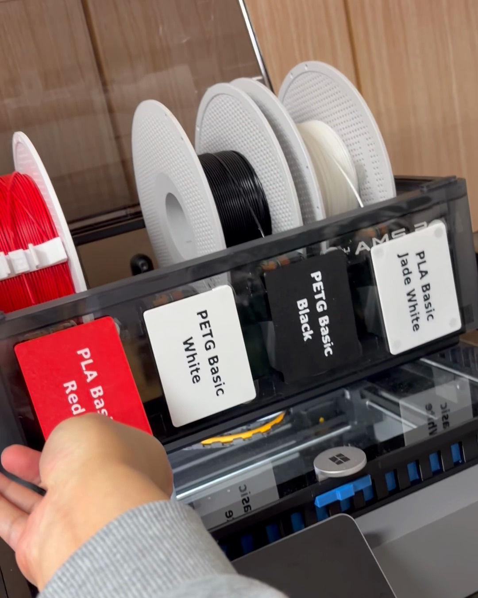

Along the top long edge of the tag there is a thick strip.
Inside it sit two round magnets, 7 mm in diameter and 2 mm thick.

On the other side, a steel disc is attached.
One on each container and one on the front of the AMS.
Hold the tag near and it snaps on.

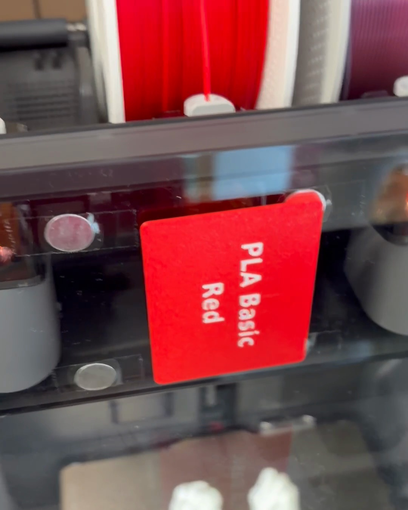

You can see which filament is loaded in the AMS on the printer screen, too.
But with a tag on the front of the AMS, you see it just walking past.
If a container is empty, you know right away: "right, that one is in the AMS."

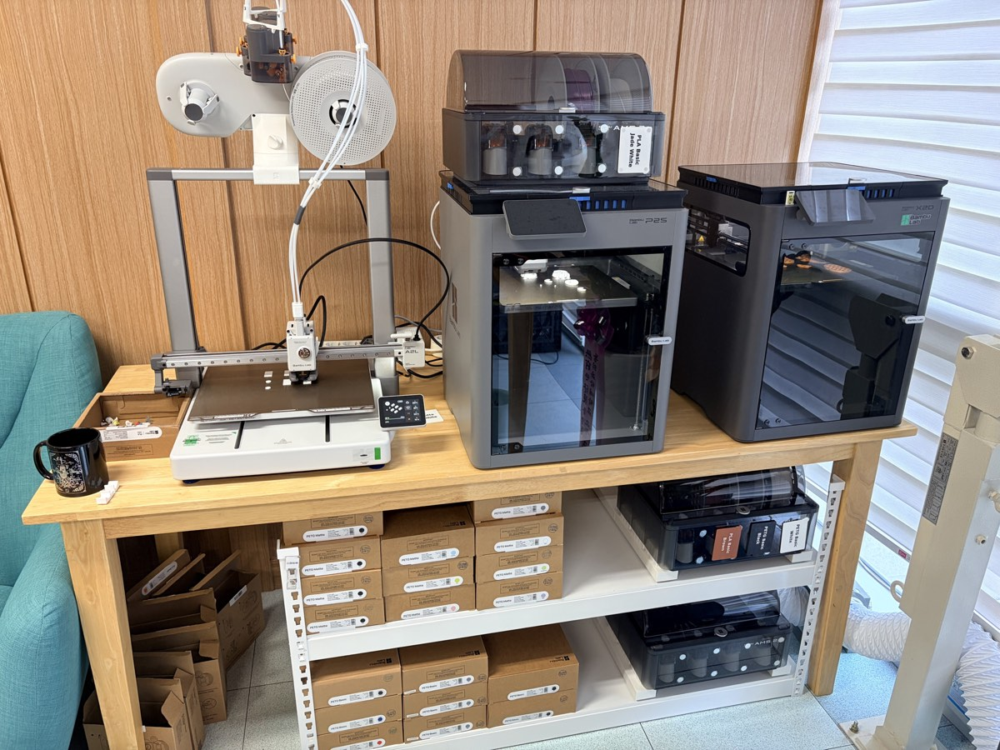

## How it evolved

It didn't start out this way.

**First attempt (August 27)**: I put magnet holes in the four corners of a flat plate.
I printed it in a few thicknesses, 2 mm and 1 mm.

**Magnet bar (late August)**: A few days later I moved the magnets into one row along the top long edge.
The plate went down to a thin 1 mm, with only the magnet strip kept thick.
Magnets went from four to two.
This is where the tag took its current shape.

I pressed the magnets into a groove open at the back.
Print, press in, done. Easy.

But after long use, the magnets fell out.
The tags are meant to be taken off and put back on, so losing magnets defeats the point.

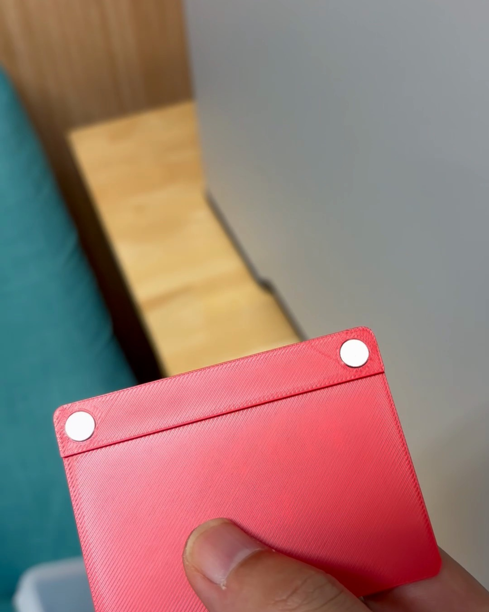

This red tag is from that batch.
You can see the magnets on the back.
I didn't reprint those tags. I glued the magnets in with super glue and kept using them.

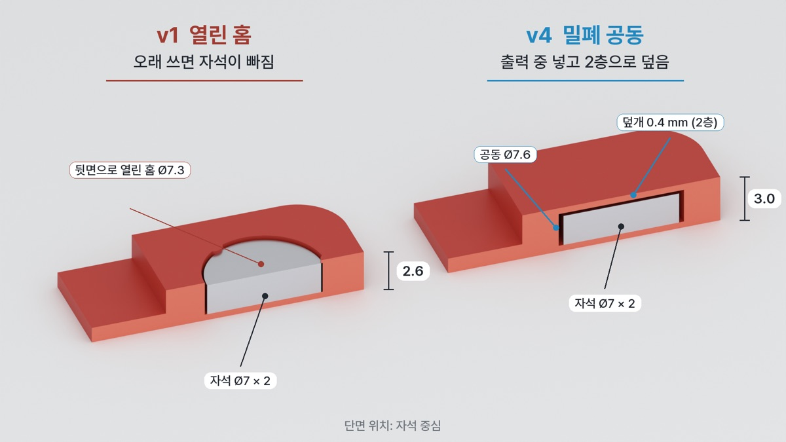

**Locking the magnets inside (October)**: I changed the groove into an enclosed cavity and pause the print partway to drop the magnets in.
When the print resumes, new layers cover them and the magnets are locked inside.
No glue, and they can't come out.

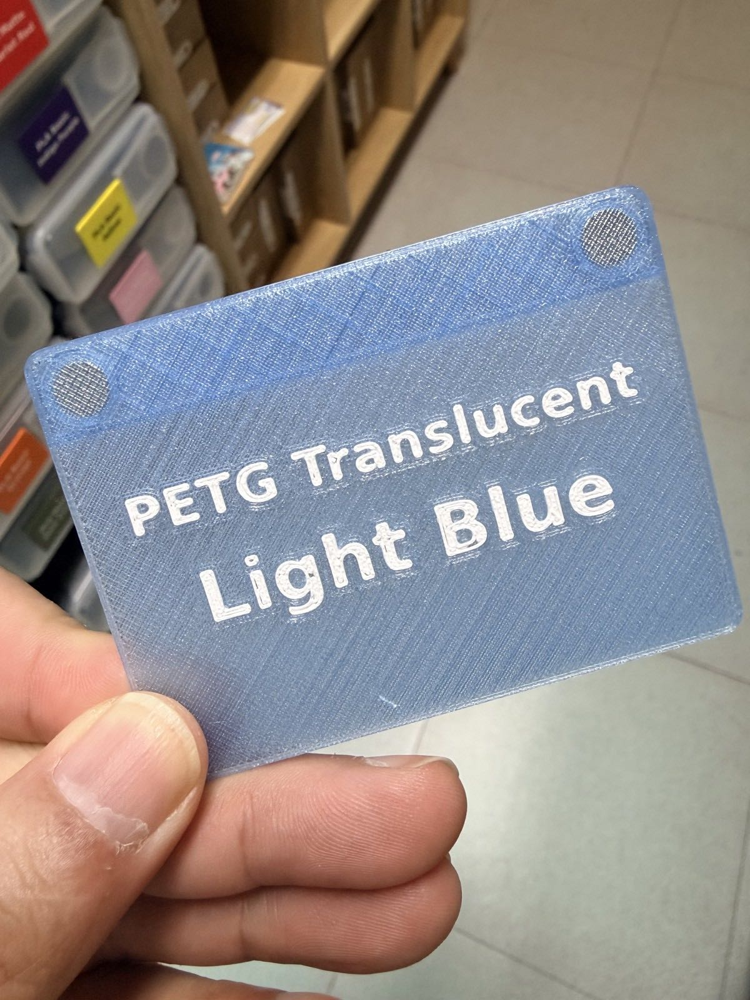

On a tag printed in translucent PETG, you can see the two magnets sealed inside.

At first the cover was 0.6 mm (3 layers).
It turned out too thick.
The thinner the cover over the magnet, the better it sticks to the steel, so I cut it to 0.4 mm (2 layers).
I also removed the nubs that held the magnets in the groove, since the top is closed anyway.

**More series**: PLA Basic, Matte, Silk+, PETG HF, Translucent, PETG-CF and Support, plus PETG Basic in late October.
I made 113 tags across 8 series, and posted the 107 tags from the 7 series with the most colors on MakerWorld.
PETG-CF has only six colors, so I left it out.

## 107 Bambu Lab filament colors, ready to print

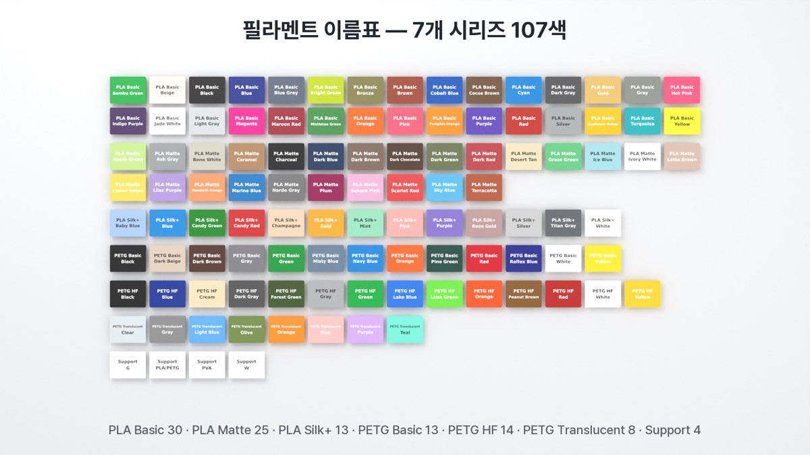

| Series | Tags |
|---|---|
| PLA Basic | 30 |
| PLA Matte | 25 |
| PLA Silk+ | 13 |
| PETG Basic | 13 |
| PETG HF | 14 |
| PETG Translucent | 8 |
| Support | 4 |
| **Total** | **107** |

Color names and codes follow the official Bambu Lab color chart.
For the text color, I checked each plate color one by one to see whether white or black reads better.
Just pick the tags for the filament you own and print them.

## How to print

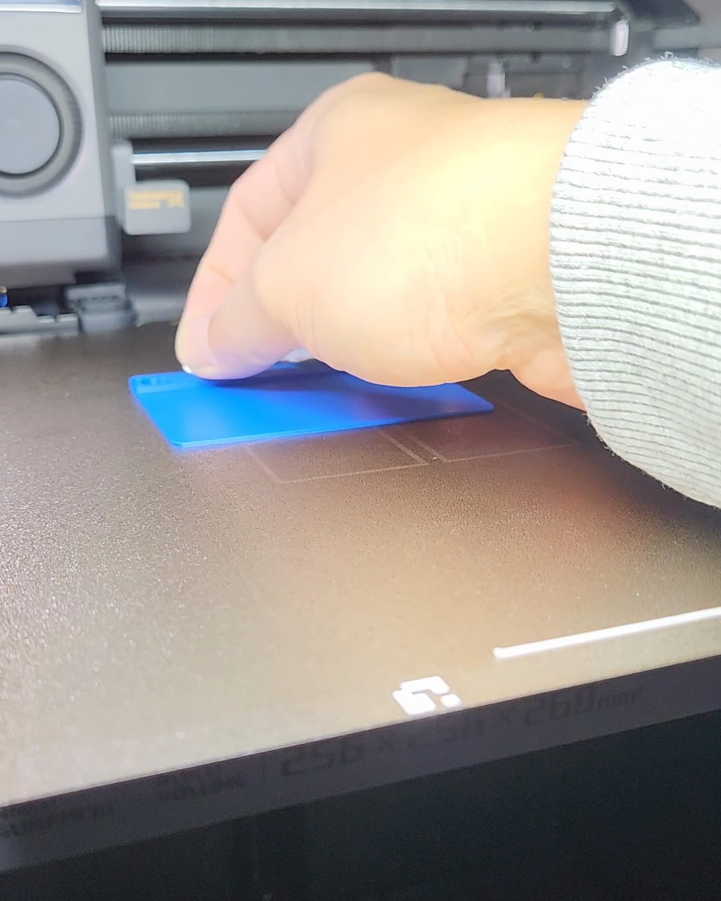

1. The tag is two colors: the plate in that filament, the text in white or black
2. Print it lying with the text face down. No supports, 0.2 mm layers
3. Pause just before the 2.8 mm layer, once the magnet cavities are fully open (2.6 mm)
4. When it pauses, drop one magnet into each of the two cavities
5. Check that no magnet has landed on the plate, then resume

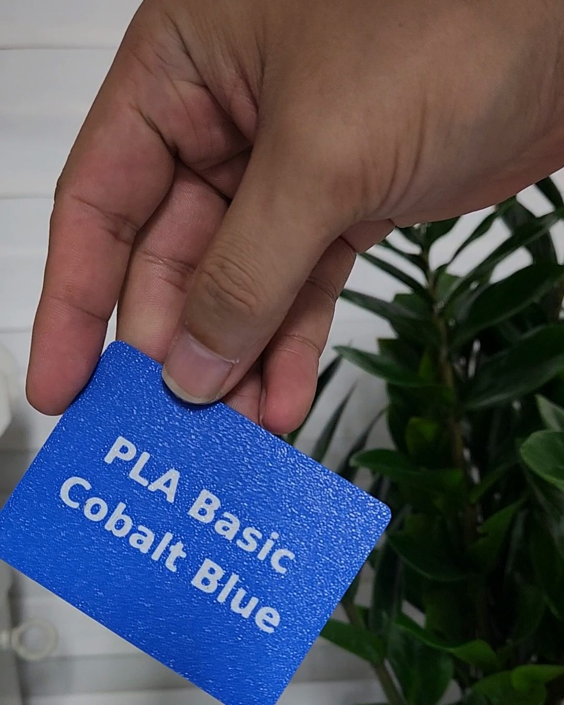

One tag takes about 25 minutes.

The MakerWorld profile already has a pause set on every plate.
One plate is one tag, so send only the colors you want.

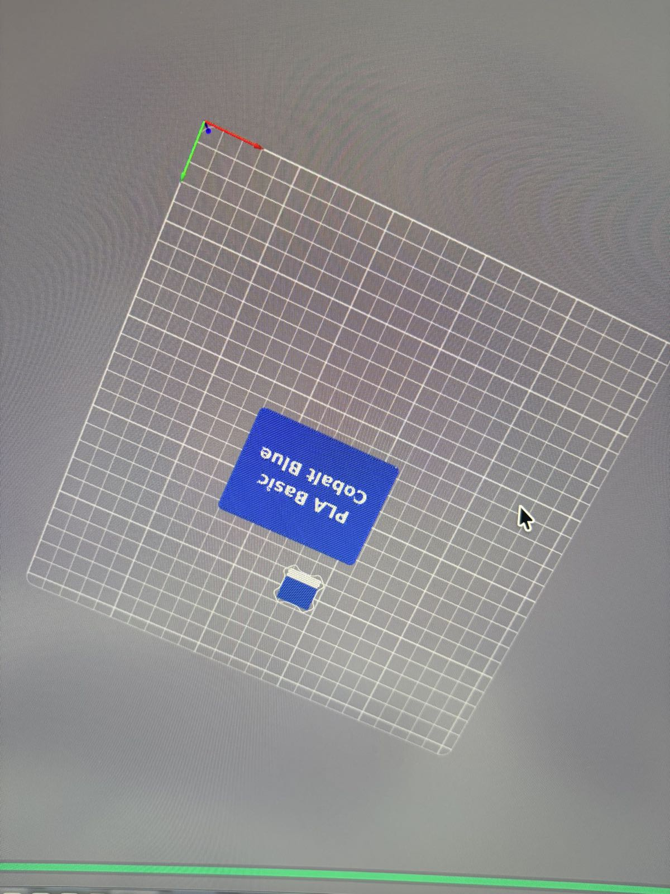

If you change the layer height from 0.2 mm, the pause layer disappears, so leave it as is.

The magnets are Ø7 × 2 mm round magnets, two per tag.
Attach a thin steel disc wherever the tag will stick.

## Summary

- Magnets in the filament bin tags let them move between the bin and the AMS
- The tag is printed in the filament itself, so it doubles as a color sample
- The magnets go in during the print and are locked inside (they won't fall out)
- 107 tags across 7 Bambu Lab filament series, pick a plate on MakerWorld and print right away

If you do multicolor printing often, this should be quite handy.

How do you organize your filament?
If there is information you'd like on the tags, let me know in the comments.

## Model files

- MakerWorld: [Magnetic Filament Name Tags — 107 Bambu Lab Colors](https://makerworld.com/en/models/3632166-magnetic-filament-name-tags-107-bambu-lab-colors)

I'm adding the print profiles one series at a time. PLA Basic is up first.

## Watch the video

From printing a tag and dropping in the magnets to moving it between the container and the AMS, all in about 2 minutes 40 seconds.

  <iframe src="https://www.youtube.com/embed/3oopvBIKz_I?cc_lang_pref=en&cc_load_policy=1" title="Magnetic Filament Name Tags | Color Samples That Follow Each Spool to the AMS" style="position: absolute; inset: 0; width: 100%; height: 100%; border: 0;" allow="accelerometer; autoplay; clipboard-write; encrypted-media; gyroscope; picture-in-picture; web-share" allowfullscreen loading="lazy"></iframe>

Or the short version:

  <iframe src="https://www.youtube.com/embed/RaKwP9tal4o?cc_lang_pref=en&cc_load_policy=1" title="Magnetic Filament Name Tags: Stick On, Peel Off" style="position: absolute; inset: 0; width: 100%; height: 100%; border: 0;" allow="accelerometer; autoplay; clipboard-write; encrypted-media; gyroscope; picture-in-picture; web-share" allowfullscreen loading="lazy"></iframe>

- YouTube video: [Magnetic Filament Name Tags | Color Samples That Follow Each Spool to the AMS](https://www.youtube.com/watch?v=3oopvBIKz_I)
- YouTube Shorts: [Magnetic Filament Name Tags: Stick On, Peel Off](https://www.youtube.com/shorts/RaKwP9tal4o)

## Print info

| Print | Qty | Layer height | Time | Filament |
|---|---|---|---|---|
| Tag plate (PLA Basic Cyan) | 1 | 0.2 mm | n/a | 7.4 g |
| Text (PLA Basic Jade White) | 1 | 0.2 mm | n/a | 1.0 g |
| **Total (1 tag)** | | | **about 24 min** | **8.4 g** |

- Printer: Bambu Lab P2S (0.4 mm nozzle), 0.20mm Standard
- Filament: Bambu PLA Basic, plate = tag color, text = white or black
- Magnets: 2 round Ø7 × 2 mm (inserted at the pause during the print)
- Source: Bambu Studio slicer estimates (including color-change purge and prime tower). Actual print time varies with the printer and the number of color changes.

## Credits

- Tag design: Kevin Park
- Color names and codes: official Bambu Lab filament color chart
