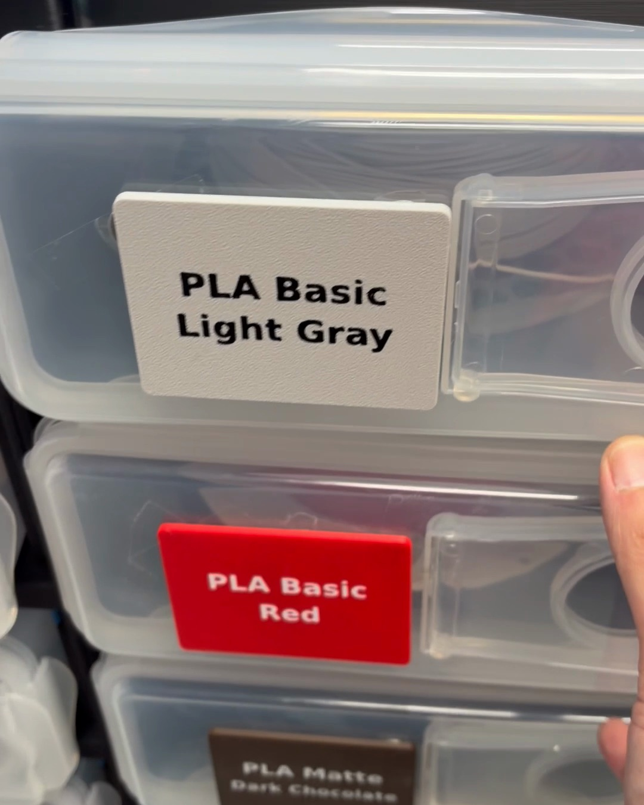

フィラメントをシリアルケースに1本ずつ入れて、積み重ねて使っています。
ケースごとにネームタグが付いています。
PLA Basic Red、PLA Matte Charcoal、PETG Basic Black...

ただ、このタグは磁石式です。
外して、ほかの場所に付けることができます。

フィラメントを取り出してAMSにセットするときは、タグも一緒に外してAMSの前に付けます。
使い終わってケースに戻すときは、タグもケースに戻します。
タグがフィラメントについていくわけです。

## 名前だけでは色が分からない

シリアルケースでフィラメントを保管してタグを付ける方法は、MakerWorldにすでにたくさんあります。
私もそこから始めました。

ただ、使ってみると名前だけでは足りませんでした。
PLA Basic Gray、Dark Gray、Blue Grey。
文字を見ればなんとなく想像はつきますが、実際に出力するとどんな色になるかは分かりません。
スプールに巻かれた色と出力物の色も違います。

マルチカラー出力のときは特にそうです。
フィギュア1体に6〜8色使っていると、「このグレーではなく、もう少し青みのあるグレーが...」と言いながら、何度もケースを開けることになります。

そこで、タグを**そのフィラメントで**出力しました。
PLA Basic RedのタグはPLA Basic Redで。
タグそのものが出力見本です。
名前を読まなくても、色を見て選ぶだけです。

## 磁石で外したり付けたり

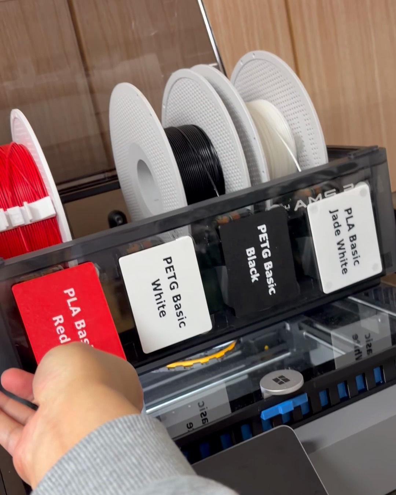

タグの上側の長い辺に、厚みのある帯があります。
この中に、直径7 mm、厚さ2 mmの丸い磁石が2個入っています。

付ける側には鉄板（スチール円盤）を貼っておきます。
シリアルケースにも、AMSの前にも。
こうすると、タグを近づけるだけでパチッとくっつきます。

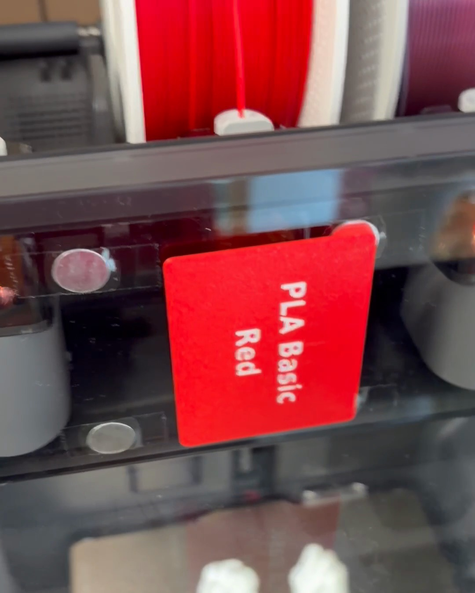

AMSにどのフィラメントが入っているかは、プリンターの画面でも見られます。
でも、AMSの前にタグが付いていれば、通りがかりにも見えます。
ケースが空なら、「ああ、あれは今AMSに入っているな」とすぐ分かります。

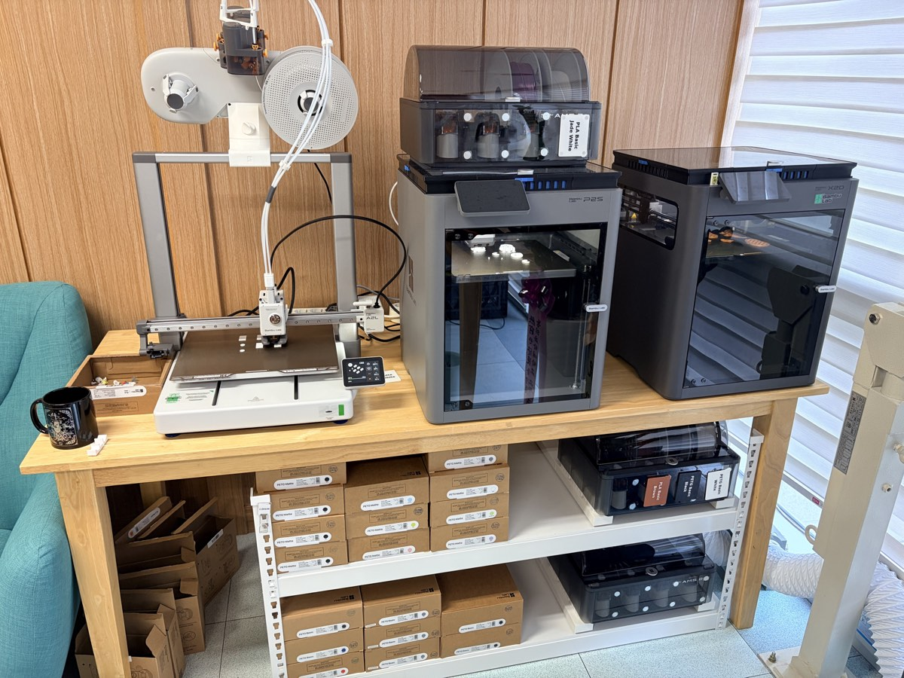

## こう変わってきました

最初からこの形だったわけではありません。

**最初の試作（8月27日）** — 平らな板の四隅に磁石用の穴を開けました。
厚さも2 mm、1 mmといろいろ出力してみました。

**磁石バー（8月末）** — 数日後、磁石を上側の長い辺に一列にまとめました。
板は1 mmに薄くして、磁石が入る帯だけ厚くしました。
磁石も4個から2個に減りました。
このときに、タグの形が今の形になりました。

磁石は、裏側が開いた溝にぐっと押し込みました。
出力して差し込むだけで済むので楽でした。

でも、長く使っていると磁石が抜けてしまいました。
外したり付けたりするために作ったのに、磁石が抜けては本末転倒です。

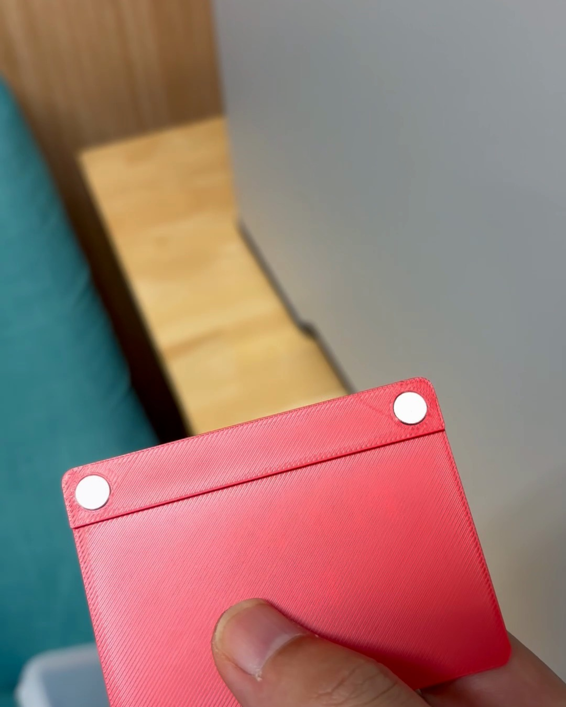

この赤いタグが、そのとき出力したものです。
裏面に磁石がそのまま見えます。
そのとき出力したタグは作り直さず、磁石を瞬間接着剤で固定してそのまま使っています。

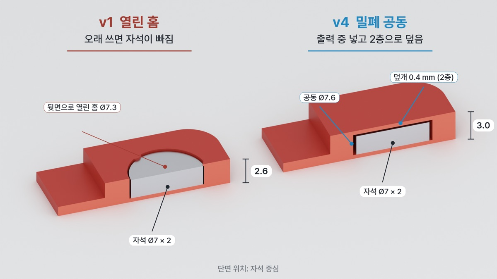

**磁石を中に閉じ込めることにしました（10月）** — 溝を閉じた空間に変えて、出力の途中で一時停止して磁石を入れます。
出力を再開すると上に層が重なって、磁石が中に閉じ込められます。
接着剤も要らず、抜け落ちることもありません。

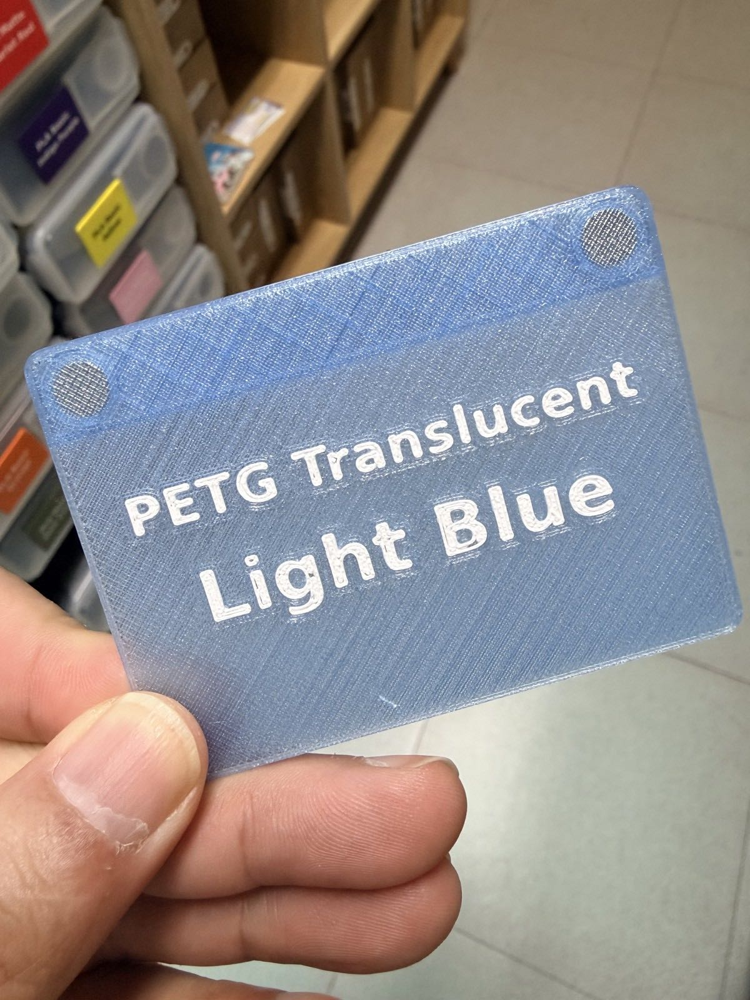

半透明のPETGで出力したタグだと、中に閉じ込めた磁石が透けて見えます。

最初は、上にかぶせる層を0.6 mm（3層）にしました。
出力してみると厚すぎました。
磁石の上は薄いほど鉄板によくくっつくので、0.4 mm（2層）に減らしました。
溝の中で磁石を押さえていた突起も外しました。どのみち上は塞がっているからです。

**シリーズを増やしました** — PLA Basic、Matte、Silk+、PETG HF、Translucent、PETG-CF、Supportに、10月末にはPETG Basicまで。
作ったのは8シリーズ113枚で、MakerWorldには色数の多い7シリーズ107枚を公開しました。
PETG-CFは色が6種類しかないので外しました。

## Bambu Labフィラメント107色、すぐに出力できます

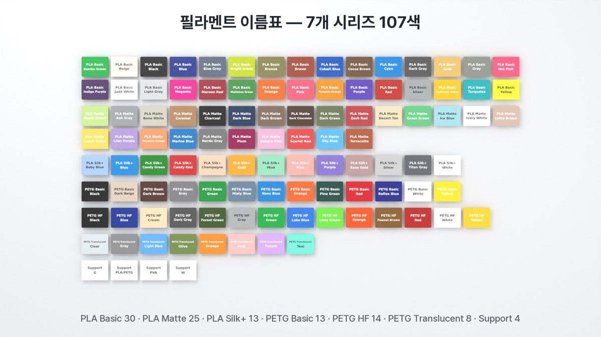

| シリーズ | 枚数 |
|---|---|
| PLA Basic | 30 |
| PLA Matte | 25 |
| PLA Silk+ | 13 |
| PETG Basic | 13 |
| PETG HF | 14 |
| PETG Translucent | 8 |
| Support | 4 |
| **合計** | **107** |

色名とカラーコードは、Bambu Lab公式のカラーチャートに合わせています。
文字の色は、板の色ごとに白と黒のどちらが見やすいかを1つずつ確認して選びました。
お持ちのフィラメントのタグだけを選んで出力すれば大丈夫です。

## 出力のしかた

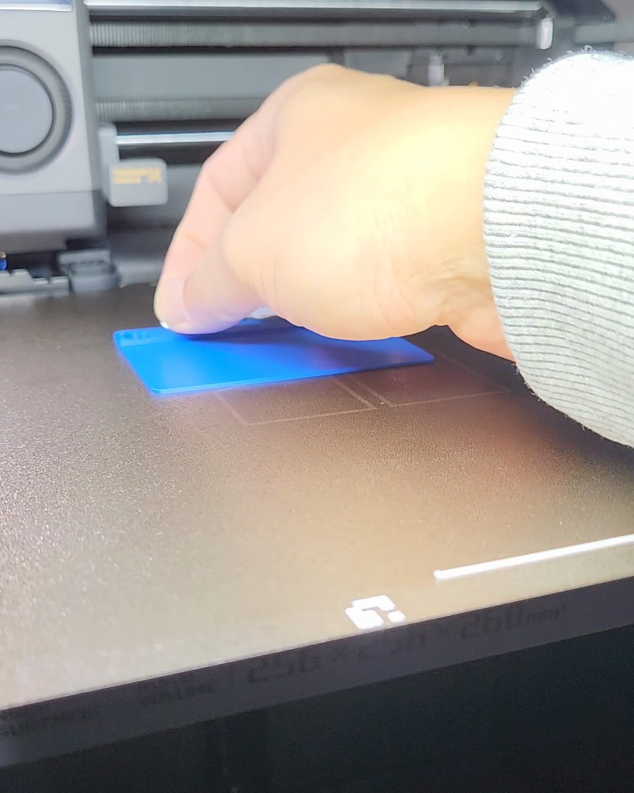

1. タグは2色です。板はそのフィラメント、文字は白か黒
2. 文字の面を下にして寝かせて出力します。サポートなし、積層ピッチ0.2 mm
3. 2.8 mmの層の直前で一時停止します。磁石の溝がすべて出た状態（2.6 mm）で止めます
4. 止まったら、2つの溝に磁石を1個ずつ入れます
5. 板の上に落ちた磁石がないか確認して、再開します

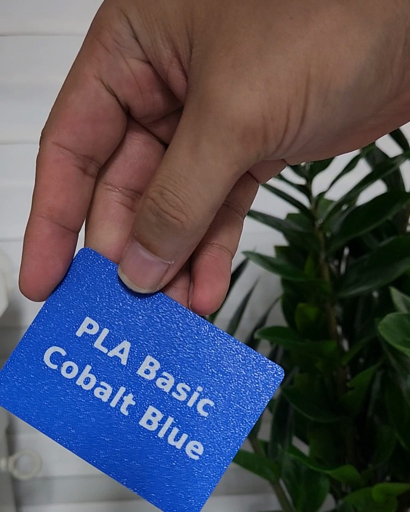

1枚あたり25分ほどかかります。

MakerWorldのプロファイルには、板ごとに一時停止をあらかじめ入れてあります。
板1枚がタグ1枚なので、欲しい色の板だけを選んで送れば大丈夫です。

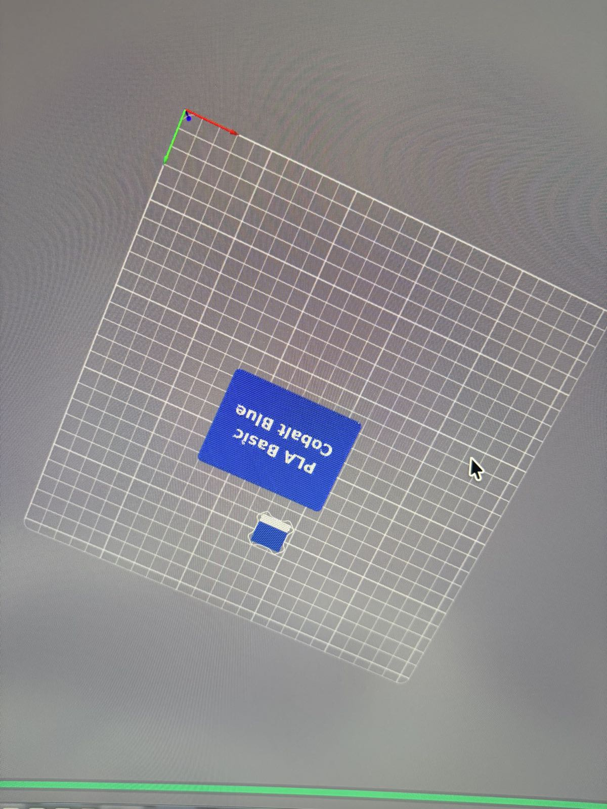

積層ピッチを0.2 mmから変えると一時停止の層がなくなるので、そのままにしてください。

磁石はØ7 × 2 mmの丸い磁石で、タグ1枚に2個です。
付ける場所には、薄いスチール円盤を貼ってください。

## まとめ

- フィラメント保管ボックスのタグに磁石を入れて、ボックスとAMSの間で付け替えます
- タグをそのフィラメントで出力するので、タグがそのまま出力色の見本になります
- 磁石は出力中に入れて中に閉じ込めます（抜けません）
- Bambu Labフィラメント7シリーズ107枚。MakerWorldで板を1つ選べば、すぐに出力できます

マルチカラー出力をよくする方には、かなり便利だと思います。

みなさんはフィラメントをどう整理していますか？
タグに入れてほしい情報があれば、コメントで教えてください。

## モデルファイル

- MakerWorld：[Magnetic Filament Name Tags — 107 Bambu Lab Colors](https://makerworld.com/en/models/3632166-magnetic-filament-name-tags-107-bambu-lab-colors)

プロファイルはシリーズごとに順次追加しています。まずPLA Basicを公開しました。

## 動画で見る

タグを出力して磁石を入れるところから、保管ケースとAMSの間を移動するところまで、2分40秒ほどにまとめました。

  <iframe src="https://www.youtube.com/embed/3oopvBIKz_I?cc_lang_pref=ja&cc_load_policy=1" title="フィラメントのネームタグに磁石を入れた | 保管ケースからAMSまでついて回る色見本" style="position: absolute; inset: 0; width: 100%; height: 100%; border: 0;" allow="accelerometer; autoplay; clipboard-write; encrypted-media; gyroscope; picture-in-picture; web-share" allowfullscreen loading="lazy"></iframe>

短く見たい方はショートで。

  <iframe src="https://www.youtube.com/embed/RaKwP9tal4o?cc_lang_pref=ja&cc_load_policy=1" title="フィラメントのネームタグ、磁石でペタッと付け外し" style="position: absolute; inset: 0; width: 100%; height: 100%; border: 0;" allow="accelerometer; autoplay; clipboard-write; encrypted-media; gyroscope; picture-in-picture; web-share" allowfullscreen loading="lazy"></iframe>

- YouTube動画：[フィラメントのネームタグに磁石を入れた | 保管ケースからAMSまでついて回る色見本](https://www.youtube.com/watch?v=3oopvBIKz_I)
- YouTubeショート：[フィラメントのネームタグ、磁石でペタッと付け外し](https://www.youtube.com/shorts/RaKwP9tal4o)

## 出力情報

| 出力物 | 個数 | 積層ピッチ | 時間 | フィラメント |
|---|---|---|---|---|
| タグの板（PLA Basic Cyan） | 1 | 0.2 mm | — | 7.4 g |
| 文字（PLA Basic Jade White） | 1 | 0.2 mm | — | 1.0 g |
| **合計（タグ1枚）** | | | **約24分** | **8.4 g** |

- プリンター：Bambu Lab P2S（0.4 mmノズル）、0.20mm Standard
- フィラメント：Bambu PLA Basic、板＝タグの色、文字＝白または黒
- 磁石：Ø7 × 2 mmの丸い磁石2個（出力中の一時停止のときに入れます）
- 数値の出典：Bambu Studioのスライサー予測値（色替えのパージ・プライムタワーを含む）。実際の出力時間は、プリンターや色替えの回数によって変わります

## クレジット

- タグの設計：Kevin Park
- 色名・カラーコード：Bambu Lab公式フィラメントカラーチャート
