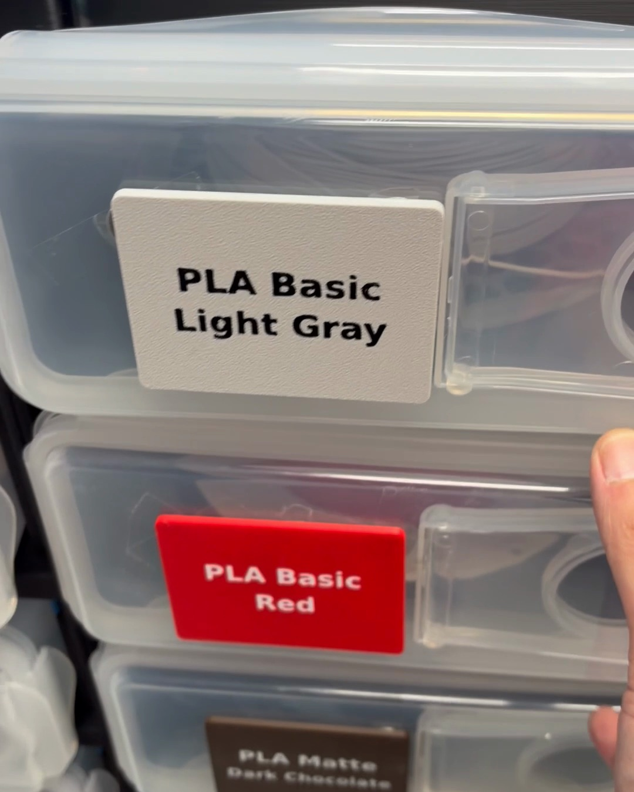

필라멘트를 시리얼통에 하나씩 넣어서 쌓아 두고 쓴다.
통마다 이름표가 붙어 있다.
PLA Basic Red, PLA Matte Charcoal, PETG Basic Black...

근데 이 이름표, 자석이다.
떼서 다른 데 붙일 수 있다.

필라멘트를 꺼내 AMS에 넣으면 이름표도 같이 떼서 AMS 앞에 붙인다.
다 쓰고 통에 돌려놓으면 이름표도 다시 통으로.
이름표가 필라멘트를 따라다니는 거다 ㅎㅎ

## 이름만으로는 색을 모른다

시리얼통에 필라멘트를 보관하고 이름표를 붙이는 방법은 메이커월드에 이미 많다.
나도 거기서 시작했다.

근데 써 보니까 이름만으로는 부족하더라.
PLA Basic Gray랑 Dark Gray랑 Blue Grey.
글자로 보면 대충 감은 오는데, 실제로 뽑으면 어떤 색이 나올지는 모른다.
스풀에 감긴 색이랑 출력물 색도 또 다르다.

다색 출력할 때 특히 그렇다.
피규어 하나에 색을 6~8개씩 쓰다 보면 "이 회색 말고 좀 더 푸른 회색..." 이러면서 통을 몇 번씩 열어 본다.

그래서 이름표를 **그 필라멘트로** 뽑았다.
PLA Basic Red 이름표는 PLA Basic Red로.
이름표 자체가 출력 견본이다.
이름을 읽을 필요도 없이 색만 보고 고르면 된다.

## 자석으로 뗐다 붙였다

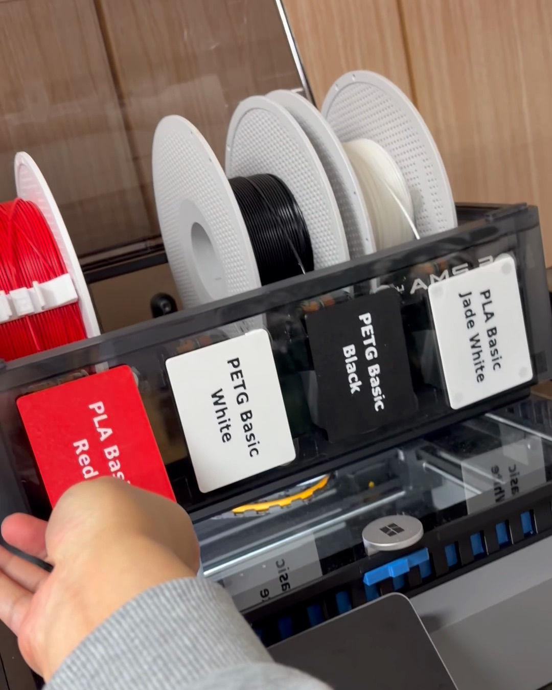

이름표 위쪽 긴 변에 두툼한 띠가 있다.
여기 안에 지름 7 mm, 두께 2 mm 원형 자석이 두 개 들어 있다.

붙이는 쪽에는 철판(스틸 원판)을 붙여 뒀다.
시리얼통에도, AMS 앞에도.
그러면 이름표를 대기만 하면 착 붙는다.

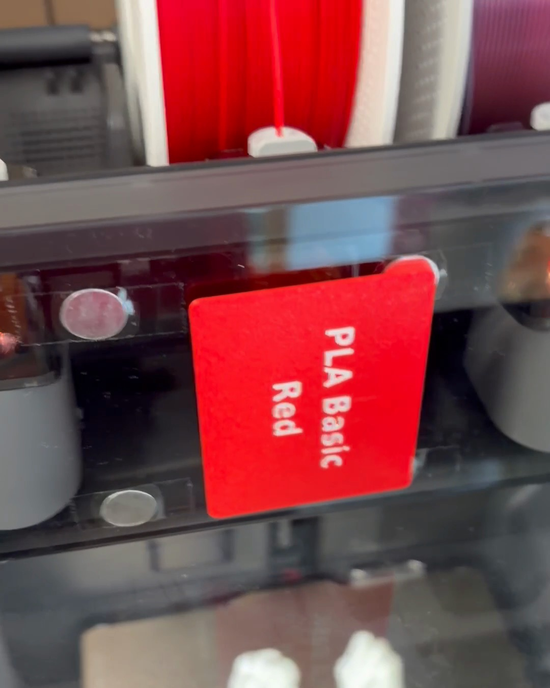

AMS에 어떤 필라멘트가 들어 있는지는 프린터 화면에서도 보이긴 한다.
근데 AMS 앞에 이름표가 붙어 있으면 지나가다가도 보인다.
통이 비어 있으면 "아 그거 지금 AMS에 있지" 하고 바로 안다.

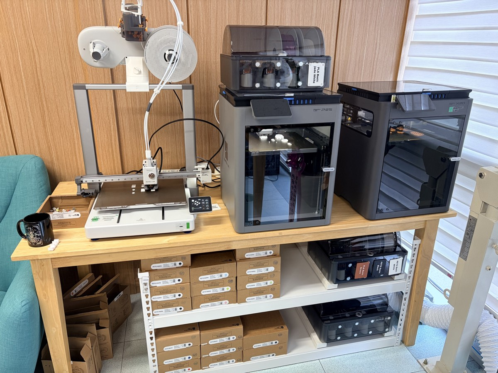

## 이렇게 바뀌어 왔다

처음부터 이 모양은 아니었다.

**첫 시도(8월 27일)** — 평평한 판 네 모서리에 자석 구멍을 뚫었다.
두께도 2 mm, 1 mm 이것저것 뽑아 봤다.

**자석바(8월 말)** — 며칠 뒤 자석을 위쪽 긴 변 한 줄로 몰았다.
판은 1 mm로 얇게 하고, 자석 들어가는 띠만 두껍게.
자석도 네 개에서 두 개로 줄었다.
이때 이름표 모양이 지금 모양이 됐다.

자석은 뒷면으로 열린 홈에 꾹 눌러 끼웠다.
뽑아서 끼우면 끝이라 편했다.

근데 오래 쓰니까 자석이 빠지더라 ㅠㅠ
뗐다 붙였다 하라고 만든 건데 자석이 빠지면 말이 안 되지.

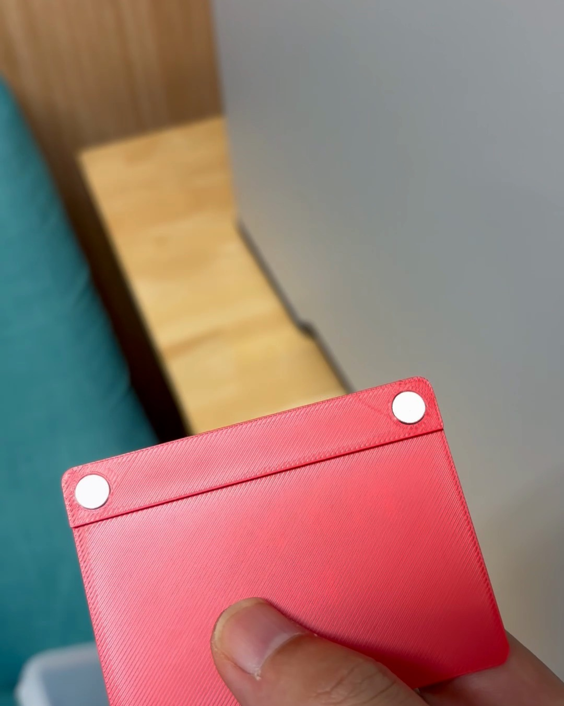

이 빨간 이름표가 그때 뽑은 거다.
뒷면에 자석이 그대로 보인다.
그때 뽑은 이름표들은 다시 뽑지 않고 자석을 순간접착제로 붙여서 그대로 쓰고 있다.

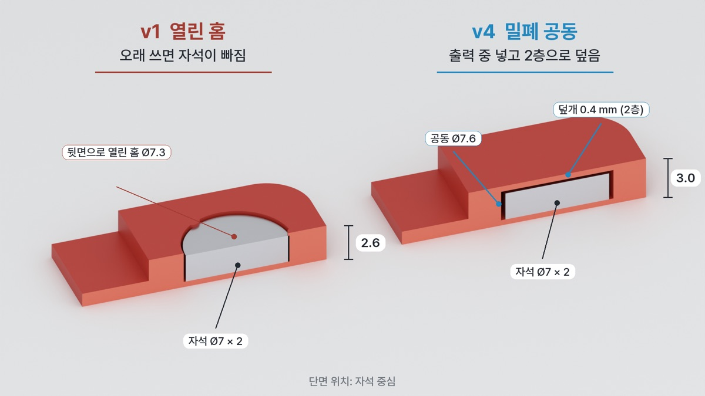

**자석을 안에 가두기로 했다(10월)** — 홈을 막힌 공간으로 바꾸고, 출력하다 중간에 멈춰서 자석을 넣는다.
다시 출력을 이어 가면 위에 층이 덮여서 자석이 안에 갇힌다.
접착제도 필요 없고, 빠질 수가 없다.

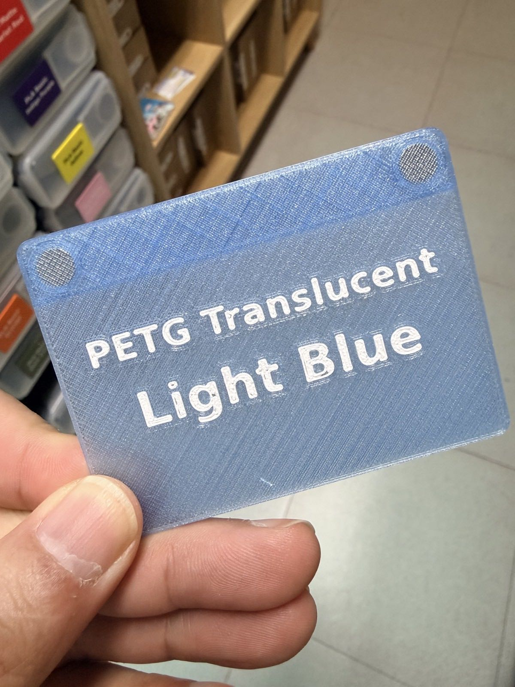

반투명 PETG로 뽑은 이름표를 보면 안에 갇힌 자석이 그대로 비쳐 보인다.

처음엔 덮는 층을 0.6 mm(3층)로 했다.
뽑아 보니 두꺼웠다.
자석 위는 얇을수록 철판에 잘 붙으니까 0.4 mm(2층)로 줄였다.
홈 안에 자석 잡아 주던 돌기도 뺐다. 어차피 위가 막혀 있으니까.

**시리즈를 늘렸다** — PLA Basic, Matte, Silk+, PETG HF, Translucent, PETG-CF, Support에 10월 말 PETG Basic까지.
만든 건 8개 시리즈 113장인데, 메이커월드에는 색이 많은 7개 시리즈 107장을 올렸다.
PETG-CF는 색이 여섯 가지뿐이라 뺐다.

## 뱀부랩 필라멘트 107색, 바로 뽑을 수 있게

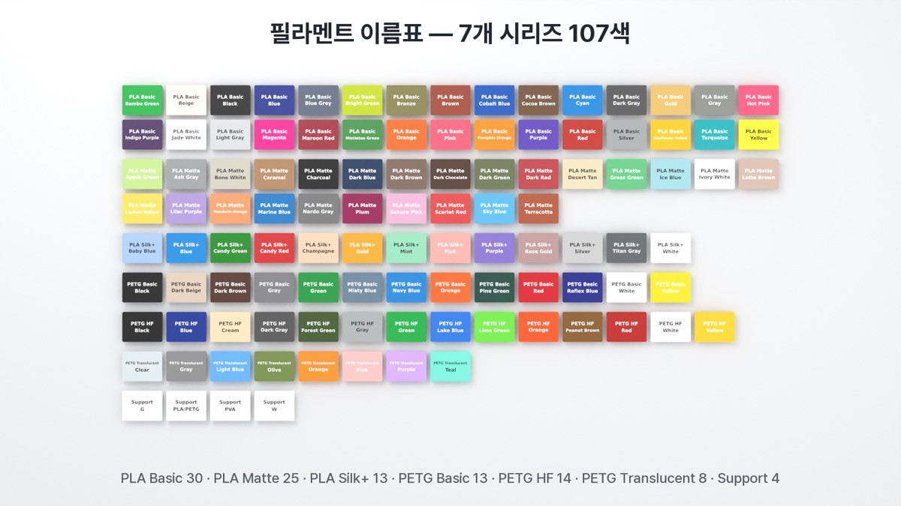

| 시리즈 | 장수 |
|---|---|
| PLA Basic | 30 |
| PLA Matte | 25 |
| PLA Silk+ | 13 |
| PETG Basic | 13 |
| PETG HF | 14 |
| PETG Translucent | 8 |
| Support | 4 |
| **합계** | **107** |

색 이름과 색 코드는 뱀부랩 공식 색상표 기준이다.
글자색은 판 색마다 흰색이 잘 보일지 검은색이 잘 보일지 하나씩 보고 골랐다.
가지고 있는 필라멘트 이름표만 골라서 뽑으면 된다.

## 뽑는 법

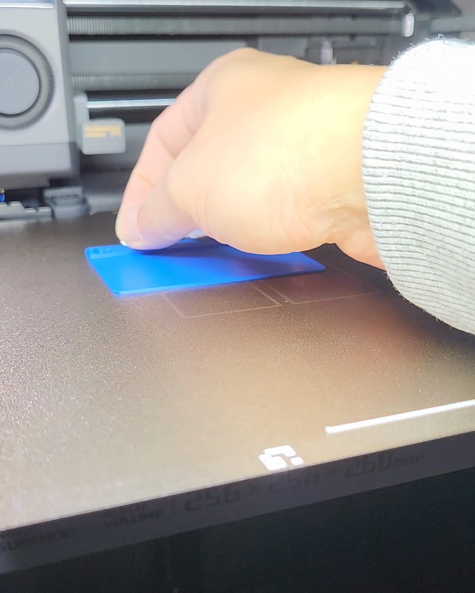

1. 이름표는 2색이다. 판은 그 필라멘트, 글자는 흰색이나 검은색
2. 글자 면이 바닥으로 가게 눕혀서 뽑는다. 서포트 없음, 레이어 0.2 mm
3. 2.8 mm 층 직전에 일시정지 — 자석 홈이 다 올라온 상태(2.6 mm)에서 멈춘다
4. 멈추면 홈 두 개에 자석을 하나씩 넣는다
5. 판 위에 떨어진 자석이 없는지 보고 재개

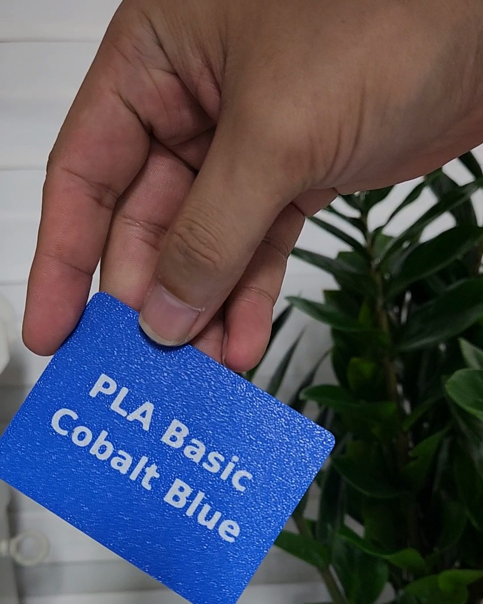

한 장에 25분 정도 걸린다.

메이커월드 프로파일에는 판마다 일시정지를 미리 넣어 뒀다.
판 하나가 이름표 한 장이라, 원하는 색 판만 골라서 보내면 된다.

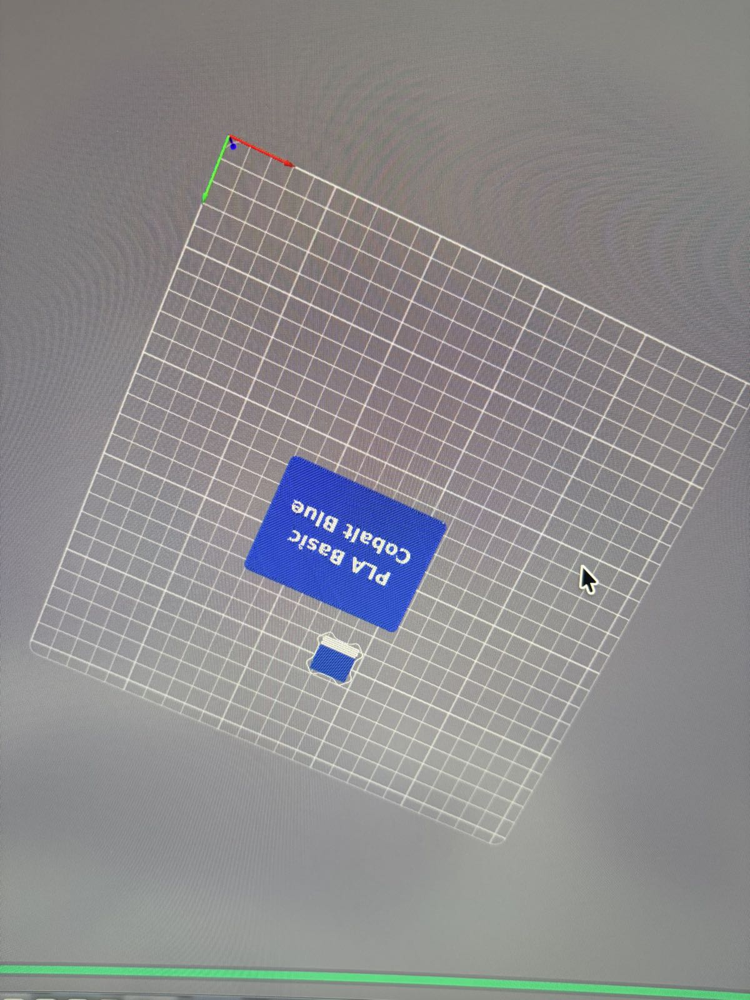

레이어 높이를 0.2 mm에서 바꾸면 일시정지 층이 사라지니 그대로 두면 된다.

자석은 Ø7 × 2 mm 원형 자석, 이름표 한 장에 두 개.
붙일 자리에는 얇은 스틸 원판을 붙인다.

## 정리하면

- 필라멘트 보관함 이름표에 자석을 넣어서 보관함 ↔ AMS로 옮겨 붙인다
- 이름표를 그 필라멘트로 뽑아서 이름표가 곧 출력 색 견본이다
- 자석은 출력 중에 넣어 안에 가둔다(빠지지 않는다)
- 뱀부랩 필라멘트 7개 시리즈 107장, 메이커월드에서 판 하나 골라 바로 뽑을 수 있다

다색 출력을 자주 한다면 꽤 쓸 만할 거다 ㅎㅎ

다들 필라멘트는 어떻게 정리하세요?
이름표에 넣었으면 하는 정보가 있으면 댓글로 알려 주세요.

## 모델 파일

- 메이커월드: [Magnetic Filament Name Tags — 107 Bambu Lab Colors](https://makerworld.com/ko/models/3632166-magnetic-filament-name-tags-107-bambu-lab-colors)

프로파일은 시리즈별로 하나씩 붙여 나가는 중이다. PLA Basic이 먼저 올라가 있다.

## 영상으로 보기

이름표를 뽑고 자석 넣는 장면부터 보관함과 AMS 사이를 옮겨 다니는 모습까지 2분 40초 정도로 묶었다.

  <iframe src="https://www.youtube.com/embed/3oopvBIKz_I?cc_lang_pref=ko&cc_load_policy=1" title="필라멘트 이름표에 자석을 넣었다 | 보관함에서 AMS까지 따라다니는 색 견본" style="position: absolute; inset: 0; width: 100%; height: 100%; border: 0;" allow="accelerometer; autoplay; clipboard-write; encrypted-media; gyroscope; picture-in-picture; web-share" allowfullscreen loading="lazy"></iframe>

짧게 보고 싶으면 쇼츠로 ㅎㅎ

  <iframe src="https://www.youtube.com/embed/RaKwP9tal4o?cc_lang_pref=ko&cc_load_policy=1" title="필라멘트 이름표, 자석으로 붙였다 뗐다" style="position: absolute; inset: 0; width: 100%; height: 100%; border: 0;" allow="accelerometer; autoplay; clipboard-write; encrypted-media; gyroscope; picture-in-picture; web-share" allowfullscreen loading="lazy"></iframe>

- 유튜브 롱폼: [필라멘트 이름표에 자석을 넣었다 | 보관함에서 AMS까지 따라다니는 색 견본](https://www.youtube.com/watch?v=3oopvBIKz_I)
- 유튜브 쇼츠: [필라멘트 이름표, 자석으로 붙였다 뗐다](https://www.youtube.com/shorts/RaKwP9tal4o)

## 출력 정보

| 출력물 | 개수 | 층 높이 | 시간 | 필라멘트 |
|---|---|---|---|---|
| 이름표 판 (PLA Basic Cyan) | 1 | 0.2 mm | — | 7.4 g |
| 글자 (PLA Basic Jade White) | 1 | 0.2 mm | — | 1.0 g |
| **합계 (이름표 1장)** | | | **약 24분** | **8.4 g** |

- 프린터: Bambu Lab P2S (0.4 mm 노즐), 0.20mm Standard
- 필라멘트: Bambu PLA Basic, 판 = 이름표 색 · 글자 = 흰색 또는 검은색
- 자석: Ø7 × 2 mm 원형 2개 (출력 중 일시정지 때 넣음)
- 수치 출처: Bambu Studio 슬라이서 예상값(색 교체 퍼지·프라임 타워 포함). 실제 출력 시간은 프린터·색 교체 횟수에 따라 다르다

## 출처

- 이름표 설계: Kevin Park
- 색 이름·색 코드: Bambu Lab 공식 필라멘트 색상표
