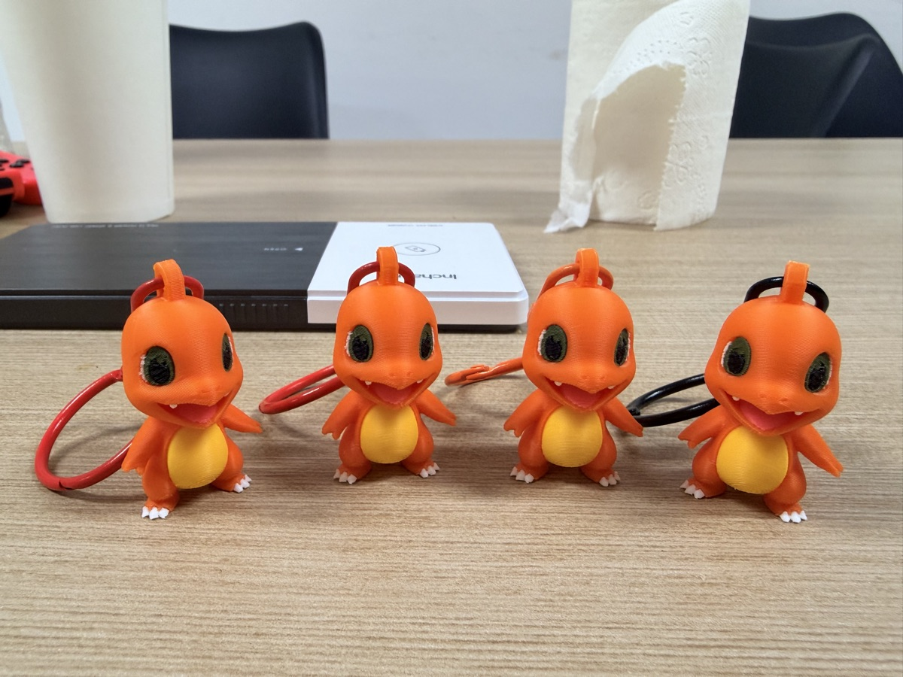

I printed four Charmander keychains haha

But this post isn't really about showing off Charmander.
It's about **print orientation**.

Same model, yet how you lay it down
changes the result more than I expected.

## What happened when I printed it upright

The model is Charmander Chibi by Atseini on MakerWorld.
A little Charmander with a big head.
Open it as the author published it, and it comes in standing up like this.

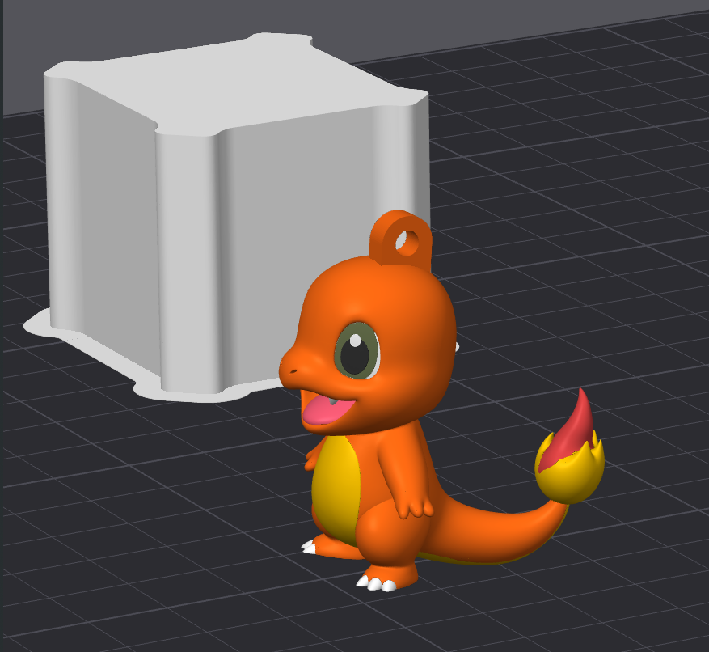

Actually, I had printed this Charmander once before in exactly this pose.
The area under the arms was pretty messy with support marks, sadly.

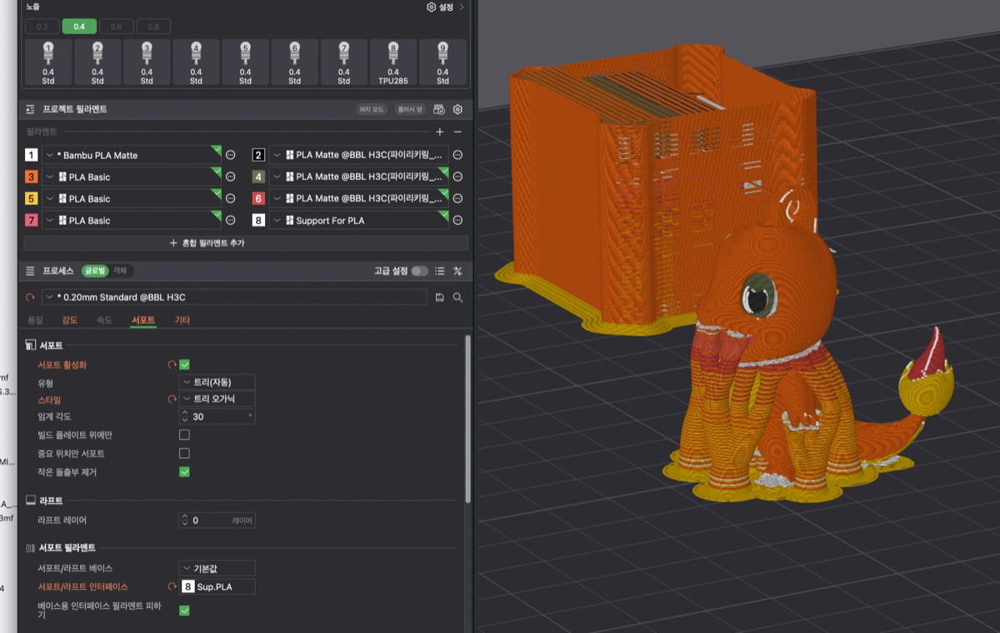

Slice it and you can see why right away.
Supports crowd in under the open mouth, around the eyes, on the belly, under the tail, and under the arms.
And of course, those are exactly the spots people look at first.

After you pull the supports off, the contact areas stay rough.
Printed this way, the mouth, the area around the eyes, the belly, and the tail would all be covered in marks.
On a small keychain, those marks look even bigger.

## This time I tilted it onto its back

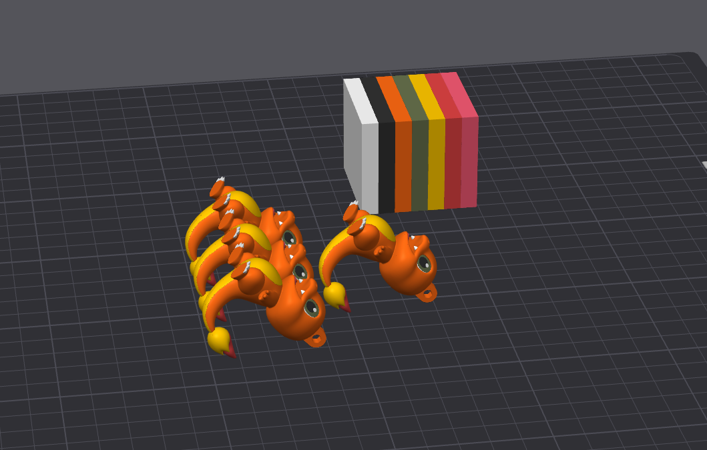

So this time I started by thinking about the stacking direction.
A 3D printer builds one layer at a time, from bottom to top.
When a detailed part tilts and hangs in the air, supports get attached underneath it.
So I just need to place the model so that details like the mouth, teeth, hands, and feet are tilted as little as possible.

Upright, the underside of the open mouth, the chin, and the area under the arms all face downward at an angle.
So I tilted Charmander back by about 136 degrees.
The mouth, teeth, hands, and feet now build upward, so they stand on their own without supports.
The only thing touching the plate directly is the single loop on top of the head,
and only the back of the head and the tip of the tail flame are held up by supports.

I changed two support settings as well.

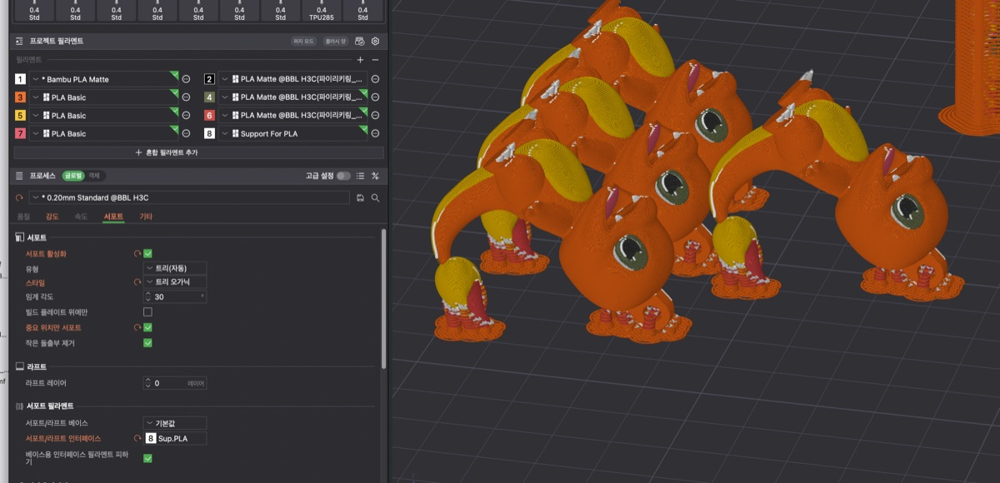

- I turned on **Support critical regions only**, so supports are placed only where they're truly needed.
- For the support interface (the layer that touches the model) I used the dedicated support filament, **Bambu Support for PLA**. It doesn't stick well to PLA, so it pops right off.

Everything else stayed the same: Tree (auto), Organic style, threshold angle 30°.

## By the numbers

I sliced both poses with the same H3C settings, changing only the orientation.
The figures are for one plate of four.

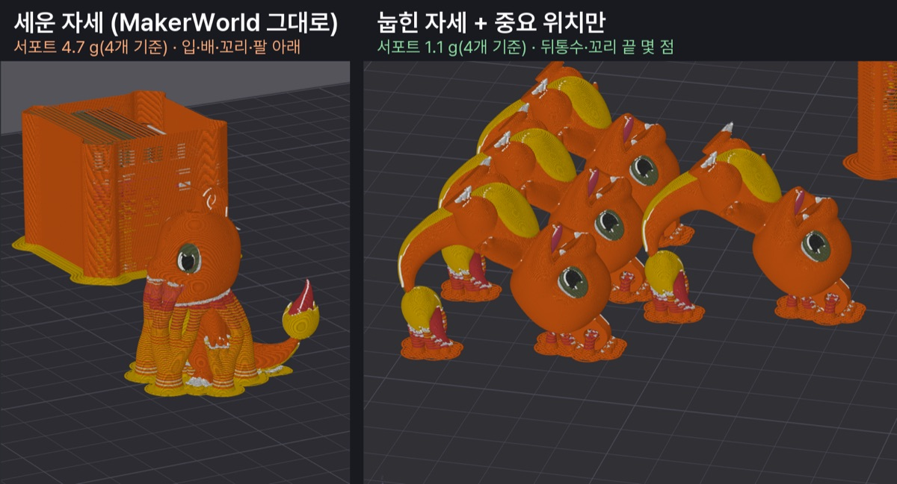

| Orientation | Supports | Where supports touch |
|---|---|---|
| Upright (as on MakerWorld) | 4.7 g | Under the mouth and chin, belly, tail, under the arms |
| Tilted + critical regions only | 1.1 g | A few points on the back of the head and the tail tip |

Supports dropped to a quarter.
But what really matters is the **location**, not the amount.
All the remaining supports are on the back of the head, so even after removal you can't see them from the front.

Print time stayed almost the same.
Tilting raises the height from 4.2 cm to 5.7 cm, which adds layers.
So it's not a way to save time. It's a way to protect quality.

## Four on the H3C, 2 hours 30 minutes

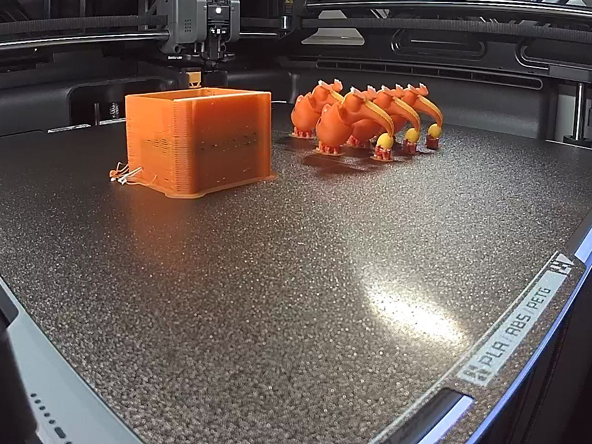

With seven colors, I would have worried first in the old days.
The H3C has a separate nozzle for each color, so I just put four on one plate and hit start.
It actually took 2 hours 30 minutes.

## Taking them off

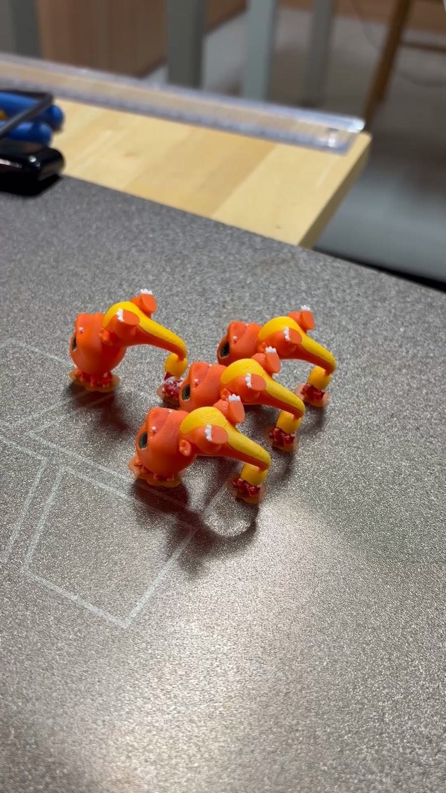

Seeing them all lying together on the plate is kind of funny haha
They look like they're sunbathing with their bellies out.

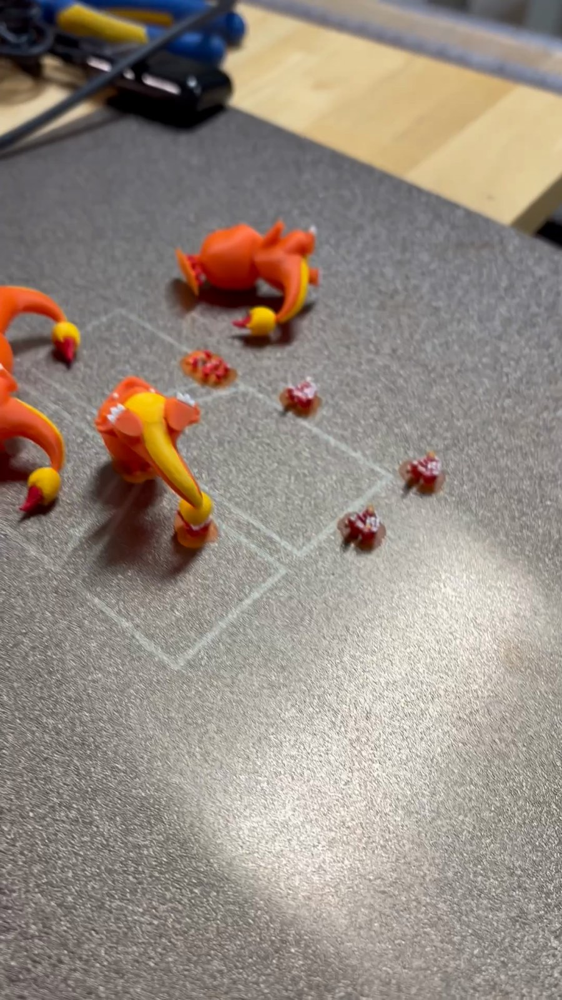

When I took them off the plate, the supports just popped off on their own, no removal needed.
All that was left on the plate were those few tiny pieces.
Printed upright, I would have had to pick the supports out from under the mouth and arms one by one.
This time that whole chore simply wasn't there haha

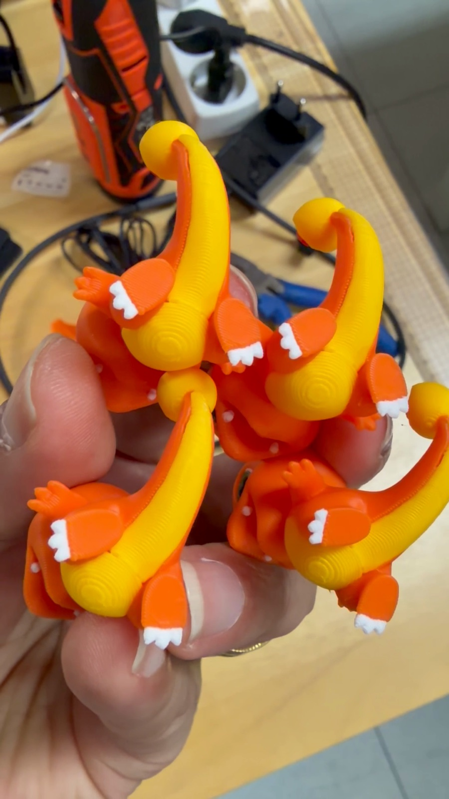

This is the belly and tail underside, where supports attach when you print upright.
This time they build upward, so supports never touched them at all.
Even the yellow belly stripes are clean.

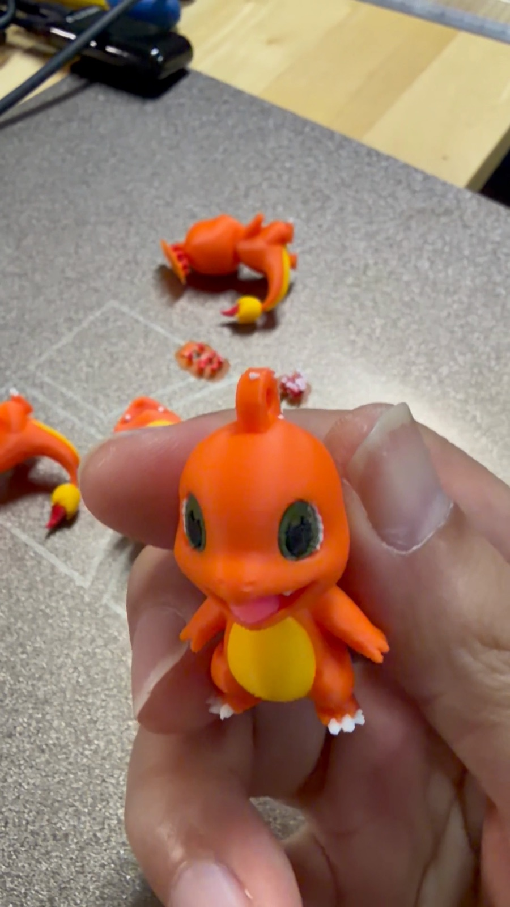

Here's the face.
The eye outlines, the open mouth, the tiny teeth, the tongue, the fingers, even the white claws are all alive.
For a 4 cm keychain, I'm happy with this haha

To be honest, a faint texture from the supports remains on the back of the head.
But it's the back of the head, so nobody sees it when it's hanging as a keychain.
The back of the head took on the supports that would have landed on the details.

## I made the loop by modifying the model

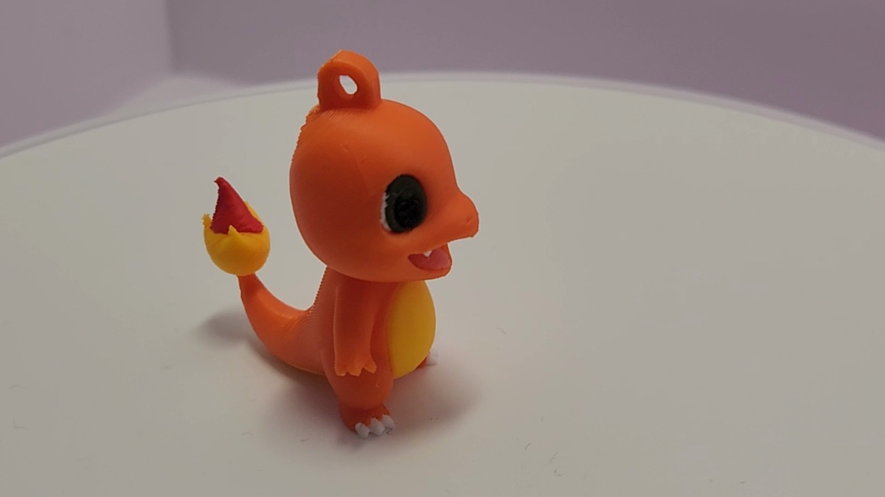

The original model is a figure, so it has no keychain loop.
So I modified the MakerWorld model and made a small loop on top of the head.
The hole is 3 mm and goes side to side, so when it hangs from a bag, the face looks straight ahead.

In the tilted pose, this loop even served as a foot touching the plate.
A little bonus haha

## Takeaways

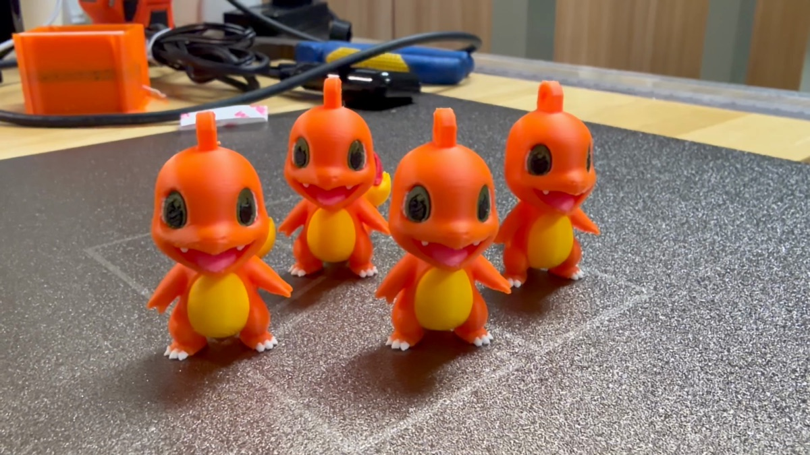

Here's what this print reminded me of for multicolor figures.

- **Think about the stacking direction first.** Place the model so details like the mouth, teeth, hands, and feet are tilted as little as possible and don't hang in the air.
- **Supports in critical regions only.** Left on auto, the slicer builds them where you don't need any.
- **Use the dedicated support filament for the interface.** It comes off easily and leaves a clean surface.
- If orientation alone won't solve it, **splitting the model into big parts and gluing them at the end** is the cleanest way. That's how it went with [Bulbasaur](/2026/11/07/bulbasaur-15cm-multipart-print/), [Bowser](/2026/11/07/bowser-multipart-assembly/), and [Mario and Luigi](/2026/11/10/mario-luigi-multipart-assembly/).

Same model, same printer,
and changing just one pose in the slicer made this much difference.

How do you set the orientation when you print figures?
If you have any good tips, let me know in the comments haha

## Watch the video

I put the orientation comparison, the supports popping off, and the print info into a short.
The narration is in Korean, with English and five more dubbed tracks and subtitles.
The background music is a calm original track I made.

  <iframe src="https://www.youtube.com/embed/RRo-vO9T6Z0?cc_lang_pref=en&cc_load_policy=1" title="Charmander Keychain: Print It Lying Down, Lose the Support Marks" style="position: absolute; inset: 0; width: 100%; height: 100%; border: 0;" allow="accelerometer; autoplay; clipboard-write; encrypted-media; gyroscope; picture-in-picture; web-share" allowfullscreen loading="lazy"></iframe>

- YouTube Short: [Charmander Keychain: Print It Lying Down, Lose the Support Marks](https://www.youtube.com/shorts/RRo-vO9T6Z0)

## Print info

| Print | Qty | Layer height | Time | Filament (est.) |
|---|---|---|---|---|
| Charmander keychain (4.2 cm tall, with loop) | 4 | 0.20 mm | 2 h 30 min (measured) | 46.5 g |
| Total | 4 | | 2 h 30 min | 46.5 g |

- Printer: Bambu Lab H3C (0.4 mm nozzle, four per plate)
- Filament: Bambu PLA Basic (orange, yellow, pink), PLA Matte (white, black, khaki, red), and Support for PLA as the support interface
- The time is the actual print time. The filament weight is a Bambu Studio slicer estimate and includes 28 g for the prime tower used during color changes. It's based on settings saved before I added the Support for PLA interface, so the real figure may differ slightly.
- The support comparison (4.7 g to 1.1 g) is an estimate from slicing the same H3C settings in both poses (the interface filament was left at the default in both cases).

## Sources

- Model: Charmander Chibi by Atseini on MakerWorld (keychain loop added by modifying the model)
- Character: Charmander © Nintendo / Creatures / GAME FREAK, a fan-made model, not official merchandise
