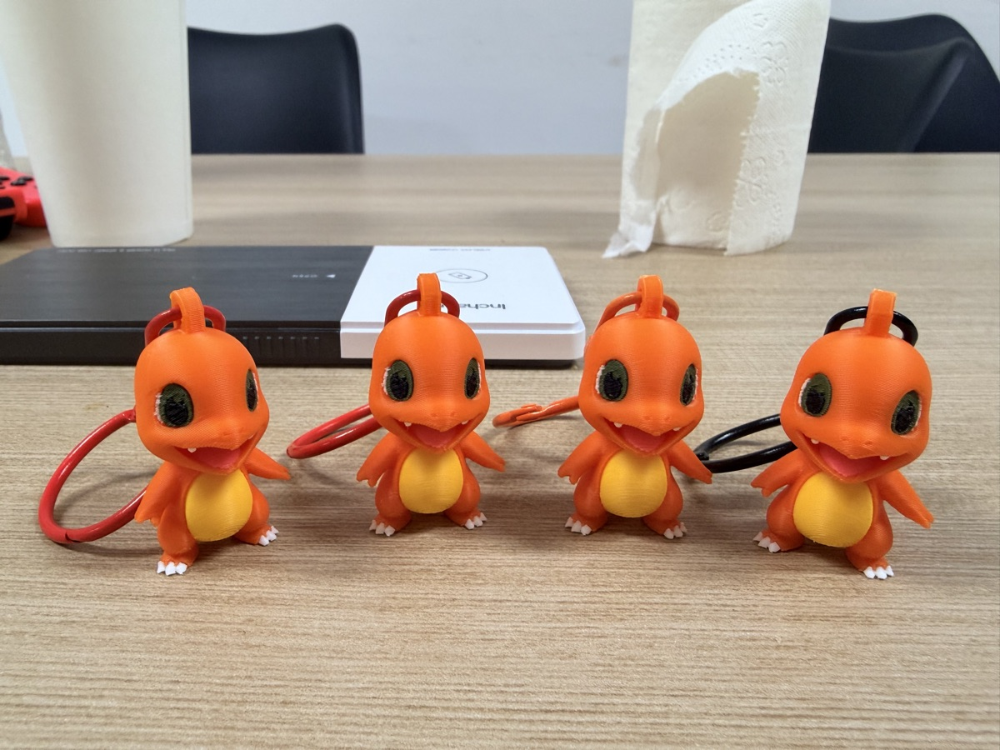

ヒトカゲのキーホルダーを4体出力しました。

ただ、今回の記事はヒトカゲの自慢というより
**造形方向** の話です。

同じモデルでも、どう寝かせるかで
結果がここまで変わりました。

## 以前、立てて出力したとき

モデルはMakerWorldにあるAtseiniさんのCharmander Chibiです。
頭が大きな、小さなヒトカゲ。
作者のプロフィールどおりに開くと、こんな立ち姿で入ってきます。

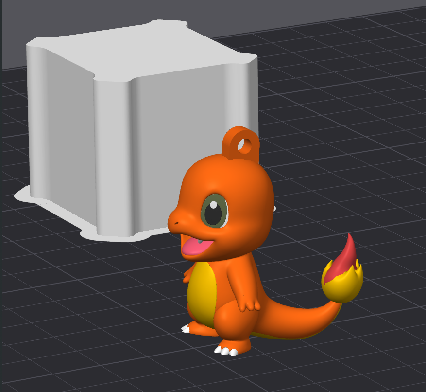

実はこのヒトカゲ、前にもこの姿勢のまま出力したことがありました。
そのときは、腕の下がサポート跡でかなり汚くなってしまいました。

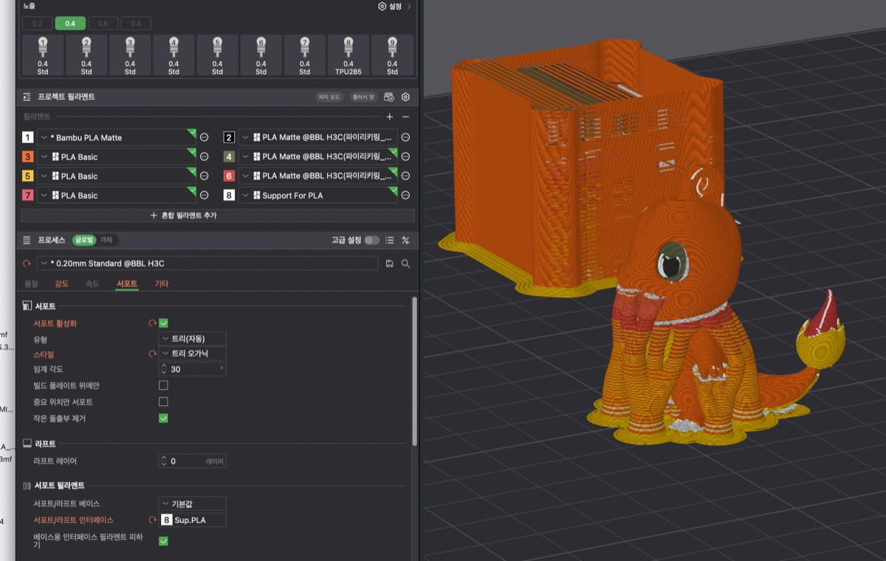

スライスしてみると、理由がすぐにわかります。
開いた口の下、目の周り、お腹、しっぽの下、腕の下まで、サポートがぎっしり立ちます。
しかも、どれも人の目にいちばん入る場所です。

サポートを外すと、触れていた部分がざらざらに残ります。
このまま出力していたら、口も目の周りもお腹もしっぽも、跡だらけだったはずです。
小さなキーホルダーなので、そんな跡はよけいに目立ちます。

## 今回は後ろに寝かせた

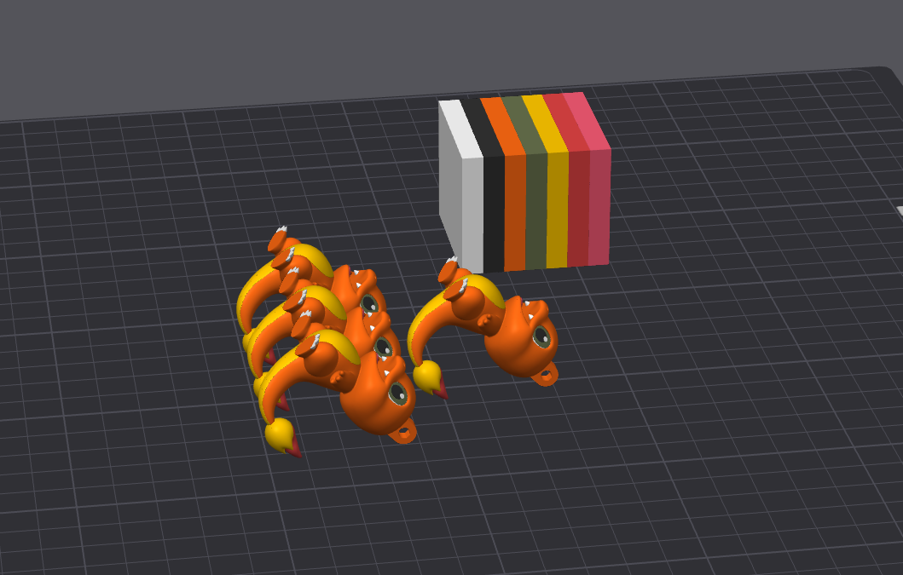

そこで今回は、積み上がる方向から考えました。
3Dプリンターは、下から上へ1層ずつ積み重ねていきます。
細かい部分が傾いて空中に張り出すと、その下にサポートが付きます。
つまり、口、歯、手、足のようなディテールがなるべく傾かないように置けばいいわけです。

立てたままだと、開いた口の下、あご、腕の下はすべて下向きに傾いた面になります。
そこでヒトカゲを後ろに約136度寝かせました。
口、歯、手、足が上向きに積み上がるので、サポートなしでそのまま立ち上がります。
プレートに直接触れるのは、頭の上に付けた輪1つだけで、
サポートが支えるのは後頭部としっぽの炎の先だけです。

サポートの設定も2つ変えました。

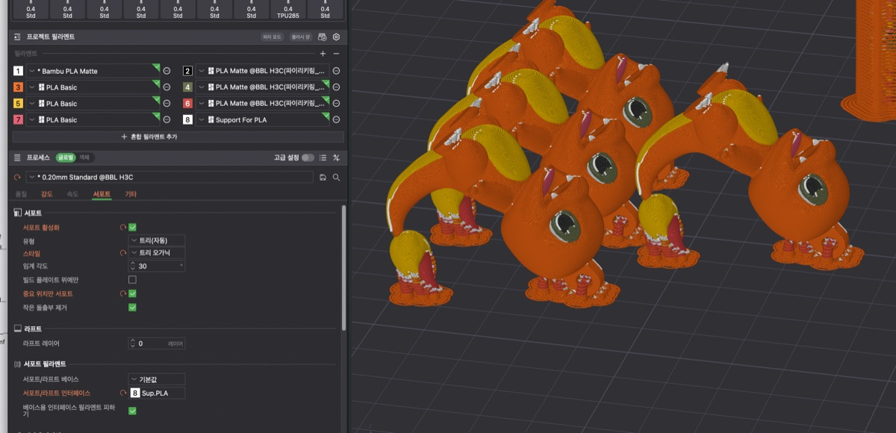

- **重要な領域のみサポート** をオンにしました。本当に必要な場所にだけサポートを立てます。
- サポートがモデルに触れる面（インターフェース）には、**サポート専用フィラメント（Support for PLA）** を使いました。PLAとくっつきにくいので、ぽろっと外れます。

そのほかは、ツリー（自動）、オーガニックスタイル、しきい角度30度のままです。

## 数字で見ると

同じH3Cの設定のまま、姿勢だけ変えてスライスしてみました。
4体を1枚に載せた場合の値です。

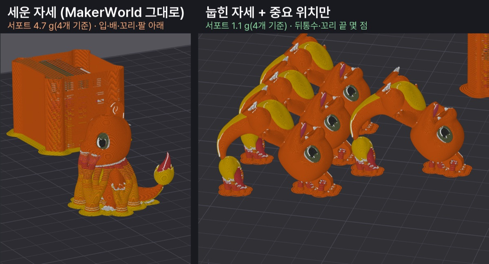

| 姿勢 | サポート | サポートが触れる場所 |
|---|---|---|
| 立てた姿勢（MakerWorldのまま） | 4.7 g | 口・あごの下・お腹・しっぽ・腕の下 |
| 寝かせた姿勢 + 重要な領域のみ | 1.1 g | 後頭部としっぽの先の数点 |

サポートは4分の1に減りました。
でも本当に大事なのは量よりも **場所** です。
残ったサポートはすべて後頭部側なので、外したあとも正面からは見えません。

出力時間はほとんど変わりませんでした。
寝かせると高さが4.2 cmから5.7 cmに上がって、層が増えるからです。
時間を節約する方法ではなく、品質を守る方法なのです。

## H3Cで4体、2時間30分

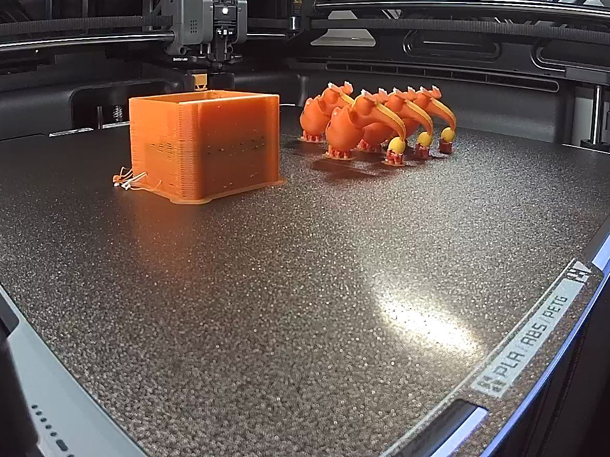

色が7色もあるので、以前なら心配から入っていたと思います。
H3Cは色ごとにノズルが分かれているので、1枚に4体載せてそのまま出力を始めました。
実際にかかったのは2時間30分です。

## 外してみると

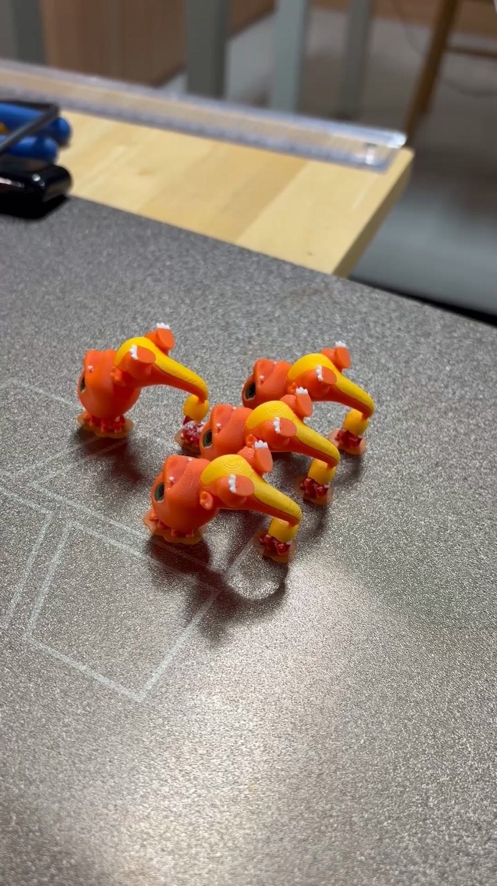

プレートの上にみんなで寝転がっている姿が、ちょっとおもしろいです。
お腹を出して日光浴をしているみたいです。

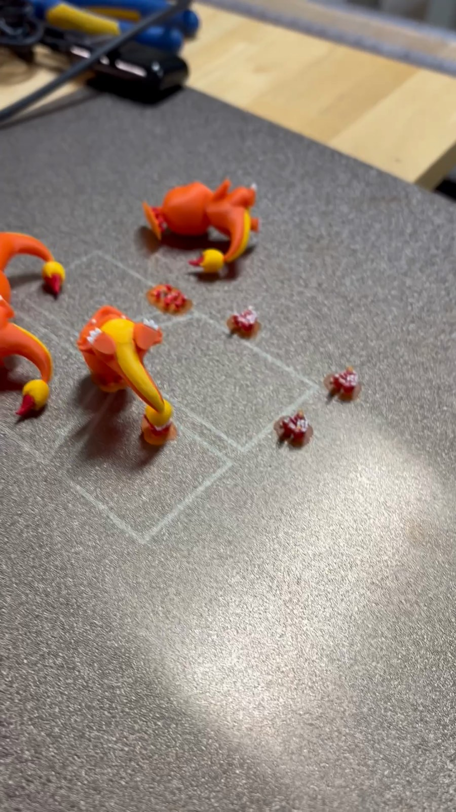

プレートから外すと、サポートはわざわざ取らなくても、ポロッと落ちました。
プレートに残ったのは、あの小さなかけらが数個だけです。
立てて出力していたら、口の下や腕の下のサポートを一つずつ苦労して取る必要があったはずです。
今回はその手間がまったくありませんでした。

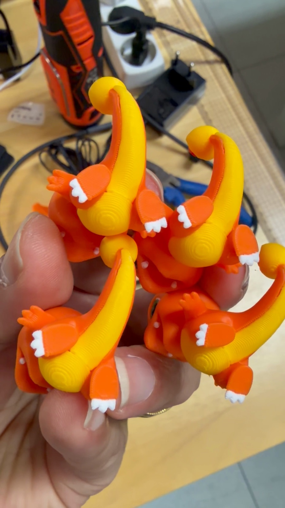

立てて出力するとサポートが付く、お腹としっぽの下面です。
今回は上向きに積み上がったので、サポートがまったく触れませんでした。
黄色いお腹のしましまもきれいです。

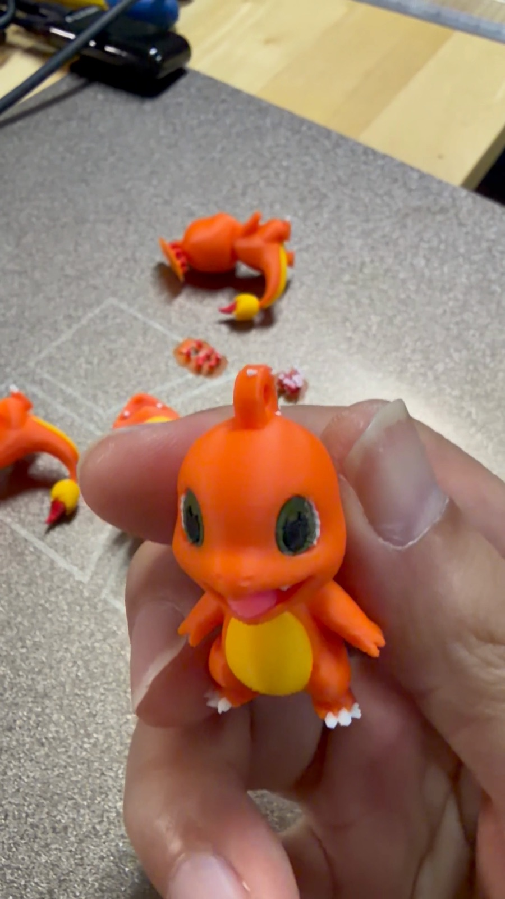

顔はこんな感じです。
目の縁、開いた口、小さな歯、舌、指、白い爪まで、全部しっかり出ています。
4 cmのキーホルダーでここまで出れば、満足です。

正直に言うと、後頭部にはサポートが触れていた跡がうっすら残りました。
でも後頭部なので、キーホルダーとして付けて持ち歩けば誰にも見えません。
ディテール側に付くはずだったサポートを、後頭部が代わりに引き受けてくれた形です。

## 輪はモデルを改造して作った

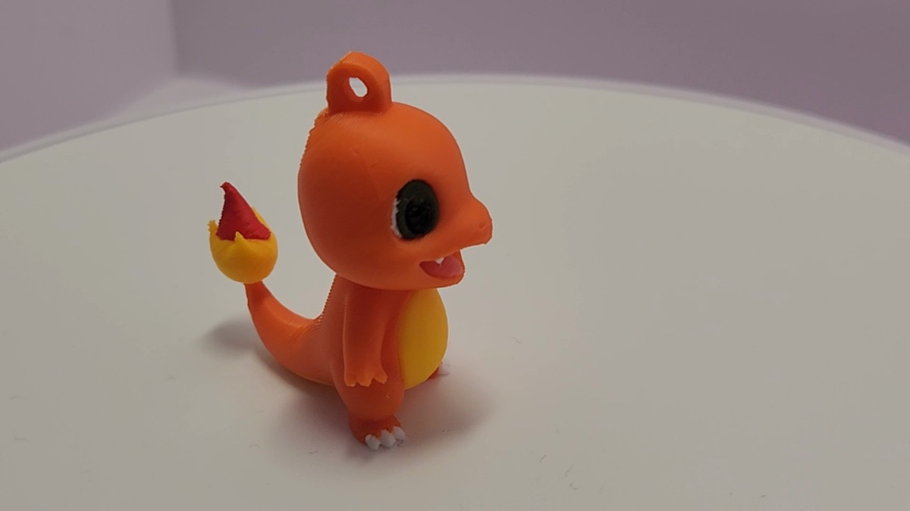

元のモデルはフィギュアなので、キーホルダーの輪はありません。
そこでMakerWorldのモデルを改造して、頭の上に小さな輪を作りました。
穴は3 mmで、左右に通してあるので、バッグに付けると顔が正面を向きます。

この輪は、寝かせた姿勢ではプレートに触れる足の役目までしてくれました。
思わぬおまけです。

## まとめ

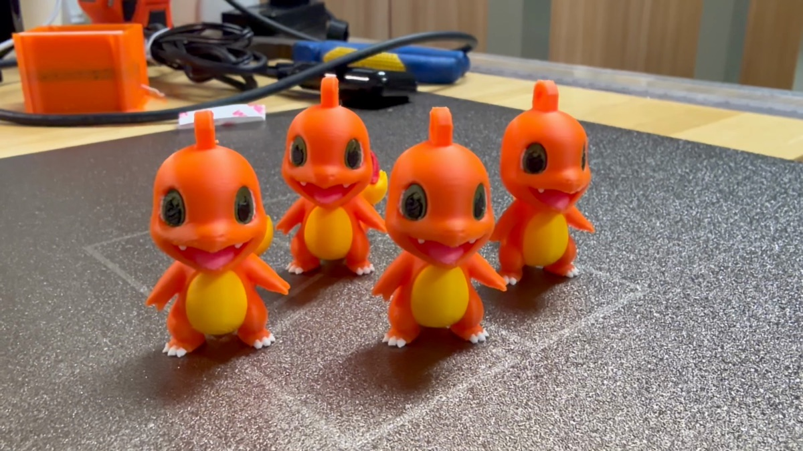

マルチカラーのフィギュアを出力するとき、今回あらためて感じたことです。

- **積み上がる方向から考える。** 口、歯、手、足のようなディテールがなるべく傾かず、空中に張り出さないように置く。
- **サポートは重要な領域だけ。** 自動に任せると、いらない場所にまで全部立てられます。
- **インターフェースはサポート専用フィラメントで。** 外しやすく、触れた面もきれいです。
- 造形方向だけでは無理な形なら、**大きなパーツに分けて出力して、最後に接着するのが** いちばんきれいです。[フシギダネ](/2026/11/07/bulbasaur-15cm-multipart-print/)、[クッパ](/2026/11/07/bowser-multipart-assembly/)、[マリオとルイージ](/2026/11/10/mario-luigi-multipart-assembly/)のときがそうでした。

モデルも同じ、プリンターも同じなのに、
スライサーで姿勢をひとつ変えただけで、これだけ結果が変わりました。

みなさんはフィギュアを出力するとき、造形方向をどう決めていますか？
いいコツがあれば、コメントで教えてください。

## 動画で見る

造形方向の比較から、サポートがポロッと落ちる場面、出力情報まで、ショート動画にまとめました。
韓国語のナレーションが基本で、日本語など6言語の吹き替えと字幕もあります。
BGMは自作の穏やかなオリジナル曲です。

  <iframe src="https://www.youtube.com/embed/RRo-vO9T6Z0?cc_lang_pref=ja&cc_load_policy=1" title="ヒトカゲのキーホルダー、寝かせて印刷したらサポート跡が消えた" style="position: absolute; inset: 0; width: 100%; height: 100%; border: 0;" allow="accelerometer; autoplay; clipboard-write; encrypted-media; gyroscope; picture-in-picture; web-share" allowfullscreen loading="lazy"></iframe>

- YouTubeショート: [ヒトカゲのキーホルダー、寝かせて印刷したらサポート跡が消えた](https://www.youtube.com/shorts/RRo-vO9T6Z0)

## 出力情報

| 出力物 | 個数 | 積層ピッチ | 時間 | フィラメント（予測） |
|---|---|---|---|---|
| ヒトカゲのキーホルダー（高さ4.2 cm、輪を含む） | 4 | 0.20 mm | 2時間30分（実測） | 46.5 g |
| 合計 | 4 | | 2時間30分 | 46.5 g |

- プリンター：Bambu Lab H3C（0.4 mmノズル、1枚に4個）
- フィラメント：Bambu PLA Basic（オレンジ・黄・ピンク）、PLA Matte（白・黒・カーキ・赤）、サポートインターフェースにSupport for PLA
- 時間は実際の出力時間です。フィラメントはBambu Studioのスライサー予測値で、色替えに使うプライムタワー28 gを含みます。Support for PLAのインターフェースを入れる前に保存した設定が基準なので、実際とは少し違う場合があります。
- サポートの比較（4.7 g → 1.1 g）は、同じH3Cの設定で姿勢だけ変えてスライスした予測値です（インターフェースのフィラメントは、どちらの場合も初期値）。

## 出典

- モデル：MakerWorldのAtseiniさんのCharmander Chibi（キーホルダーの輪はモデルを改造して追加）
- キャラクター：ヒトカゲ © Nintendo / Creatures / GAME FREAK、公式グッズではなく、ファンが作ったモデルです
