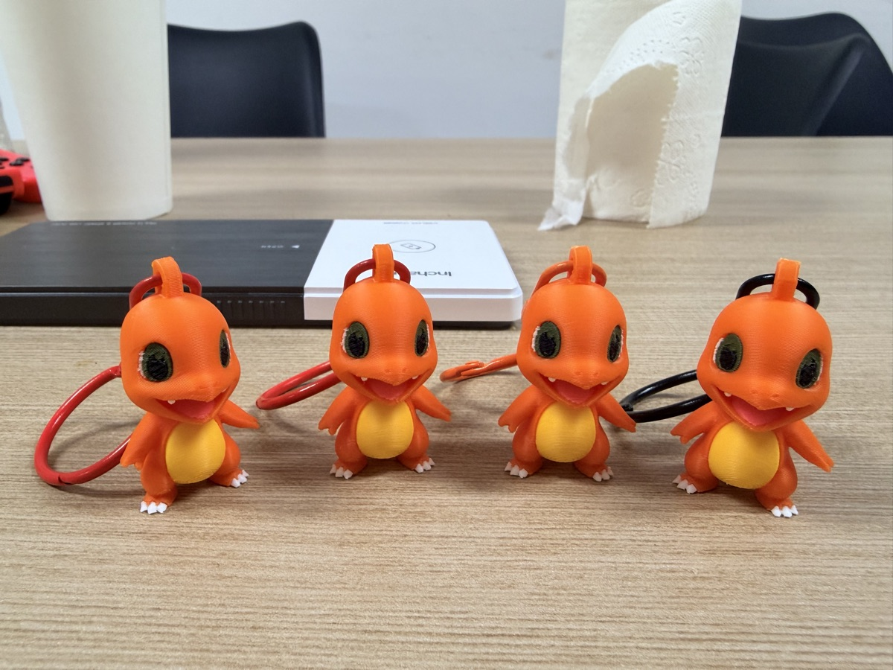

파이리 키링 4마리를 뽑았다 ㅎㅎ

근데 이번 글은 파이리 자랑보다
**출력 방향** 이야기다.

같은 모델인데 어떻게 눕히느냐에 따라
결과물이 이렇게까지 달라지더라.

## 예전에 세워서 뽑았을 때

모델은 MakerWorld에 올라온 Atseini 님의 Charmander Chibi다.
머리가 큼직한 꼬마 파이리.
원작자 프로필대로 열면 이렇게 서 있는 자세로 들어온다.

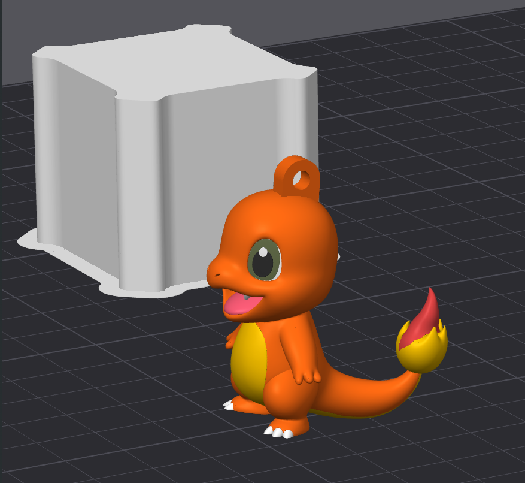

사실 이 파이리는 전에 한 번 이 자세 그대로 뽑아 봤었다.
그때 팔 아래가 서포트 자국으로 꽤 지저분했었다 ㅠㅠ

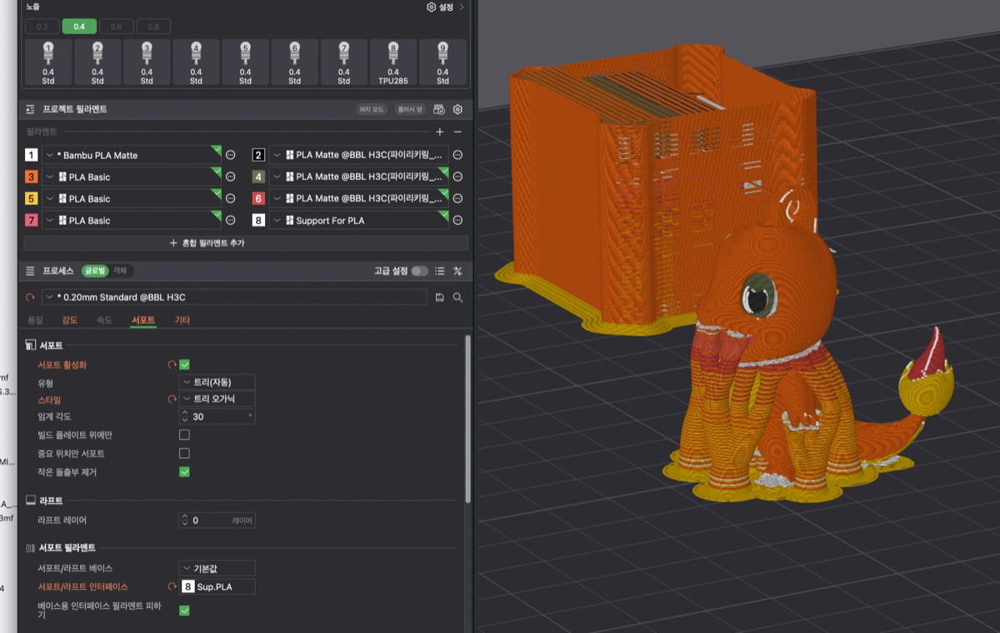

슬라이스해 보면 이유가 바로 보인다.
벌린 입 아래, 눈 둘레, 배, 꼬리 아래, 팔 아래까지 서포트가 빼곡하게 선다.
하필 다 사람 눈에 제일 잘 보이는 자리다.

서포트를 떼고 나면 닿았던 자리가 까슬까슬하게 남는다.
이대로 뽑았으면 입이랑 눈 둘레, 배, 꼬리까지 자국투성이였을 거다.
작은 키링이라 그런 자국이 더 크게 보인다.

## 이번엔 뒤로 눕혔다

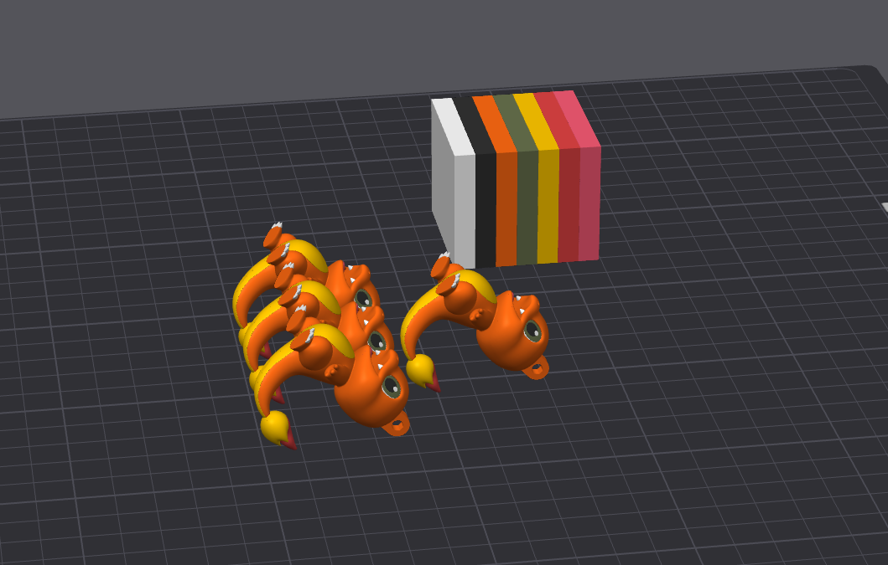

그래서 이번엔 쌓이는 방향부터 생각했다.
3D 프린터는 아래에서 위로 한 층씩 쌓는다.
디테일한 부분이 기울어져서 허공에 매달리면 그 밑에 서포트가 붙는다.
그러니까 입, 이빨, 손, 발 같은 디테일이 최대한 기울어지지 않게 놓으면 되는 거다.

세워 두면 벌린 입 아래, 턱, 팔 아래가 전부 아래로 기울어진 면이다.
그래서 파이리를 뒤로 약 136도 눕혔다.
입과 이빨, 손, 발이 위를 향해 쌓이니까 서포트 없이 그대로 선다.
판에 직접 닿는 건 머리 위에 단 고리 하나뿐이고,
뒤통수랑 꼬리 불꽃 끝만 서포트가 받친다.

서포트 설정도 두 가지 바꿨다.

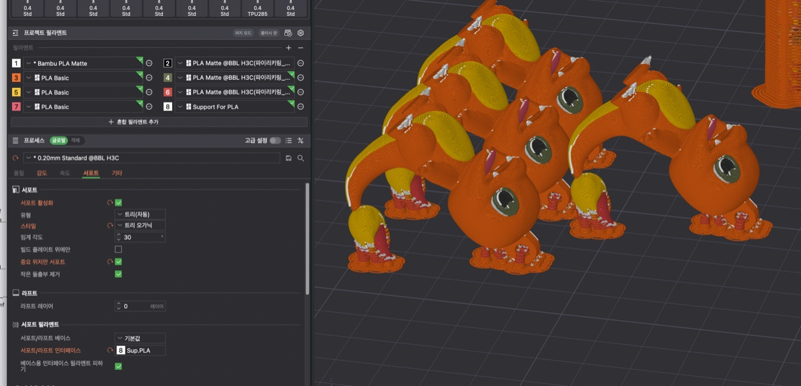

- **중요 위치만 서포트**를 켰다. 꼭 필요한 곳에만 서포트를 세운다.
- 서포트가 모델에 닿는 면(인터페이스)은 **서포트 전용 필라멘트(Support for PLA)** 로. PLA랑 잘 안 붙어서 똑 떨어진다.

나머지는 트리(자동), 오가닉 스타일, 임계 각도 30도 그대로다.

## 숫자로 보면

같은 H3C 설정으로 자세만 바꿔서 슬라이스해 봤다.
4마리 한 판 기준이다.

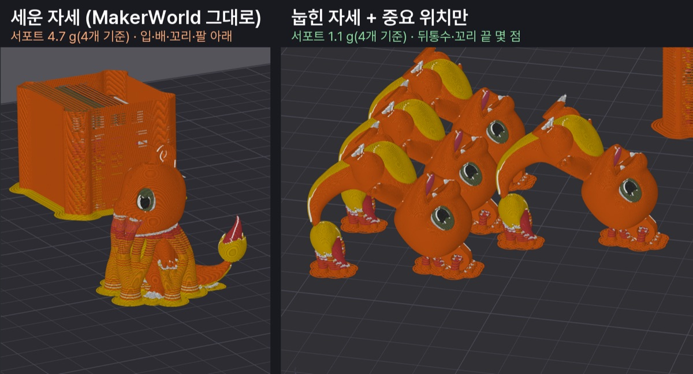

| 자세 | 서포트 | 서포트 닿는 곳 |
|---|---|---|
| 세운 자세(MakerWorld 그대로) | 4.7 g | 입·턱 아래·배·꼬리·팔 아래 |
| 눕힌 자세 + 중요 위치만 | 1.1 g | 뒤통수·꼬리 끝 몇 점 |

서포트가 4분의 1로 줄었다.
근데 진짜 중요한 건 양보다 **자리**다.
남은 서포트가 전부 뒤통수 쪽이라 떼고 나도 앞에서는 안 보인다.

출력 시간은 거의 그대로였다.
눕히면 높이가 4.2 cm에서 5.7 cm로 올라가서 층이 늘어나니까.
시간을 아끼는 방법은 아니고, 품질을 챙기는 방법인 거다.

## H3C로 4마리, 2시간 30분

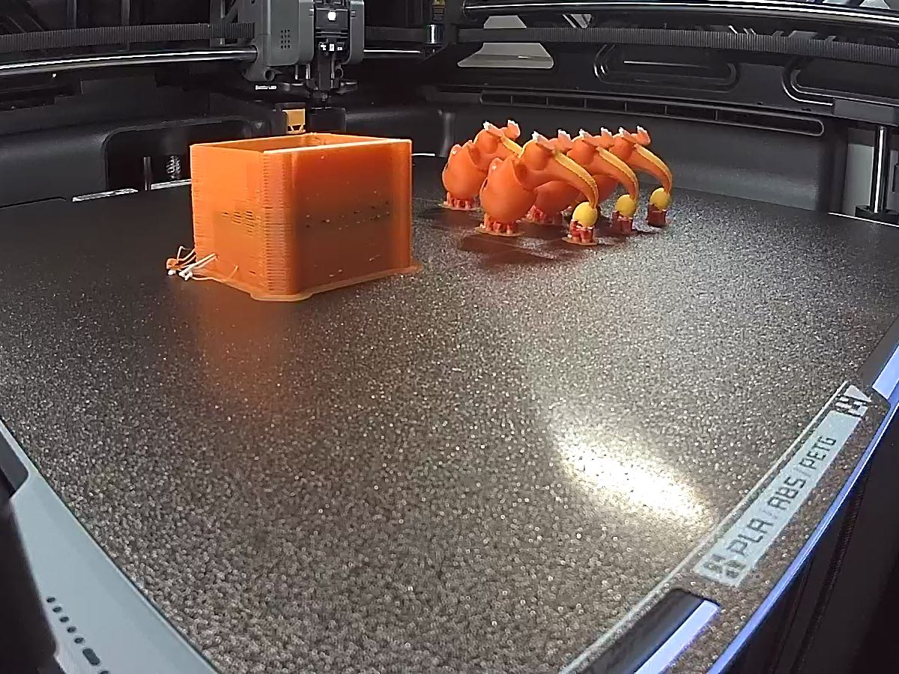

색이 7가지라 예전 같으면 걱정부터 했을 거다.
H3C는 색마다 노즐이 따로라 그냥 한 판에 4마리 올리고 걸었다.
실제로 2시간 30분 걸렸다.

## 떼어 보니

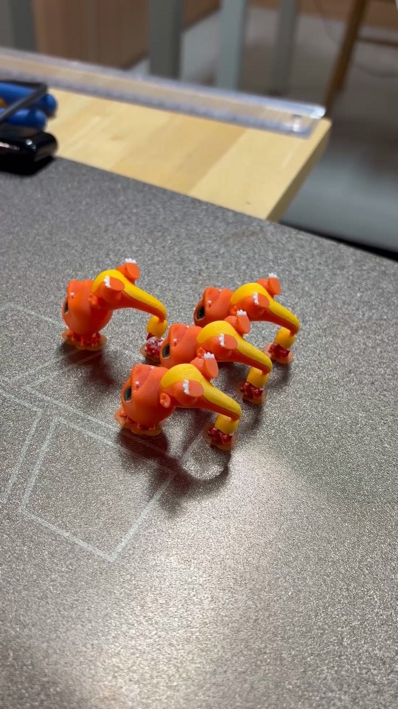

판 위에 다 같이 누워 있는 모습이 좀 웃기다 ㅋㅋ
배를 내밀고 일광욕하는 것 같다.

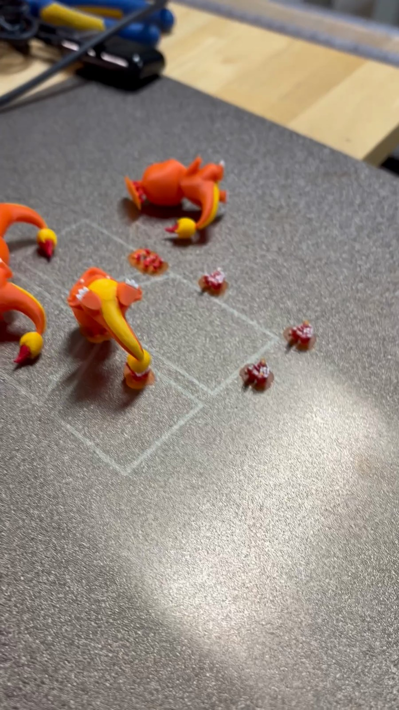

판에서 떼니까 서포트는 따로 제거할 것도 없이 그냥 톡 떨어졌다.
판 위에 남은 건 저 작은 조각 몇 개가 전부다.
세워서 뽑았으면 입 아래며 팔 아래 서포트를 하나하나 힘들게 떼어내야 했을 거다.
이번엔 그 수고가 아예 없다 ㅎㅎ

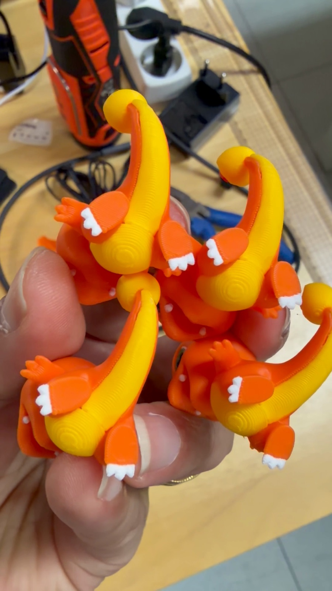

세워서 뽑으면 서포트가 붙는 배와 꼬리 아랫면이다.
이번엔 위를 향해 쌓여서 서포트가 아예 안 닿았다.
노란 배 줄무늬까지 깔끔하다.

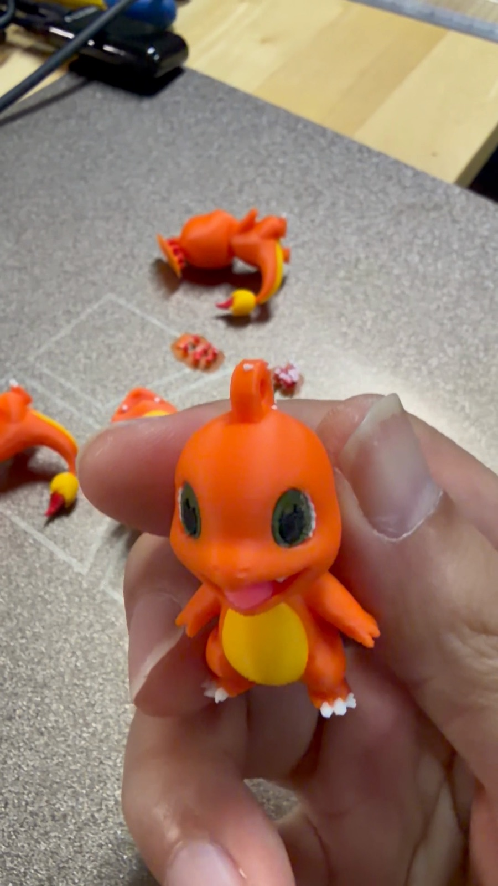

얼굴은 이렇다.
눈 테두리, 벌린 입, 작은 이빨, 혀, 손가락, 하얀 발톱까지 다 살아 있다.
4 cm짜리 키링인데 이 정도면 만족이다 ㅎㅎ

솔직히 뒤통수엔 서포트 닿았던 결이 살짝 남았다.
근데 그건 뒤통수라 키링으로 달고 다니면 아무도 안 본다.
디테일 쪽에 붙을 서포트를 뒤통수가 대신 떠안은 셈이다.

## 고리는 모델을 고쳐서 만들었다

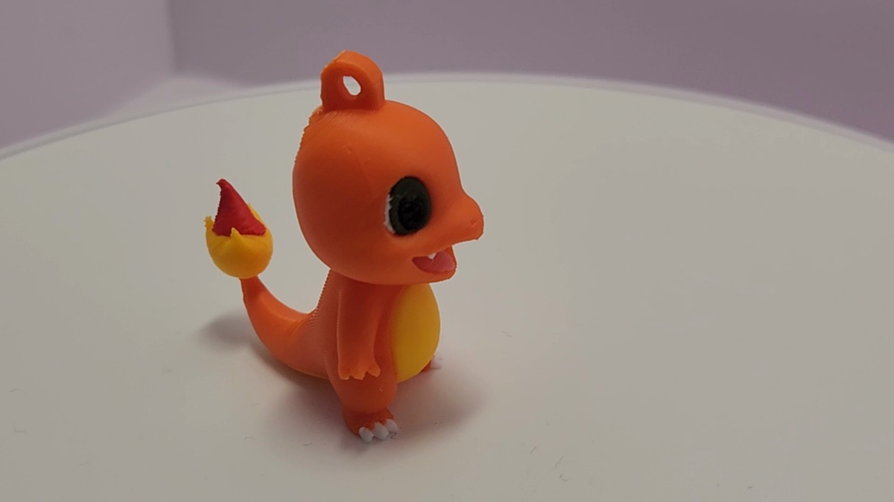

원래 모델은 피규어라 키링 고리가 없다.
그래서 메이커월드 모델을 수정해서 머리 위에 작은 고리를 만들었다.
구멍은 3 mm, 좌우로 뚫어서 가방에 달면 얼굴이 정면을 본다.

이 고리가 눕힌 자세에서는 판에 닿는 발 노릇까지 해 줬다.
덤으로 얻은 거다 ㅋㅋ

## 정리하면

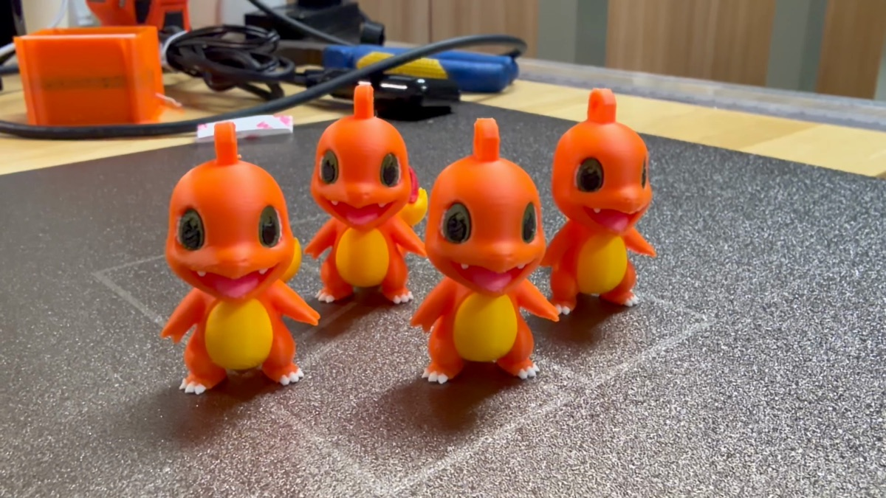

다색 피규어 뽑을 때 이번에 다시 느낀 것들이다.

- **쌓이는 방향부터 생각한다.** 입, 이빨, 손, 발 같은 디테일이 최대한 기울어지지 않게, 허공에 매달리지 않게 놓는다.
- **서포트는 중요 위치만.** 자동으로 두면 필요 없는 데까지 다 세운다.
- **인터페이스는 서포트 전용 필라멘트로.** 떼기 쉽고 닿은 면이 깨끗하다.
- 출력 방향만으로 안 되는 모양이면 **큰 파트로 나눠서 뽑고 마지막에 붙이는 게** 제일 깔끔하다. [이상해씨](/2026/11/07/bulbasaur-15cm-multipart-print/), [쿠파](/2026/11/07/bowser-multipart-assembly/), [마리오와 루이지](/2026/11/10/mario-luigi-multipart-assembly/) 때가 그랬다.

모델도 같고 프린터도 같은데
슬라이서에서 자세 하나 바꾼 걸로 결과물이 이만큼 달라졌다.

다들 피규어 뽑을 때 출력 방향 어떻게 잡으세요?
좋은 요령 있으면 댓글로 알려 주세요 ㅎㅎ

## 영상으로 보기

출력 방향 비교부터 서포트가 톡 떨어지는 장면, 출력 정보까지 쇼츠로 담았다.
한국어 내레이션이 기본이고, 영어·일본어 등 6개 언어 더빙과 자막도 있다.
배경음악은 직접 만든 잔잔한 곡이다.

  <iframe src="https://www.youtube.com/embed/RRo-vO9T6Z0" title="파이리 키링, 눕혀서 뽑았더니 서포트 자국이 사라졌다" style="position: absolute; inset: 0; width: 100%; height: 100%; border: 0;" allow="accelerometer; autoplay; clipboard-write; encrypted-media; gyroscope; picture-in-picture; web-share" allowfullscreen loading="lazy"></iframe>

- 유튜브 쇼츠: [파이리 키링, 눕혀서 뽑았더니 서포트 자국이 사라졌다](https://www.youtube.com/shorts/RRo-vO9T6Z0)

## 출력 정보

| 출력물 | 개수 | 층 높이 | 시간 | 필라멘트(예상) |
|---|---|---|---|---|
| 파이리 키링(높이 4.2 cm, 고리 포함) | 4 | 0.20 mm | 2시간 30분(실측) | 46.5 g |
| 합계 | 4 | | 2시간 30분 | 46.5 g |

- 프린터: Bambu Lab H3C (0.4 mm 노즐, 한 판에 4개)
- 필라멘트: Bambu PLA Basic(주황·노랑·분홍), PLA Matte(흰색·검정·카키·빨강), 서포트 인터페이스 Support for PLA
- 시간은 실제 출력 시간이다. 필라멘트는 Bambu Studio 슬라이서 예상값이고, 색 바꿀 때 쓰는 프라임 타워 28 g이 포함돼 있다. Support for PLA 인터페이스를 넣기 전에 저장한 설정 기준이라 실제와 조금 다를 수 있다.
- 서포트 비교(4.7 g → 1.1 g)는 같은 H3C 설정에서 자세만 바꿔 슬라이스한 예상값이다(인터페이스 필라는 두 경우 모두 기본값).

## 출처

- 모델: MakerWorld Atseini 님의 Charmander Chibi (키링 고리는 모델을 수정해서 추가)
- 캐릭터: 파이리 © Nintendo / Creatures / GAME FREAK — 공식 상품이 아니라 팬이 만든 모델이다
