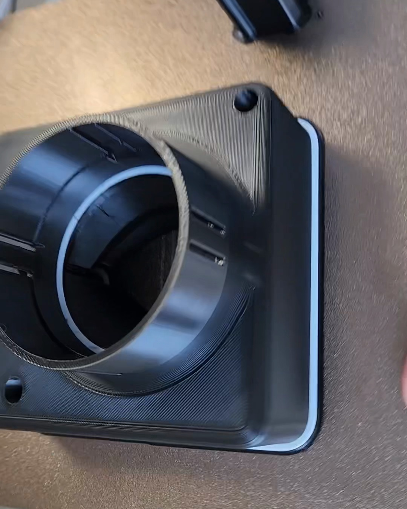
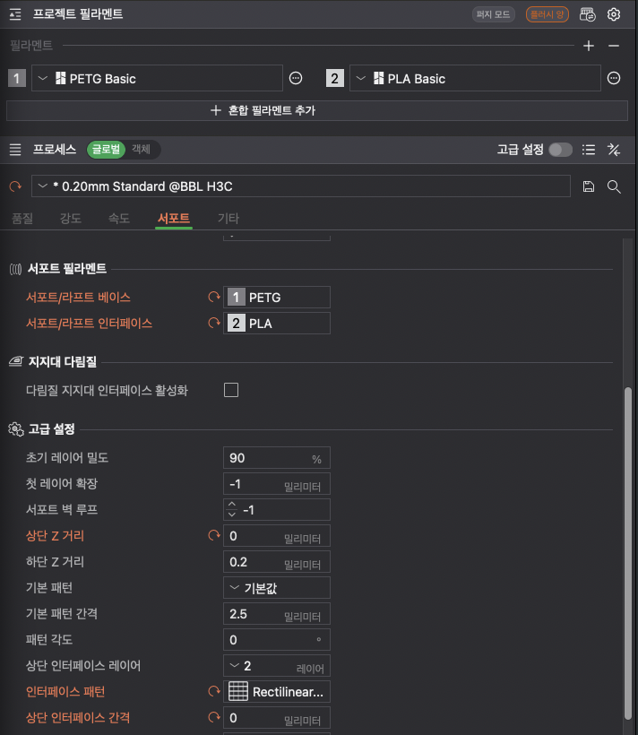
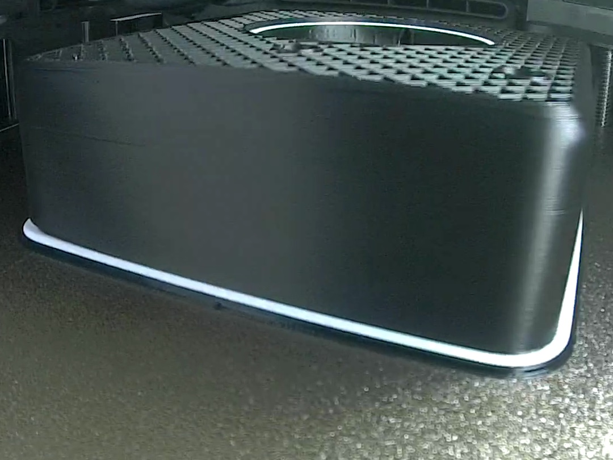
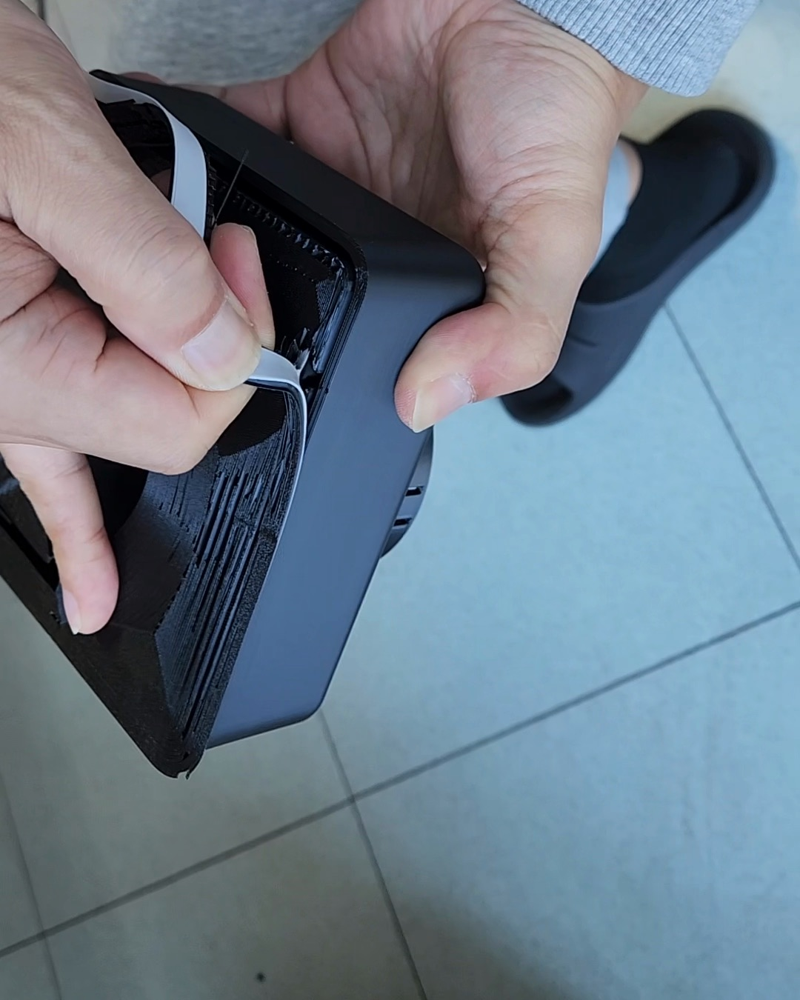
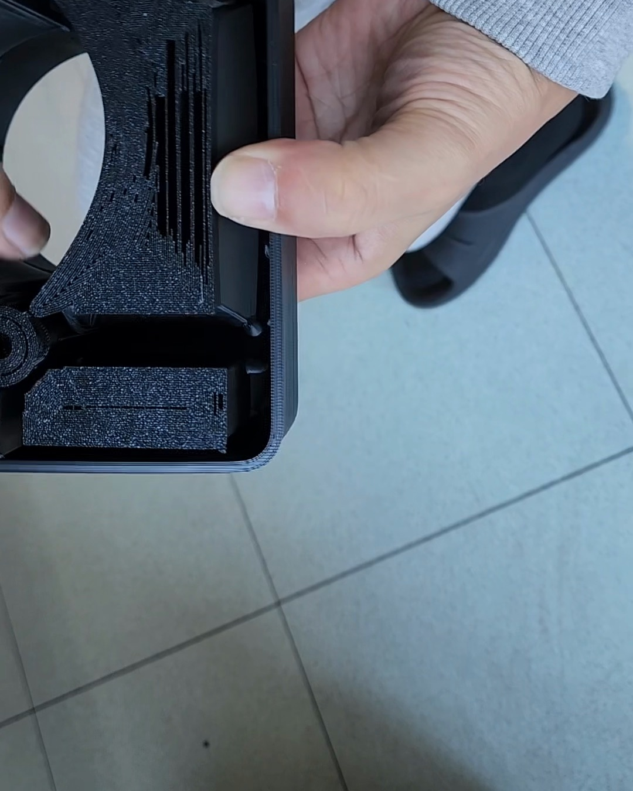
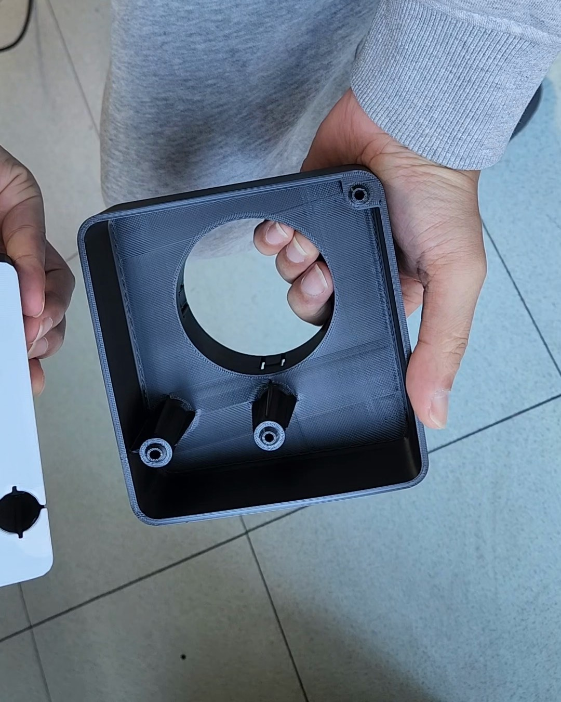
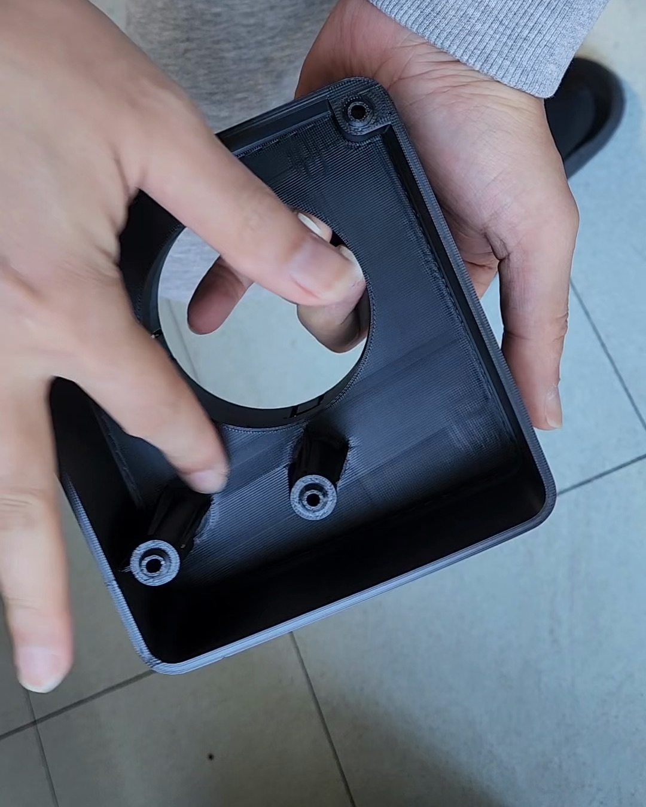
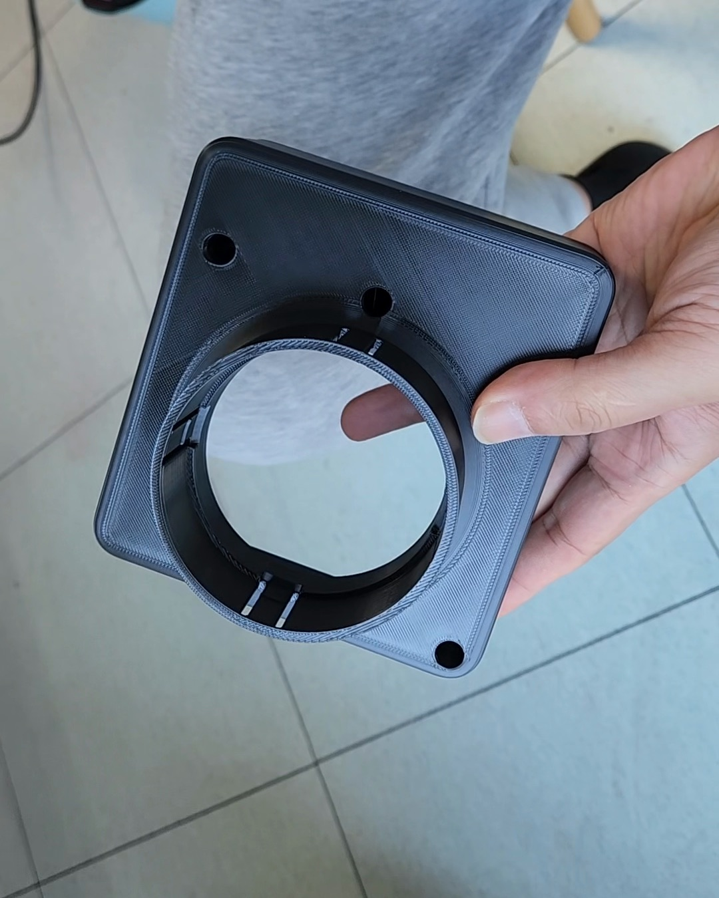

Among the models Bambu Lab posted on MakerWorld themselves,
there's an air purifier hose adapter.
I downloaded the H3C profile and opened it, and... huh?

The body is PETG,
but the part of the support that touches the model is set to PLA.
And it's not a dedicated support filament, just regular PLA Basic.

I wondered if that could really work,
so I went through the settings one by one and printed it for real.

## What dual-material supports are

Supports are usually printed in the same filament as the model.
To make them removable, you leave a gap of about 0.2 mm right under the model.
Because of that gap, the surface the support touches sags a bit and comes out rough.

With dual-material supports, only the part that touches the model (the interface) is printed in a different material.
PETG and PLA barely stick to each other even when melted together.
So you can print them with no gap at all, and they still come apart later.
With no gap, the underside doesn't sag and comes out flat.

Yesterday's [Charmander keychain](/en/2026/11/21/charmander-print-orientation/) was a PLA model, so I used a dedicated support filament (Support for PLA) for the interface.
This time the body is PETG, so plain PLA plays that role.

## Only 7 settings changed

Open the 3MF and only 7 values differ from the default preset (0.20mm Standard @BBL H3C).
In Studio, changed items show their names in orange.

| Setting (Studio English UI) | Default | Official file |
|---|---|---|
| Enable support | Off | On |
| Support/raft base | Default (the filament in use at the time) | Filament 1, PETG |
| Support/raft interface | Default | Filament 2, PLA |
| Top Z distance | 0.2 mm | 0 |
| Top interface spacing | 0.5 mm | 0 |
| Interface pattern | Default | Rectilinear Interlaced |
| Independent support layer height | On | Off |

Going through them one by one:

- **The support body is locked to PETG.** Left at default, the body is printed in whatever filament happens to be active, so materials and colors can get mixed.
- **PLA only on the 2 layers touching the model.** That's why it uses just 7.6 g of PLA.
- **Top Z distance 0, top interface spacing 0.** Lay down a solid sheet of PLA with no gaps, then put PETG straight on top.
- **Independent support layer height off.** The support layers have to match the model's layer height for 0 to really mean 0.

Everything else is left at defaults, like Tree (auto) and a 30 degree threshold angle.
No per-object settings, no painted supports.
Where to put the supports is left entirely to the slicer.

## The model's shape helps too

The settings are this simple, so why does it work so well? I took the model apart too.

In the print orientation, I measured the faces that need support (undersides flatter than 30 degrees),
and about 97 % of them are perfectly flat, concentrated at just two heights.

| Height | What the support holds up | Area |
|---|---|---|
| 2 mm | Underside of the cover rim | 1,726 mm² |
| 42 mm | Inside of the cover ceiling | 10,104 mm² |

The PLA layers only appear at those two heights, so there are just 6 filament changes.
The duct stands upright, so all the supports are hidden inside the cover.
There's nowhere on the outer surface for support marks to land.

The funny part is that the only things touching the plate directly are 3 small 2 mm nubs under the rim.
The whole underside of the rim floats 2 mm up and is printed on top of the PLA.

So it's less a model tuned for supports
and more a mechanical part made mostly of flat faces, which is why this method works so well.

## Black PETG with white PLA

The original file uses gray and light gray, which are hard to tell apart.
So I printed the body in black PETG and the contact layer in white PLA.
The white line you can see under the rim is the PLA layer.

The H3C has a separate nozzle for each filament, so switching between the two materials is almost no burden.

## Taking it off

After taking it off the plate and flipping it over, there's a band of white PLA stuck under the rim.

Lift one end a little and it peels right off, haha
No knife, no pliers needed.

The inside of the cover is packed with PETG tree supports.
I grabbed it and pulled, and it came out in one chunk.

The top of the removed support is white (left).
The PLA contact layer that was touching the ceiling came out as one sheet, still attached to the support.
Even the holes where the inner pillars sit are cleanly open.

This is the inside of the ceiling.
Where supports were removed is usually left rough, but here it's flat.
Up close you can see a faint imprint of the contact layer's grid pattern.
Still, nothing sags.

## Using it on other models

- **Parts with wide, flat undersides at only a few heights** are ideal. Mounting faces, cover ceilings, rim undersides, that kind of thing.
- **If overhangs are scattered across many heights, like on a figure,** each PLA layer means a filament change, so efficiency drops.
- **Single-nozzle printers** (like the P2S and A2L) generate purge waste at every change. For this model, one PETG-to-PLA round trip costs about 0.7 g, and with 3 round trips that's roughly 2 g extra.
- **The support body is just PETG, so it isn't free.** On this model the support body alone is 95.8 g, almost the same as the model itself (106.4 g). Sigh.
- In principle a PETG contact layer under a PLA body should work too, but I haven't tried that yet.

## Summary

- PETG and PLA don't bond to each other. Use that for supports, and they come off even with the top Z distance at 0.
- Regular PLA works, no dedicated support filament needed.
- 7 settings to change. Locking the support body filament to the body material matters more than it looks.
- The flatter the model's faces, the better it fits.

I opened one official file and learned a lot, haha

How do you remove PETG supports?
If you've tried dual-material supports, let me know in the comments.

## Watch the video

I put the white PLA peeling off, the support settings, and the print info into a short.
The narration is in Korean, with English and five more dubbed tracks and subtitles.
The background music is a calm original track I made.

  <iframe src="https://www.youtube.com/embed/wyGlZ6_S4aE?cc_lang_pref=en&cc_load_policy=1" title="PLA Under PETG: Supports Peel Right Off" style="position: absolute; inset: 0; width: 100%; height: 100%; border: 0;" allow="accelerometer; autoplay; clipboard-write; encrypted-media; gyroscope; picture-in-picture; web-share" allowfullscreen loading="lazy"></iframe>

- YouTube Short: [PLA Under PETG: Supports Peel Right Off](https://www.youtube.com/shorts/wyGlZ6_S4aE)

## Print info

| Print | Qty | Layer height | Time (est.) | Filament (est.) |
|---|---|---|---|---|
| Air purifier hose adapter (133.8 × 125.4 × 78.1 mm) | 1 | 0.20 mm | 6 h 16 min | PETG 212.6 g + PLA 7.6 g |
| Total | 1 | | 6 h 16 min | 220.2 g |

- Printer: Bambu Lab H3C (0.4 mm nozzle)
- Filament: Bambu PETG Basic black (body and support body), Bambu PLA Basic white (support contact layer only)
- The time and filament weight are estimates from slicing in Bambu Studio with the official file's settings as they are. The PETG figure includes 95.8 g of support body and 10.3 g of prime tower.

## Sources

- Model and print profile: Bambu Lab (E1 Air Purifier Hose Adapter, H3C profile)
