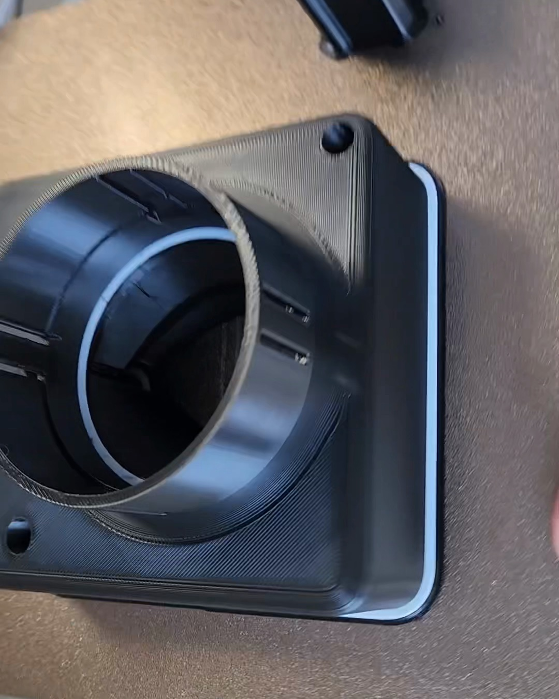
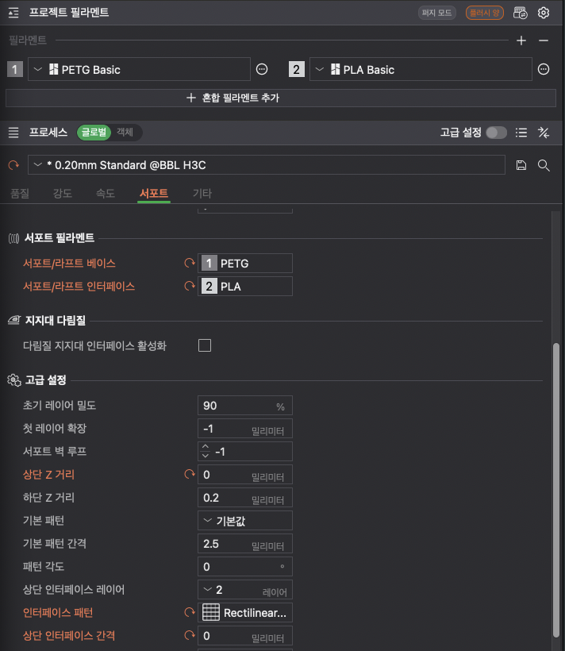
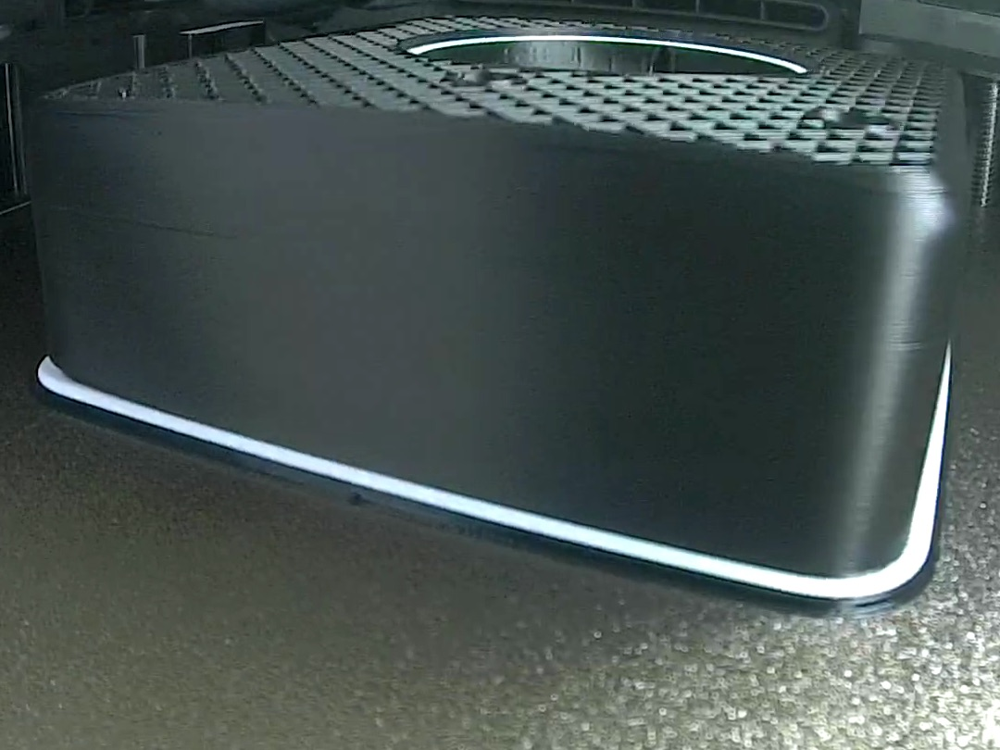
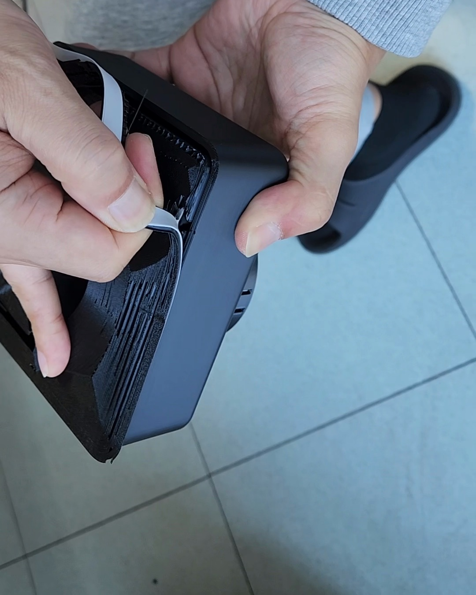
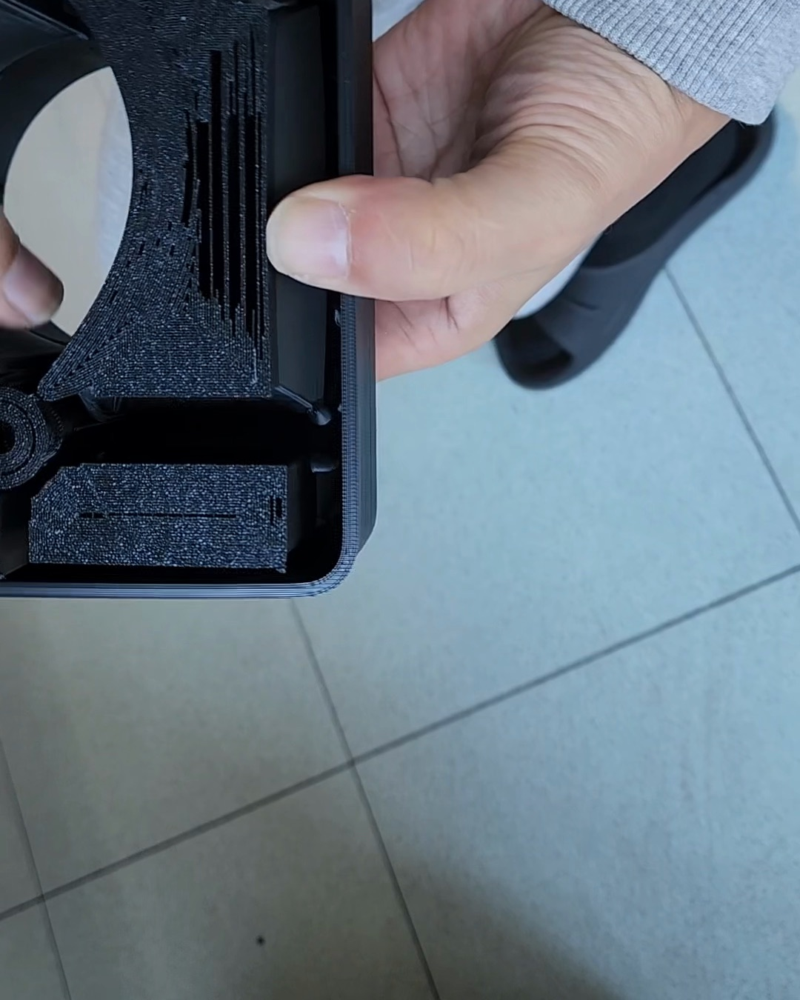
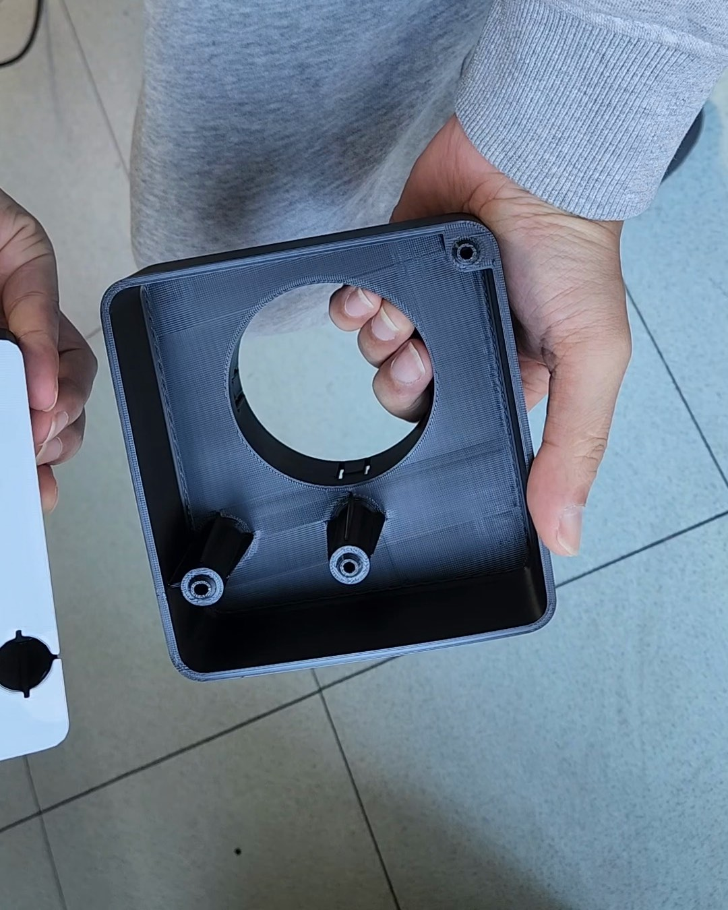
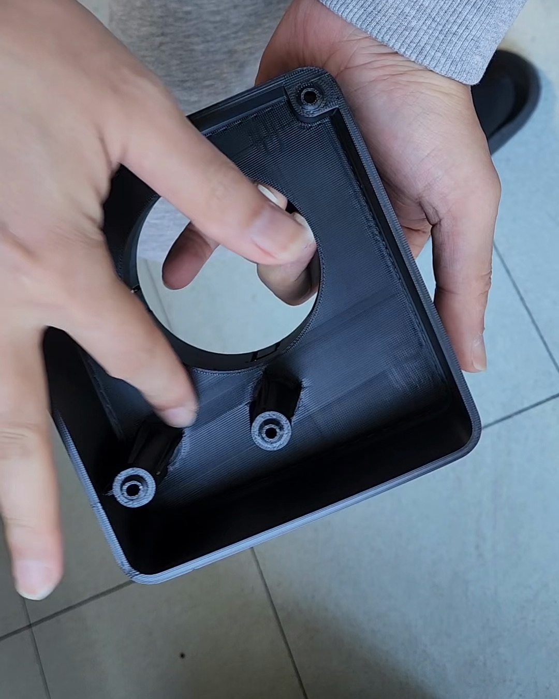
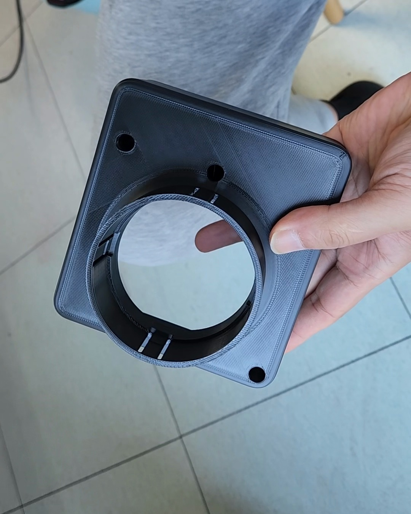

Bambu LabがMakerWorldに自分で公開しているモデルの中に、
空気清浄機のホースアダプターがあります。
H3C用のプロファイルをダウンロードして開いてみたところ、あれ？

本体はPETGなのに、
サポートがモデルに触れる面だけPLAになっていました。
サポート専用フィラメントでもなく、ごく普通のPLA Basicです。

本当にこれで大丈夫なのかと思って、設定を一つずつ確かめて、
実際に出力してみました。

## 異種サポートとは

サポートは普通、モデルと同じフィラメントで出力します。
そのかわり、あとで外せるようにモデルの真下を0.2 mmほど空けます。
その隙間のせいで、サポートが触れた面は少したれて、ざらざらになります。

異種サポートは、サポートがモデルに触れる面（インターフェース）だけを別の素材で出力する方法です。
PETGとPLAは、溶かして重ねてもほとんどくっつきません。
だから隙間なしでぴったり接して出力しても、あとで外れます。
隙間がないので、底面がたれずに平らに仕上がります。

昨日の[ヒトカゲのキーホルダー](/ja/2026/11/21/charmander-print-orientation/)はPLAのモデルだったので、インターフェースにサポート専用フィラメント（Support for PLA）を使いました。
今回は本体がPETGなので、普通のPLAがその役目をします。

## 変えた設定はたったの7つ

3MFを開くと、初期のプリセット（0.20mm Standard @BBL H3C）から変えた値は7つだけです。
Studioでも、変更した項目は名前がオレンジ色で表示されます。

| 設定（Studioの日本語表示） | 初期値 | 公式ファイル |
|---|---|---|
| 有効化（サポート） | オフ | オン |
| サポート/ラフトベース | デフォルト（そのとき使っているフィラメント） | 1番 PETG |
| サポート/ラフトインターフェース | デフォルト | 2番 PLA |
| トップ面とのZ間隔 | 0.2 mm | 0 |
| トップ接触面間隔 | 0.5 mm | 0 |
| 接触面パターン | デフォルト | 直線インターレース |
| 独立サポート層ピッチ | オン | オフ |

一つずつ見ていきます。

- **サポート本体はPETGに固定。** デフォルトのままだと、そのとき使っているフィラメントで本体を出力するので、色や素材が混ざることがあります。
- **PLAはモデルに触れる2層だけ。** だからPLAは7.6 gしか使いません。
- **トップ面とのZ間隔0、トップ接触面間隔0。** PLAを隙間なく1枚敷いて、その上にPETGをそのまま載せます。
- **独立サポート層ピッチはオフ。** サポートの層をモデルの層の高さに合わせてこそ、0が本当に0になります。

残りは、ツリー (自動)、しきい角度30度などの初期値のままです。
オブジェクトごとの設定も、サポートのペイントもありません。
サポートをどこに立てるかは、スライサーに任せています。

## モデルの形も効いている

設定がこんなに単純なのに、なぜうまくいくのか気になって、モデルも調べてみました。

出力姿勢のまま、サポートが必要な面（30度より寝ている下向きの面）を測ると、
約97 %が完全に平らで、ちょうど2つの高さに集まっていました。

| 高さ | サポートが支える場所 | 面積 |
|---|---|---|
| 2 mm | カバーの縁の下面 | 1,726 mm² |
| 42 mm | カバーの天井の内側 | 10,104 mm² |

PLAの層はこの2つの高さにしかできないので、フィラメントの交換も6回で済みます。
ダクトを上向きに立てているので、サポートはすべてカバーの内側に隠れます。
外側の面には、サポート跡が残る場所がありません。

おもしろいのは、プレートに直接触れるのが、縁の下の2 mmの小さな突起3つだけということです。
縁の下面全体が2 mm浮いて、PLAの上に出力されます。

つまり、サポートのために特別に作り込んだモデルというより、
平らな面が中心の機械部品だから、この方法がよく効くのです。

## 黒いPETGに白いPLAで出力した

元のファイルは灰色と明るい灰色で、2つの区別がつきにくいです。
そこで本体は黒いPETG、接触面は白いPLAに変えて出力しました。
縁の下に見える白い線が、PLAの層です。

H3Cはフィラメントごとにノズルが分かれているので、2つの素材を行き来してもほとんど負担がありません。

## 外してみると

プレートから外して裏返すと、縁の下に白いPLAが帯のように付いています。

端を少し持ち上げると、するっと剥がれました。
カッターもペンチも要りませんでした。

カバーの内側は、PETGのツリーサポートでぎっしり埋まっています。
つかんで引っぱると、かたまりのまま抜けました。

抜いたサポートの上面は白いです（左）。
天井に触れていたPLAの接触面が、サポート側にくっついたまま、1枚で抜けました。
内側の柱の位置の穴まで、そのまま開いています。

天井の内側です。
普通はサポートを外した跡がざらざらに残りますが、ここは平らです。
近くで見ると、接触面の格子の目がうっすら写っています。
それでも、たれたところはありません。

## ほかのモデルで使うなら

- **広くて平らな底面が、いくつかの高さにだけある部品** がぴったりです。取り付け面、カバーの天井、縁の下面などです。
- **フィギュアのようにオーバーハングがいろいろな高さに散らばっていると、** PLAの層ごとに交換が発生して、効率が落ちます。
- **ノズルが1つのプリンター**（P2SやA2Lなど）は、交換のたびにパージが出ます。このモデルの場合、PETG↔PLAの往復1回で0.7 gほど、3往復なので2 gくらい余計にかかります。
- **サポート本体は普通のPETGなので、タダではありません。** このモデルはサポート本体だけで95.8 gです。モデル（106.4 g）とほぼ同じです。トホホ。
- 逆に、PLA本体にPETGの接触面も、原理的にはできるはずですが、それはまだ試していません。

## まとめ

- PETGとPLAはくっつきません。これをサポートに使うと、トップ面とのZ間隔を0にして接していても外れます。
- サポート専用フィラメントがなくても、普通のPLAでできます。
- 変える設定は7つ。サポート本体のフィラメントを本体と同じに固定するのが、意外と大事です。
- モデルが平らな面中心であるほど、よく合います。

公式ファイルを1つ開いただけなのに、学ぶことがたくさんありました。

みなさんはPETGのサポートをどうやって外していますか？
異種サポートを試した方がいたら、コメントで教えてください。

## 動画で見る

白いPLAがするっと剥がれる場面から、サポート設定、出力情報まで、ショート動画にまとめました。
韓国語のナレーションが基本で、日本語など6言語の吹き替えと字幕もあります。
BGMは自作の穏やかなオリジナル曲です。

  <iframe src="https://www.youtube.com/embed/wyGlZ6_S4aE?cc_lang_pref=ja&cc_load_policy=1" title="PETGの下にPLAを敷いたらサポートがするっと剥がれた" style="position: absolute; inset: 0; width: 100%; height: 100%; border: 0;" allow="accelerometer; autoplay; clipboard-write; encrypted-media; gyroscope; picture-in-picture; web-share" allowfullscreen loading="lazy"></iframe>

- YouTubeショート: [PETGの下にPLAを敷いたらサポートがするっと剥がれた](https://www.youtube.com/shorts/wyGlZ6_S4aE)

## 出力情報

| 出力物 | 個数 | 積層ピッチ | 時間（予測） | フィラメント（予測） |
|---|---|---|---|---|
| 空気清浄機のホースアダプター（133.8 × 125.4 × 78.1 mm） | 1 | 0.20 mm | 6時間16分 | PETG 212.6 g + PLA 7.6 g |
| 合計 | 1 | | 6時間16分 | 220.2 g |

- プリンター：Bambu Lab H3C（0.4 mmノズル）
- フィラメント：Bambu PETG Basic 黒（本体・サポート本体）、Bambu PLA Basic 白（サポートの接触面のみ）
- 時間とフィラメントは、公式ファイルの設定のままBambu Studioでスライスした予測値です。PETGにはサポート本体95.8 gとプライムタワー10.3 gが含まれています。

## 出典

- モデル・出力プロファイル：Bambu Lab（E1 Air Purifier Hose Adapter、H3Cプロファイル）
