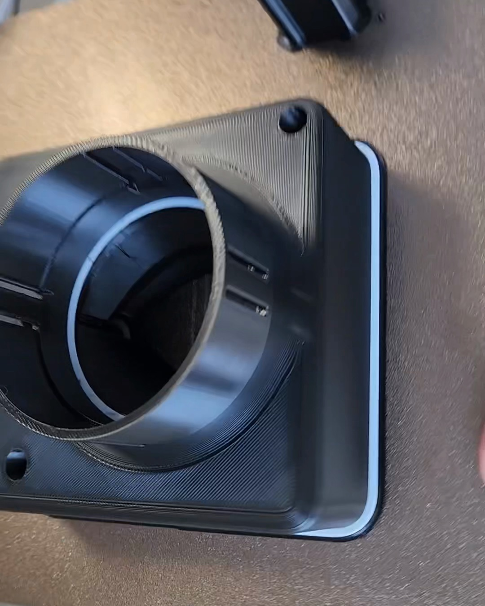
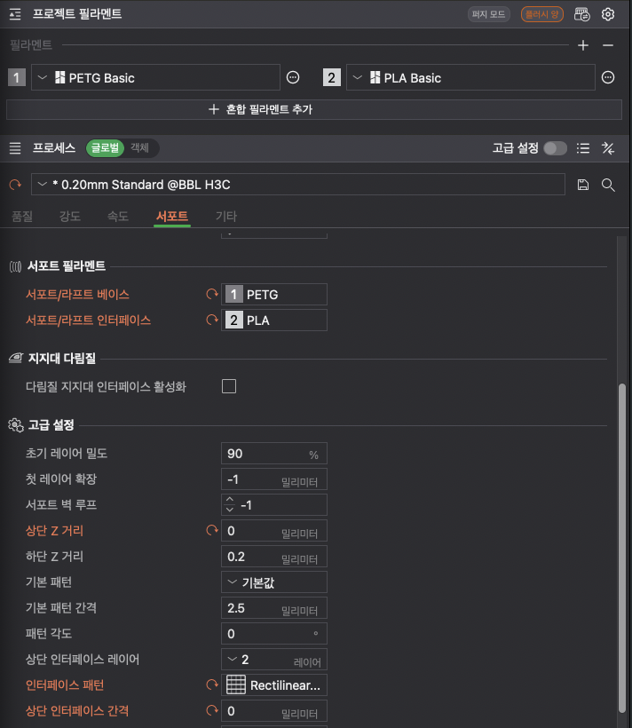
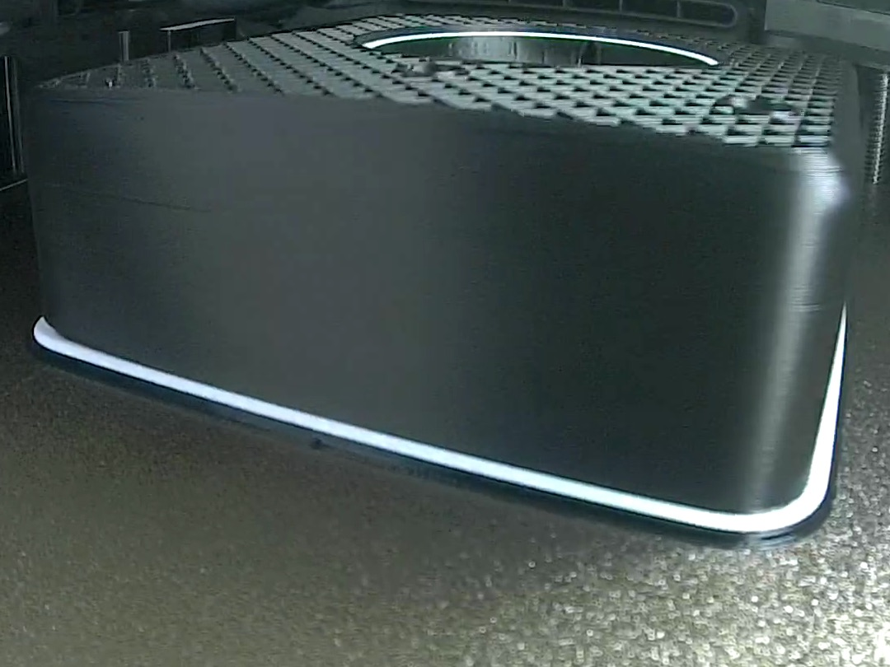
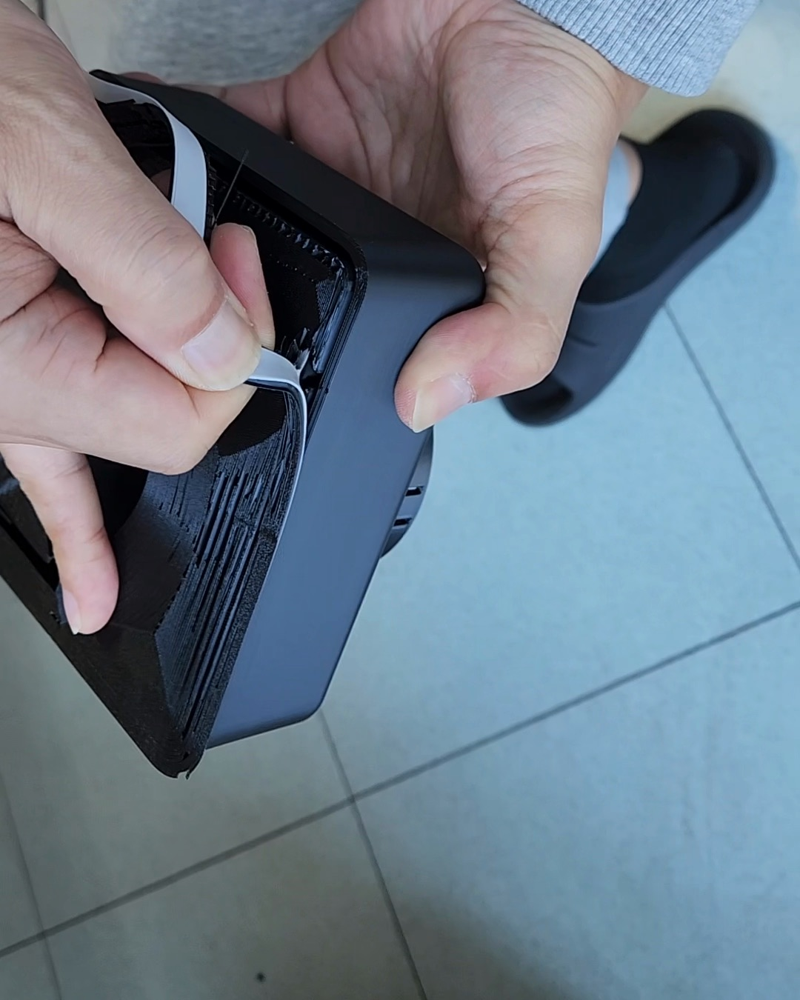
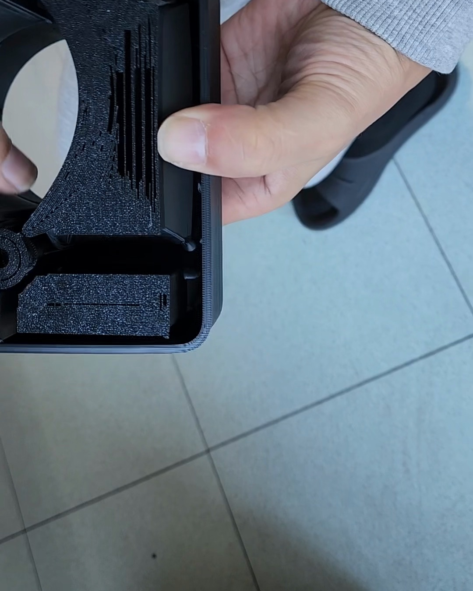
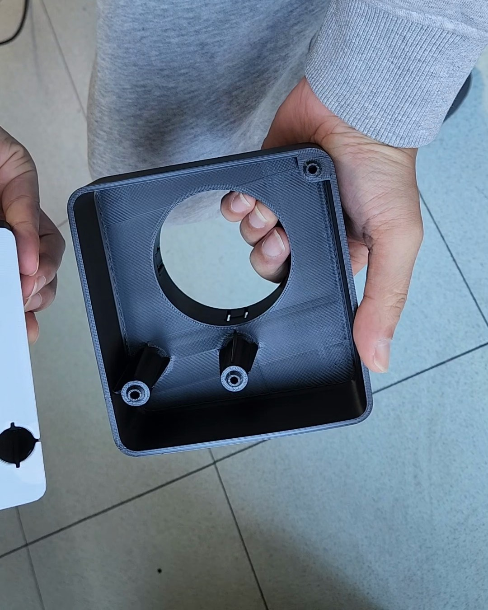
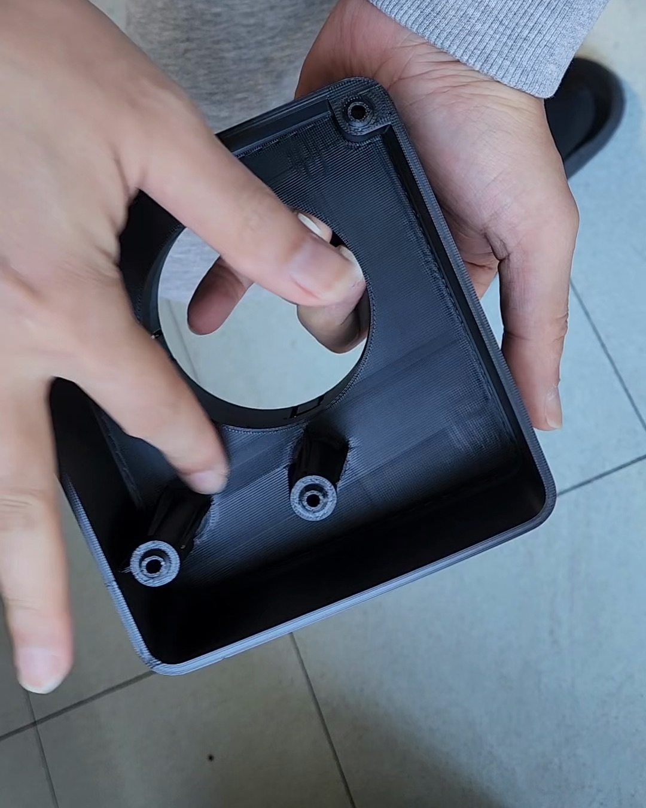
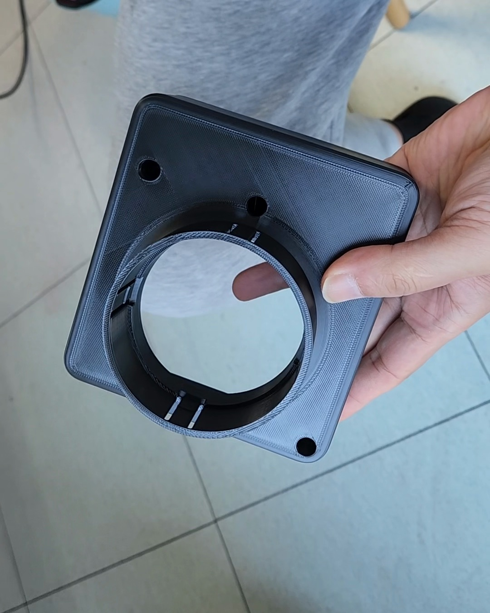

뱀부랩이 MakerWorld에 직접 올린 모델 중에
공기청정기 호스 어댑터가 있다.
H3C용 프로필을 받아서 열어 봤는데... 어라?

본체는 PETG인데
서포트가 모델에 닿는 면만 PLA로 잡혀 있더라.
지지대 전용 필라멘트도 아니고 그냥 일반 PLA Basic이다.

이게 되나 싶어서 설정을 하나하나 뜯어보고
진짜로 뽑아 봤다 ㅎㅎ

## 이종 서포트가 뭐냐면

서포트는 보통 모델이랑 같은 필라멘트로 뽑는다.
대신 나중에 떼라고 모델 바로 아래를 0.2 mm쯤 띄운다.
그 틈 때문에 서포트가 닿은 면은 살짝 처지고 거칠어진다.

이종 서포트는 서포트가 모델에 닿는 면(인터페이스)만 다른 재료로 뽑는 거다.
PETG랑 PLA는 녹여서 붙여도 서로 거의 안 붙는다.
그래서 틈 없이 딱 붙여서 뽑아도 나중에 떨어진다.
틈이 없으니 밑면이 처지지 않고 평평하게 나온다.

어제 [파이리 키링](/2026/11/21/charmander-print-orientation/)은 PLA 모델이라 인터페이스에 서포트 전용 필라멘트(Support for PLA)를 썼었다.
이번엔 본체가 PETG라서 그냥 PLA가 그 역할을 하는 거다.

## 바꾼 설정은 딱 7개

3MF를 열어 보면 기본 프리셋(0.20mm Standard @BBL H3C)에서 바꾼 값이 7개뿐이다.
Studio에서도 바꾼 항목은 이름이 주황색으로 보인다.

| 설정(Studio 한국어 화면) | 기본값 | 공식 파일 |
|---|---|---|
| 서포트 활성화 | 끔 | 켬 |
| 서포트/라프트 베이스 | 기본(그때 쓰는 필라) | 1번 PETG |
| 서포트/라프트 인터페이스 | 기본 | 2번 PLA |
| 상단 Z 거리 | 0.2 mm | 0 |
| 상단 인터페이스 간격 | 0.5 mm | 0 |
| 인터페이스 패턴 | 기본값 | Rectilinear 인터레이스 |
| 독립 서포트 레이어 높이 | 켬 | 끔 |

하나씩 보면 이렇다.

- **서포트 몸통은 PETG로 고정.** 기본값으로 두면 그때 쓰던 필라로 몸통을 뽑아서 색이랑 재료가 섞일 수 있다.
- **PLA는 모델에 닿는 2개 층에만.** 그래서 PLA는 7.6 g밖에 안 든다.
- **상단 Z 거리 0, 상단 인터페이스 간격 0.** PLA를 빈틈없이 한 판 깔고 그 위에 PETG를 바로 올린다.
- **독립 서포트 레이어 높이 끔.** 서포트 층을 모델 층 높이에 맞춰야 0이 진짜 0이 된다.

나머지는 트리(자동), 임계 각도 30도 같은 기본값 그대로다.
개체별 설정이나 서포트 칠하기도 없다.
서포트를 어디에 세울지는 슬라이서한테 맡긴 거다.

## 모델 모양도 한몫한다

설정이 이렇게 단순한데 왜 잘 되나 싶어서 모델도 뜯어봤다.

출력 자세 그대로 서포트가 필요한 면(30도보다 눕은 아랫면)을 재 보니
약 97 %가 완전히 평평하고, 딱 두 높이에 몰려 있더라.

| 높이 | 서포트가 받치는 곳 | 면적 |
|---|---|---|
| 2 mm | 덮개 테두리 밑면 | 1,726 mm² |
| 42 mm | 덮개 천장 안쪽 | 10,104 mm² |

PLA 층이 이 두 높이에만 생기니까 필라멘트 교체도 6번이면 끝난다.
덕트를 위로 세워 놓아서 서포트는 전부 덮개 안쪽에 숨는다.
겉면에는 서포트 자국이 남을 데가 없다.

재밌는 건 판에 직접 닿는 게 테두리 아래 2 mm짜리 작은 돌기 3개뿐이라는 거다.
테두리 밑면 전체가 2 mm 떠서 PLA 위에 출력된다.

그러니까 서포트용으로 특별히 다듬은 모델이라기보다
평평한 면 위주의 기계 부품이라 이 방식이 잘 먹히는 거다.

## 검정 PETG에 흰 PLA로 뽑았다

원본 파일은 회색이랑 밝은 회색이라 둘이 잘 구분이 안 된다.
그래서 본체는 검정 PETG, 접촉면은 흰 PLA로 바꿔서 뽑았다.
테두리 밑에 보이는 하얀 줄이 바로 PLA 층이다.

H3C는 필라마다 노즐이 따로라 두 재료를 오가도 부담이 거의 없다.

## 떼어 보니

판에서 떼고 뒤집어 보니 테두리 밑에 흰 PLA가 띠처럼 붙어 있다.

끝을 살짝 들어 올리니까 쭉 벗겨진다 ㅋㅋ
칼도 펜치도 필요 없었다.

덮개 안쪽은 PETG 트리 서포트로 꽉 차 있다.
잡고 당기니까 덩어리째 빠진다.

빼낸 서포트 윗면을 보면 하얗다(왼쪽).
천장에 닿아 있던 PLA 접촉면이 서포트 쪽에 붙은 채로 한 장으로 빠진 거다.
안쪽 기둥 자리 구멍까지 그대로 뚫려 있다.

천장 안쪽이다.
보통 서포트를 뗀 자리는 까슬까슬하게 남는데 여기는 평평하다.
가까이 보면 접촉면 격자 결이 살짝 찍혀 있긴 하다.
그래도 처진 데는 없다.

## 다른 모델에 써먹으려면

- **넓고 평평한 밑면이 몇 높이에만 있는 부품**이 딱이다. 장착면, 덮개 천장, 테두리 밑면 같은 거.
- **피규어처럼 오버행이 여러 높이에 흩어져 있으면** PLA 층마다 교체가 생겨서 효율이 떨어진다.
- **노즐 하나짜리 프린터**(P2S, A2L 같은)는 교체할 때마다 퍼지가 생긴다. 이 모델 기준으로 PETG↔PLA 왕복 한 번에 0.7 g쯤, 3번 왕복이니 2 g 정도 더 든다.
- **서포트 몸통은 그냥 PETG라 공짜가 아니다.** 이 모델은 서포트 몸통만 95.8 g이다. 모델(106.4 g)이랑 거의 같다 ㅠㅠ
- 반대로 PLA 본체에 PETG 접촉면도 원리상 될 텐데, 그건 아직 안 해 봤다.

## 정리하면

- PETG랑 PLA는 서로 안 붙는다. 이걸 서포트에 쓰면 상단 Z 거리를 0으로 붙여도 떨어진다.
- 지지대 전용 필라 없이 일반 PLA로 된다.
- 바꿀 설정은 7개. 서포트 몸통 필라를 본체로 고정하는 게 은근 중요하다.
- 모델이 평평한 면 위주일수록 잘 맞는다.

공식 파일 하나 열어 봤는데 배운 게 많다 ㅎㅎ

다들 PETG 서포트 어떻게 떼세요?
이종 서포트 써 보신 분 있으면 댓글로 알려 주세요.

## 영상으로 보기

흰 PLA를 쭉 벗기는 장면부터 서포트 설정, 출력 정보까지 쇼츠로 담았다.
한국어 내레이션이 기본이고, 영어·일본어 등 6개 언어 더빙과 자막도 있다.
배경음악은 직접 만든 잔잔한 곡이다.

  <iframe src="https://www.youtube.com/embed/wyGlZ6_S4aE" title="PETG 밑에 PLA를 깔았더니 서포트가 쭉 벗겨진다" style="position: absolute; inset: 0; width: 100%; height: 100%; border: 0;" allow="accelerometer; autoplay; clipboard-write; encrypted-media; gyroscope; picture-in-picture; web-share" allowfullscreen loading="lazy"></iframe>

- 유튜브 쇼츠: [PETG 밑에 PLA를 깔았더니 서포트가 쭉 벗겨진다](https://www.youtube.com/shorts/wyGlZ6_S4aE)

## 출력 정보

| 출력물 | 개수 | 층 높이 | 시간(예상) | 필라멘트(예상) |
|---|---|---|---|---|
| 공기청정기 호스 어댑터(133.8 × 125.4 × 78.1 mm) | 1 | 0.20 mm | 6시간 16분 | PETG 212.6 g + PLA 7.6 g |
| 합계 | 1 | | 6시간 16분 | 220.2 g |

- 프린터: Bambu Lab H3C (0.4 mm 노즐)
- 필라멘트: Bambu PETG Basic 검정(본체·서포트 몸통), Bambu PLA Basic 흰색(서포트 접촉면만)
- 시간과 필라멘트는 공식 파일 설정 그대로 Bambu Studio에서 슬라이스한 예상값이다. PETG에는 서포트 몸통 95.8 g과 프라임 타워 10.3 g이 들어 있다.

## 출처

- 모델·출력 프로필: Bambu Lab (E1 Air Purifier Hose Adapter, H3C 프로필)
