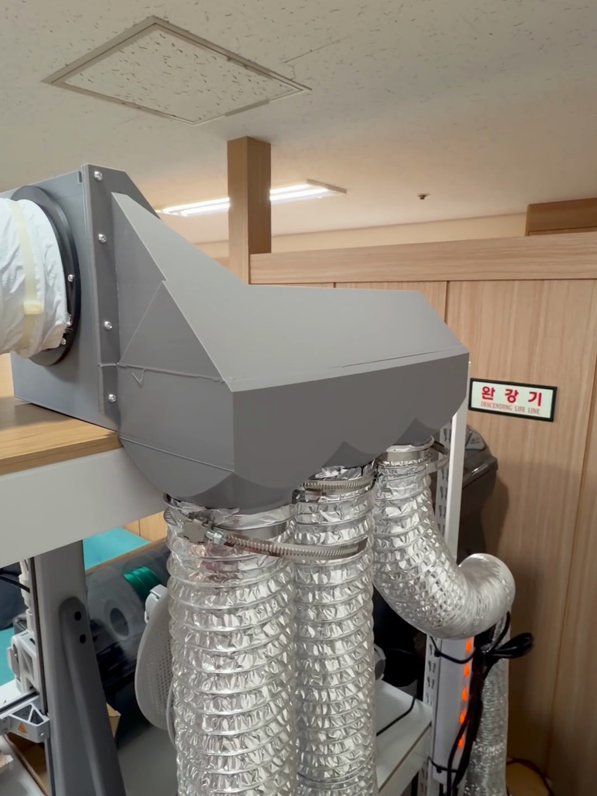

いつの間にか、プリンターが4台になりました。
H3C、P2S、X2D、そしてA2Lです。

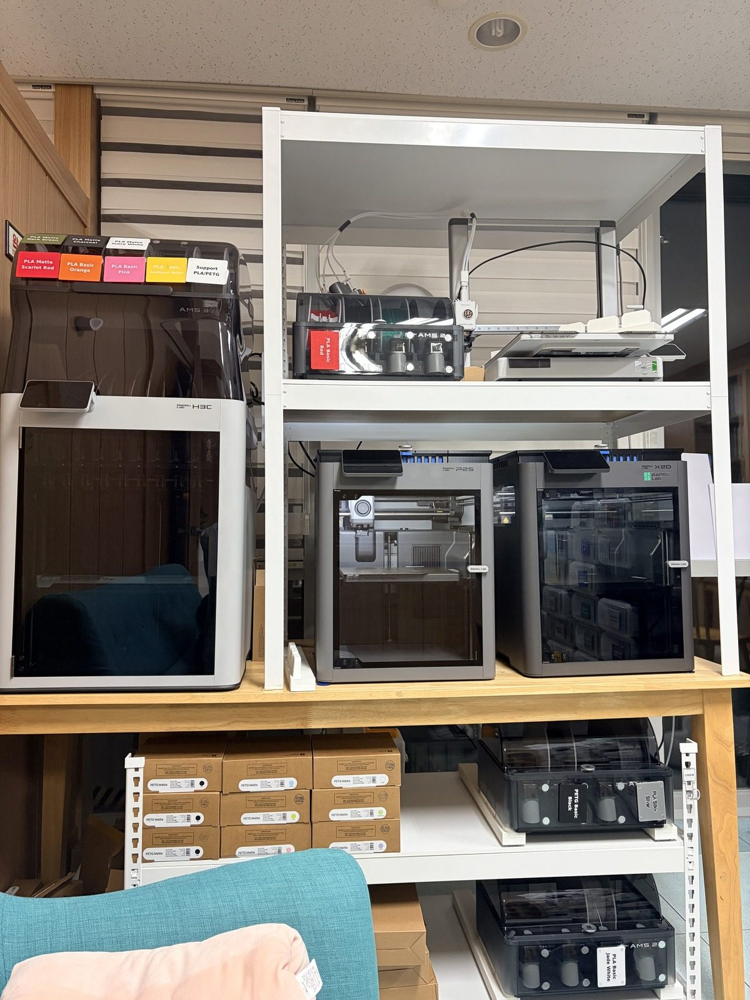

1台のときは、それほど気になりませんでした。
でも台数が増えるにつれて、部屋の中にツンとした臭いが漂うようになりました。
少し頭も痛いような気がして。

PLAだけを出力していたときはまだましでしたが、
PETGをたくさん出力し始めてから、空気がはっきり悪くなった気がします。

そこで思い切って、排気システムを作ることにしました。
チャンバーのある3台(H3C、P2S、X2D)の排気を排気ファン1台にまとめて、窓の外へ出す計画です。
A2Lはチャンバーのないオープン型なので、今回は対象外です。
いずれチャンバーを作って取り付けるつもりです。

結論から言うと、設置まで全部終わりました。
ただ、思った以上に時間がかかりました。
合流アダプターを1つ、4回も設計し直したので。

## 準備したもの

まず材料からです。

- **排気ファン（シロッコファン）**：吸込口・出口とも100 mm。知人からもらいました。
- **ダクトホース100 mm(白)**：これも知人からもらいました。合流アダプターから排気ファン(短く)、排気ファンから窓まで
- **アルミ蛇腹ダクト80 mm**：プリンターから合流アダプターまで、3本。[ダクト用アルミ蛇腹ホースとステンレス固定バンドのセット](https://www.coupang.com/vp/products/8322535527?vendorItemId=96127339158)を3セット
- **発泡PVC板5T グレー**：窓をふさぐ用。[ダハンジン カラー発泡PVC板 A3(297 × 420 mm、5T) グレー](https://www.coupang.com/vp/products/8727713188?vendorItemId=92072455395)を5枚
- **ホースバンド、M3・M4のボルトとナット**：接続部を締める用、枠・蝶番・掛け金の固定用。80 mm用のバンドはダクトのセットに入っています
- **貼れるすき間ゴム(ダイソー)**：板の扉のすき間と、フードとプリンターのすき間をふさぐ用
- **はがせる3M両面テープ**：板を窓枠に貼る用(引っ越しのときに外しやすいように)
- **スピードラック**：排気ファンを一番上に載せる場所。[スピードラック公式ショップの一般収納棚](https://speedrack.co.kr/product/%EC%8A%A4%ED%94%BC%EB%93%9C%EB%9E%99-%EC%9D%BC%EB%B0%98-%EC%88%98%EB%82%A9%EC%84%A0%EB%B0%98/99/category/146/display/1/)をブラックフライデーの特価で購入
- **蝶番**：板の窓に扉を付ける用。ダイソーで買いましたが、何でも構いません

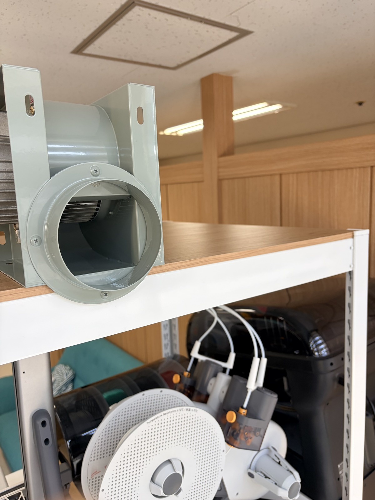

このスピードラックは、[AMSのスライド収納](/ja/2026/11/09/ams2-pro-sliding-speedrack-underrail/)で使ったものとは別に、もう1つ注文しました。
排気ファンがプリンターの真上の中央に来るように、棚を組み直したのです。

## 全体の構成

空気の通り道はこうなっています。

- プリンターの後ろに**フード**を付けて
- 80 mmのアルミダクトで棚の後ろを通って上へ上がり
- 棚の一番上の**3→1合流アダプター**で1本にまとめて
- 短い100 mmダクトで**排気ファン**に入れ
- 排気ファンの出口から、再び100 mmダクトで**窓**まで

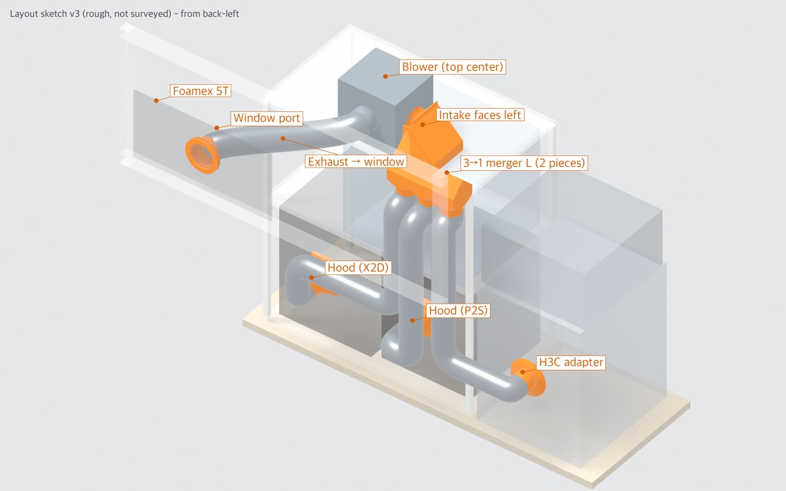

上の図は設計のときに使った概略図なので、実際の寸法とは少し違います。

出力物のうち、**P2SとX2Dのフードと上側の合流アダプターは自分で設計**しました。
H3Cのフードは Bambu Lab の公式ファイルを、窓の排気口は公開モデルを手直しして使っています。

排気ファンは棚の一番上の中央に載せました。
100 mmの吸込口が左、出口が奥の窓の方向です。

排気ファンの手前(プリンターから排気ファンまで)は吸い込む側なので、負圧になります。
接続部が少し漏れても、臭いは部屋に漏れません。
意外と安心できるポイントです。

部品はすべてPETGで出力しました。
排気が温かくなることがあるので、PLAより熱に強い方にしました。

## H3Cは公式フードで、取り付け情報がほとんどないのでまとめておきます

H3Cは発売されて間もないせいか、排気口の取り付け方法がネット上にほとんどありません。
なので、まずここから書いておきます。

1. ツールボックスから**一番長い六角レンチ**を取り出します。
2. プリンター背面の**ネジ3本**を外します。
3. Bambu Lab が公式に配布しているフードを出力して、そのネジで固定します。

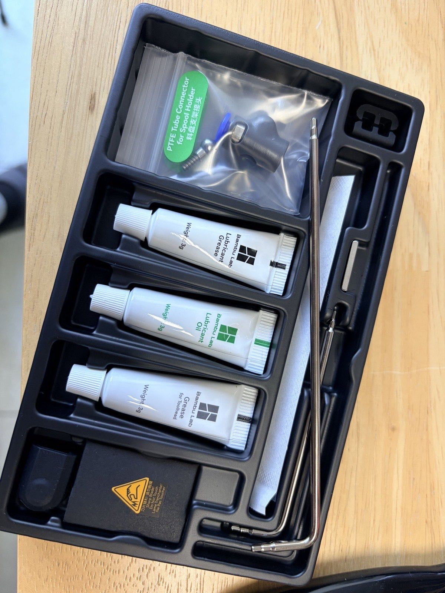

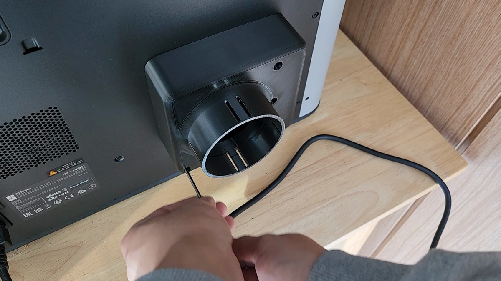

このネジ3本は、フードを付けるために Bambu Lab があらかじめ付けておいたものです。
外しても落ちる部品はありません。
ネジを外してフードを当て、また締めれば終わりです。

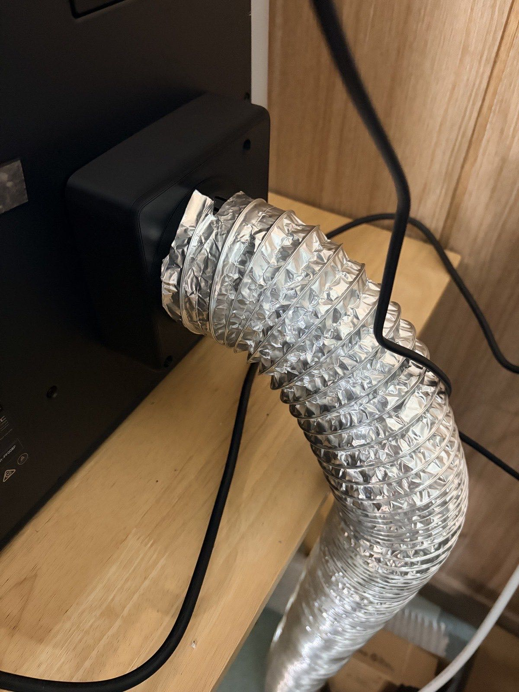

この公式フードは、実は[前回の異種サポートの記事](/ja/2026/11/22/h3c-petg-pla-support-interface/)で出力したものそのものです。
Bambu Lab のファイル名は「E1 Air Purifier Hose Adapter」(H3Cプロファイル)。
PETGの本体の下にPLAの接触面を敷いて、サポートがするっと外れたあのモデルです。
これに80 mmダクトをつなぎました。

## P2SとX2Dのフードは自分で設計しました、ファンは外して一体型に

P2Sには、Bambu Lab が MakerWorld に公式の排気キットを公開しています。
ただ、これは途中に120 mmファンを付ける構造です。
ファンハウジング、フレーム、ファンネル、小さなクリップまで含めて、部品が16個もあります。

わが家は排気ファン1台でまとめて吸い込むので、プリンターごとにファンを置く必要はありません。
MakerWorld をしばらく探してみましたが、今の状況にぴったりのフードは見つかりませんでした。
それなら作ってしまおうと思いました。
ファンの場所、箱、クリップはすべてなくして、プリンターからダクトまで直接つながる一体型にしました。

公式キットから持ってきたのは1つだけです。
プリンターの背面パネルに掛かる**爪6個**。
ここを間違えると取り付けられないので、公式キットの爪の形だけをそのまま持ってきて付けました。
残りはフランジから45度のファンネルで絞って、80 mmの管で終わります。

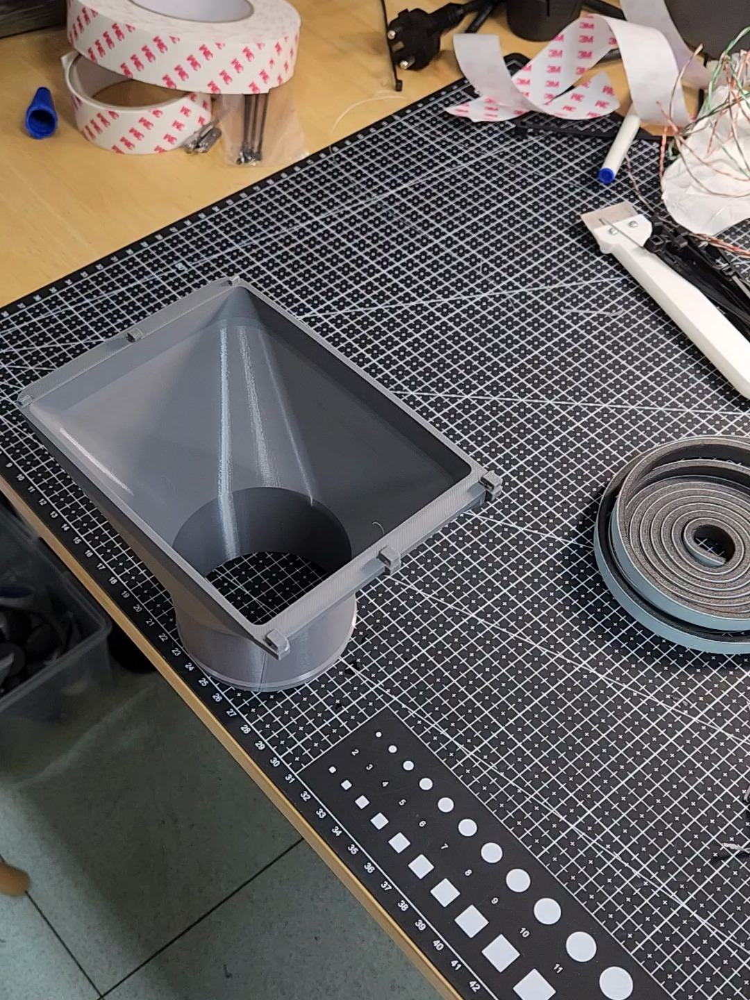

P2Sは、背面のバッファー下のシールをはがして爪を合わせ、左へスライドさせるとカチッと掛かります。

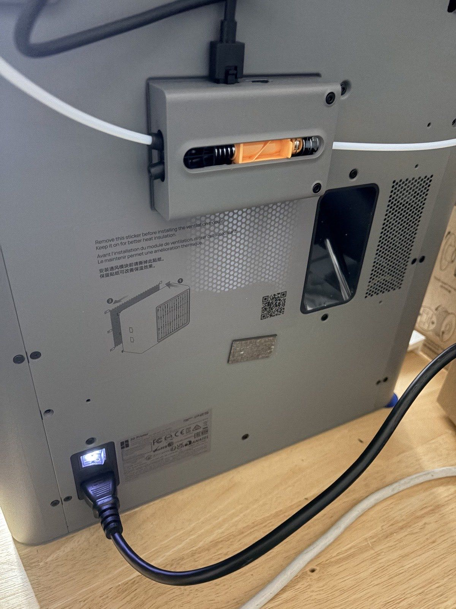

X2Dには、もともと外付けの排気ファンが付いています。
以前はその排気ファンの上に公式のコネクターを付けて使っていたのですが、
結合部が弱くて、何度も外れてしまいました。
そこで今回は、P2Sと同じフードを出力して、
既存の排気ファンを外し、その場所に取り付けました。

ところが付けてみると、フードとプリンターが当たる部分が思ったよりゆるいのです。
そこで、窓の扉のすき間に使った貼れるすき間ゴムを、フード側のプリンターに当たる面に貼りました。
P2SもX2Dも、両方です。
これですき間をしっかりふさぎました。

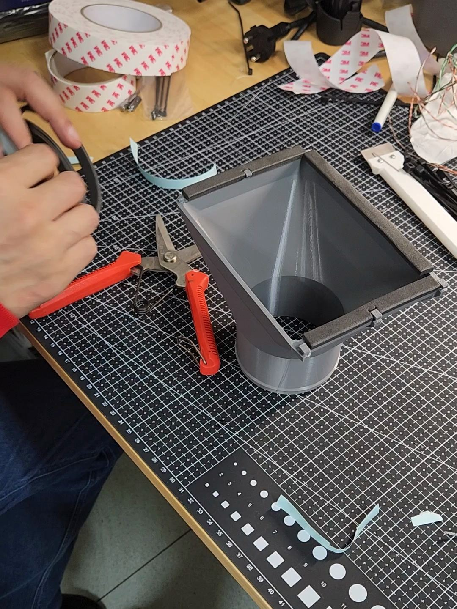

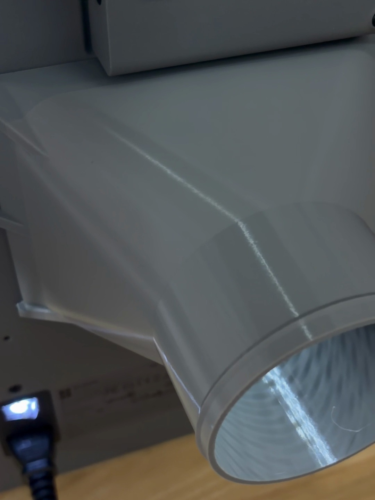

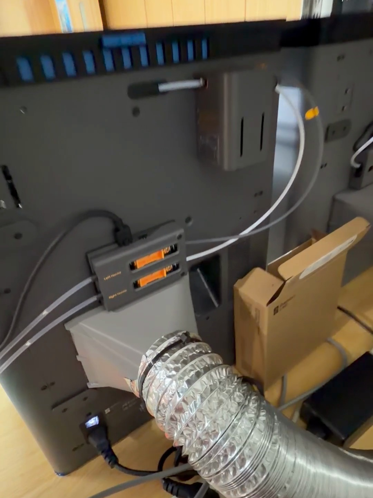

## フードはひっくり返して出力しました

最初は管の先を床に当てて、立てた状態で出力しようとしました。
でも、爪のかぎ爪を支えるサポートが床から伝って立ち上がり、プライムタワーも一番上まで120 mmも積まれてしまいました。困りました。
そこで、爪を床に当ててひっくり返して出力しました。
サポートが当たる面はPLAにして外れやすくし（[前回の異種サポートの記事](/ja/2026/11/22/h3c-petg-pla-support-interface/)）、タワーは4 mmで終わり、出力時間も27分短くなりました。

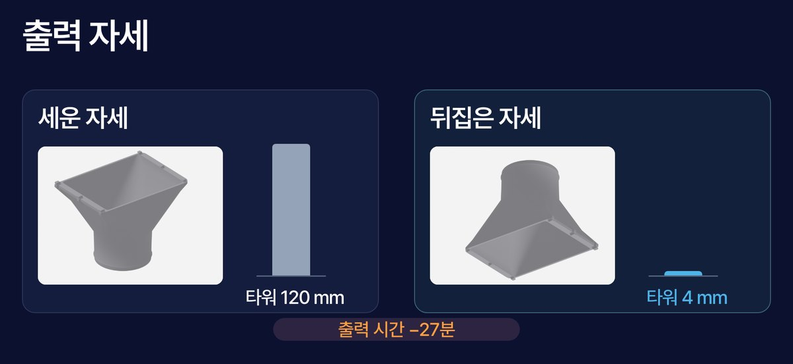

## 合流アダプターだけ4回設計し直しました

今回のプロジェクトで、一番時間がかかったのがこれです。

**1回目、配置を間違えて理解していました。**
排気ファンの吸込口が棚の右端にあると思い込んで、
アダプターが棚の側面にぶら下がり、入口3つが下を向く形で作りました。
検査まで全部終わらせたのに...
配置図を見た瞬間に「吸気が逆だ」となりました笑
排気ファンは天板の中央にあって、吸込口は左でした。
最初から図で合わせていればよかったのです。

**2回目、L字の一体型。**
カラーからL字に出て、天板の後ろの縁にまたがり、入口3つは棚の後ろへ下りる形。
形は合っていました。
でも天板に載る底面(115 × 175 mm)が、出力姿勢では高さ80 mmに浮いた板になってしまいます。
サポート285 g、出力19時間。
これはないな、と思いました。

**3回目、2つに分割。**
天板の後ろの縁のラインで、ぴったり切りました。
入口のある集合部は入口を床に当てて、
天板の上の通路は平らな底面をベッドに当てて出力します。
どちらもサポート0。
つなぎ目の縁を合わせて、M3ボルト8本で締めれば完成です。

**4回目、直結ではなく短いダクトで。**
もともとは、排気ファンのカラーにスリーブを直接差し込む直結でした。
でもそれだと、カラーの位置をmm単位で合わせる必要があります。
短いダクトでつなげばその心配がなく、排気ファンの振動も伝わりにくくなります。
通路の壁に付いていたスリーブの場所には、同じネジ位置の100 mm管の板を付けるだけで済みました。

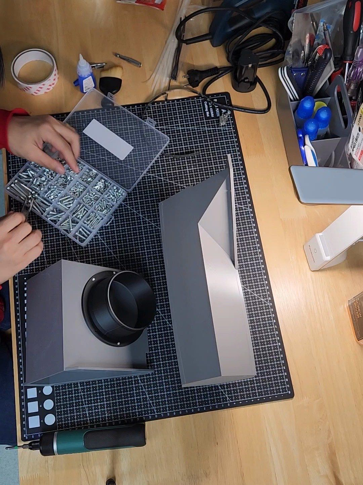

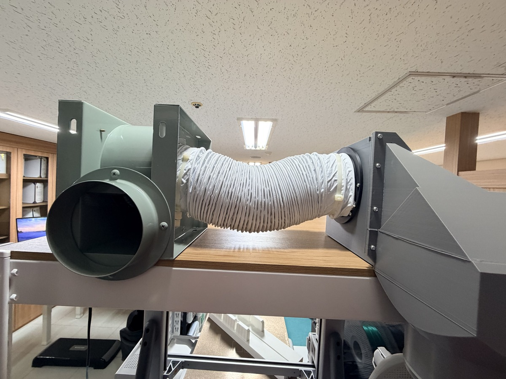

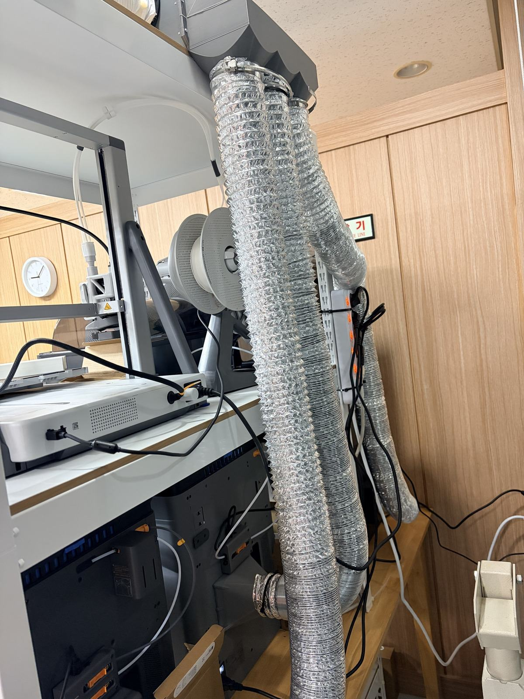

## 窓は発泡PVC板5Tでまるごとふさぎました

事務所の窓は、外へ少し三角に開くタイプです。
開けっぱなしにすると寒すぎるし、虫まで入ってきます。
かといって、ずっと開けておくわけにもいきません。

排気口の場所だけ残して、残りのすき間をふさげばいいのではと思いましたが、
窓の構造が微妙で、それも簡単ではありませんでした。

そこで、**窓全体を発泡PVC板5Tでふさいで**、そこに排気口をあけて取り付けることにしました。
A3サイズのグレーの発泡PVC板5枚を、板同士を瞬間接着剤でつなぎました。
窓枠の周囲は、引っ越しのときにきれいにはがせるよう、**はがせる3M両面テープ**で貼りました。

ただ、窓を完全にふさいでしまうと困ります。
開け閉めもしたいし、ときどき換気もしたいので。
そこで、板に扉を1つ作りました。
ダイソーで蝶番を買って付けたのですが(蝶番は何でも構いません)、ちょっと雑な仕上がりです笑
扉を留める掛け金も、簡易的ながらなんとか付けました。
扉の枠と蝶番、掛け金は、M3のボルトとナットで固定しました。
扉のすき間には、ダイソーで買った貼れるすき間ゴムを貼って、風が漏れないようにしました。
それでも開け閉めには問題ありません。

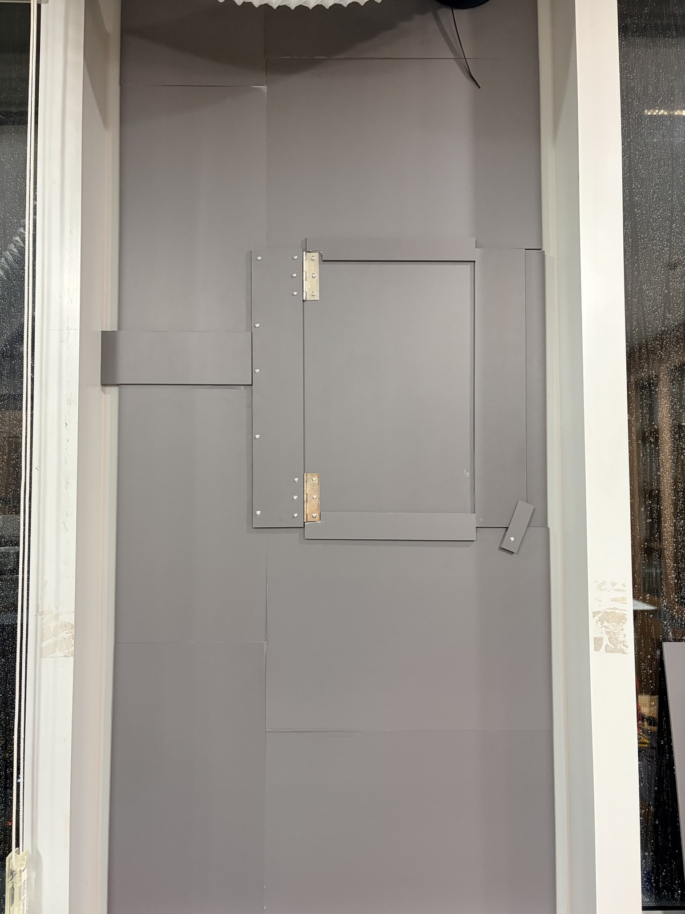

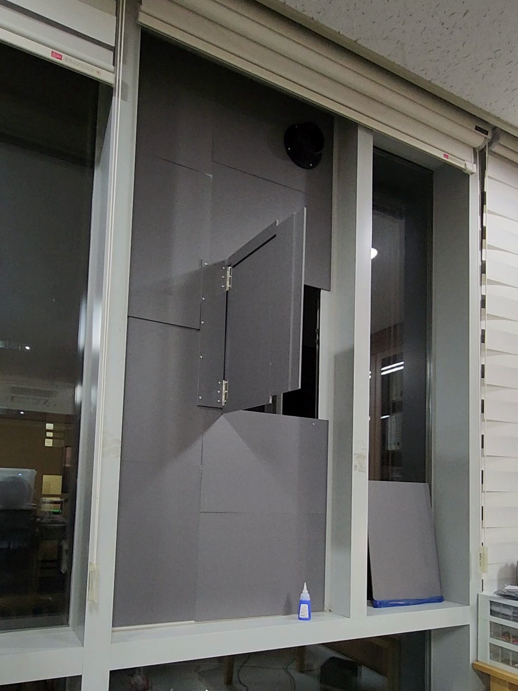

排気口は、MakerWorld の RandomKhaos さんのモデルを参考にしました。
もともとは、磁石で付けたり外したりする構造です。
でも外すことはまずないので、磁石はやめて一体型に変えました。

内側はフランジと100 mmの管が一体で、外側はリングです。
発泡PVC板をはさんで、M4ボルト4本で締めます。
外側のリングに六角ナットの溝があるので、内側からドライバーを回すだけで済みます。

板の穴は、外側のリングを当ててなぞって描いてからあけました。
リングがそのまま型紙になるので、楽でした。

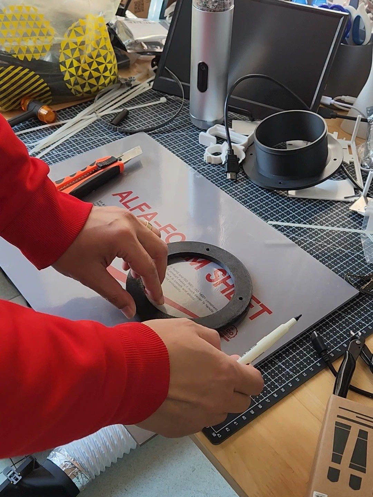

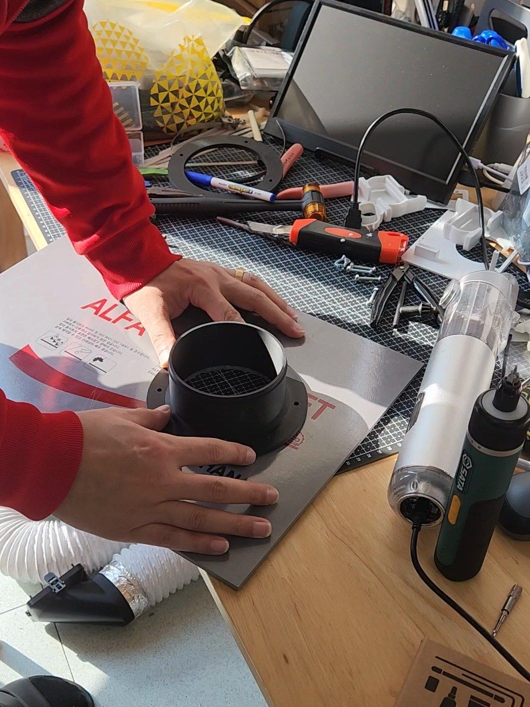

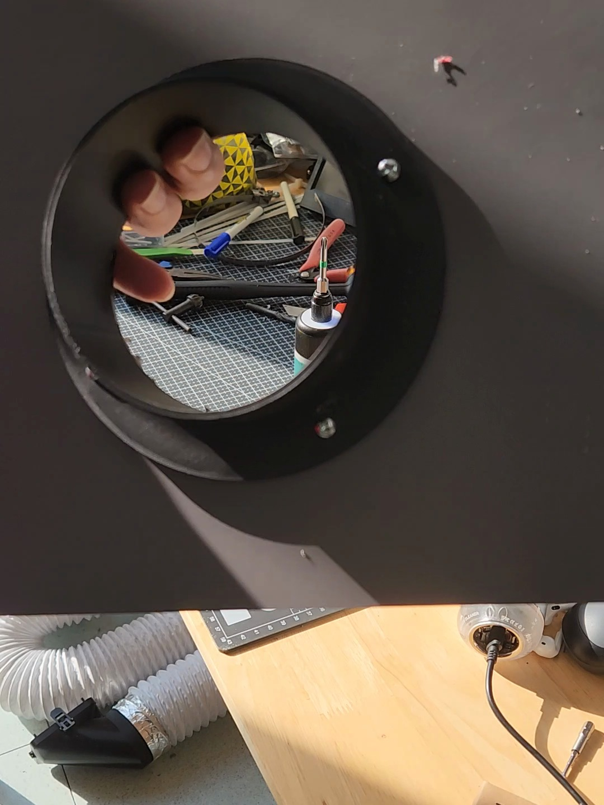

最後は、白い100 mmダクトです。
まず窓の上の排気口につないで、

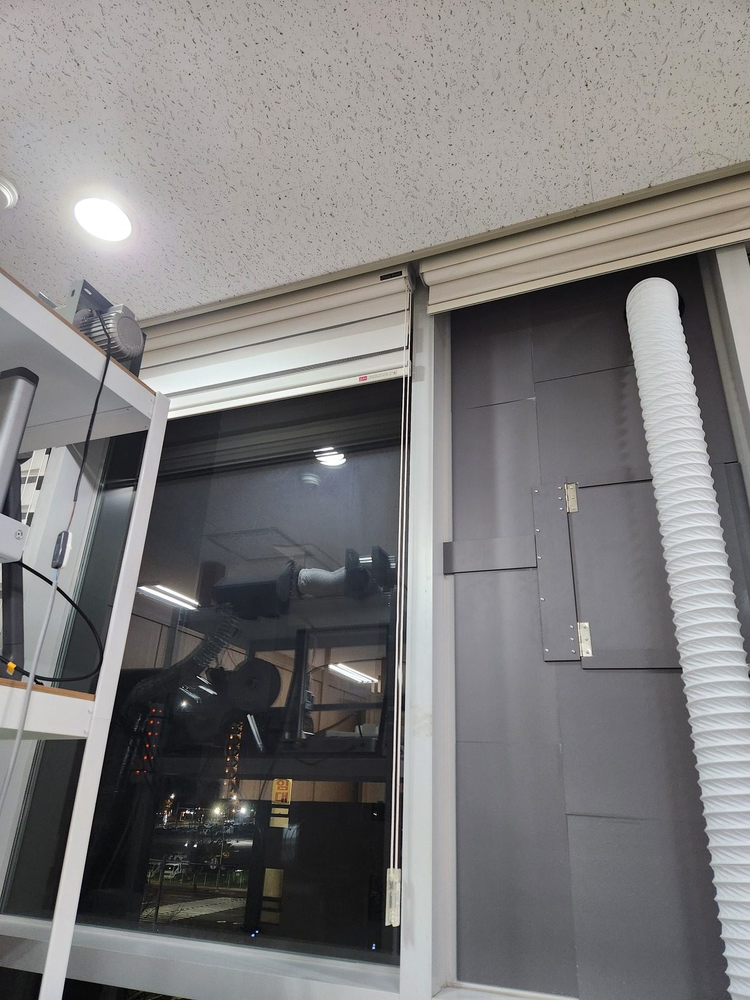

反対側の端を天井の下に回して、排気ファンの出口につなぎました。

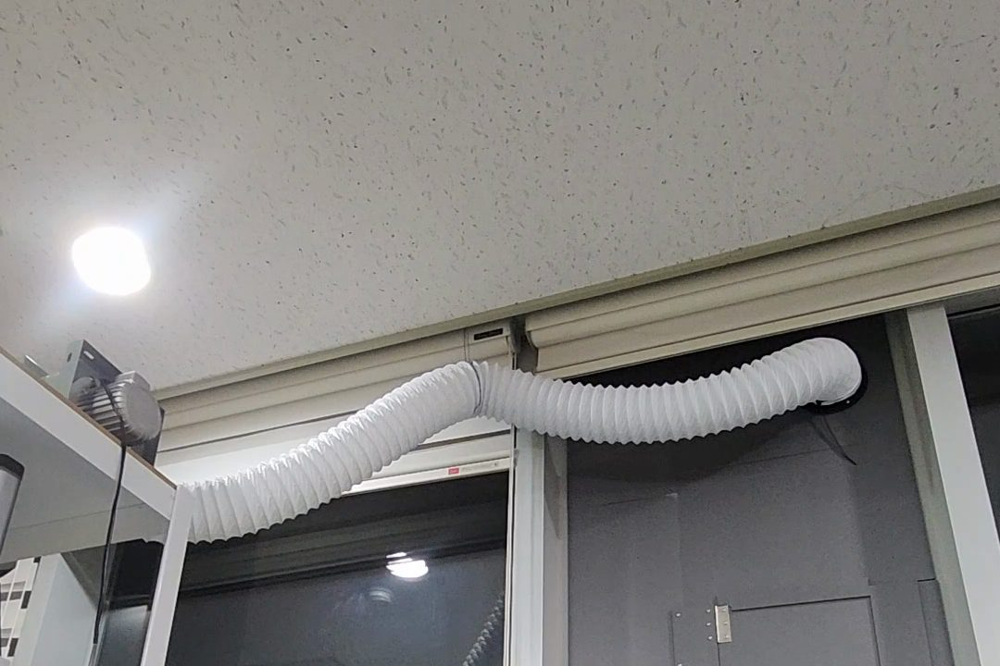

## 取り付け終わった様子

棚の一番上には、排気ファンと合流アダプターが並んで載っています。

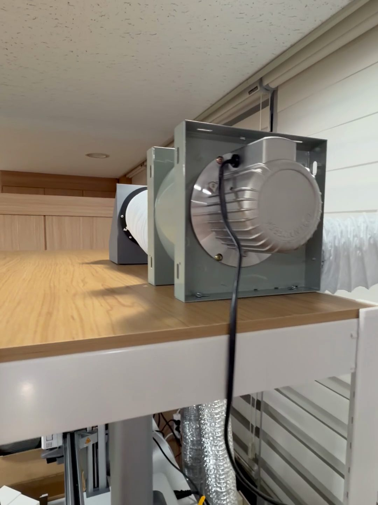

合流アダプターから出た80 mmダクト3本は、棚の支柱に沿って下り、各プリンターの背面に入ります。

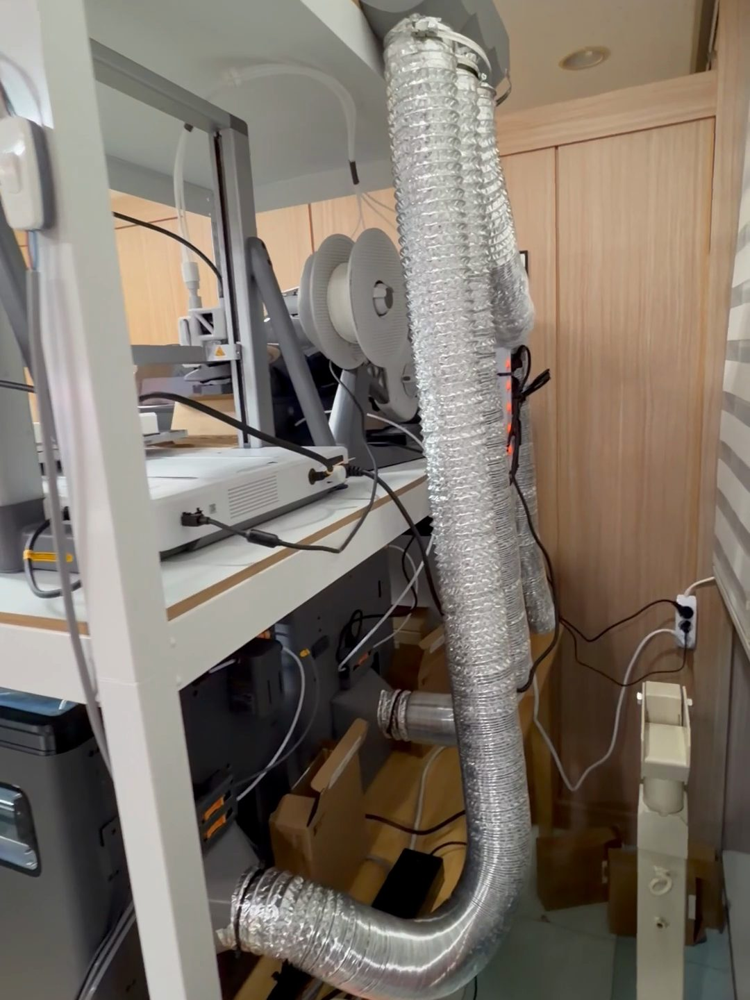

## まとめ

- 配置は最初から図で合わせましょう。言葉だけでやり取りして、一度大きくやり直しになりました。
- 造形姿勢が、サポートもプライムタワーも左右します。サポートを減らしたらタワーが大きくなることもありました。
- 公式キットも、自分の状況に合わせて変えて構いません。ファンやクリップなどの細かい部品を外したら、ずっと楽になりました。

まだ残っていることもあります。
X2Dの外付けファンを外したことで、ファームウェア側に問題がないかは、もう少し様子を見るつもりです。

それからA2Lは、チャンバーを作ってこの排気につなぐ予定です。
そのときは、合流アダプターの入口をもう1つ増やさないといけません。
5回目の設計になりそうです笑

似たような排気を作ったことがある方は、ぜひコメントで教えてください。

自作の合流アダプターと窓用排気口（太さ確認用の試験リング付き）は[MakerWorldに公開しました](https://makerworld.com/models/3678886)。
P2S・X2D用フードは公式キットのツメ形状を使っているため含めていません。

設置の様子は動画にもまとめました。
1〜2時間かかった設置シーンを短くつないでいます。
韓国語ナレーションが基本で、日本語など6言語の吹き替えと字幕もあります。

  <iframe src="https://www.youtube.com/embed/vhXm8nz6GXE?cc_lang_pref=ja&cc_load_policy=1" title="3Dプリンター排気システム | PETGの臭いを窓の外へ（プリンター3台・排気ファン1台）" style="position: absolute; inset: 0; width: 100%; height: 100%; border: 0;" allow="accelerometer; autoplay; clipboard-write; encrypted-media; gyroscope; picture-in-picture; web-share" allowfullscreen loading="lazy"></iframe>

短く見たい方はショート動画でどうぞ。

  <iframe src="https://www.youtube.com/embed/LjdKEq_2nqs?cc_lang_pref=ja&cc_load_policy=1" title="3Dプリンター排気システム、PETGの臭いを窓の外へ" style="position: absolute; inset: 0; width: 100%; height: 100%; border: 0;" allow="accelerometer; autoplay; clipboard-write; encrypted-media; gyroscope; picture-in-picture; web-share" allowfullscreen loading="lazy"></iframe>

- YouTube動画: [3Dプリンター排気システム | PETGの臭いを窓の外へ（プリンター3台・排気ファン1台）](https://www.youtube.com/watch?v=vhXm8nz6GXE)
- YouTubeショート: [3Dプリンター排気システム、PETGの臭いを窓の外へ](https://www.youtube.com/shorts/LjdKEq_2nqs)

## 出力情報

| 出力物 | 個数 | 積層ピッチ | 時間（予測） | フィラメント（予測） |
|---|---|---|---|---|
| プリンター用フード（P2S・X2D共用） | 2 | 0.20 mm | 3時間3分 × 2 | 106.2 g × 2 |
| 合流アダプター集合部 | 1 | 0.20 mm | 8時間50分 | 359.2 g |
| 合流アダプター通路 | 1 | 0.20 mm | 4時間50分 | 213.4 g |
| 100 mm管の板 | 1 | 0.20 mm | 1時間17分 | 48.2 g |
| 窓の排気口（室内パーツ + 外側リング） | 1セット | 0.20 mm | 1時間57分 | 80.5 g |
| 合計 | 6 | | 23時間0分 | 913.7 g |

- プリンター：Bambu Lab H3Cの設定基準（0.4 mmノズル）。合流アダプター集合部は300 mmのプレートが必要なので、H3CかA2Lで出力する必要があります。
- フィラメント：Bambu PETG Basic。フードのサポート接触面のみPLA Basic。
- 時間とフィラメントは、Bambu Studioのスライサーによる予測値です。フードの値にはサポート5.6 gとプライムタワーが含まれています。爪のはめ合わせ用の試験片は表から除きました。

## 出典

- P2S・X2Dフード：自分で設計（プリンターに掛かる爪の形だけ、Bambu Lab の P2S Exhaust Fan Kit (X2D Pipe Connector) から持ってきました）
- 合流アダプター・100 mm管の板：自分で設計
- H3Cフード：Bambu Lab（E1 Air Purifier Hose Adapter、H3Cプロファイル）
- 窓の排気口：RandomKhaos（Generic Magnetic Hose Adapter）、磁石なしで両側からボルトで締める方式に設計し直し
