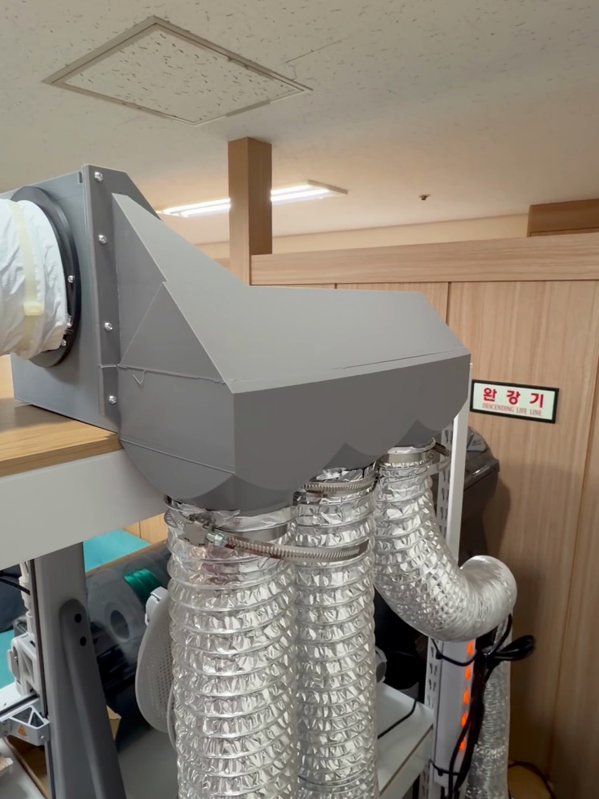

프린터가 어느새 4대가 됐다.
H3C, P2S, X2D, 그리고 A2L.

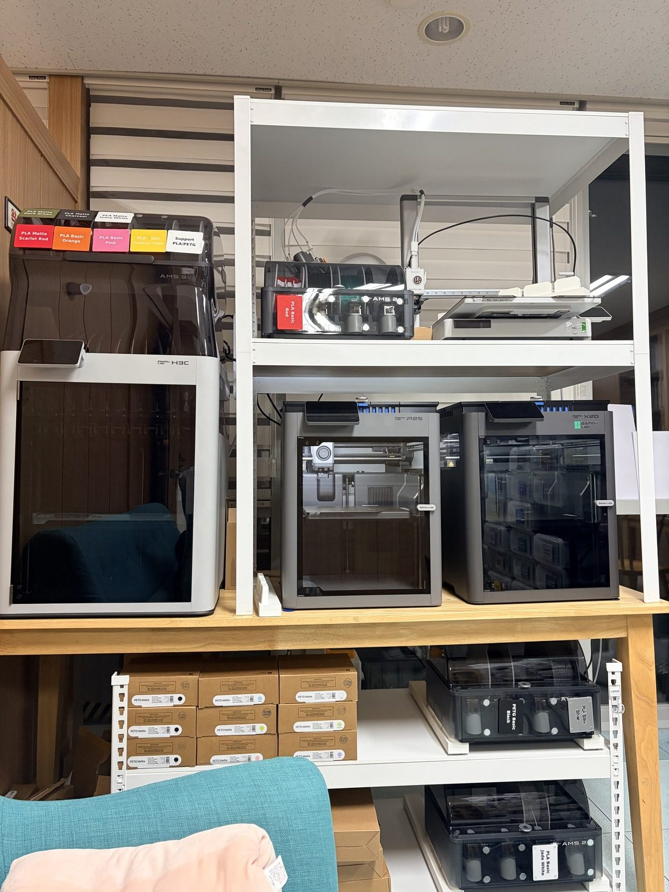

1대일 때는 크게 신경 쓰이지 않았다.
근데 대수가 늘어나니까 방 안에 약간 매캐한 냄새가 돌기 시작했다.
살짝 머리도 아픈 것 같고...

PLA만 뽑을 때는 덜했는데,
PETG를 많이 뽑기 시작하면서 공기가 확실히 더 안 좋아진 느낌이었다 ㅠㅠ

그래서 큰맘 먹고 배기 시스템을 만들었다.
챔버가 있는 3대(H3C, P2S, X2D)의 배기를 배기팬 하나로 모아서 창문 밖으로 빼는 거다.
A2L은 챔버가 없는 오픈형이라 이번엔 빠졌다.
나중에 챔버를 만들어서 붙일 생각이다.

결론부터 말하면 설치까지 다 끝났다 ㅎㅎ
근데 생각보다 정말 오래 걸렸다.
합류 어댑터 하나를 네 번이나 다시 설계했으니까...

## 준비한 것들

준비물부터.

- **배기팬(시로코 팬)**: 흡입구·출구 100 mm. 지인에게 받았다 ㅎㅎ
- **주름관 100 mm(흰색)**: 이것도 지인에게 받았다. 합류 어댑터 → 배기팬(짧게), 배기팬 → 창문
- **알루미늄 주름관 80 mm**: 프린터 → 합류 어댑터, 3줄. [덕트용 알루미늄 은박 주름관 + 고정용 스텐 밴드 세트](https://www.coupang.com/vp/products/8322535527?vendorItemId=96127339158) 3세트
- **포맥스 5T 회색**: 창문 막기. [다한진 컬러 포맥스판 A3(297 × 420 mm, 5T) 회색](https://www.coupang.com/vp/products/8727713188?vendorItemId=92072455395) 5장
- **호스 밴드, M3·M4 볼트와 너트**: 이음 조이는 용도, 포맥스 문틀·경첩·걸쇠 고정. 80 mm용 밴드는 주름관 세트에 들어 있다
- **접착식 틈새 고무(다이소)**: 포맥스 문틈, 후드와 프린터 사이 틈 메우기
- **떼어 낼 수 있는 3M 양면테이프**: 포맥스를 창틀에 붙이는 용도(이사할 때 철거하기 쉽게)
- **스피드랙**: 배기팬을 맨 위에 올릴 자리. [스피드랙 공식몰 일반 수납선반](https://speedrack.co.kr/product/%EC%8A%A4%ED%94%BC%EB%93%9C%EB%9E%99-%EC%9D%BC%EB%B0%98-%EC%88%98%EB%82%A9%EC%84%A0%EB%B0%98/99/category/146/display/1/)을 블프 특가로 샀다
- **경첩**: 포맥스 창문에 문 달기용. 다이소에서 샀는데 아무거나 써도 된다

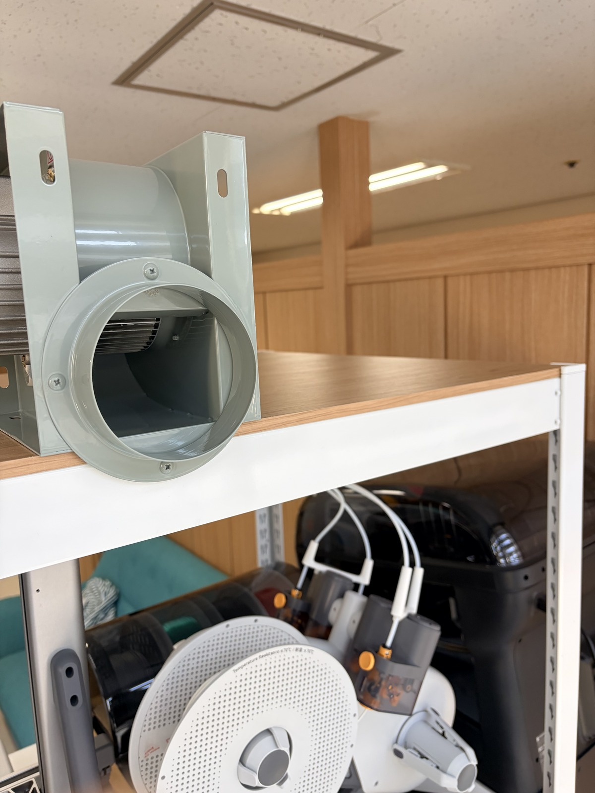

스피드랙은 [AMS 슬라이딩 수납](/2026/11/09/ams2-pro-sliding-speedrack-underrail/) 때 쓴 것과는 별개로 하나 더 주문했다.
배기팬이 프린터들 위 한가운데에 오도록 선반을 새로 구성한 거다.

## 전체 구성

공기가 가는 길은 이렇다.

- 프린터 뒤에 **후드**를 달고
- 80 mm 알루미늄 주름관으로 선반 뒤를 타고 올라와서
- 선반 맨 위 **3→1 합류 어댑터**에서 하나로 모은 다음
- 짧은 100 mm 주름관으로 **배기팬**에 넣고
- 배기팬 출구에서 다시 100 mm 주름관으로 **창문**까지

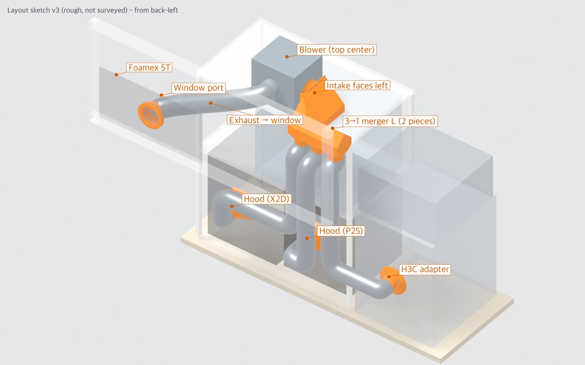

위 그림은 설계할 때 쓴 개략도라 실제 치수와는 조금 다르다.

출력물 중 **P2S·X2D 후드와 위쪽 합류 어댑터는 직접 설계**했다.
H3C 후드는 뱀부랩 공식 파일을, 창문 배기구는 공개 모델을 고쳐서 썼다.

배기팬은 선반 맨 위 가운데에 올렸다.
100 mm 흡입구가 왼쪽, 출구가 뒤쪽 창문 방향이다.

배기팬 앞쪽(프린터 → 배기팬)은 빨아들이는 쪽이라 음압이다.
이음이 조금 새도 냄새가 방으로 새지 않는다.
은근 마음 편한 포인트다.

부품은 전부 PETG로 뽑았다.
배기 공기가 따뜻할 수 있어서 PLA보다는 열에 강한 쪽으로 갔다.

## H3C는 공식 후드로, 설치 정보가 거의 없어서 정리해 둔다

H3C가 나온 지 얼마 안 돼서 그런지 배기구 설치 방법이 온라인에 거의 없더라.
그래서 이것부터 적어 둔다.

1. 툴박스에서 **가장 긴 육각렌치**를 꺼낸다.
2. 프린터 뒤쪽 **나사 3개**를 푼다.
3. 뱀부랩이 공식으로 배포하는 후드를 출력해서, 그 나사로 고정한다.

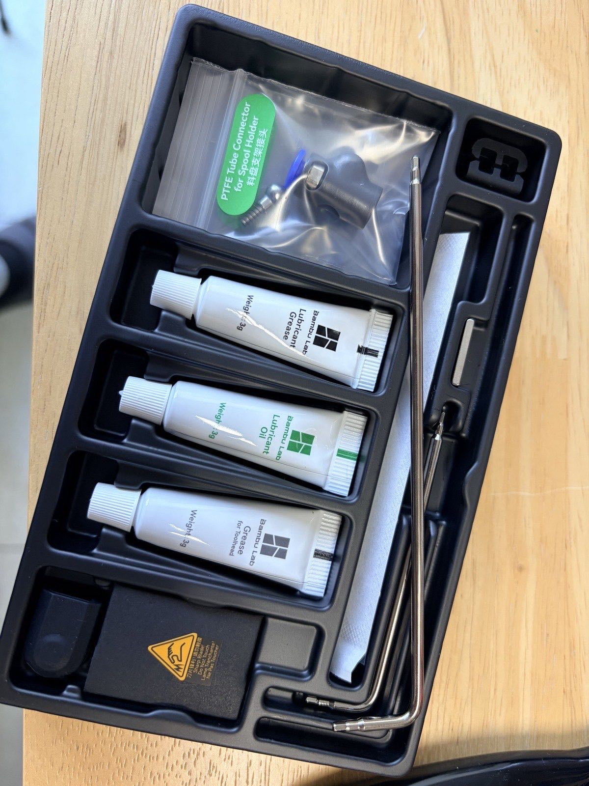

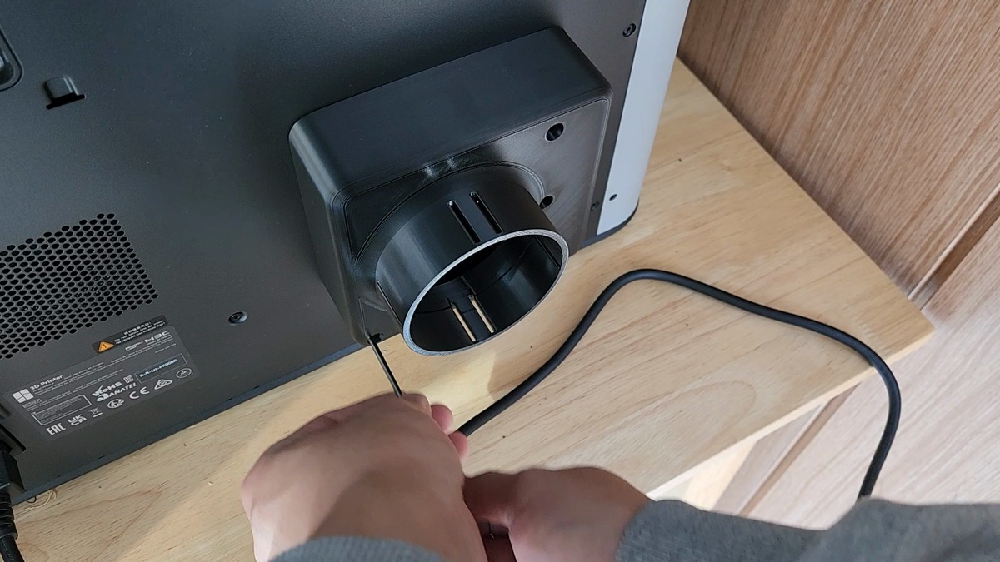

이 나사 3개는 뱀부랩이 후드를 달라고 미리 박아 둔 거다.
풀어도 떨어지는 부품은 없다.
나사만 풀고 후드를 대고 다시 조이면 끝이다 ㅎㅎ

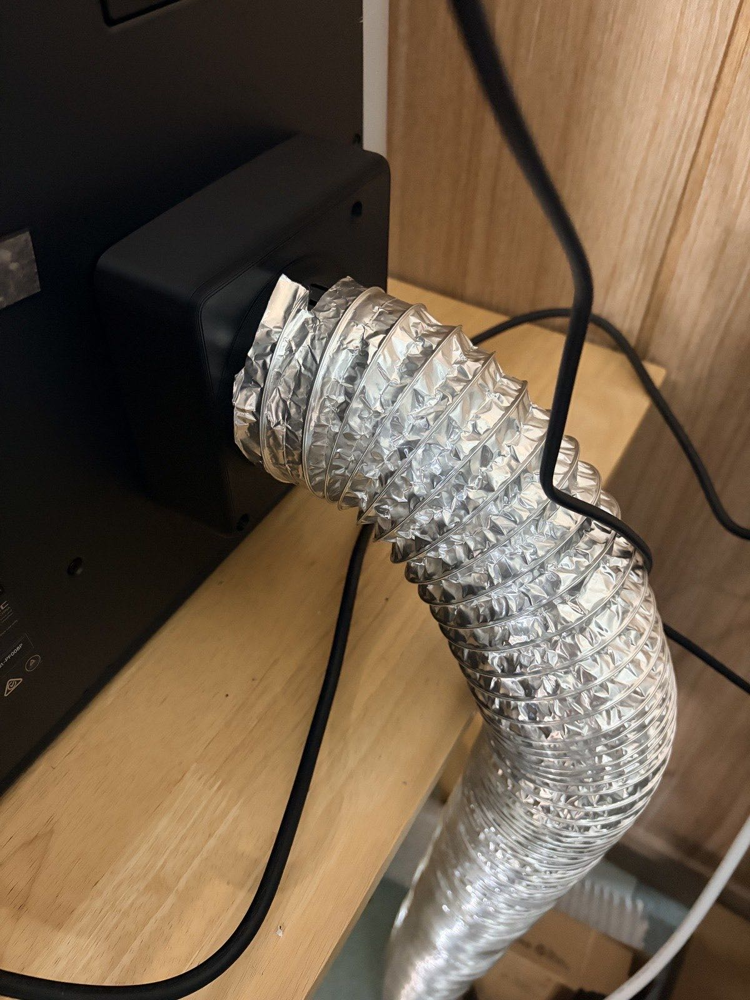

이 공식 후드가 사실 [지난번 이종 서포트 글](/2026/11/22/h3c-petg-pla-support-interface/)에서 뽑은 바로 그 출력물이다.
뱀부랩 파일 이름은 'E1 Air Purifier Hose Adapter'(H3C 프로필).
PETG 본체 밑에 PLA 접촉면을 깔아서 서포트가 쭉 떨어지던 그 모델이다 ㅎㅎ
여기에 80 mm 주름관을 물렸다.

## P2S·X2D 후드는 직접 설계했다, 팬은 빼고 일체형으로

P2S는 뱀부랩이 MakerWorld에 공식 배기 키트를 올려 두었다.
근데 이건 중간에 120 mm 팬을 다는 구조다.
팬 하우징, 프레임, 깔때기에 작은 클립까지 부품이 16개나 된다.

우리 집은 배기팬이 한 곳에서 다 빨아들이니까 프린터마다 팬을 둘 필요가 없다.
MakerWorld를 한참 뒤져 봤는데 지금 상황에 딱 맞는 후드는 못 찾았다.
그래서 그냥 만들었다 ㅎㅎ
팬 자리랑 박스, 클립은 다 빼고, 프린터에서 주름관으로 바로 이어지게 한 덩어리로.

딱 하나 가져온 게 있다.
프린터 뒷판에 걸리는 **클로 6개**.
여기를 잘못 만들면 안 끼워지니까 공식 키트의 클로 형상만 그대로 가져와서 붙였다.
나머지는 플랜지에서 45도 깔때기로 좁아지다가 80 mm 수관으로 끝난다.

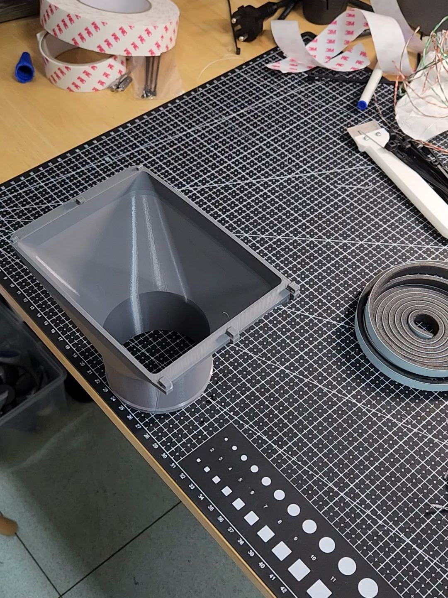

P2S는 뒷면 버퍼 아래 스티커를 떼고, 클로를 맞춘 다음 왼쪽으로 밀면 딸깍 걸린다.

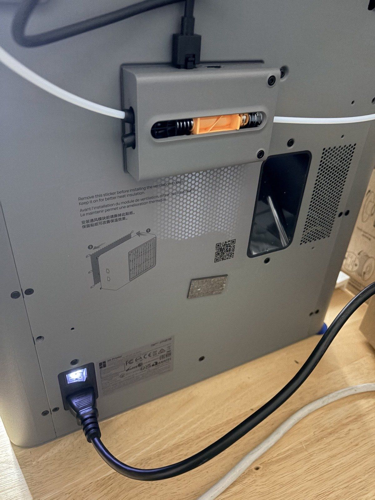

X2D는 원래 외장 배기팬이 달려 나온다.
전에는 그 배기팬 위에 공식 연결구를 끼워서 썼었는데,
결합부가 약해서 자꾸 떨어지더라 ㅠㅠ
그래서 이번에는 P2S랑 같은 후드를 뽑아서,
기존 배기팬을 떼어 내고 그 자리에 달았다.

근데 달아 보니 후드와 프린터가 맞닿는 부분이 생각보다 헐렁했다.
그래서 창문 문틈에 쓴 접착식 틈새 고무를 후드 쪽, 프린터에 닿는 면에 붙였다.
P2S, X2D 둘 다.
이걸로 틈을 꼼꼼하게 메웠다.

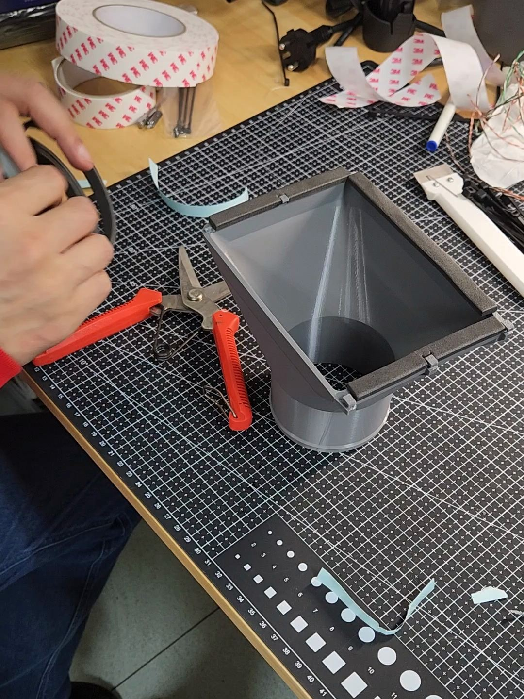

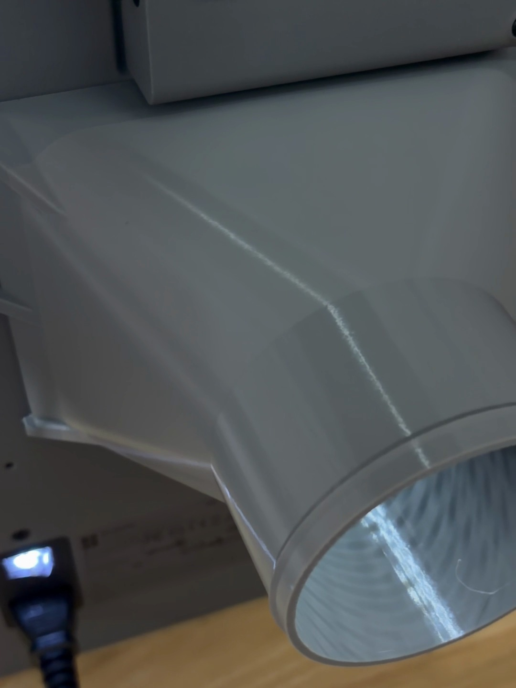

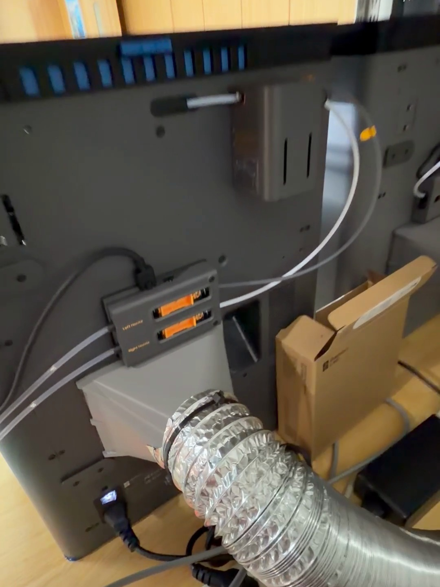

## 후드는 뒤집어서 뽑았다

처음엔 수관 끝을 바닥에 대고 세워서 뽑으려 했는데, 클로 갈고리를 받치는 서포트가 바닥부터 타고 올라오고 프라임 타워도 꼭대기까지 120 mm나 쌓이더라 ㅠㅠ
그래서 클로를 바닥에 대고 뒤집어서 뽑았다.
서포트가 닿는 면은 PLA로 깔아서 잘 떨어지게 했고([지난번 이종 서포트 글](/2026/11/22/h3c-petg-pla-support-interface/)), 타워는 4 mm에서 끝나고 출력 시간도 27분 줄었다.

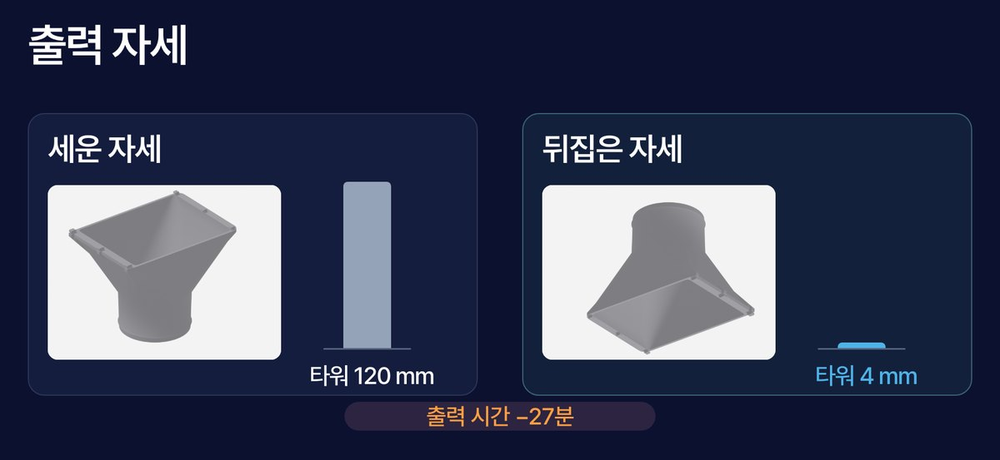

## 합류 어댑터만 네 번 다시 설계했다

이번 플젝에서 제일 오래 걸린 게 이거다.

**첫 번째, 배치를 잘못 알았다.**
배기팬 흡입구가 선반 오른쪽 끝에 있다고 생각하고,
어댑터가 선반 옆면에 매달려서 입구 3개가 아래를 향하는 모양으로 만들었다.
검수까지 다 끝냈는데...
배치 그림을 보자마자 "흡기가 반대야"가 나왔다 ㅋㅋ
배기팬은 상판 가운데에 있고, 흡입구는 왼쪽이었다.
처음부터 그림으로 맞춰 봤으면 됐을 일이다.

**두 번째, L자 한 덩어리.**
칼라에서 L자로 나와서 상판 뒤 가장자리에 걸치고, 입구 3개는 선반 뒤로 내려가는 모양.
모양은 맞았다.
근데 상판에 얹히는 바닥(115 × 175 mm)이 출력 자세에서는 높이 80 mm에 떠 있는 판이 된다.
서포트 285 g, 출력 19시간 ㅠㅠ
이건 아니다 싶었다.

**세 번째, 두 조각으로.**
상판 뒤 가장자리 선에서 딱 잘랐다.
입구가 있는 집합부는 입구를 바닥에 대고,
상판 위 통로는 평평한 바닥을 베드에 대고 뽑는다.
둘 다 서포트 0.
이음 테두리를 맞대고 M3 볼트 8개로 조이면 끝이다.

**네 번째, 직결 대신 짧은 주름관.**
원래는 배기팬 칼라에 슬리브를 바로 끼우는 직결이었다.
근데 그러면 칼라 위치에 mm 단위로 맞춰야 한다.
짧은 주름관으로 이으면 그런 걱정이 없고, 배기팬 진동도 덜 전해진다.
통로 벽에 붙던 슬리브 자리에 같은 나사 자리의 100 mm 수관 판만 달면 됐다.

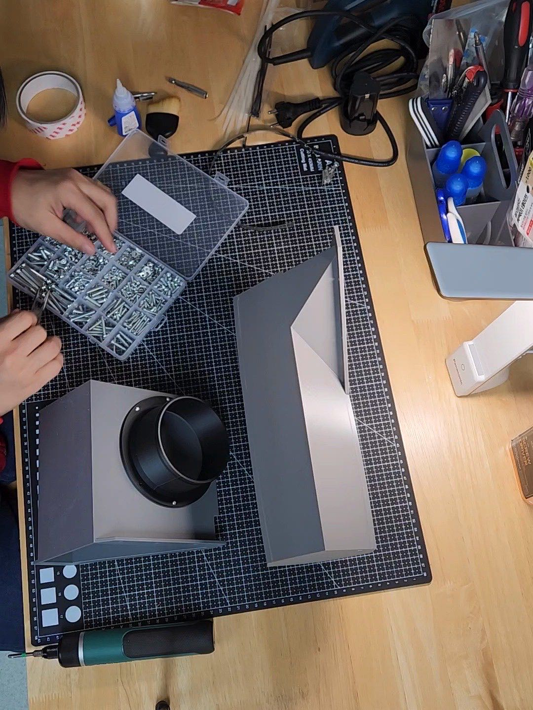

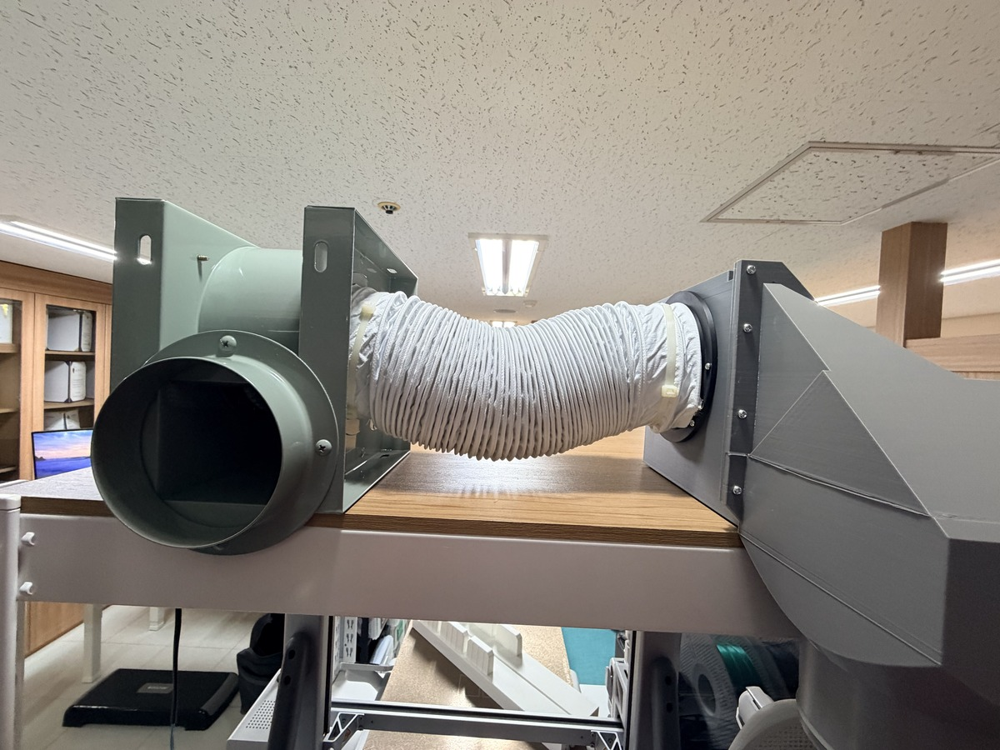

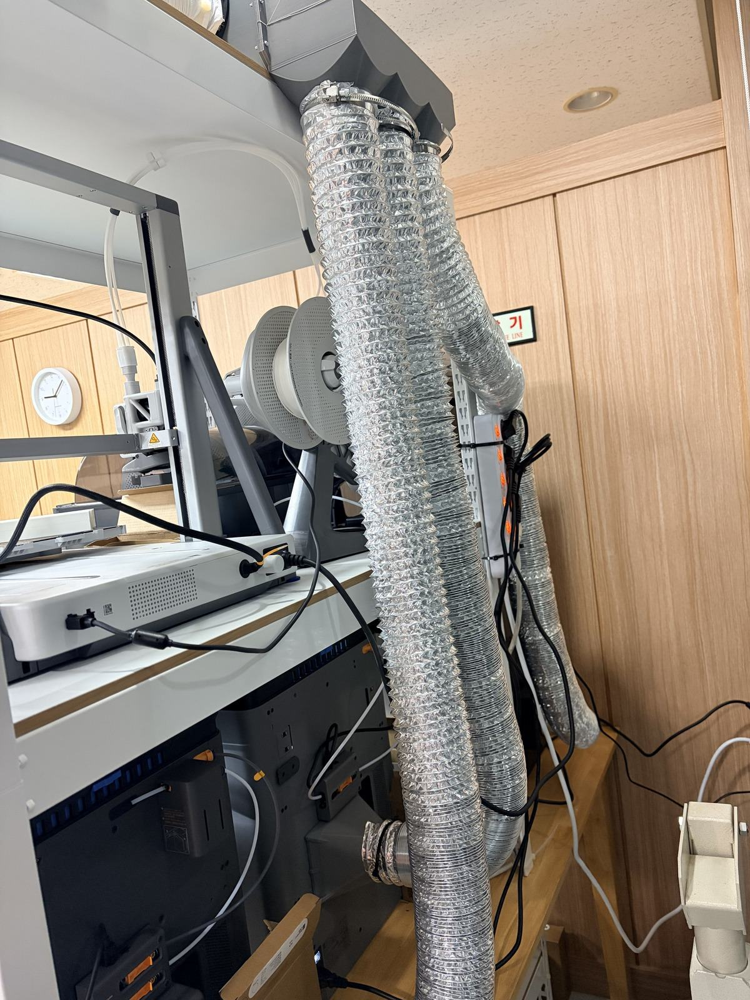

## 창문은 포맥스 5T로 통째로 막았다

사무실 창문이 밖으로 약간 세모지게 열리는 창이다.
열어 두면 너무 춥고, 벌레까지 들어온다 ㅠㅠ
그렇다고 계속 열어 둘 수도 없다.

배기구 자리만 남기고 나머지 틈을 막으면 되지 않나 싶었는데,
창 구조가 애매해서 그것도 쉽지 않더라.

그래서 아예 **창문 전체를 포맥스 5T로 막고**, 거기에 배기구를 뚫어서 달았다.
A3 크기 회색 포맥스 5장을 판끼리 순간접착제로 이었다.
창틀 둘레는 나중에 이사할 때 깔끔하게 뗄 수 있게 **떼어 낼 수 있는 3M 양면테이프**로 붙였다.

근데 창문을 완전히 막아 버리면 곤란하다.
여닫기도 해야 하고, 가끔은 환기도 시켜야 하니까.
그래서 포맥스에 문을 하나 냈다.
다이소에서 경첩을 사다가 달았는데(경첩은 아무거나 써도 된다)... 좀 조잡하긴 하다 ㅋㅋ
문을 잠그는 걸쇠도 어설프게나마 달았다.
문틀이랑 경첩, 걸쇠는 M3 볼트와 너트로 고정했다.
문틈에는 다이소에서 산 접착식 틈새 고무를 붙여서 바람이 새지 않게 했다.
그래도 열고 닫는 데는 문제없다.

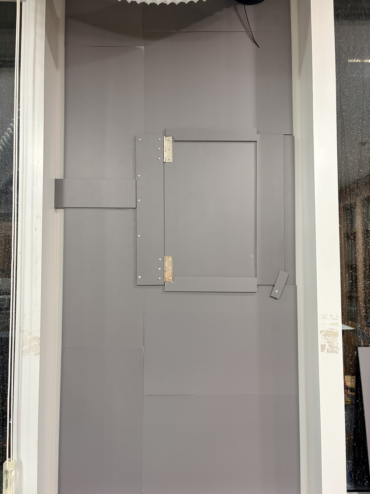

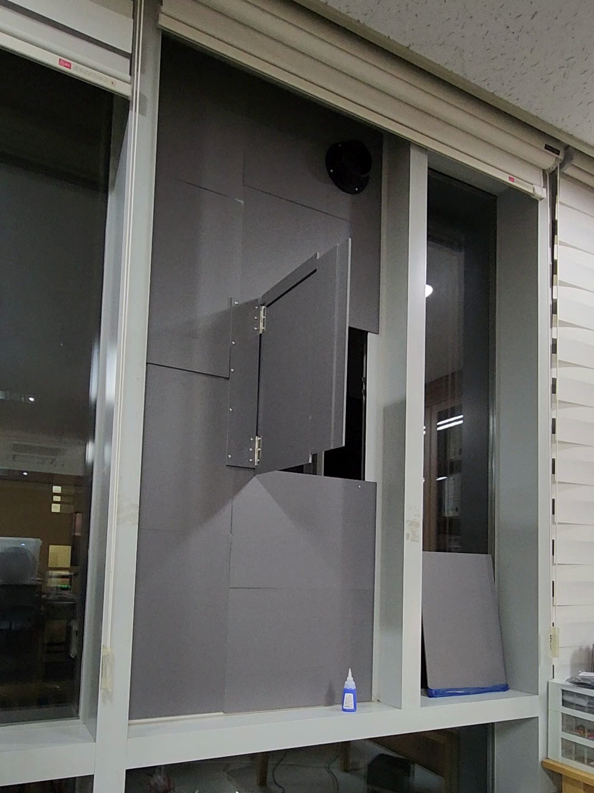

배기구는 MakerWorld의 RandomKhaos 님 모델을 참고했다.
원래는 자석으로 붙였다 뗐다 하는 구조다.
근데 굳이 뗄 일이 없어서 자석은 빼고 일체형으로 바꿨다.

안쪽은 플랜지와 100 mm 수관이 한 덩어리, 바깥쪽은 링이다.
포맥스를 사이에 두고 M4 볼트 4개로 조인다.
바깥 링에 육각 너트 홈이 있어서 안에서 드라이버만 돌리면 된다 ㅎㅎ

포맥스 구멍은 바깥 링을 대고 따라 그린 다음 뚫었다.
링이 그대로 형판이 되니까 편하더라.

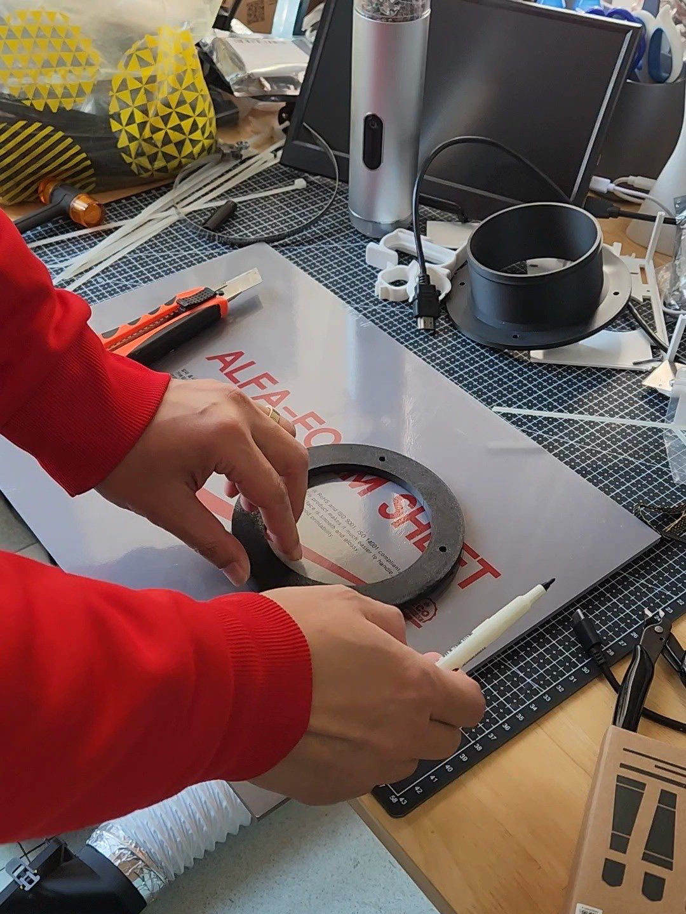

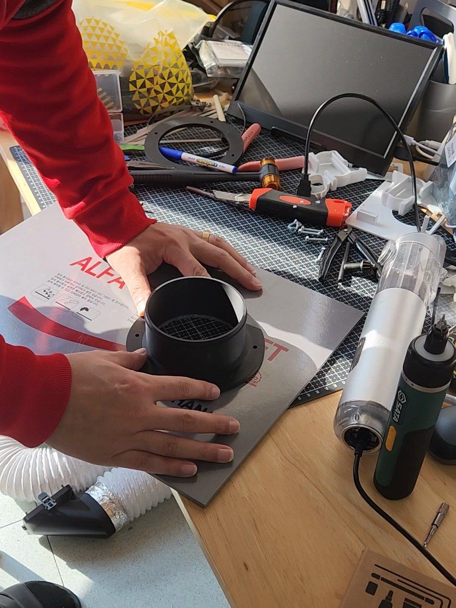

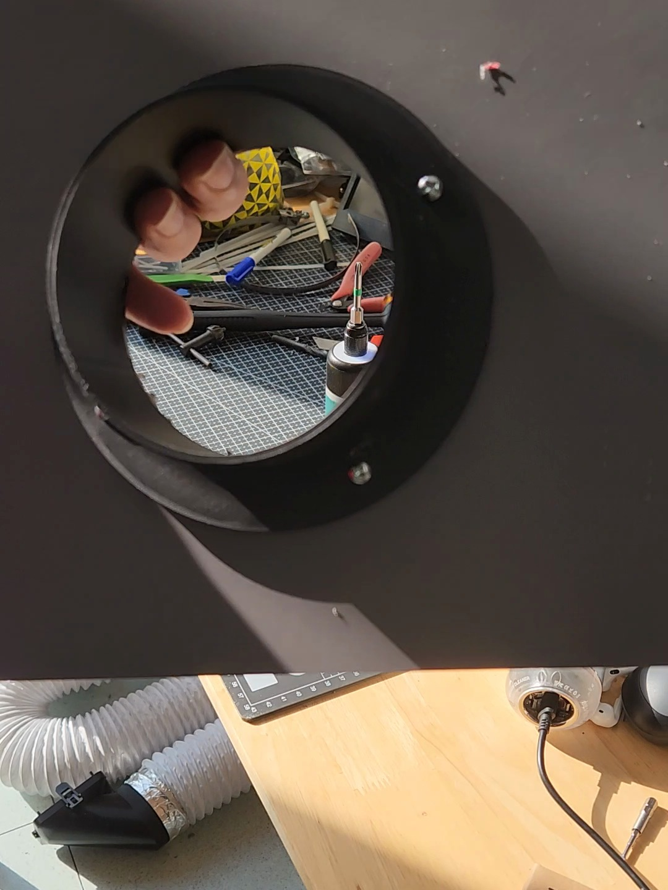

마지막은 흰색 100 mm 주름관이다.
창문 위쪽 배기구에 먼저 물려 두고,

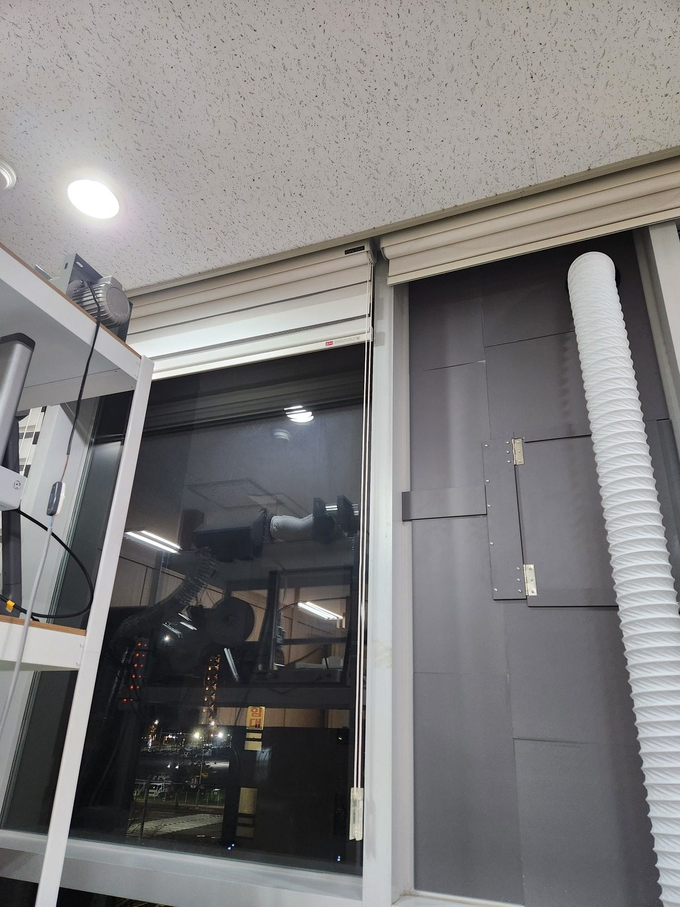

반대쪽 끝을 천장 아래로 둘러서 배기팬 출구에 이었다.

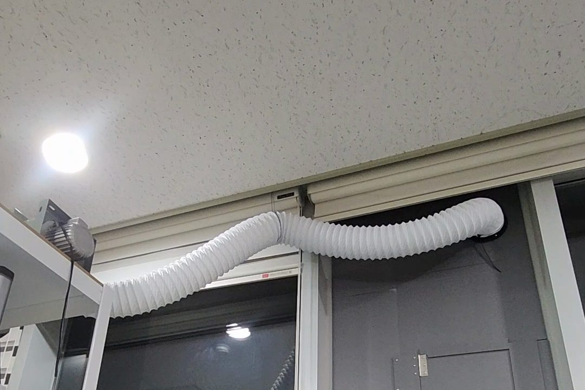

## 다 달고 난 모습

선반 맨 위에는 배기팬과 합류 어댑터가 나란히 올라가 있다.

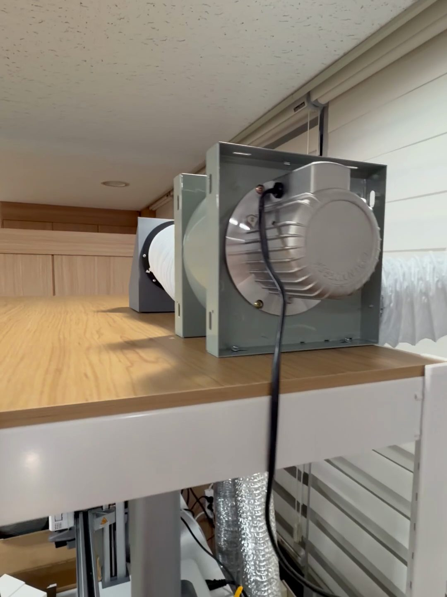

합류 어댑터에서 나온 80 mm 주름관 3줄은 선반 기둥을 따라 내려가 각 프린터 뒷면으로 들어간다.

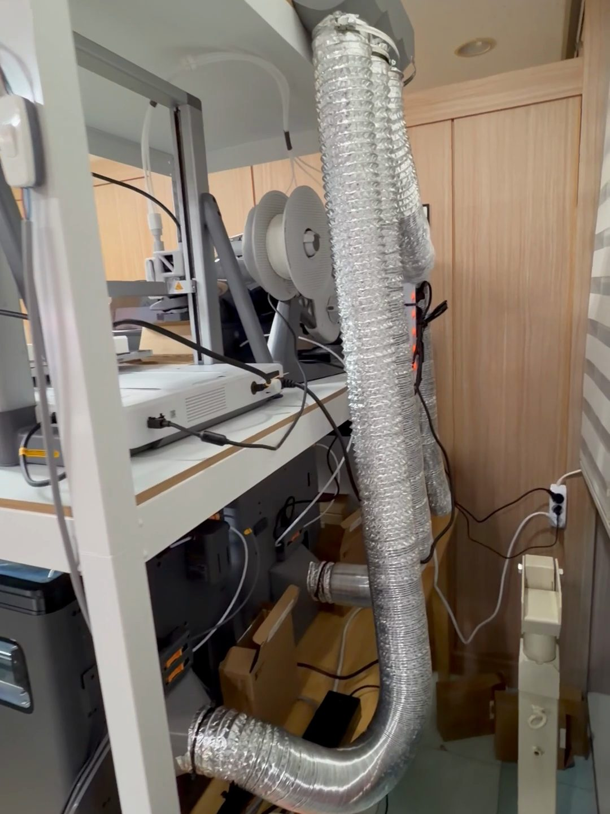

## 정리하면

- 배치는 처음부터 그림으로 맞춰 보자. 말로만 주고받다가 한 번 크게 엎었다.
- 출력 자세가 서포트도, 프라임 타워도 좌우한다. 서포트를 줄였더니 타워가 커질 수도 있더라.
- 공식 키트도 내 상황에 맞게 바꾸면 된다. 팬, 클립 같은 자잘한 부품을 빼니 훨씬 편했다.

아직 남은 것도 있다.
X2D 외장 팬을 뗐을 때 펌웨어 쪽에서 문제가 없는지는 좀 더 지켜보려고 한다.

그리고 A2L은 챔버를 만들어서 이 배기에 붙일 계획이다.
그땐 합류 어댑터 입구를 하나 더 늘려야겠지...
다섯 번째 설계 각이다 ㅋㅋ

비슷하게 배기 만들어 보신 분 있으면 댓글로 알려 주세요!

직접 설계한 합류 어댑터와 창문 배기구(굵기 확인용 시험 링 포함)는 [MakerWorld에 올려 두었다](https://makerworld.com/models/3678886).
P2S·X2D 후드는 공식 키트의 클로 형상이 들어가 있어서 올리지 않았다.

설치 과정은 영상으로도 정리했다.
한두 시간씩 걸린 설치 장면을 짧게 끊어 붙였다 ㅎㅎ
한국어 내레이션이 기본이고, 영어·일본어 등 6개 언어 더빙과 자막도 있다.

  <iframe src="https://www.youtube.com/embed/vhXm8nz6GXE?cc_lang_pref=ko&cc_load_policy=1" title="3D 프린터 배기 시스템 | PETG 냄새, 창문으로 뽑았습니다 (프린터 3대 · 배기팬 1개)" style="position: absolute; inset: 0; width: 100%; height: 100%; border: 0;" allow="accelerometer; autoplay; clipboard-write; encrypted-media; gyroscope; picture-in-picture; web-share" allowfullscreen loading="lazy"></iframe>

짧게 보고 싶으면 쇼츠로.

  <iframe src="https://www.youtube.com/embed/LjdKEq_2nqs?cc_lang_pref=ko&cc_load_policy=1" title="3D 프린터 배기 시스템, PETG 냄새 창문으로 뽑기" style="position: absolute; inset: 0; width: 100%; height: 100%; border: 0;" allow="accelerometer; autoplay; clipboard-write; encrypted-media; gyroscope; picture-in-picture; web-share" allowfullscreen loading="lazy"></iframe>

- 유튜브 롱폼: [3D 프린터 배기 시스템 | PETG 냄새, 창문으로 뽑았습니다 (프린터 3대 · 배기팬 1개)](https://www.youtube.com/watch?v=vhXm8nz6GXE)
- 유튜브 쇼츠: [3D 프린터 배기 시스템, PETG 냄새 창문으로 뽑기](https://www.youtube.com/shorts/LjdKEq_2nqs)

## 출력 정보

| 출력물 | 개수 | 층 높이 | 시간 | 필라멘트(예상) |
|---|---|---|---|---|
| 프린터 후드(P2S·X2D 공용) | 2 | 0.20 mm | 3시간 3분 × 2 | 106.2 g × 2 |
| 합류 어댑터 집합부 | 1 | 0.20 mm | 8시간 50분 | 359.2 g |
| 합류 어댑터 통로 | 1 | 0.20 mm | 4시간 50분 | 213.4 g |
| 100 mm 수관 판 | 1 | 0.20 mm | 1시간 17분 | 48.2 g |
| 창문 배기구(실내 조각 + 바깥 링) | 1세트 | 0.20 mm | 1시간 57분 | 80.5 g |
| 합계 | 6 | | 23시간 0분 | 913.7 g |

- 프린터: Bambu Lab H3C 설정 기준(0.4 mm 노즐). 합류 어댑터 집합부는 판이 300 mm 필요해서 H3C나 A2L로 뽑아야 한다.
- 필라멘트: Bambu PETG Basic. 후드 서포트 접촉면만 PLA Basic.
- 시간과 필라멘트는 Bambu Studio 슬라이서 예상값이다. 후드 값에는 서포트 5.6 g과 프라임 타워가 들어 있다. 클로 맞춤 시험편은 표에서 뺐다.

## 출처

- P2S·X2D 후드: 직접 설계 (프린터에 걸리는 클로 형상만 Bambu Lab 님의 P2S Exhaust Fan Kit (X2D Pipe Connector)에서 가져옴)
- 합류 어댑터·100 mm 수관 판: 직접 설계
- H3C 후드: Bambu Lab 님의 E1 Air Purifier Hose Adapter (H3C 프로필)
- 창문 배기구: RandomKhaos 님의 Generic Magnetic Hose Adapter — 자석 없이 양쪽 볼트 체결로 다시 설계
