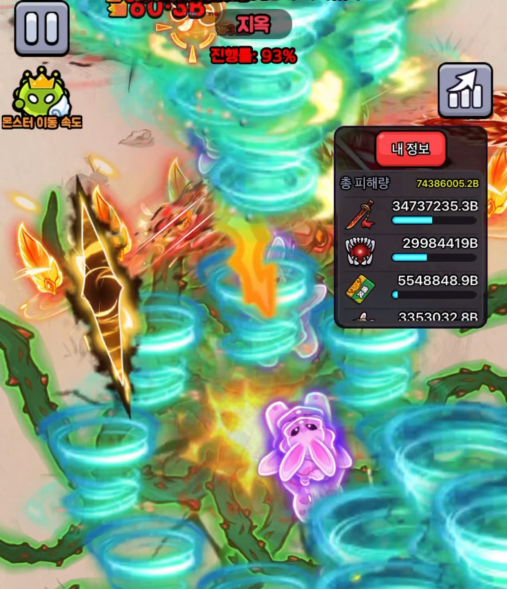
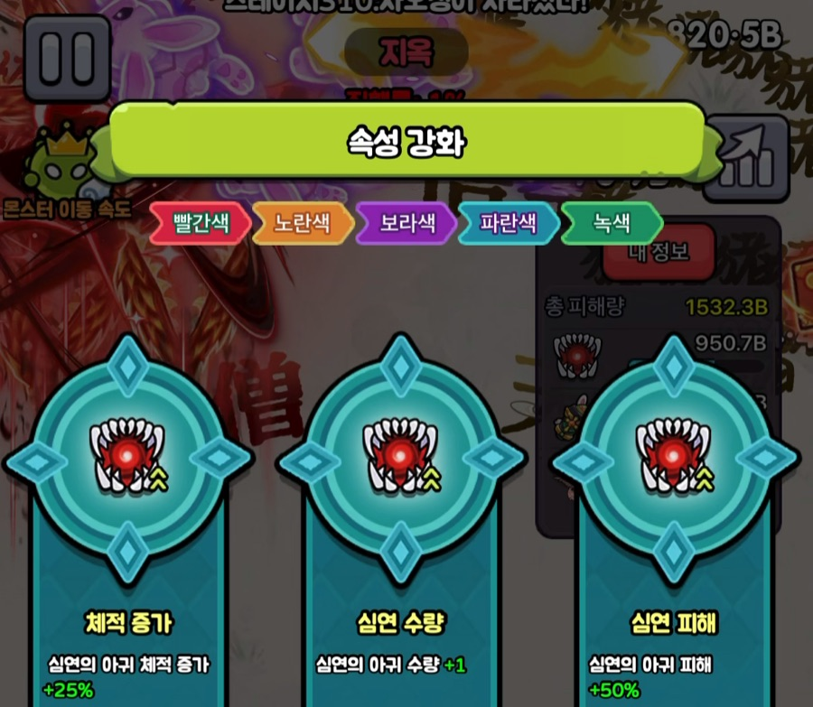
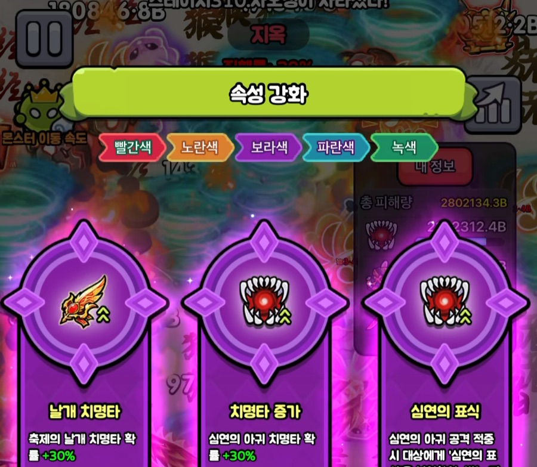
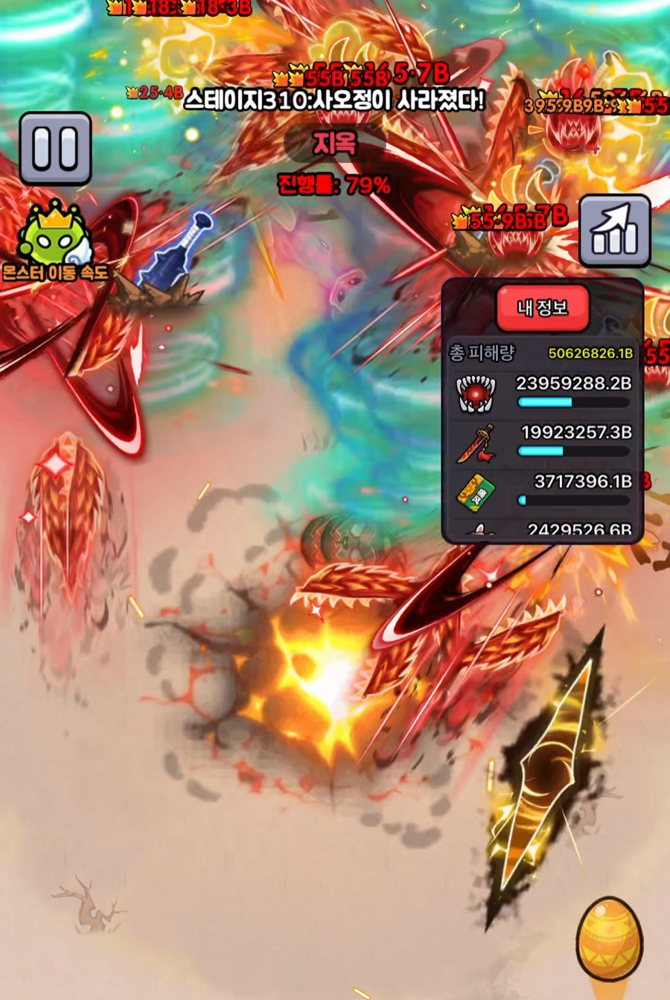
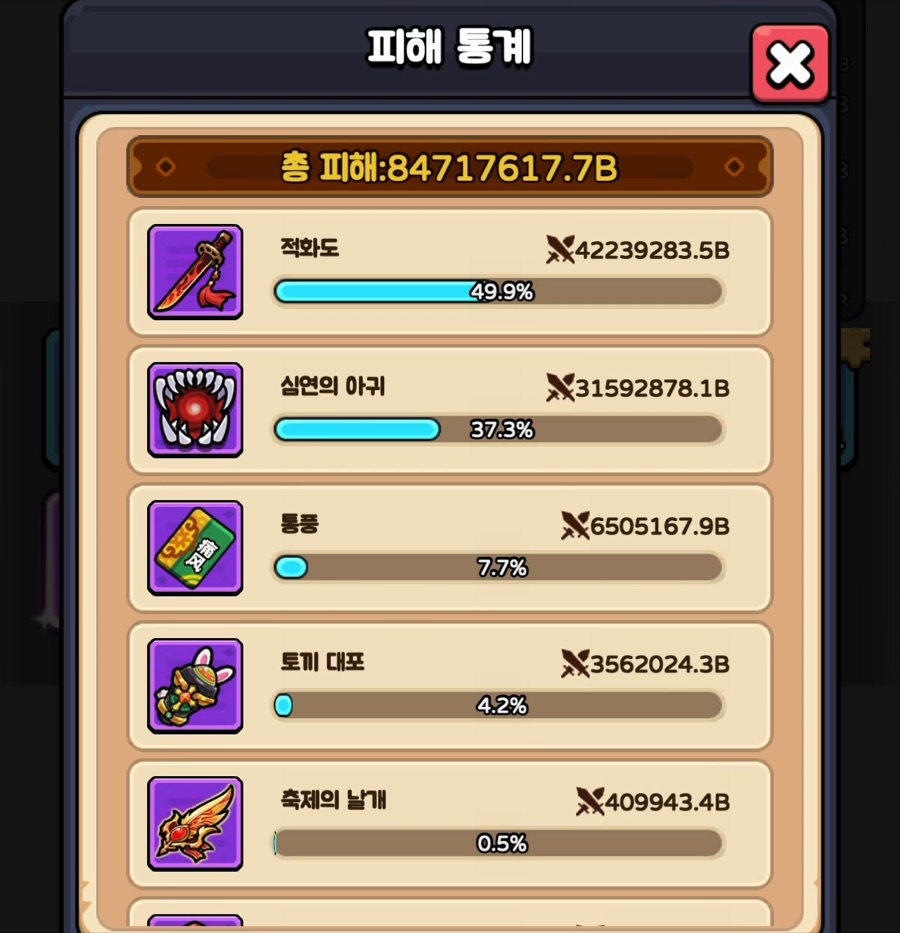
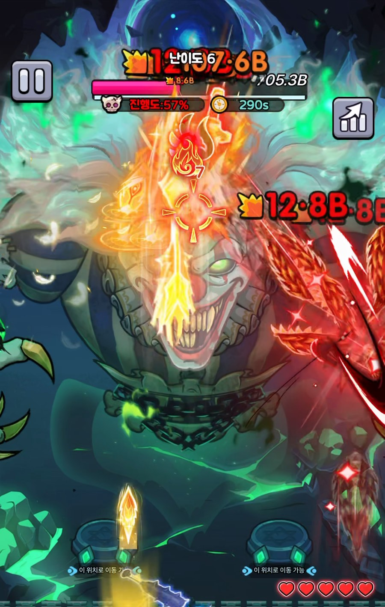

There's a mobile game I've been playing a lot lately.
It's Cell Survivor (the Korean title is 세포특공대).

So far this blog has only had 3D printer posts, so this is my first game post, haha.
There was an update today, so I'm saving two records I captured before it.

- Cleared Stage 310, the last stage before the update
- Ancient Invasion, final difficulty 6, a 10-second clear

## What Kind of Game Is Cell Survivor

It's a roguelike defense game. Enemies pour down from the top, and you hold them off with weapons on the bottom line.
During a fight, three "attribute upgrade" cards pop up at a time, and you pick one to power up your weapons.

If you don't like the options, you can refresh, but only a set number of times.
Which cards show up comes down to luck, so even the same stage plays out differently every run.

## The Last Stage Before the Update, 310

Stage 310 is called "Sha Wujing Has Vanished!" (「사오정이 사라졌다!」).
It's a Journey to the West chapter, with characters like 悟空 floating around in the background.

I had 8 weapons equipped this run.
Abyssal Maw (심연의 아귀), Mechanical Heart (기계의 심장), Monkey King (몽키킹), Red Blade (적화도), Bunny Cannon (토끼 대포), Ventilation (통풍), Festival Wings (축제의 날개), and Tide Stone (조수의 돌).

The most important piece of this build is the Abyssal Mark (심연의 표식).
It isn't a separate skill. It's one of the Abyssal Maw cards.
Enemies hit by the Maw get a mark, and marked enemies take 100% more damage.

So the Maw doesn't just get stronger on its own. It boosts the damage of your other weapons too.
That made it a must-have in this run.

## But the Abyssal Mark Won't Show Up

Cards kept coming, but all I got for the Maw were damage, count, and size upgrades.

1 minute, 2 minutes, 6 minutes, 7 minutes...
Maw cards kept showing up on schedule, but the Mark never appeared.

Ten minutes in, progress was still at 24%.
Honestly, it was pretty rough.

## 11 min 48 s, Finally

At 11 min 48 s into the fight, it finally showed up.
Progress was at 29%.

I picked it right away, haha.

I wanted to know how much it changed things, so I read the total damage that builds up in "My Info" at the top right of the screen from the recording, by time range.

| Segment (by recording) | Damage per minute |
|---|---|
| Before the Mark, 6 min to 12 min | about 386K B |
| Right after the Mark, 12.5 min to 18 min | about 2M B |
| Late game, 25 min to 31 min | about 5.57M B |

After I picked the Mark, damage per minute went up about 5x.
Other upgrades kept stacking in the meantime, so I can't say it was all thanks to the Mark.

Still, the damage from the first 12 minutes is only 3.3% of the final total.
You can see in the numbers how frustrating that opening was, haha.

## Cleared in 31 min 45 s

In the late game the screen fills up with effects.

I finally cleared it in 31 min 45 s.
Total damage was 84,717,617.7B.

By weapon, the Red Blade did half (49.9%), and the Abyssal Maw was second at 37.3%.
So the Maw boosted the other weapons' damage with the Mark and still dealt the second-most damage itself.

## Ancient Invasion, Final Difficulty 6, a 10-Second Clear

I'm saving one more record from another mode, Ancient Invasion (원시 침공).
It's a boss-fight mode, and before the update, difficulty 6 was the final one.

The time limit is 300 seconds.
For the first 8 seconds, progress didn't budge from 0%.
Then in the last 2.5 seconds it went from 0% to 100%.

From 300 seconds left down to 290.
A clean 10-second clear, haha.

## Video

I also cut these into two Shorts.
Game audio as-is, with Korean captions on screen and subtitles in 7 languages.

  <iframe src="https://www.youtube.com/embed/xHoMl8oHquI?cc_lang_pref=en&cc_load_policy=1" title="Cell Survivor Stage 310: my must-have skill didn't show for 11 minutes" style="position: absolute; inset: 0; width: 100%; height: 100%; border: 0;" allow="accelerometer; autoplay; clipboard-write; encrypted-media; gyroscope; picture-in-picture; web-share" allowfullscreen loading="lazy"></iframe>

And here is the 10-second Ancient Invasion clear.

  <iframe src="https://www.youtube.com/embed/WqDoFDl6u4E?cc_lang_pref=en&cc_load_policy=1" title="Cell Survivor: Ancient Invasion max level in 10 seconds (before the update)" style="position: absolute; inset: 0; width: 100%; height: 100%; border: 0;" allow="accelerometer; autoplay; clipboard-write; encrypted-media; gyroscope; picture-in-picture; web-share" allowfullscreen loading="lazy"></iframe>

- YouTube Shorts (Stage 310): [Cell Survivor Stage 310: my must-have skill didn't show for 11 minutes](https://www.youtube.com/shorts/xHoMl8oHquI)
- YouTube Shorts (Ancient Invasion): [Cell Survivor: Ancient Invasion max level in 10 seconds (before the update)](https://www.youtube.com/shorts/WqDoFDl6u4E)

## Wrap-up

- If you run the Abyssal Maw in Cell Survivor, make sure you get the Abyssal Mark. In this run it came late, so the damage from the first 12 minutes was only 3.3% of the total.
- Still, you can just hold on. After the Mark showed up, damage per minute jumped, and I cleared it in 31 min 45 s.
- Ancient Invasion difficulty 6 is quiet for the first 8 seconds, then ends in the last 2.5.

If you play Cell Survivor, around what minute does the Abyssal Mark usually show up for you?
Let me know in the comments!

## Play info

| Item | Stage 310 | Ancient Invasion |
|---|---|---|
| Name / difficulty | Chapter 310 "Sha Wujing Has Vanished!" | Difficulty 6 (final before the update) |
| Clear time | 31 min 45 s | 10 s (300 s to 290 s) |
| Result | Total damage 84,717,617.7B | Progress 100% |
| Highlight | Abyssal Mark appeared at 11 min 48 s | Progress stuck at 0% for 8 s, then 100% in 2.5 s |

- Equipped weapons: Abyssal Maw, Mechanical Heart, Monkey King, Red Blade, Bunny Cannon, Ventilation, Festival Wings, Tide Stone.
- Recorded: 2026-11-22 (310) and 11-23 (Ancient Invasion), before the update. Times and damage are values read from the recorded footage, and the clear time runs from the first card screen to the victory screen.
