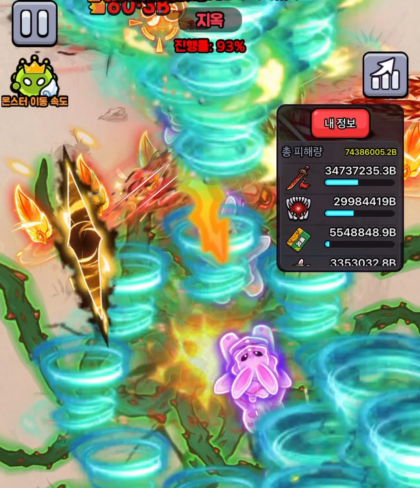
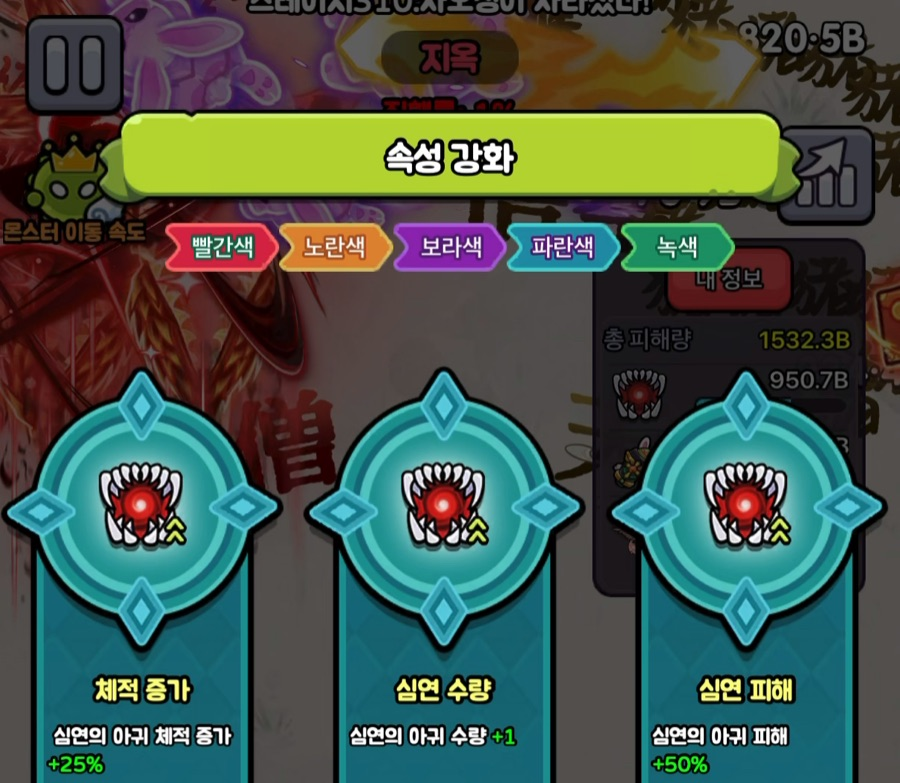
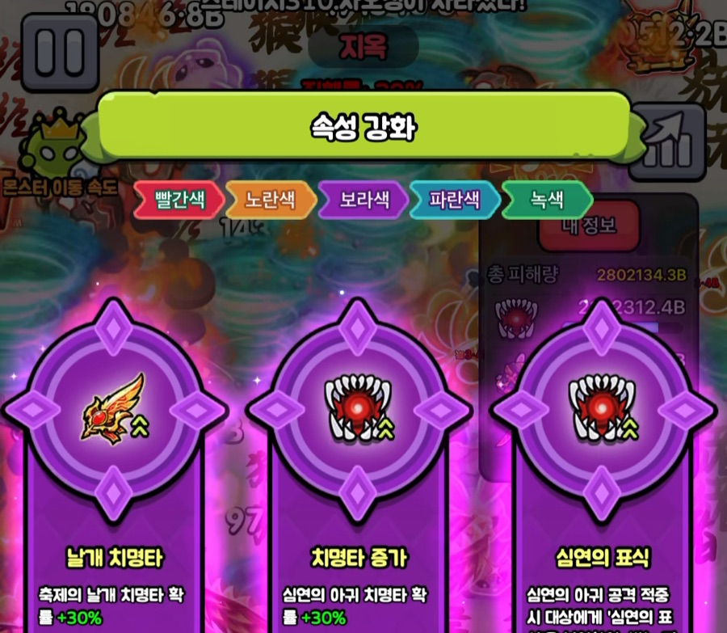
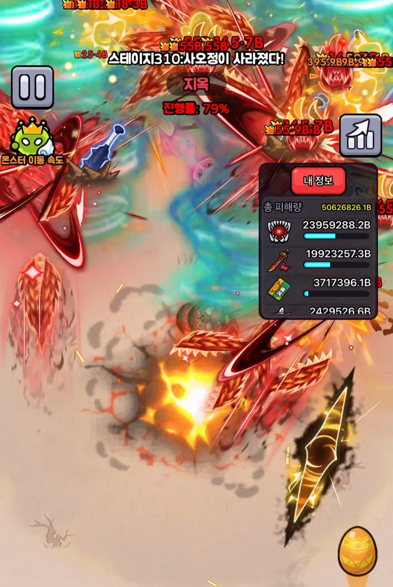
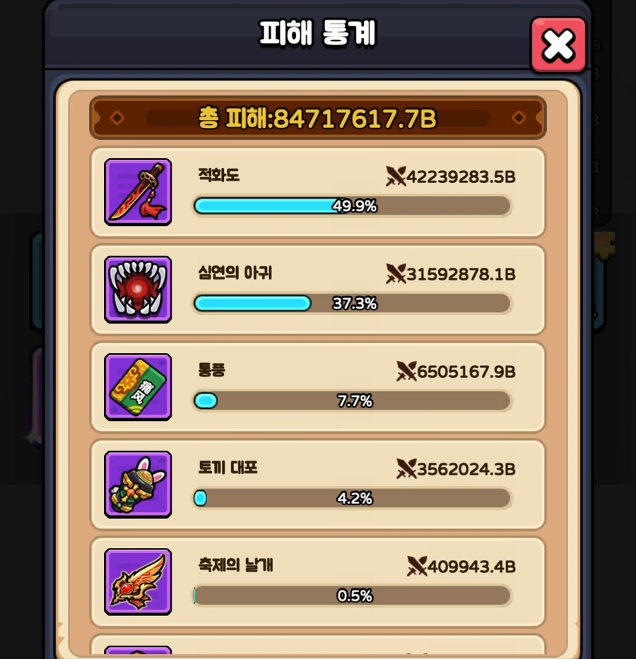
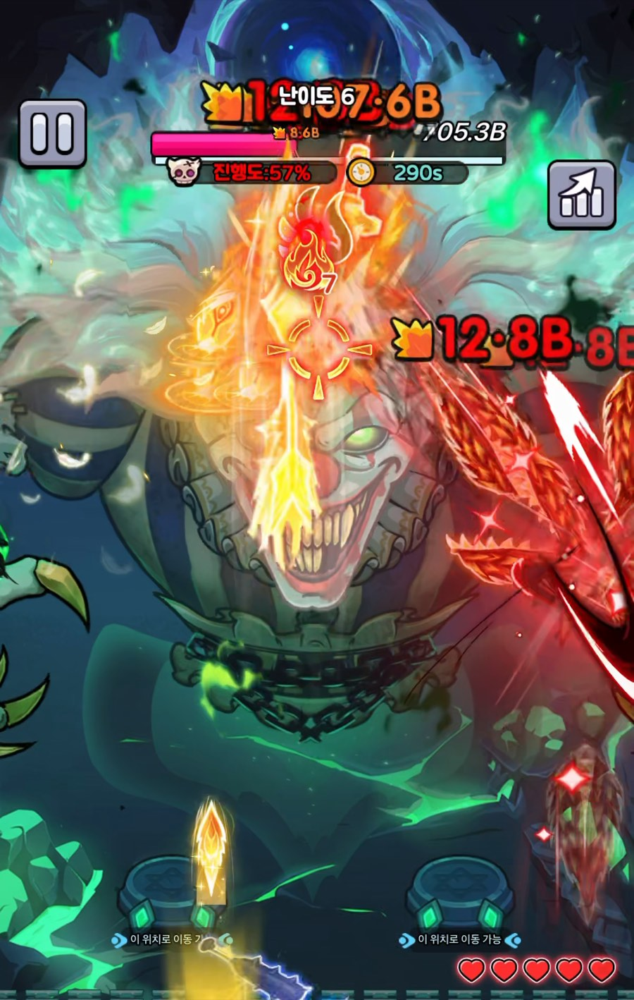

最近よく遊んでいるモバイルゲームがあります。
Cell Survivor（韓国語の題名は세포특공대）です。

これまでブログには3Dプリンターの記事ばかり載せてきましたが、今回は初めてのゲーム記事です。
今日アップデートがあったので、その前に撮っておいた記録を2つ残しておきます。

- アップデート前の最終ステージ310をクリア
- Ancient Invasion（원시 침공）最終難易度6、10秒クリア

## Cell Survivorはこんなゲームです

上から押し寄せてくる敵を、下のラインで武器を使って食い止めるローグライクのディフェンスゲームです。
戦闘中に「属性強化」のカードが3枚ずつ出て、その中から1枚を選んで武器を育てていきます。

気に入らなければ更新できますが、回数は決まっています。
結局どのカードが出るかは運なので、同じステージでも毎回流れが変わります。

## アップデート前の最終ステージ、310

310の名前は「Sha Wujing Has Vanished!」（「사오정이 사라졌다!」、「沙悟浄が消えた！」）です。
背景のあちこちに悟空のような漢字が浮かんでいる、西遊記のチャプターです。

今回の挑戦で装備した武器は8つです。
Abyssal Maw（심연의 아귀）、Mechanical Heart（기계의 심장）、Monkey King（몽키킹）、Red Blade（적화도）、Bunny Cannon（토끼 대포）、Ventilation（통풍）、Festival Wings（축제의 날개）、Tide Stone（조수의 돌）です。

この組み合わせでいちばん大切なのが「Abyssal Mark」（심연의 표식）です。
独立したスキルではなく、「Abyssal Maw」のカードの1つです。
Mawの攻撃を受けた敵に印をつけ、印のついた敵は受けるダメージが100%増えます。

Maw単体が強くなるのではなく、ほかの武器のダメージまで一緒に引き上げてくれます。
だからこの挑戦では必須でした。

## ところがAbyssal Markが出ません

カードはずっと出るのですが、Mawの側はダメージ・数・体積の強化ばかりです。

1分、2分、6分、7分と過ぎていきます。
Mawのカードは律儀に出るのに、Markだけが最後まで見えませんでした。

10分が過ぎても進行度は24%です。
正直、かなり困りました。

## 11分48秒、ついに

戦闘開始から11分48秒で、ようやく出ました。
進行度29%のときです。

すぐに選びました。

どれくらい変わったのか気になって、画面右上の「マイ情報」に溜まっていく総ダメージ量を、録画から時間帯ごとに読み取ってみました。

| 区間（録画基準） | 毎分のダメージ |
|---|---|
| Mark前、6分～12分 | 約38.6万B |
| Mark直後、12分半～18分 | 約200万B |
| 後半、25分～31分 | 約557万B |

Markを選んでから、毎分のダメージが約5倍になりました。
もちろんその間にほかの強化も積み重なっているので、すべてMarkのおかげとは言えません。

それでも、最初の12分間に溜めたダメージは最終ダメージのわずか3.3%です。
序盤がどれだけもどかしかったか、数字で見えます（笑）。

## 31分45秒、最終ステージクリア

後半は画面がエフェクトでいっぱいになります。

最終的に31分45秒でクリアしました。
総ダメージは84,717,617.7Bです。

武器別ではRed Bladeが半分（49.9%）を出し、Abyssal Mawが37.3%で2位です。
MawはMarkでほかの武器のダメージを上げながら、自分も2番目に多く与えたことになります。

## Ancient Invasion最終難易度6、10秒クリア

別のモードのAncient Invasionも1つ残しておきます。
ボス戦のモードで、アップデート前は難易度6が最終でした。

制限時間は300秒です。
開始から8秒間は、進行度が0%のまま動きませんでした。
それが最後の2.5秒で、0%から100%まで一気に上がりました。

残り時間300秒から290秒。
ちょうど10秒クリアです。

## 動画

ショート動画も2本作りました。
ゲームの音はそのままで、画面に字幕だけ載せています(字幕は7言語)。

  <iframe src="https://www.youtube.com/embed/jChEJJ6KmfI?cc_lang_pref=ja&cc_load_policy=1" title="Cell Survivor アップデート前の最終ステージ310クリア(31分45秒)" style="position: absolute; inset: 0; width: 100%; height: 100%; border: 0;" allow="accelerometer; autoplay; clipboard-write; encrypted-media; gyroscope; picture-in-picture; web-share" allowfullscreen loading="lazy"></iframe>

Ancient Invasion の10秒クリアはこちらです。

  <iframe src="https://www.youtube.com/embed/WqDoFDl6u4E?cc_lang_pref=ja&cc_load_policy=1" title="Cell Survivor 原始侵攻(Ancient Invasion)最終難易度を10秒でクリア(アップデート前)" style="position: absolute; inset: 0; width: 100%; height: 100%; border: 0;" allow="accelerometer; autoplay; clipboard-write; encrypted-media; gyroscope; picture-in-picture; web-share" allowfullscreen loading="lazy"></iframe>

- YouTubeショート(ステージ310): [Cell Survivor アップデート前の最終ステージ310クリア(31分45秒)](https://www.youtube.com/shorts/jChEJJ6KmfI)
- YouTubeショート(Ancient Invasion): [Cell Survivor 原始侵攻(Ancient Invasion)最終難易度を10秒でクリア(アップデート前)](https://www.youtube.com/shorts/WqDoFDl6u4E)

## まとめ

- アップデート前の最終ステージ310を31分45秒でクリアしました。総ダメージは84,717,617.7Bです。
- 途中、必須スキルの「Abyssal Mark」が11分48秒まで出ず、最初の12分間に溜めたダメージは全体の3.3%だけでした。Abyssal Mawを使うなら、Markは必ず確保したいところです。
- Ancient Invasion難易度6は、開始の8秒間は静かで、最後の2.5秒で終わります。

Cell Survivorを遊んでいる方、アップデート前に310までクリアできましたか？
Abyssal Markがだいたい何分ごろに出るのかも気になります。
コメントで教えてください！

## プレイ情報

| 項目 | ステージ310 | Ancient Invasion |
|---|---|---|
| 名前・難易度 | チャプター310「沙悟浄が消えた！」 | 難易度6（アップデート前の最終） |
| クリア時間 | 31分45秒 | 10秒（300秒 → 290秒） |
| 結果 | 総ダメージ84,717,617.7B | 進行度100% |
| ポイント | Abyssal Markが11分48秒に登場 | 8秒間は進行度0% → 2.5秒で100% |

- 装備武器：Abyssal Maw、Mechanical Heart、Monkey King、Red Blade、Bunny Cannon、Ventilation、Festival Wings、Tide Stone。
- 録画：2026-11-22（310）・11-23（Ancient Invasion）、アップデート前。時間とダメージは録画画面から読み取った値で、クリア時間は最初のカード画面から勝利画面までです。
