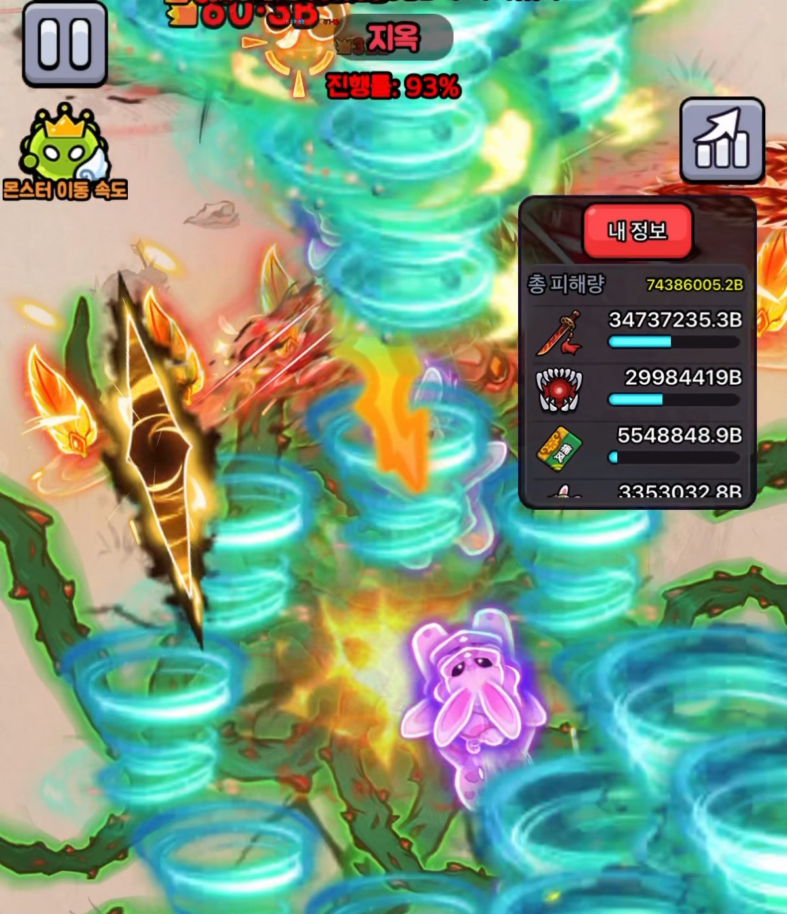
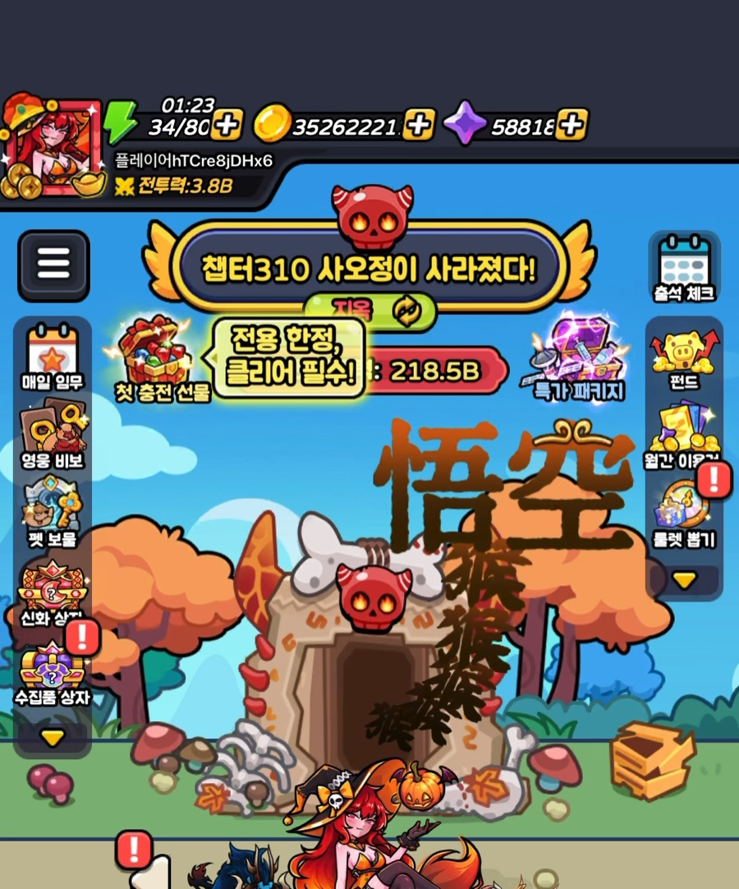
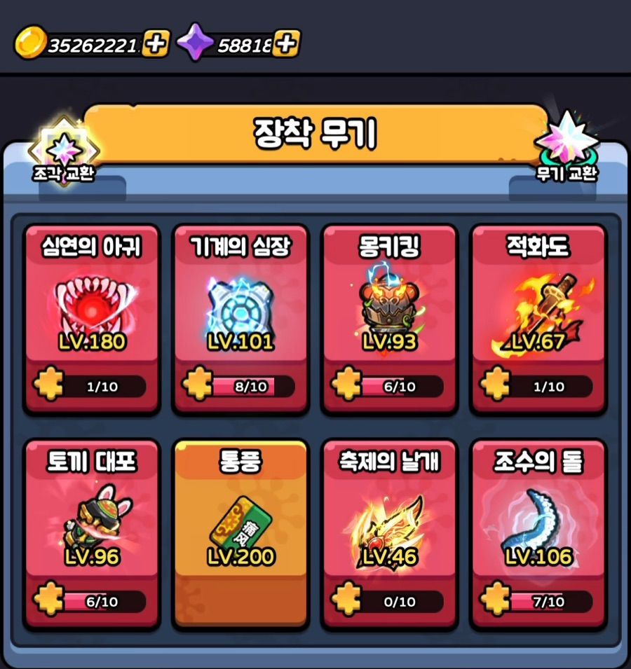
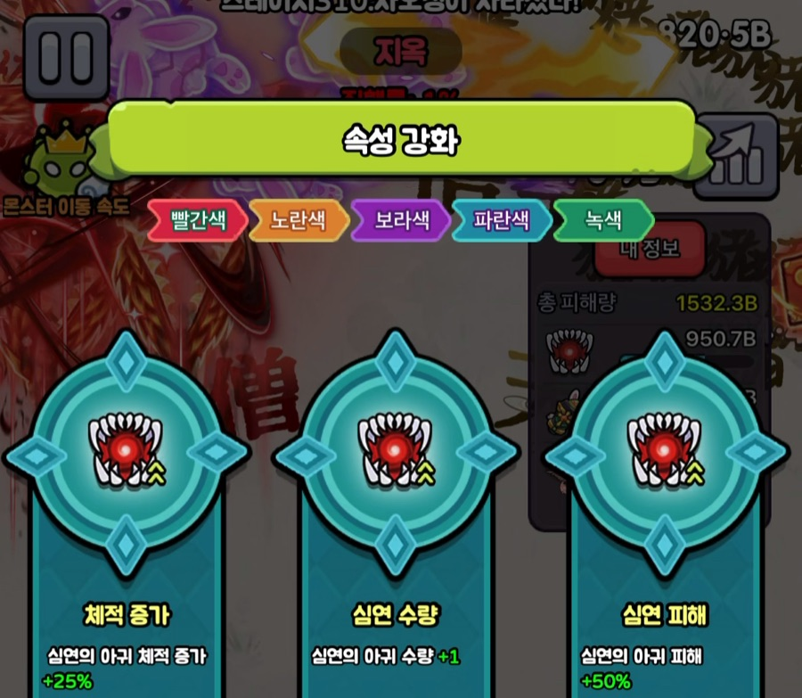
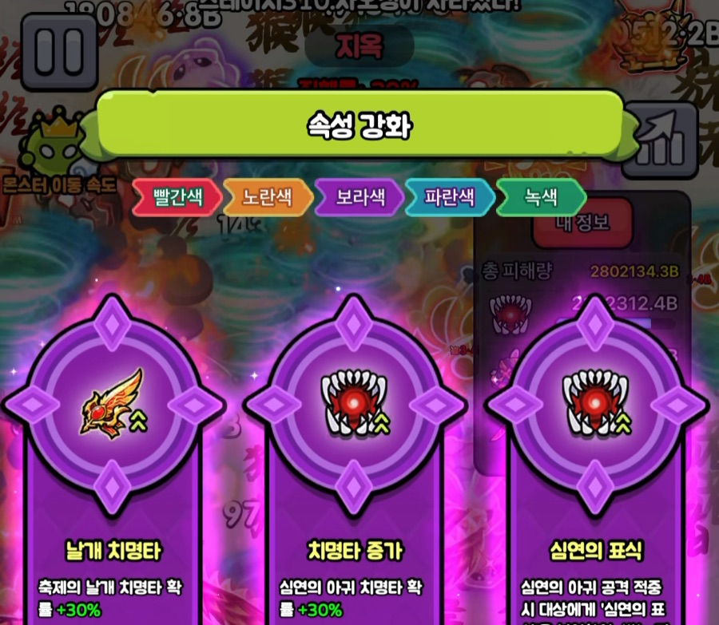
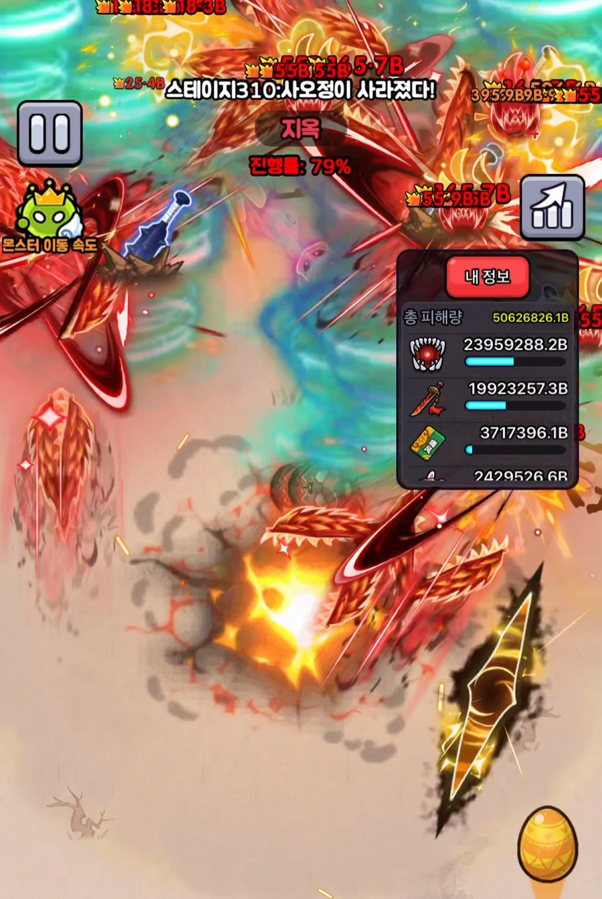
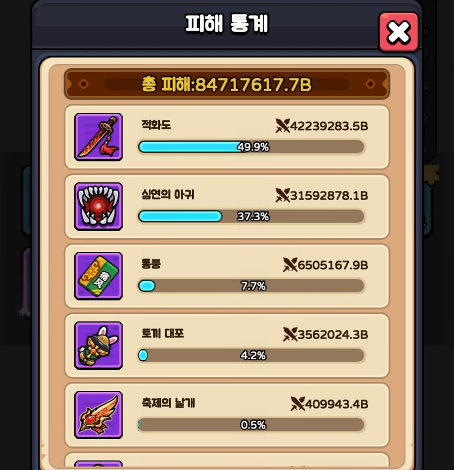
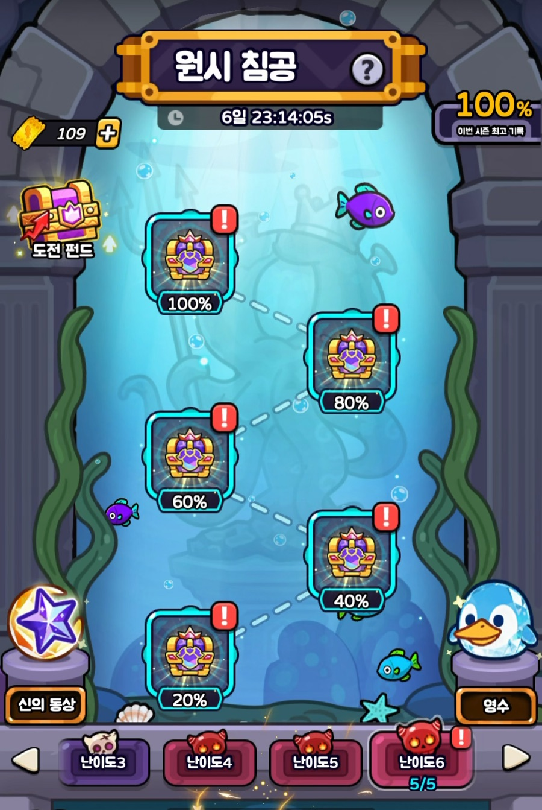
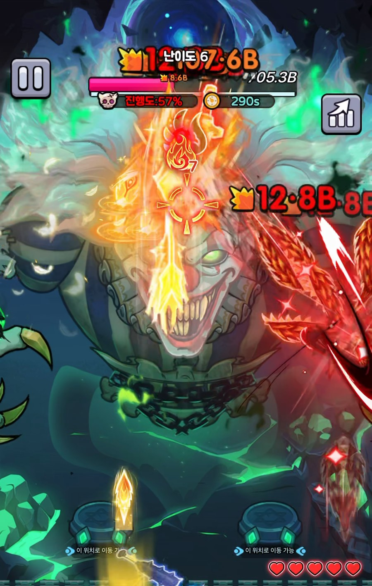
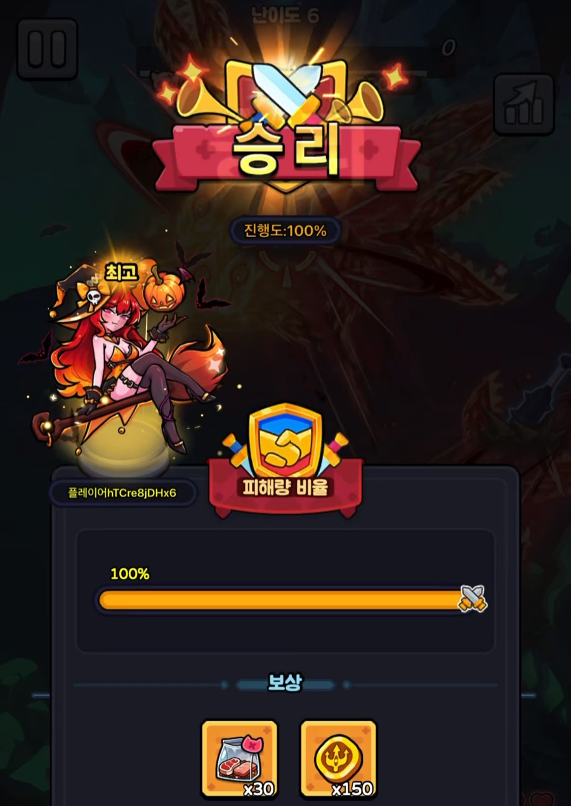

요즘 즐겨 하는 모바일 게임이 있다.
세포특공대다. 영문 이름은 Cell Survivor.

그동안 블로그에는 3D 프린터 글만 올렸는데, 이번엔 처음으로 게임 글이다 ㅎㅎ
오늘 업데이트가 있어서, 그 전에 찍어 둔 기록 두 개를 남겨 둔다.

- 업데이트 전 마지막 스테이지 310 클리어
- 원시 침공 최종 난이도 6, 10초 컷

## 세포특공대는 이런 게임이다

위에서 몰려 내려오는 적을 아래쪽 라인에서 무기로 막아 내는 로그라이크 디펜스 게임이다.
전투 중에 '속성 강화' 카드가 3장씩 뜨고, 그중 하나를 골라 무기를 키워 간다.

마음에 안 들면 새로 고침을 할 수 있지만 횟수가 정해져 있다.
결국 어떤 카드가 뜨느냐는 운이라, 같은 스테이지도 판마다 흐름이 다르다.

## 업데이트 전 마지막 스테이지, 310

310의 이름은 「사오정이 사라졌다!」.
배경 곳곳에 悟空 같은 한자가 떠다니는 서유기 챕터다.

이번 판에 낀 무기는 8개.
심연의 아귀, 기계의 심장, 몽키킹, 적화도, 토끼 대포, 통풍, 축제의 날개, 조수의 돌.

이 조합에서 제일 중요한 게 「심연의 표식」이다.
따로 있는 스킬이 아니라 「심연의 아귀」 카드 중 하나인데,
아귀 공격에 맞은 적에게 표식을 붙이고, 표식이 붙은 적은 받는 피해가 100% 늘어난다.

아귀 혼자 세지는 게 아니라 다른 무기 피해까지 같이 올려 준다.
그래서 이 판에서는 필수였다.

## 그런데 심연의 표식이 안 나온다

카드는 계속 뜨는데, 아귀 쪽은 피해·수량·체적 강화만 나온다.

1분, 2분, 6분, 7분...
아귀 카드는 꼬박꼬박 나오는데 표식만 끝까지 안 보였다.

10분이 지나도 진행도는 24%.
솔직히 좀 난감했다 ㅠㅠ

## 11분 48초, 드디어

전투 시작하고 11분 48초째에 드디어 떴다.
진행도 29%일 때다.

바로 골랐다 ㅎㅎ

얼마나 달라졌는지 궁금해서, 화면 오른쪽 위 '내 정보'에 쌓이는 총 피해량을 녹화에서 시간대별로 읽어 봤다.

| 구간(녹화 기준) | 분당 피해 |
|---|---|
| 표식 전, 6분 ~ 12분 | 약 38.6만B |
| 표식 직후, 12분 반 ~ 18분 | 약 200만B |
| 후반, 25분 ~ 31분 | 약 557만B |

표식을 고르고 나서 분당 피해가 약 5배가 됐다.
물론 그 사이에 다른 강화도 계속 쌓였으니, 전부 표식 덕이라고는 못 한다.

그래도 처음 12분 동안 쌓은 피해가 최종 피해의 3.3%밖에 안 된다.
앞부분이 얼마나 답답했는지 숫자로 보인다 ㅋㅋ

## 31분 45초 만에 클리어

후반에는 화면이 이펙트로 꽉 찬다.

결국 31분 45초 만에 클리어했다.
총 피해는 84,717,617.7B.

무기별로는 적화도가 절반(49.9%)을 냈고, 심연의 아귀가 37.3%로 두 번째다.
아귀는 표식으로 다른 무기 피해를 올려 주면서 자기도 두 번째로 많이 때린 셈이다.

## 원시 침공 최종 난이도 6, 10초 컷

다른 모드인 원시 침공도 하나 남겨 둔다.
보스전 모드인데, 업데이트 전에는 난이도 6이 최종이었다.

제한 시간은 300초.
시작하고 8초 동안은 진행도가 0%에서 꿈쩍도 안 했다.
그러다 마지막 2.5초 만에 0%에서 100%까지 올라갔다.

남은 시간 300초에서 290초.
딱 10초 컷이다 ㅎㅎ

## 영상

쇼츠로도 짧게 만들었다.
게임 소리 그대로에 자막만 얹었다 ㅎㅎ

  <iframe src="https://www.youtube.com/embed/xHoMl8oHquI?cc_lang_pref=ko&cc_load_policy=1" title="세포특공대 310 클리어, 필수 스킬 심연의 표식이 11분 동안 안 나왔다" style="position: absolute; inset: 0; width: 100%; height: 100%; border: 0;" allow="accelerometer; autoplay; clipboard-write; encrypted-media; gyroscope; picture-in-picture; web-share" allowfullscreen loading="lazy"></iframe>

원시 침공 10초 컷은 이쪽.

  <iframe src="https://www.youtube.com/embed/WqDoFDl6u4E?cc_lang_pref=ko&cc_load_policy=1" title="세포특공대 원시 침공 최종 난이도 10초 컷 (업데이트 전)" style="position: absolute; inset: 0; width: 100%; height: 100%; border: 0;" allow="accelerometer; autoplay; clipboard-write; encrypted-media; gyroscope; picture-in-picture; web-share" allowfullscreen loading="lazy"></iframe>

- 유튜브 쇼츠(310): [세포특공대 310 클리어, 필수 스킬 심연의 표식이 11분 동안 안 나왔다](https://www.youtube.com/shorts/xHoMl8oHquI)
- 유튜브 쇼츠(원시 침공): [세포특공대 원시 침공 최종 난이도 10초 컷 (업데이트 전)](https://www.youtube.com/shorts/WqDoFDl6u4E)

## 정리하면

- 세포특공대에서 심연의 아귀를 쓰면 「심연의 표식」은 꼭 챙겨야 한다. 이번 판은 이게 늦게 나와서 앞 12분 동안 쌓은 피해가 전체의 3.3%뿐이었다.
- 그래도 버티면 된다. 표식이 나온 뒤로는 분당 피해가 확 뛰었고, 31분 45초 만에 깼다.
- 원시 침공 난이도 6은 시작 8초는 조용하다가 마지막 2.5초에 끝난다.

세포특공대 하시는 분들, 심연의 표식 보통 몇 분쯤에 나오나요?
댓글로 알려 주세요!

## 플레이 정보

| 항목 | 스테이지 310 | 원시 침공 |
|---|---|---|
| 이름·난이도 | 챕터 310 「사오정이 사라졌다!」 | 난이도 6(업데이트 전 최종) |
| 클리어 시간 | 31분 45초 | 10초(300초 → 290초) |
| 결과 | 총 피해 84,717,617.7B | 진행도 100% |
| 포인트 | 심연의 표식 11분 48초에 등장 | 8초간 진행도 0% → 2.5초 만에 100% |

- 장착 무기: 심연의 아귀, 기계의 심장, 몽키킹, 적화도, 토끼 대포, 통풍, 축제의 날개, 조수의 돌.
- 녹화: 2026-11-22(310)·11-23(원시 침공), 업데이트 전. 시간과 피해는 녹화 화면에서 읽은 값이고, 클리어 시간은 첫 카드 화면부터 승리 화면까지다.
